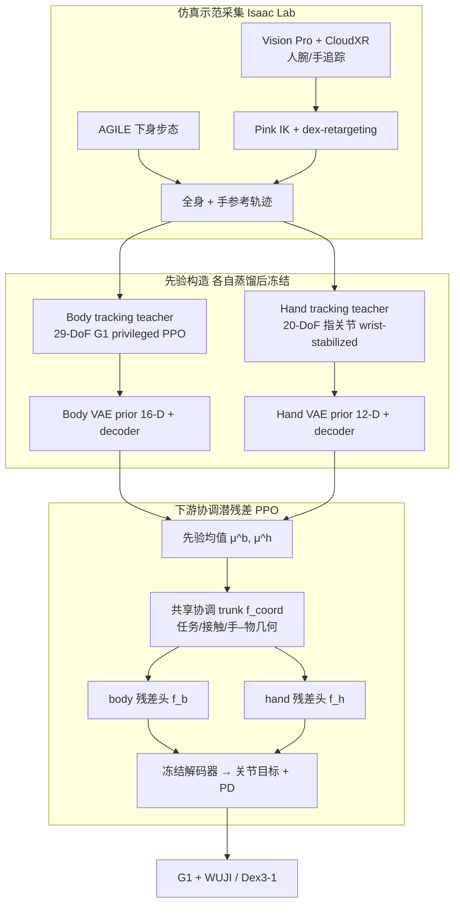

# CoorDex（Coordinating Body and Hand Priors for Continuous Dexterous Humanoid Loco-Manipulation）

## 一句话定义

**CoorDex**（arXiv:[2606.23680](https://arxiv.org/abs/2606.23680)，[项目页](https://skevinci.github.io/coordex/)，UNC Chapel Hill / UC Berkeley）提出面向 **连续高 DoF 灵巧人形 loco-manipulation** 的学习管线：不把行走与操作拆成停走两阶段，而是将 **29-DoF 全身** 与 **20-DoF 五指手** 分别蒸馏为 **冻结的 proprio 条件潜先验**（16-D body / 12-D hand），再用 **共享任务上下文 + 分体 body/hand 潜残差头** 的 PPO 在 Isaac Lab 中联合适配步态、腕位与指级接触。仿真在 **Unitree G1 + WUJI 手** 上完成 WalkGrab、OpenFridge、WalkPickTurn 三项技能；真机视频为 **G1+Dex3-1** 轨迹回放定性验证。

## 英文缩写速查

| 缩写 | 英文全称 | 简要说明 |
|------|----------|----------|
| CoorDex | Coordinating Body and Hand Priors for Dexterous Loco-Manipulation | 本文提出的 body–hand 潜先验协调残差框架 |
| DoF | Degrees of Freedom | 自由度；G1 身体 29 + WUJI 手 20 |
| PPO | Proximal Policy Optimization | 先验 tracking teacher 与下游残差策略均采用的 on-policy RL |
| VAE | Variational Autoencoder | 先验蒸馏用的 encoder–prior–decoder 结构（PULSE 同族） |
| RL | Reinforcement Learning | 下游在冻结先验潜空间上的残差强化学习 |
| IK | Inverse Kinematics | 示范采集时 Pink 求解器跟踪人腕目标 |
| RSI | Reference State Initialization | WalkPickTurn 用的 NoDemoRSI 课程式状态重置 |
| PD | Proportional-Derivative | 解码关节目标后的低层位置跟踪 |
| WUJI | Wuji Hand | 舞肌 20 主动 DoF 五指灵巧手，仿真主实验末端 |
| G1 | Unitree G1 Humanoid | 宇树 29-DoF 人形平台 |

## 为什么重要

- **把「边走边灵巧操作」从停走范式里拆出来：** 论文指出大量 loco-manip 仍是 **走近–停下–抓取**；CoorDex 用速度曲线与 WalkGrab 消融（对比 **86% stop rate** 的关节空间基线）证明可在 **~0.25 m/s 前进速度** 下完成抓抬。
- **不对称 body–hand 先验是核心归纳：** **Body prior** 负责步态、躯干、到达与 **腕位涌现**；**Wrist-stabilized hand prior** 在仿真中 **运动学固定腕**、只学 **指间协调**，避免 12-D 手潜码被 6D 腕运动占满——这是与「单手 monolithic 潜动作」不同的结构假设。
- **协调残差头有可证伪价值：** 与 Monolithic Latent Residual（同冻结先验、同 28-D 残差维）相比，分体头将成功率 **0%→55%**，body **action rate 0.40→0.22**，说明 **共享上下文 + 分通道修正** 优于单 MLP 劈裂残差。
- **工程管线完整可复用：** 仿真 XR 遥操作采参考 → privileged tracking teacher → VAE 蒸馏 → 冻结先验作 action space → 任务奖励 PPO；与 [ResMimic](./paper-resmimic.md) 的 GMT 残差、[HALOMI](./paper-halomi-humanoid-loco-manipulation.md) 的 VLA+稀疏头手接口形成 **控制层** 对照三角。

## 流程总览



## 源码运行时序图

> 基于官方仓库 `Skevinci/coordex`（2026-11-19）的**已训练 checkpoint 仿真回放**入口核对；对应源码详见 [官方源码归档](../../sources/repos/coordex.md)。以下**不是** teacher/VAE/PPO 训练时序。

```mermaid
sequenceDiagram
  autonumber
  participant CLI as play_locomanip.py
  participant App as Isaac Lab AppLauncher
  participant Env as ManagerBasedRLEnv
  participant Runner as RSL-RL OnPolicyRunner
  participant Actor as ActorCriticCoordResidual
  participant Prior as ResidualLatentAction and VAE
  participant Sim as JointPositionAction and Sim

  CLI->>App: 初始化 Isaac Sim
  CLI->>CLI: 解析 task 与三类 checkpoint 路径
  CLI->>Env: gym.make 注册的 CoorDex 任务
  Env->>Prior: 初始化 action term 并加载 body/hand prior
  CLI->>Runner: RslRlVecEnvWrapper + OnPolicyRunner
  CLI->>Runner: load 任务策略 checkpoint
  Runner-->>CLI: get_inference_policy
  CLI->>Env: get_observations
  loop 每个仿真控制步
    Env->>Prior: 获取 body/hand proprio 的 prior mean
    Prior-->>Env: body_prior_mean + hand_prior_mean
    Env-->>CLI: 返回任务状态与先验均值观测
    CLI->>Actor: policy(obs)
    Actor->>Actor: shared coord_trunk + body/hand residual heads
    Actor-->>CLI: 28-D latent residual
    CLI->>Env: env.step(actions)
    Env->>Prior: process_actions(residual)
    Prior->>Prior: prior mean + residual, 冻结 decoder
    Prior->>Prior: hand EMA 与关节限位
    Prior->>Sim: JointPositionAction.process_actions
    Env->>Prior: apply_actions
    Prior->>Sim: JointPositionAction.apply_actions
    Sim-->>Env: 物理推进与更新观测
    Env-->>CLI: next obs
  end
```

回放命令（需按 README 安装 Python 3.11、Isaac Sim 5.0、Isaac Lab 2.2.0）：

```bash
python scripts/rsl_rl/play_locomanip.py --task CoorDex-WalkGrab-Wuji-v0 --headless --num_envs 1
```

运行模块核验：`play_locomanip.py`、`tasks/locomanip/__init__.py`、`policies/actor_critic_coord_residual.py`、`mdp/actions.py` 中的 `ResidualLatentAction` / `_PriorPolicy`，及 `distillation/vae.py`；源码路径与任务 ID 见 [归档](../../sources/repos/coordex.md)。

## 核心机制（归纳）

### 1）先验：teacher → VAE 蒸馏 → 冻结

| 子系统 | Teacher 环境 | 控制维度 | 潜维 | 部署 proprio 要点 |
|--------|--------------|----------|------|-------------------|
| **Body** | 全身 G1+固定手型 | 29 身体关节 | 16 | 5 帧历史：$\omega_{\mathrm{base}}, q, \dot q, a_{t-1}$；**无基座线速度** |
| **Hand** | 腕位写入仿真的 floating hand | 20 指关节 | 12 | 腕系速度 + 指关节相对默认位 + 上一步手动作 |

蒸馏损失：teacher 动作 MSE + 潜码均值时序平滑 + encoder–prior KL（系数退火）。推理与 RL 期默认用 **prior mean** $\boldsymbol{\mu}^{x,p}_t$。

### 2）协调潜残差 actor

- **输入：** body/hand proprio 栈、物体与把手位姿（root + hand frame）、指尖接触力、投影重力、**冻结先验均值**、上一步 $\Delta z$。
- **输出：** $\Delta z^b \in \mathbb{R}^{16}, \Delta z^h \in \mathbb{R}^{12}$；$\tilde z = \mu + \Delta z$ 解码后经 **手目标 EMA(0.4)** 与身体槽位合并。
- **设计意图：** trunk 推理 **任务阶段与接触状态**；body 头调 **步态/躯干/腕位**，hand 头调 **预成形/闭合/接触精修**，避免单通道 MLP 抖动全身。

### 3）三项任务（仿真定量）

| 任务 | 交互结构 | 成功率 | 备注 |
|------|----------|--------|------|
| **WalkGrab** | 侧桌抓瓶–抬–搬 | **55%** | 主消融任务；fall **0%**；drop **40%** |
| **OpenFridge** | 抓把手边后退开门 | **66%** | 门角 **57.76°** / 60° 阈值 |
| **WalkPickTurn** | 取立方体转身 180° 持物 | **89%** | **NoDemoRSI** 辅助长时程 |

评估：**50k episodes**，**10k** 并行环境；成功需任务完成且保持平衡。

### 4）WalkGrab 动作空间消融（同 PPO 预算）

| 方法 | Success | Reach | Grasp | Stop | Fall |
|------|---------|-------|-------|------|------|
| All Joint Space | 0% | 100% | 0% | **86%** | 4% |
| Body Prior + Hand Joint | 0% | 96% | 1% | **90%** | 4% |
| Monolithic Latent Residual | 0% | — | — | — | 2% |
| **CoorDex** | **55%** | 100% | 55% | **0%** | 0% |

解读：关节空间基线常 **停住再抓**；仅 body 先验时腕能到位但 **指协调在关节空间不可学**；单体式潜残差能接近物体但 **躯干抖动、抓取失败**。

## 评测（论文报告）

**仿真（G1 + 20-DoF WUJI，Isaac Lab）：** 每项 **50k** eval episodes（**10k** 并行环境）；成功 = 任务完成条件满足且未摔倒。

| 任务 | 成功率 | Fall | Drop | 任务指标 |
|------|--------|------|------|----------|
| WalkGrab | 55% | 0% | 40% | 非停前进速度近瓶 ~0.25 m/s |
| OpenFridge | 66% | 0% | — | 门角 57.76° / 60° |
| WalkPickTurn | 89% | 1% | 10% | 最小航向误差 9.98° |

**真机（定性）：** G1 + **Dex3-1** 回放关节轨迹；**非** WUJI 配置的定量成功率。

## 结论

**连续高 DoF 灵巧 loco-manipulation 应用分离的 body/hand 潜先验 + 协调潜残差，而不是关节空间 PPO 或单体式潜残差。**

1. **不对称先验** — Body（16-D）管步态/躯干/腕位涌现；Hand（12-D）在腕固定仿真里只学指间协调，避免腕运动占满手潜码。
2. **协调残差头** — 共享任务上下文 + 分体 body/hand 头；相对 Monolithic 同维残差，WalkGrab **0%→55%**，body action rate **0.40→0.22**。
3. **关节空间会停走** — All Joint / Body Prior+Hand Joint 成功率 **0%**，stop rate **86–90%**；CoorDex stop **0%**、前进近瓶约 **0.25 m/s**。
4. **三项仿真技能** — WalkGrab **55%**、OpenFridge **66%**、WalkPickTurn **89%**（50k eval）；成功含未摔倒条件。
5. **真机勿直接比成功率** — 主结果是 G1+WUJI；真机为 G1+Dex3-1 轨迹回放定性，且用特权物体/接触、未做视觉 sim2real。
6. **选型对照** — 相对 ResMimic（GMT 关节残差）与 HALOMI（VLA+稀疏头手），CoorDex 落在 **指级潜空间控制层**。

## 真机与局限

- **仿真主结果：** G1 + **20-DoF WUJI**（右手）；报告成功率均基于此配置；附录另训了 Dex3-1 手 teacher 与先验。
- **真机视频：** 可用硬件为 G1 + **Dex3-1**（附录 C，因设施限制 OpenFridge 用简化模型而非完整冰箱门）；展示为 **回放仿真关节轨迹** 的定性兼容性与 **换 hand teacher 重蒸馏** 的可扩展性，**不应与 WUJI 仿真成功率直接对比**。
- **观测：** 当前使用 **特权物体位姿与接触**；论文明确 **未做视觉 sim2real**。
- **课程：** WalkPickTurn 依赖任务特定 **NoDemoRSI**；更长时程与更多物体/hand 形态待扩展。

## 与其他工作对比

| 维度 | CoorDex | ResMimic | HALOMI |
|------|---------|----------|--------|
| 接口 | body/hand **潜先验 + 协调残差** | GMT **关节残差** | 稀疏头手 + **VLA** |
| 手 | **20-DoF 指级** 连续接触 | 多为夹爪/低维接触 | Pika **夹爪** |
| 移动操作形态 | **非停** 抓抬/开门 | 全身搬运 MoCap 残差 | 无机器人示范 + WBC |
| 先验来源 | 仿真 XR 示范 tracking | 人类 MoCap GMT | BFM-Zero 流形 |

## 关联页面

- [Loco-Manipulation](../tasks/loco-manipulation.md) — 任务语境与路线（「冻结先验之上」组）
- [Manipulation](../tasks/manipulation.md) — 灵巧操作与高 DoF 手
- [ResMimic](./paper-resmimic.md) — GMT→残差 loco-manip 对照
- [HALOMI](./paper-halomi-humanoid-loco-manipulation.md) — 数据驱动/VLA 路线对照
- [Privileged Training](../concepts/privileged-training.md) — teacher–student 先验蒸馏
- [Whole-Body Tracking Pipeline](../concepts/whole-body-tracking-pipeline.md) — 运动跟踪 teacher 语境
- [BeyondMimic](../methods/beyondmimic.md) — body tracking teacher 设计来源
- [Unitree G1](./unitree-g1.md)
- [舞肌 Wuji Hand](./wuji-robotics.md)

## 官方源码开放情况与复现边界（2026-11-19）

**当前结论：部分开源，可加载 checkpoint 做三项 Isaac Lab 仿真回放，不等于从示范数据起完整重训。**

| 资源 | 本次实际核对 |
|------|--------------|
| 官方仓库 | [Skevinci/coordex](https://github.com/Skevinci/coordex) |
| 仿真任务 | `CoorDex-WalkGrab-Wuji-v0`、`CoorDex-Fridge-Wuji-v0`、`CoorDex-WalkPickTurn-Wuji-v0` |
| 回放入口 | `scripts/rsl_rl/play_locomanip.py`，支持 `--task`、`--checkpoint`、`--body-prior-checkpoint`、`--hand-prior-checkpoint` |
| 公开内容 | `ckpts/body_prior`、`ckpts/hand_prior`、`ckpts/locomanip`、环境和动作模块、VAE/协调 actor 定义 |
| 尚未确认开放 | teacher tracking、VAE 蒸馏、下游 PPO 的**从头训练入口**及完整训练数据 |
| 依赖 | Python 3.11；Isaac Sim 5.0.0；Isaac Lab 2.2.0；PyTorch 2.7.0（官方 README） |
| 实际运行 | **未执行 GPU 回放或成功率复测**；本文成功率均为论文报告数值 |

**代码级差异：** 回放脚本的默认 checkpoint 中，WalkGrab/OpenFridge 使用 `kinematic_wrist_16k.pt`，WalkPickTurn 使用 `active_wrist_20k.pt`。源码 `actions.py` 支持 `wuji_floating_kinematic_wrist` 与 `wuji_floating_active` 两种 hand prior 变体，不能将所有任务一概描述为完全相同的手部 checkpoint。

**原文与源码关系：** arXiv v1 §3、§4、附录 A/B 说明训练流程和评估；当前官方仓库 README 明确展示的是已训练权重回放。项目页本次直连读取失败，开放状态由作者官网及官方 GitHub 的 README/源码核实，不推断未公开资源的状态。见 [项目页来源](../../sources/sites/coordex.md) 与 [源码来源](../../sources/repos/coordex.md)。

## 工程实践

以下训练参数均来自论文附录 A/B（arXiv v1 全文）。官方代码已开放**checkpoint 仿真回放**及部分模型/环境实现，但本页未在 GPU 上运行或复现训练；复现范围见上一节。

**仿真与控制栈**
- Isaac Lab，物理步长 1/240 s、decimation 4 → **60 Hz** 控制；G1 手指固定（WUJI），**训练时仅 29 个身体关节驱动**；PD 跟踪关节位置目标。
- 下游 PPO：**4096 并行环境**；评测另用 10,000 环境 / 50,000 episodes。
- 动作 = **28-D 潜残差**（16 body + 12 hand）；残差缩放 1.0；初始动作噪声 σ=0.22；手目标 EMA 0.4。

**先验训练**
- Body teacher（BeyondMimic 式）：10 s episode；actor 5 帧历史；critic 非对称，额外看特权参考位姿/速度误差；奖励为指数跟踪项 + 动作抖动/关节限位/非期望接触惩罚；域随机化含摩擦、关节默认偏置、躯干质心扰动、随机推力。部署版去掉锚点平移与基座线速度，每帧 90 维 [ω_base, q, q̇, a_{t-1}]（5 帧 = 450 维）。
- Hand teacher：floating-hand，ManipTrans 式 MANO 标注，120 Hz 降到 60 Hz；腕位姿/速度由数据集运动学写入，策略只控 20 个指关节；奖励偏重指尖关键点。手 prior 输入 66 维。
- teacher PPO：24 步/rollout、5 epoch、4 minibatch、γ=0.99、λ=0.95、lr 1e-3（自适应，KL 目标 0.01）、熵 0.005、梯度裁剪 1.0、MLP [1024,512,256]、ELU。
- VAE 蒸馏：encoder/prior/decoder 均为 MLP [512,256,128]，最多 30000 次迭代；body lr 2e-4、平滑系数 0.005、KL 系数 1e-3→1e-4（15k–20k 次更新退火）；hand lr 5e-4、KL 1e-2→1e-3（15k–25k 退火）。

**下游残差策略**
- 共享 PPO 设置（三任务相同）：24 步×4096 环境 = 98304 batch、clip 0.2、价值损失系数 1.0；actor/critic [1024,512,256]；协调 trunk [512,256]；body/hand 头 [256,128]。
- 观测维度：WalkGrab 618、WalkPickTurn 620、OpenFridge 629（含 450 维 body proprio 历史、66 维手 proprio、28 维上步潜动作、15 维指尖力）；actor 加观测噪声，critic 无噪声。
- Episode：WalkGrab 15 s（900 步）、OpenFridge 7 s（420 步）、WalkPickTurn 10 s（600 步）。
- 奖励：WalkGrab/OpenFridge 为单阶段，用 grasped / 接触谓词门控（grasped = 指尖–瓶平均距离 <0.10 m 且 ≥2 个指尖力 >1 N 含拇指）；成功奖励 500（WalkGrab）/ 1000（OpenFridge、WalkPickTurn）。
- 成功条件：WalkGrab 根前进 >2.0 m、瓶抬起 >0.02 m 且抓取；OpenFridge 门角 ≥60° 且保持开启计数 ≥30 步（门角 ≥35° 且有指尖接触才累计）。

**NoDemoRSI（仅 WalkPickTurn）**
- 三阶段（接近/抓抬/转身，单调推进）；每个非初始阶段一个 **512 条** FIFO 快照缓冲，快照须满足未摔倒（根高 ≥0.5 m）、最小停留步数、速度已稳定。
- 阶段解锁：缓冲 ≥128 条且前一阶段成功率 >0.70；解锁后采样份额从 0.05 在 1000 次尝试内爬升；各阶段成功率 ≥0.80 进入巩固模式（85% 重置到阶段 0），<0.75 退出。

**踩坑 / 论文指出的失败模式**
- 全关节空间 PPO：为避免摔倒把身体扭成怪姿，从不抓取（stop 86%）。
- Body prior + 手关节空间：到位后减速/停下当静态抓取处理，grasp 仅 1%。
- 单体式潜残差：能接近目标但躯干抖动（action rate 0.40 vs 0.22）、抓取失败。
- 长时程任务从默认姿态纯奖励优化不可靠，需 NoDemoRSI；该课程与先验均按任务选择，非通用。
- 真机：仅 G1+Dex3-1 回放关节轨迹，验证运动学兼容；无闭环真机策略、无视觉。

## 参考来源

- [sources/papers/coordex_arxiv_2606_23680.md](../../sources/papers/coordex_arxiv_2606_23680.md)
- [CoorDex 官方项目页归档](../../sources/sites/coordex.md)
- [CoorDex 官方源码与运行入口归档](../../sources/repos/coordex.md)
- Li et al., *CoorDex: Coordinating Body and Hand Priors for Continuous Dexterous Humanoid Loco-Manipulation*, arXiv:2606.23680, 2026. <https://arxiv.org/abs/2606.23680>

## 推荐继续阅读

- [CoorDex 项目主页](https://skevinci.github.io/coordex/)
- [CoorDex 官方 GitHub 源码及权重](https://github.com/Skevinci/coordex)
- [arXiv:2606.23680 全文](https://arxiv.org/html/2606.23680v1)
- [PULSE（Physics-based Universal Latent Space）](https://arxiv.org/abs/2109.07416) — 潜技能空间蒸馏动机来源
- [ResMimic 项目页](https://resmimic.github.io/) — 另一路全身 loco-manip 残差学习
