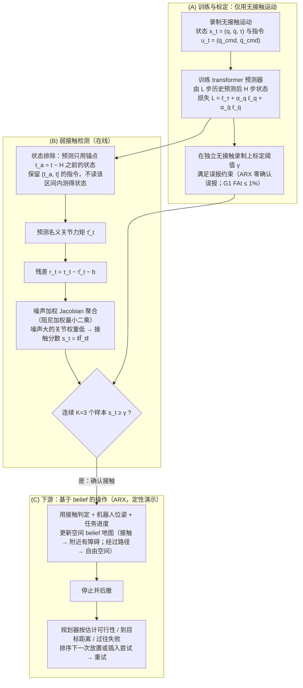

# CoPRE

**CoPRE: Improving Sensitivity in Proprioceptive Contact Detection for Low-Cost Robot Arms**（[arXiv:2609.27381](https://arxiv.org/abs/2609.27381)，[项目页](https://copre-arm.github.io/)）收录自 [具身智能小站 12 篇盘点（恢复/WAM 专题）](../../sources/blogs/wechat_embodied_station_12_papers_recover_wam_2026-09-27.md)。

## 一句话定义

**排除近期可能已接触观测来预测无接触关节力矩，再用噪声加权雅可比把残差转为接触分数。**

## 英文缩写速查

| 缩写 | 英文全称 | 简要说明 |
|------|----------|----------|
| SR | Success Rate | 任务成功率 |
| WAM | World Action Model | 联合预测未来观测与动作 |
| VLA | Vision-Language-Action | 视觉-语言-动作策略 |
| RL | Reinforcement Learning | 强化学习 |

## 为什么重要

- 纳入 [12 篇技术地图](../overview/embodied-research-12-papers-recover-wam-technology-map.md) 与同期失败恢复、异步 WAM、接触感知、持续学习、安全 RL 条目横向对照。
- 步骤 2.5 开源结论：**部分/待核实代码**。

## 流程总览

图依据：论文 §IV-A–C、§V-D 与 Fig. 2（A 训练标定、B 检测、C 下游；下游任务仅为定性演示，成功率未量化）。

## 核心信息

| 项 | 内容 |
|----|------|
| **arXiv** | [2609.27381](https://arxiv.org/abs/2609.27381) |
| **项目页** | https://copre-arm.github.io/ |
| **代码** | — |
| **开源** | **部分/待核实代码** |

## 实验与评测（公众号口径）

- 指标与数字以 [公众号盘点](../../sources/blogs/wechat_embodied_station_12_papers_recover_wam_2026-09-27.md) 与 **原文 PDF** 为准；读复现前核对仿真/真机与 attempt 定义。

## 源码运行时序图

**不适用**（无统一官方入口或未开源）。

## 与其他工作对比

| 对照 | 差异读法 |
|------|----------|
| [Contact Estimation](../concepts/contact-estimation.md) | 经典力矩法 τ_contact = τ_measured − τ_gravity − τ_dynamics 再经雅可比映射；CoPRE 改为 **学习无接触力矩预测**，并用 **噪声加权** 雅可比出接触分数 |
| [关节力矩传感器选型](../concepts/joint-torque-sensor-selection.md) | 物理力矩/六维力传感路线；CoPRE 面向 **低成本臂**，只用本体信号补灵敏度 |
| [Tactile Sensing](../concepts/tactile-sensing.md) | 触觉在接触面直接测力与滑移；CoPRE 不加表面传感器，接触信息来自 **关节层残差** |
| [TactileStep](./paper-tactilestep.md) | 同期 sensing 条目；TactileStep 用 **足底压力** 服务人形 locomotion，CoPRE 用 **本体力矩** 服务机械臂接触检测 |

## 结论

**总判：CoPRE 适合作为「排除近期可能已接触观测来预测无接触关节力矩，再用噪声加权雅可比把残差转为接触分数。…」方向的入口页；机制细节以 arXiv 与项目页为准。**

1. 与 [12 篇技术地图](../overview/embodied-research-12-papers-recover-wam-technology-map.md) 对照，避免与其它 arXiv 混淆。
2. 开源为 **部分/待核实代码** 时从项目页/GitHub 再核实一次再写复现计划。
3. 涉及异步 WAM 或恢复评测时，同时记录 **正常起点 SR** 与 **偏差后恢复率**（若适用）。

## 关联页面

- [具身研究 12 篇（恢复/WAM）技术地图](../overview/embodied-research-12-papers-recover-wam-technology-map.md)
- [Manipulation](../tasks/manipulation.md)

## 参考来源

- [论文归档](../../sources/papers/copre_proprioceptive_contact_arxiv_2609_27381.md)
- [公众号 12 篇清单](../../sources/blogs/wechat_embodied_station_12_papers_recover_wam_2026-09-27.md)
- [arXiv PDF](https://arxiv.org/pdf/2609.27381)：已通读方法部分（实验与附录以略读为准）：摘要、§I 引言、§III 问题定义、§IV 方法（A–C）、§V 实验（A–D，含消融与下游演示）

## 推荐继续阅读

- [arXiv:2609.27381](https://arxiv.org/abs/2609.27381)
- [项目页](https://copre-arm.github.io/)

