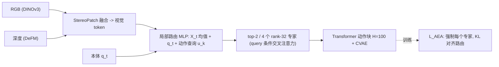

# CoRE（Collaboration-Role Experts）

**CoRE**（arXiv:2610.07752，Sydney PAIR Lab 的 Zhou / … / Weiming Zhi）研究**去中心化协同操作**：每个机器人运行同一网络，只用自己的视觉观测和本体感觉，没有任务提示、身份标签或机器人间通信；通过**协作角色专家 + 局部路由 + 无标签对齐损失**在共享参数里学出互补角色。注意：与 [paper-core.md](./paper-core.md)（另一篇同缩写的人形论文）无关。

## 英文缩写速查

| 缩写 | 英文全称 | 简要说明 |
|------|----------|----------|
| CoRE | Collaboration-Role Experts | 本文方法 |
| MoE | Mixture of Experts | 多个专家 + 路由器的稀疏结构 |
| AEA | Action-Expert Alignment loss | 用强制路由误差监督路由器的 KL 损失 |
| CVAE | Conditional VAE | 动作块回归器的隐变量，部署时置零 |
| ARCA | action-query cross-attention | 论文消融名，query 条件交叉注意力专家（具体展开未核实） |
| StereoPatch | RGB+depth patch fusion | DINOv3 RGB 特征与 [DeFM](./paper-defm.md) 深度特征共网格融合 |

## 为什么重要

- 分任务训策略复杂，全体同行为又无法分工；单策略学出角色是折中。
- 无通信、无身份标签，更接近真实部署，也能容忍伙伴延迟/变慢。

## 方法栈与流程总览

## 方法

- **专家**：每个解码器层含 E 个协作角色专家 + 共享交叉注意力，专家用低秩投影对视觉 token 做 query 条件交叉注意力。
- **路由**：MLP 以视觉 token 均值、本体编码、位置查询 u_k 打分，softmax + top-K 重归一，修正量加在前馈块之前。
- **L_AEA**：依次强制每个专家，用逐位置误差 ℓ 的 softmax(−ℓ/τ) 作 stop-gradient 目标，对路由概率求 KL；无需角色标签。
- **规模与超参**：H=100，4 个 rank-32 专家，top-2，7 层解码器，λ_CVAE=1e-3，λ_AEA=0.05，时间集成系数 0.01。
- **训练**：仿真 120k 次更新、批 40；真机 80k 次、批 32、640×320 RGB、AR0234 立体。

## 实验与评测

- **仿真 13 任务**（RoboFactory 5 / DuoBench 4 / BiCoord 4，2–4 机器人，每任务 100 seed）去中心化平均：CoRE 47.6 / 75.5 / 84.2；CHORUS 43.5 / 26.5 / 58.4；CLS-DP 40.7 / 17.3 / 73.8；GauDP 27.4 / 14.0 / 20.2；独立回归 25.0 / 21.0 / 14.0。中心化回归在 RoboFactory 达 90.4，高于 CoRE。
- **消融**：RGB 回归 40.4 → Stereo 56.6 → +MoE 62.4 → +ARCA 64.2 → CoRE(RGB) 72.4 → 完整 84.2；稀疏度 (E,K)=(4,2) 84.2，(2,2) 80.2，(4,1) 62.6，(4,4) 58.8，(8,2) 83.4；对齐损失使 LPD 15% → 94%。
- **演示合并**：分任务回归 53.6、全任务 RGB 回归 40.4、CoRE(RGB) 72.4。
- **真机**（两台 Piper，5 任务，各 30 次）：CoRE 91.3%，CHORUS 56.0%，CLS-DP 35.3%；Bridge 25/30 vs 7/30。扰动：Box 暂停 1.0 s 22/30 vs 4/30；Pan 0.25× 速度 17/30 vs 1/30。

## 源码运行时序图

不适用：项目页（aus.bot/research/core）标注代码 “Coming soon”，截至 2026-10-12 无仓库可对齐。

## 工程实践

- 部署只需每台机器人各跑一份同样的网络与自己的传感器，无通信栈。
- top-K 不宜取 1 或全开（62.6 / 58.8），4 专家 top-2 是论文最优。
- 开源状态：**待发布**（2026-10-12 项目页 “Coming soon”）。

## 与其他工作对比

| 对照 | 差异读法 |
|------|----------|
| [CHORUS](./paper-chorus.md) | 同属去中心化多机器人 VLA 一类（该页为 π0.5 路线），在本文基准上 CoRE 更高；两者设置是否完全可比未核实 |
| CLS-DP / GauDP | 本文基线，CoRE 在 DuoBench/BiCoord 大幅领先 |
| [AE-VLA](./paper-ae-vla-arm-wise-compositional.md) | 都做角色拆分；AE-VLA 需要技能标签，CoRE 路由无角色标签 |
| [MoE 概念](../concepts/mixture-of-experts.md) | CoRE 的路由监督来自强制路由误差而非负载均衡 |

## 结论

**CoRE 的核心是用“强制每个专家看谁预测得好”的无标签监督，让共享策略自发分工；去中心化接近但未超过中心化上限。**

1. **对齐损失是关键** — LPD 15% → 94%。
2. **稀疏度要调** — (4,2) 最好。
3. **几何/深度输入有大贡献** — Stereo 回归比 RGB 回归 +16.2。
4. **鲁棒性有证据** — 暂停/变慢场景大幅领先，但每任务仅一种扰动。
5. **难任务仍弱** — Take Photo 29%，DuoBench 47.6%。

## 局限与风险

- 论文无独立局限节；真机仅 2 台机器人 5 个任务。
- 代码待发布。
- 中心化回归 90.4 > CoRE 84.2，说明去中心化仍有信息损失。

## 关联页面

- [Manipulation 周报汇总（2026-10-05 至 10-09）](../overview/frontier-manipulation-2026-10-05-10-09.md)
- [双臂操作任务页](../tasks/bimanual-manipulation.md)
- [Mixture of Experts](../concepts/mixture-of-experts.md)
- [CHORUS](./paper-chorus.md)

## 参考来源

- [core_collab_role_experts_arxiv_2610_07752.md](../../sources/papers/core_collab_role_experts_arxiv_2610_07752.md)
- [core-collab-role-experts-project.md](../../sources/sites/core-collab-role-experts-project.md) — 项目页核查
- [frontier_manipulation_2026_10_05_10_09.md](../../sources/blogs/frontier_manipulation_2026_10_05_10_09.md) — 周报线索
- 论文：<https://arxiv.org/abs/2610.07752>

## 推荐继续阅读

- [项目页](https://aus.bot/research/core/)
- [RoboFactory](https://iranqin.github.io/robofactory/)
