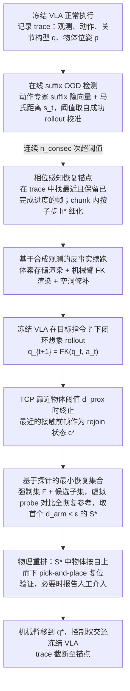

# CoRe（arXiv:2608.14822）

**CoRe**（*Imagining Recovery: Inference-Time Counterfactual Realignment for Vision-Language-Action Models*，[arXiv:2608.14822](https://arxiv.org/abs/2608.14822)）收录于 [多模空间 · 一周 VLA 研究趋势简析（2026.08.10–08.16）第四篇](../../sources/blogs/wechat_duomo_vla_weekly_trends_2026-08-10_part4.md) **架构模块** 段。

## 一句话定义

**推理期反事实重对齐：跑偏后用合成画面在内部设想恢复路径，小步把状态接回再让原 VLA 继续，无需失败数据或重训。**

## 英文缩写速查

| 缩写 | 英文全称 | 简要说明 |
|------|----------|----------|
| VLA | Vision-Language-Action | 视觉–语言–动作策略 |
| VLM | Vision-Language Model | 视觉–语言多模态模型 |
| RL | Reinforcement Learning | 强化学习 |
| PRM | Process Reward Model | 过程/进度奖励模型 |
| OOD | Out-of-Distribution | 分布外场景或轨迹 |

## 为什么重要

- 目标/布局突变时 VLA 易偏离；CoRe 把试错留在想象空间，保留已完成进度。
- 策展机构：凯斯西储大学（美）
- 开源结论：**待核实**（步骤 2.5，2026-09-27）。

## 流程总览

图依据：论文 Methodology 各小节（Online Suffix OOD Detection 至 Physical Rearrangement and Handoff）、Fig. 2、Fig. 3。

## 核心机制

| 项 | 内容 |
|----|------|
| **arXiv** | [2608.14822](https://arxiv.org/abs/2608.14822) |
| **开源** | **待核实** |
| **文内评测** | LangSwitch、LIBERO-Long；UFACTORY xArm6 实机 |

## 源码运行时序图

**不适用**（截至入库日未提供可运行官方代码入口，或仓库尚无可辨识训练/推理入口）。

## 实验与评测

- **文内口径：** LangSwitch、LIBERO-Long；UFACTORY xArm6 实机
- **读法：** 本页为 [公众号策展](../../sources/blogs/wechat_duomo_vla_weekly_trends_2026-08-10_part4.md) 摘要；逐项指标以 **原文 PDF** 为准。

## 与其他工作对比

| 对照 | 差异读法 |
|------|----------|
| [第四篇技术地图](../overview/vla-weekly-trends-2026-08-10-part4-technology-map.md) | 同批 14 篇横向索引；本文属 **架构模块** |
| [VLA 方法页](../methods/vla.md) | 单篇机制细节以原文为准 |

## 结论

**CoRe 适合作为本期「架构模块」路线的快速索引页。**

1. 核心贡献：推理期反事实重对齐：跑偏后用合成画面在内部设想恢复路径，小步把状态接回再让原 VLA 继续，无需失败数据或重训。
2. 开源结论：**待核实** — 以项目页/仓库实际链接为准。
3. 横向对照见 [第四篇技术地图](../overview/vla-weekly-trends-2026-08-10-part4-technology-map.md)。

## 关联页面

- [VLA（Vision-Language-Action）](../methods/vla.md)
- [一周 VLA 趋势技术地图（第四篇）](../overview/vla-weekly-trends-2026-08-10-part4-technology-map.md)

## 参考来源

- [wechat_duomo_vla_weekly_trends_2026-08-10_part4.md](../../sources/blogs/wechat_duomo_vla_weekly_trends_2026-08-10_part4.md)
- [arXiv:2608.14822](https://arxiv.org/abs/2608.14822)
- [arXiv PDF](https://arxiv.org/pdf/2608.14822)：已通读方法部分（实验与附录以略读为准）：Introduction 概述、Methodology 全部小节（含 Fig. 2/3）

## 推荐继续阅读

- [VLA 方法页](../methods/vla.md)
- [arXiv PDF](https://arxiv.org/pdf/2608.14822)
