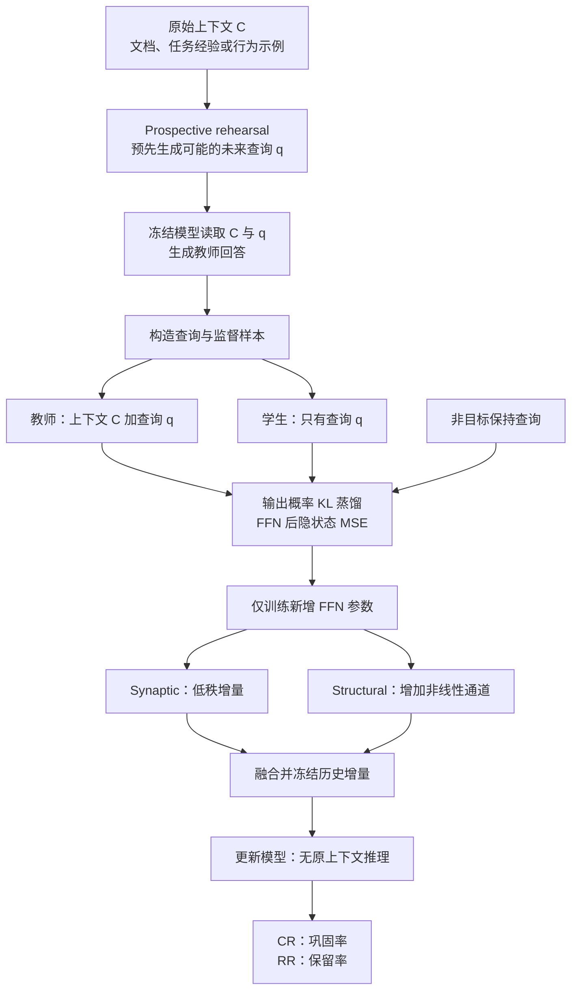

# Cortex: Consolidating Context into Parametric Memory / Cortex：将上下文巩固为参数记忆

## 一句话定义

**Cortex**（*Consolidating Context into Parametric Memory*，arXiv:2610.20399v1）让模型先用上下文回答未来可能的问题，再把这份条件化能力蒸馏到 **FFN 新参数**中，使部署时不再提供原上下文，也能尽量保留新能力和原有能力。

## 英文缩写速查

| 缩写 | 英文全称 | 简要说明 |
|------|----------|----------|
| MC | Memory Consolidation | 从上下文获得能力增益并在无上下文时保持 |
| CR | Consolidation Rate | 目标能力回收的上下文增益比例 |
| RR | Retention Rate | 更新后非目标任务的基线能力保持比例 |
| FFN | Feed-Forward Network | 权重增量或新增通道所在的前馈网络 |
| LoRA | Low-Rank Adaptation | Synaptic 方案在 FFN 上进行的低秩更新 |
| MoE | Mixture of Experts | 使用可访问的共享前馈分支存放新能力 |
| KL | Kullback–Leibler Divergence | 教师与学生输出概率分布的蒸馏损失 |
| MSE | Mean Squared Error | 教师与学生隐状态匹配的辅助损失 |

## 为什么重要

- 长上下文并不等于长期学会：移除会议记录、接口说明或成功轨迹后，LLM 往往失去当时的表现增益。
- 外部记忆需要每次检索与注入；Cortex 验证另一种方向：把可复用的上下文条件能力转为参数记忆。
- 仅看新任务分数可能掩盖遗忘；CR 和 RR 两个轴可以区分真正巩固与过度改写。

## 核心信息

| 项目 | 论文原文与公开状态 |
|------|-------------------|
| 英文标题 | Cortex: Consolidating Context into Parametric Memory |
| 中文标题 | Cortex：将上下文巩固为参数记忆 |
| 作者 | Jintian Zhang、Feng He、Xinnian Liang、Ziwen Xu、Haoming Xu、Haojing Huang、Shuangzhi Wu、Ningyu Zhang |
| 机构 | 浙江大学（Zhejiang University）、字节跳动 Seed（ByteDance Seed）、清华大学（Tsinghua University） |
| 版本 | arXiv v1，2026-10-14（Technical report） |
| 适用模型 | 4B–120B 稠密及 MoE 骨干；部分多模态骨干的本文任务仍以文本输入评测 |
| 开源情况 | [官方 GitHub](https://github.com/zjunlp/Cortex) 当前仅 LICENSE，暂无可执行实现 |
| 机器人边界 | 未报告真实机器人策略、运动控制或动作闭环测试 |

## 流程总览

*图依据：* [arXiv:2610.20399v1](https://arxiv.org/pdf/2610.20399) 的方法描述；这是论文**训练/评估数据流**，不是未公开源码的调用图。

## 核心原理

### 1. 先明确巩固与遗忘两个指标

令原模型为 M、更新后模型为 M'，上下文为 C、目标查询为 Q+、非目标查询为 Q−：

- 上下文增益：$\Delta_{ctx}=\mathrm{Perf}(M,Q^+,C)-\mathrm{Perf}(M,Q^+)$。
- **巩固率**：$CR=[\mathrm{Perf}(M',Q^+)-\mathrm{Perf}(M,Q^+)]/\Delta_{ctx}$。
- **保留率**：$RR=\mathrm{Perf}(M',Q^-)/\mathrm{Perf}(M,Q^-)$。

CR 是**无上下文恢复了多少原先的上下文增益**，不是绝对成功率；RR 是**相对保留比例**。解读结果时应确认原始上下文确实带来正增益。

### 2. 前瞻式查询与上下文蒸馏

- 从上下文 C 推演将来可能发生的查询，再用上下文条件化教师模型生成响应作为软监督，缩小“只背输入文本”和“学会未来使用场景”的差距。
- 教师读取 C+q，学生只读取 q；通过输出分布的 KL 和隐藏层 MSE 对齐知识与表达。
- 合并通用保持查询以降低非目标任务退化；连续更新时对旧查询进行排练并冻结旧增量。

### 3. 两种可融合的参数记忆

| 方案 | 学习位置 | 取舍 |
|------|----------|------|
| Cortex-Synaptic | FFN gate/up/down 上新增低秩 LoRA 增量 | 参数增量较紧凑，可在更新后并入；连续巩固存在干扰 |
| Cortex-Structural | FFN 增加非线性通道后融合成更宽 FFN | 增加表示容量，作者连续编辑设置保留效果更好，但会增加网络规模 |
| MoE 拓展 | 额外可共享 FFN 分支 | 新记忆可在不同路由访问，适用性依赖具体 MoE 架构 |

## 实验与评测

论文的五类任务覆盖智能体经验（ALFWorld、τ²-Bench）、新 API、行为引导、知识抑制（RWKU）与事实更新（zsRE）；不同设置对单次、批量及顺序编辑的覆盖不同。

| 核验点 | 论文报告 | 应如何解释 |
|--------|----------|------------|
| Qwen2.5-14B-Instruct，50 次连续事实更新 | Cortex-Structural：**CR 88.9%，RR 99.8%** | 回收上下文增益且较好保留非目标表现；并非 88.9% 机器人成功率 |
| 相同设置下 AlphaEdit 对照 | **CR 22.7%，RR 96.0%** | 是作者协议内的对比，不能推出所有骨干和任务都压倒性领先 |
| 旧查询排练消融 | 去掉排练后旧知识持续退化；保留旧查询可缓解 | 回放机制重要，但不是理论上的不遗忘保证 |

各项结果由作者报告，未复现；不同任务的 CR/RR 不能不看定义直接平均。部分结构扩展会增加参数与计算开销。

## 与其他工作对比

| 研究/路线 | 记忆存放与使用方式 | 和 Cortex 的本质区别 |
|----------|------------------|-------------------|
| [Agent 记忆与 dreaming](../concepts/agent-memory-and-dreaming.md) | 会话转写、笔记、检索、后台整理 | 外部可读记忆，不要求修改模型参数 |
| [Robot In-Context Learning](../concepts/robot-in-context-learning.md) | 测试时提供示范上下文、模型权重通常不变 | 依赖当次示范，Cortex 目标是去掉上下文后仍具备能力 |
| [MemCompiler](./paper-memcompiler-state-conditioned-memory.md) | 每步按当前状态选择/编译文本或 Soft-Mem | 在运行时给执行器“送记忆”，不等价于模型权重吸收 |
| [RSI 纵深路线](../../roadmap/depth-rsi.md) | 区分外部经验、权重更新、评测门和改进机制 | Cortex 属于可用的参数巩固组件，不构成完整递归自我改进 |

## 结论

**Cortex 说明上下文增益可以通过前瞻式蒸馏与 FFN 可塑性在模型权重中留下来，但评估结果主要来自文本任务，尚不能直接称为机器人在线学习能力。**

1. **部署设计：** 区分“一次会话理解正确”和“撤掉上下文仍掌握”，最好单独设置无上下文回归测试。
2. **验收指标：** 同时记录 CR、RR 与绝对任务准确率，避免只报新任务涨幅。
3. **顺序更新：** 保留旧查询进行排练，监测新知识写入导致的旧技能退化。
4. **方法选型：** 低秩合并与 FFN 结构扩展分别权衡容量、模型尺寸与持续干扰。
5. **具身迁移：** 若用于机器人，应增加真实观测/动作分布、延迟、成功率和安全回退实验；论文未验证这些。
6. **复现前提：** 当前源码仅 LICENSE，不能把论文伪装成可直接执行的训练框架。

## 工程实践

- **数据：** 对日志、接口文档或执行经验构造未来可能遇到的查询集合，并与独立的最终测试严格隔离。
- **训练：** 保留有上下文教师与无上下文学生两种视角，限定新参数的可更新范围，并配置非目标保持集。
- **验证：** 每次更新分别测原始无上下文模型、上下文条件模型与合并后模型，对齐 CR/RR 的分子与分母。
- **扩展到机器人（研究设想，非论文实测）：** 将任务经验或失败日志整理为可验证查询；需在仿真/真机重新设计策略观测、动作监督和安全门，不可直接照搬 LLM 文本知识编辑数字。
- **可运行性：** 截至 2026-11-16，官方仓库没有训练/评测入口，不能按所提供链接直接复现 Cortex。

## 源码运行时序图

**不适用（2026-11-16 核验）。** [官方仓库根目录](https://github.com/zjunlp/Cortex) 只有 LICENSE，缺 README、训练或评测脚本。无真实入口及调用关系可以核对，因此不编造 sequenceDiagram；上方流程图仅反映论文方法。

## 局限与风险

- 模型覆盖稠密、MoE 乃至多模态骨干，不代表本文验证了视觉—动作机器人端到端策略；本组任务评测是文本主导。
- 查询生成可能遗漏后续真实分布；评测设置的编辑数量、任务域及骨干选择不应外推为无限持续学习。
- Structural 加宽 FFN 与教师条件化蒸馏具有训练、模型体积和推理成本；缺独立复现实验与源码性能剖析。
- 用旧模型重新回答历史查询并不等于保存全部原始信息；对于错误教师回答，还需要证据核验与回滚机制。
- 与真实机器人部署相关的灾难性遗忘、物理安全、sim2real 漂移未被本文测试。

## 关联页面

- [Agent 记忆与 dreaming](../concepts/agent-memory-and-dreaming.md)
- [Robot In-Context Learning](../concepts/robot-in-context-learning.md)
- [MemCompiler](./paper-memcompiler-state-conditioned-memory.md)
- [RSI 纵深路线](../../roadmap/depth-rsi.md)

## 参考来源

- [Cortex arXiv v1 论文核读归档](../../sources/papers/cortex_arxiv_2610_20399.md)
- [官方 zjunlp/Cortex 仓库实际开放状态](../../sources/repos/zjunlp-cortex.md)

## 推荐继续阅读

- [作者论文 PDF（arXiv:2610.20399v1）](https://arxiv.org/pdf/2610.20399)
- [官方 GitHub：zjunlp/Cortex](https://github.com/zjunlp/Cortex)（当前缺可运行源码）
