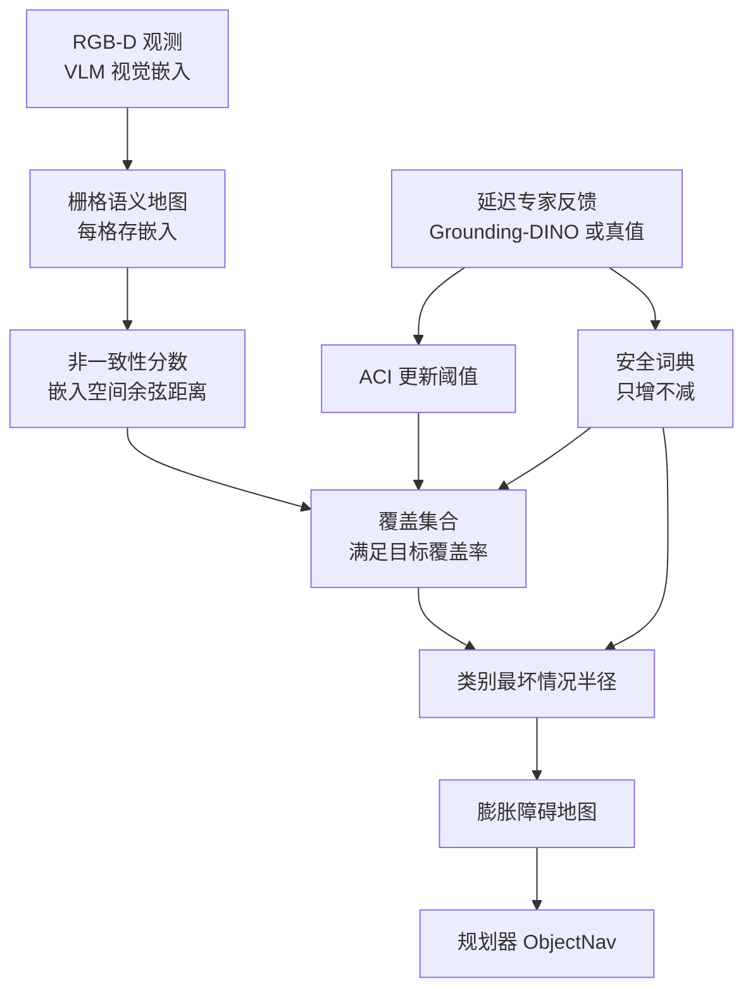
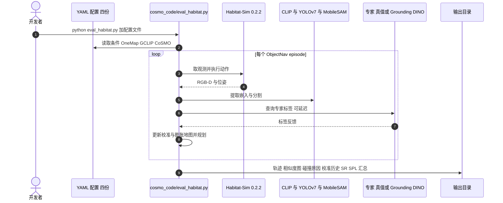

# CoSMO：用共形预测给开放世界语义地图配安全边距

**CoSMO 把 VLM 的地图嵌入转成带覆盖保证的标签集合，再据此给不同类别的障碍物设不同的膨胀半径；安全词典随新危险类别只增不减，阈值由延迟的专家反馈在线更新。**

论文 *CoSMO: Conformal Semantic Mapping for Open-World Safe Robot Navigation*（[arXiv:2610.18321](https://arxiv.org/abs/2610.18321)，[代码](https://github.com/Yangming911/CoSMO)，[项目页](https://yangming911.github.io/cosmo-page/)）。

## 英文缩写速查

| 缩写 | 英文全称 | 简要说明 |
|------|----------|----------|
| VLM | Vision-Language Model | 提供地图单元嵌入；置信度未校准，直接用于安全规划不可靠 |
| ACI | Adaptive Conformal Inference | 用延迟专家反馈在线更新共形阈值 |
| SCR | Semantic Collision Rate | 语义碰撞率；语义安全违例会终止 episode |
| SR / SPL | Success Rate / Success weighted by Path Length | 导航成功率与路径加权成功率 |
| MP3D | Matterport3D | 仿真评测所用场景数据集（ObjectNav episodes） |

## 为什么重要

- 纯几何避障不区分「墙」与「易碎的人/物」；不同类别需要不同安全边距，且探索中会遇到训练时没有的新危险类别。
- 已有共形语义地图假设固定标签集与离线校准，开放世界里不成立；CoSMO 针对「词表会增长 + 反馈有延迟」设计。
- 把「VLM 分数不可信」转为可量化的覆盖集合，使安全膨胀有可解释的依据。

## 核心信息

| 项 | 内容 |
|----|------|
| **机构** | 上海交通大学（SJTU）；上海创智学院（Shanghai Innovation Institute）；复旦大学（Fudan），依据 arXiv HTML 版作者单位 |
| **平台** | 仿真：Habitat 上 MP3D ObjectNav；真机：Unitree Go2 四足，两个室内场景 |
| **感知与专家** | GCLIP 感知；Grounding-DINO 作为延迟专家（真机延迟约 350 ms，反馈延迟 128–448 ms） |
| **开源** | **部分开源**（2026-10-17 核查）：[Yangming911/CoSMO](https://github.com/Yangming911/CoSMO)，MIT，仅仿真评测代码，无数据与检查点；Go2 真机代码未见 |

## 核心原理

### 流程总览

- **嵌入地图与分数：** 标签通过文本编码器查询；分数与词表大小无关，因此加新类别不必重新标定。
- **覆盖集合到半径：** 集合内任一类别的安全半径取最大，给出最坏情况膨胀。
- **理论：** 论文给出校准界、延迟下规划期覆盖与逐步安全定理；长期平均界为 α + τΔ + 2ϵ（τ 延迟，Δ 分布漂移，ϵ 依赖偏差）。
- **专家假设：** 保证依赖可靠的专家标签，标签噪声的影响论文未形式化。

## 源码运行时序图

仓库只有 Habitat 仿真评测入口。时序对齐 README：`cosmo_code/eval_habitat.py` 加一份 YAML 配置。内部模块名未逐文件核实，故只画到入口层。

- **复现前提：** Python 3.8、PyTorch 2.4.1、CUDA 12.1、Habitat-Sim 0.2.2；MP3D episodes、场景资产与各检查点需自备。

## 工程实践

| 项 | 建议 |
|----|------|
| 先跑通 | 从 OneMap 与 GCLIP Argmax 两份基线配置起，对齐指标后再开 CoSMO 配置 |
| 专家来源 | 论文对比真值专家与 Grounding-DINO 专家；部署时专家延迟与噪声要实测 |
| 看覆盖率还要看碰撞 | 覆盖率是标签集合是否包含真类别，不等于路径无碰撞 |
| 安全与效率 | 膨胀越保守 SCR 越低，SR 也会下降（紧凑户型可能堵门） |
| 源码运行时序图 | 见上；真机栈未随仓库提供 |

## 实验与评测

- **仿真（2,195 条 MP3D ObjectNav episode）：** OneMap SCR 25.5% / SR 11.3%；GCLIP Argmax 13.1% / 18.4%；CoSMO 开放词表 9.8% / 13.8%；CoSMO + Grounding-DINO 专家 10.5% / 16.5%。61.6% 即 25.5%→9.8% 的相对降幅。
- **项目页补充：** Uniform Dilation SCR 8.9% 但 SR 仅 8.7%；CoSMO 已知词表 SCR 9.4% / SR 10.4%；延迟 0–100 步消融（330 episode）SCR 在 10.0%–10.9%。
- **Go2 真机（30 次，两个室内场景）：** 长期经验覆盖 90.73%（目标 90%），SCR 16.67%，SR 46.67%。
- **口径提醒：** 论文注明 GCLIP Argmax 的 top-1 准确率 58.06% 与覆盖率是不同指标，不应直接比较。

## 结论

**CoSMO 的价值是把「VLM 不可信」变成带覆盖目标的类别膨胀，用较小的成功率代价换语义碰撞率下降；但保证成立的前提是可靠的专家反馈。**

1. **真正的影响指标是 SCR 而非 SR** — SCR 25.5%→9.8%，同时 SR 11.3%→13.8% 并未牺牲，但低于 GCLIP Argmax 的 18.4%。
2. **统一膨胀不是免费午餐** — Uniform Dilation SCR 8.9% 最低之一，但 SR 掉到 8.7%，类别化膨胀才保住可通行性。
3. **覆盖率不等于无碰撞** — Go2 上覆盖 90.73% 达标，SCR 仍有 16.67%、SR 46.67%。
4. **部署读法** — 需要在线专家且每步查询，真机反馈延迟 128–448 ms 下覆盖达标，仿真延迟 0–100 步消融 SCR 稳定在 10.0%–10.9%；查询成本由作者建议自触发查询缓解（未实现）。
5. **复现边界** — 仓库只含仿真评测代码，无数据与权重；真机结论不能凭仓库复核。

## 与其他工作对比

| 对照 | 差异读法 |
|------|----------|
| [具身语义认知地图](../concepts/embodied-semantic-cognitive-map.md) | 同样建语义地图；CoSMO 额外给标签集合以覆盖保证并驱动膨胀 |
| [零样本 ObjectNav](../tasks/zero-shot-object-navigation.md) | 任务设定相同（MP3D ObjectNav）；CoSMO 关注语义碰撞而非只看成功率 |
| [Safety filter](../concepts/safety-filter.md) | 同为安全约束；CoSMO 的约束来自校准后的类别半径，而非控制层滤波 |
| GCLIP Argmax / OneMap 基线 | 前者无共形校准，后者纯几何；见实验节数字 |

## 局限与风险

- **专家依赖：** 保证假设可靠专家，标签噪声影响未形式化。
- **查询成本：** 每步查专家，开销大；自触发查询仅为建议。
- **效率代价：** 紧凑场景膨胀可能堵门，降低 SR。
- **真机规模小：** 30 次、两个场景；SR 46.67% 仍偏低。
- **开源边界：** 仅仿真代码（2026-10-17 核查）；项目页仍写论文 "Coming soon"，与 arXiv 已发布不一致。

## 关联页面

- [具身语义认知地图](../concepts/embodied-semantic-cognitive-map.md) — 语义地图的上位概念
- [机器人视觉感知栈选型闭环](../queries/robot-perception-stack-selection-loop.md) — CoSMO 位于「2D→3D 提升与语义建图」层：开放词汇标签经 conformal 校准后才交给下游避障消费
- [零样本物体导航](../tasks/zero-shot-object-navigation.md) — 评测任务族
- [Safety filter](../concepts/safety-filter.md) — 安全约束的另一条路线
- [Habitat-Sim](../entities/habitat-sim.md) — 仿真评测平台

## 参考来源

- [cosmo_arxiv_2610_18321.md](../../sources/papers/cosmo_arxiv_2610_18321.md) — 论文摘录与开源核查
- [cosmo-project.md](../../sources/sites/cosmo-project.md) — 项目页归档
- [cosmo.md](../../sources/repos/cosmo.md) — 官方仓库归档
- [arXiv:2610.18321](https://arxiv.org/abs/2610.18321) — 原文

## 推荐继续阅读

- [CoSMO 项目页](https://yangming911.github.io/cosmo-page/)
- [CoSMO 官方仓库](https://github.com/Yangming911/CoSMO)
