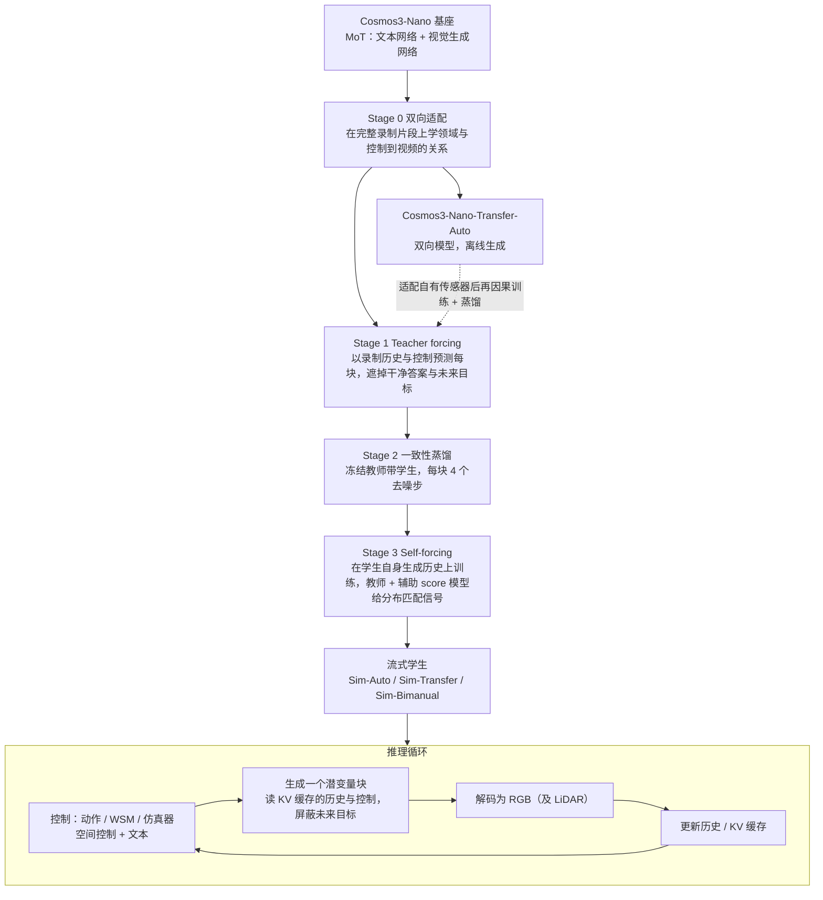
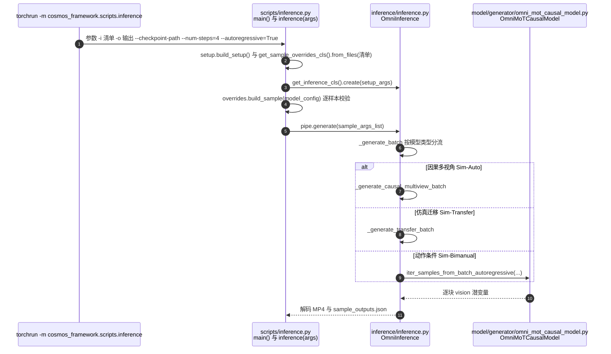
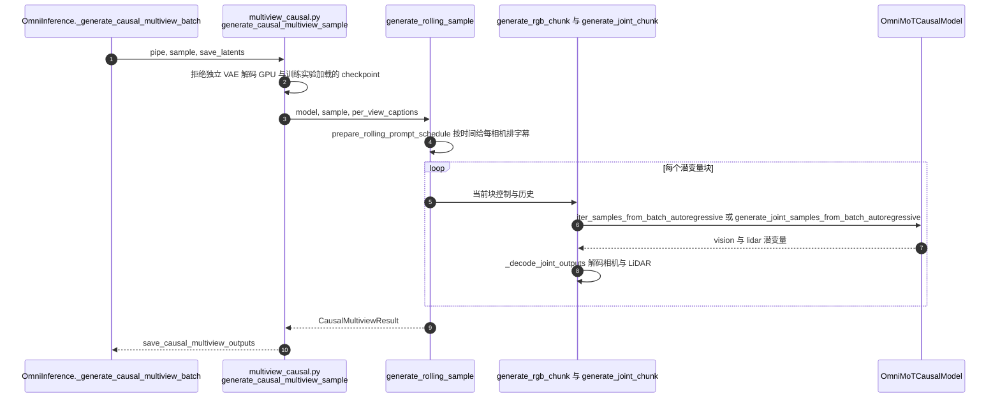
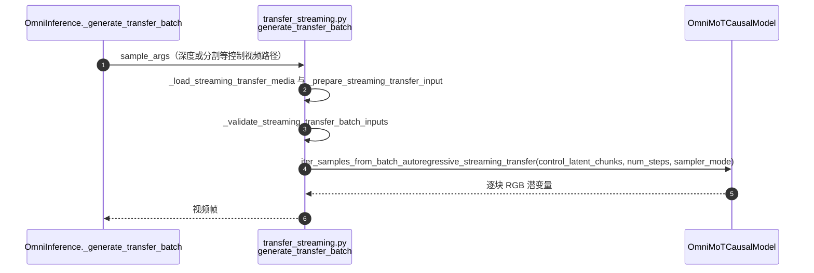
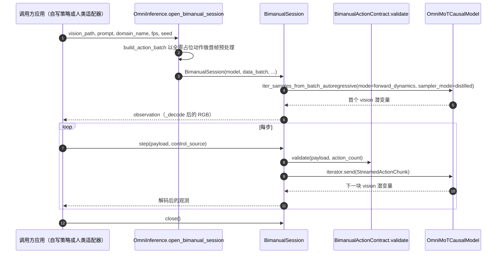

# Cosmos Interactive World Simulation（交互式世界仿真）

## 一句话定义

**这是 NVIDIA Cosmos 3 的后训练分支：把视频世界模型改成按动作与场景控制流式生成观测，让具身智能体或仿真器驱动的虚拟环境可以实时交互。**

## 英文缩写速查

| 缩写 | 英文全称 | 简要说明 |
|------|----------|----------|
| AV | Autonomous Vehicle | 自动驾驶，报告的三类场景之一 |
| sim-to-real | Simulation-to-Real | 仿真控制到真实外观的视觉迁移（Transfer 模型） |
| MoT | Mixture-of-Transformers | 模型卡所列架构 |
| LiDAR | Light Detection and Ranging | Transfer-Auto 可同时生成的激光雷达距离图 |
| WSM | World Scenario Map | 驾驶场景结构（车道线、交通标志 / 灯、物体立方体）的渲染控制视频（模型卡） |
| KV cache | Key/Value cache | 保留已生成历史的注意力键值，供下一块预测（博文） |
| CFG | Classifier-Free Guidance | Transfer-Auto 示例的 35 步去噪所用引导（模型卡） |
| YAM | （模型卡 / 仓库未展开全称） | Sim-Bimanual 博文所列另一种双臂本体 |

## 为什么重要

- 世界模型若只能离线生成视频，难以直接作为具身智能体的交互环境；流式、可控的生成使其可用于策略评估与 RL 训练。
- 报告把机器人操作、视频迁移与驾驶仿真放进同一后训练框架，便于比较不同场景下的共享设计（据摘要）。

## 方法与机制

- **后训练配方：** 报告目录包括 Cosmos 3 骨干、多模态 token 排布、时序因果注意力，以及双向适配、因果训练（teacher forcing）与因果一致性蒸馏（据目录）。
- **输入输出：** 动作或场景控制流入，视觉观测流出；外部仿真器可保持物理状态的权威。
- **模型族：** Bimanual（动作条件动力学）、Transfer（空间控制 → RGB）、Auto（多视角驾驶，可含 LiDAR）。
- **⚠ 2026-11-06 更正：** 三个“族”对应 **四个独立 checkpoint**——Auto 族含 Transfer-Auto（双向离线）与 Sim-Auto（因果蒸馏流式）两个不同权重，见下文「博文口径补充」。早先技术报告归档把二者当作同一方向的两种命名，不准确。

## 流程总览

依据 HF 博文「How streaming generation works」「The four-stage training recipe」与模型卡 Description（作者表述，非技术报告方法图转绘；报告完整方法章节未逐页核对）。

## 实验与评测

- 报告摘要说明覆盖相机导航、机器人操作、可控视频迁移与多视角 AV 仿真。
- 模型卡数字（来自 Hugging Face 模型卡，经摘要核对）：
  - Bimanual 相机导航（PAI-Bench-G）：视频质量 73.9，对比 LingBot-World 2.0 的 65.4；绝对平移误差高于 LingBot-World 2.0（4.71 对 4.17）。
  - Bimanual AgiBot-World：视频质量 76.1，对比 DreamDojo 14B 的 74.9。
  - Transfer（PAI-Bench-C）：分割 mIoU 0.738 对比 Cosmos3-Nano 的 0.643；深度 SI-RMSE 0.619 对比 0.842（越低越好）。
  - Transfer-Auto（720p）：文生视频 Frame FID 45.5 对比 Cosmos-Transfer2.5-2B Multiview 的 61.9。

## 与其他工作对比

- 与 DreamDojo、LingBot-World 2.0 的对比见上方模型卡数字；模型卡称基线的提示词设置可能不同。
- 与 Cosmos 3 基座：Transfer 在控制一致性指标上提升，但 DOVER 与 prompt following 略低（模型卡）。

## 结论

本报告的核心判断是：同一个 Cosmos 3 后训练配方可以支撑交互式、可控的世界仿真，而不是只做离线视频生成。

- 流式与因果训练是交互性的关键，报告以此区别于离线视频模型。
- 控制保真（分割、深度、边缘）是 sim-to-real 视频迁移的主要改进点，画质指标并未全面提升。
- 证据主要来自模型卡与摘要；完整报告的实验表与附录未逐页核对。

## 工程实践

- 代码：`nvidia/cosmos` 与 `nvidia/cosmos-framework`（报告列出）。
- 模型：四个 Hugging Face 模型卡，许可 OpenMDW 1.1。
- 推理门槛：模型卡所列测试环境为 Linux，且需要 NVIDIA Blackwell 或 Hopper GPU；Transfer-Auto 单路 480p 视频约 1 分 22 秒（GB200，无 LiDAR）。

## 博文口径补充（2026-11-05 HF Blog 与模型卡）

来源：[博文归档](../../sources/blogs/nvidia_cosmos_interactive_world_simulation_hf_blog.md)（发布日期 2026-11-05，NVIDIA 署名）、[四张模型卡归档](../../sources/sites/hf_cosmos3_nano_sim_checkpoints_model_cards.md)（均 V1.0，2026-10-20 发布，`gated: false`）。以下除注明外均为厂商自述。

### 四个 checkpoint 逐个说明

| checkpoint | 角色 | 输入 → 输出 | 关键约束（模型卡） |
|------------|------|-------------|--------------------|
| Cosmos3-Nano-Transfer-Auto | 双向、离线合成驾驶数据；也是适配自有传感器配置的起点 | 文本 + 每相机 WSM 视频（可选首帧 RGB；LiDAR 需对齐 HD-map range-map）→ 最多 11 路同步视频 + LiDAR | Hyperion 8.1 相机组 1–11 路 + 128 线 LiDAR；其他装备需后训练；至多 300 帧 / 视图，480p 或 720p；示例 35 步 + CFG |
| Cosmos3-Nano-Sim-Auto | Transfer-Auto 的因果蒸馏流式变体，用于驾驶仿真 | 同上，分块生成并滚动历史 | 固定 4 步、guidance 1；实测 LiDAR 条件只支持 1 个初始扫描；闭环需自备仿真运行时与 WSM 渲染器 |
| Cosmos3-Nano-Sim-Transfer | 物理仿真器的外观渲染器：控制由仿真器给，物理与真值状态留在仿真器 | 深度 / 分割 / 边缘 / 模糊控制视频 + 文本 → RGB | 至多 600 帧、480p、30 fps；面向 Isaac Lab 等循环，单 GB200 上最多 8 路并行环境（作者表述）；生成画面与仿真器标注的对齐需自行校验 |
| Cosmos3-Nano-Sim-Bimanual | 直接由场景与机器人动作生成下一观测 | 初始图像 + 动作 `(T, D)`（混合示例 59 维补零到 64）/ 相机轨迹 + 可选文本 → 视频 | 480p、30 fps；T 个转移需 T+1 个观测；已发布动作已归一化，勿再归一化；示例用 64 潜帧滚动 KV + 8 个 sink |

共同点：16B 可训练参数（卡面；HF safetensors 元数据约 15.2B）、MoT、OpenMDW 1.1、示例均以 `--no-guardrails` 运行、仅在 Linux + Blackwell / Hopper 上测试、vLLM-Omni 示例只在单张 GB200 上测过（博文明确称这不是最小显存规格）。

### 与技术报告归档的差异与补缺

- **checkpoint 数量与命名：** 博文与四张卡显示是 4 个独立权重；既有页摘要与 [Cosmos 3](./cosmos-3.md)、[NVIDIA Cosmos](./nvidia-cosmos.md) 关联页写“三类”，指的是三个模型族。
- **训练配方：** 本页早先只据目录写“双向适配、因果训练、因果一致性蒸馏”；博文补出 Stage 0 – 3 的完整四阶段，第四阶段 self-forcing（学生自身生成历史 + 冻结教师与辅助 score 模型）是此前页面缺失的一环。仓库 `examples/toml/sft_config/` 里有 `sim_bimanual_stage0_bidir`、`stage1_tf`、`stage2_tfdcm`、`stage3_sfdmd` 四个同名 TOML，与之对应（后缀含义为推测）。
- **块长：** 首帧之后每个潜变量时间步对应 4 帧 RGB；Transfer 每块 1 个时间步，报告中优化后的 Bimanual 配置每块 2 个（博文表述，报告原表未核对）。
- **本体范围：** 博文称 Sim-Bimanual 支持 **YAM 与 AgiBot**；模型卡 Inputs 却写 "Supported embodiment: AgiBot"。仓库 `cosmos_framework/inference/bimanual.py` 的域表含 `abc_yam`、`molmoact2_yam`、`xdof_yam`，HF 仓内也有 `assets/sim_bimanual/yam/` 示例，`docs/inference_bimanual.md` 提到“Additional YAM inputs”，所以以博文 + 仓库为准，模型卡该行疑为滞后（推测）。
- **“实时”口径：** 模型卡称 Sim-Auto 面向实时闭环驾驶仿真；同卡吞吐表（vLLM-Omni 单 GPU，无 LiDAR）里 GB200 的 1 视图 480p 为 16.8 fps、7 视图 480p 为 3 fps、11 视图 720p 为 0.74 fps，均低于 30 fps 播放帧率；卡面写“多 GPU 优化进行中”，且未说明吞吐是否按视图折算。
- **Sim-Auto 与 Transfer-Auto 质量取舍（模型卡）：** Sim-Auto 单图像质量指标（如 720p I2V Frame FID 33.6）逊于 Transfer-Auto（27.8），跨视图 Sampson 误差也高于基线 Cosmos-Transfer2.5-2B Multiview；LiDAR 物体检测 F1 为 0.188，低于 LidarVerse（116 scans）的 0.200。这是少步蒸馏换流式的代价。
- **更正数据量口径：** 早先技术报告归档写 Bimanual“约 13 亿数据点（393 个数据集条目）”；该数字在 Sim-Transfer 卡中逐字相同，属 Cosmos 3 共享的后训练数据说明，其私有数据表里 AgiBot 仅 0.2M 样本，不能当作 Bimanual 专属规模。

### 使用约束

- **许可：** OpenMDW 1.1，卡面称可商用与非商用，受许可条款约束；HF 元数据 `license: other`。
- **环境：** Linux、NVIDIA GPU、Docker、NVIDIA Container Toolkit；框架侧需 Python 3.13、Git LFS、FFmpeg 共享库与 CUDA 驱动（`docs/inference_bimanual.md`）。
- **安全：** 示例关闭 guardrails；卡面要求使用者自行负责输入输出、加护栏、确认图像 / 视频的权利。
- **适配自有装备：** 驾驶需先后训练 Transfer-Auto 再蒸馏出 Sim-Auto；机器人按各自 post-training skill（数据校验 → 四阶段配置 → 检查点交接 → 导出）。
- **评估：** 博文建议在留出 episode 上评估，短跑成功只证明执行通，不证明收敛。
- **闭环不是开箱即用：** Sim-Auto 快速开始仍喂预渲染 WSM 视频做自回归 rollout；真正闭环需要自备仿真运行时与 WSM 渲染器。Sim-Bimanual 的 `BimanualSession` 只提供“收观测 → 给动作”的接口，策略 / 人类适配器要自己写。

## 局限与风险

- 模型卡明确仅在 Linux 与 Blackwell / Hopper GPU 上测试。
- Bimanual 模型卡 Inputs 仅列 AgiBot 本体；其他机器人需要另行后训练。**⚠ 更正：** 博文与仓库显示 YAM 也已支持，详见「博文口径补充」。
- 生成画面与仿真器标注可能不一致，使用前需逐场景校验。
- 模型卡示例关闭了 guardrails；部署前需自行加安全措施（模型卡）。

## 源码运行时序图

**静态阅读、未运行。** 依据 NVIDIA/cosmos-framework 提交 `b2faa2617b21ad572f0ff2e8421d738ec0cb4a84`（2026-11-05）浅克隆；节点均为该提交里读到的真实文件 / 类 / 函数。`NVIDIA/cosmos`（提交 `1fdeae69f627b1f6fde678b924a45857a11ba7e8`）只含 README、COOKBOOK.md、AGENTS.md、`assets/`、`docs/`，无运行代码，COOKBOOK 的 Simulation 表链到 framework 的 skill。`vllm-omni` / SGLang 侧的服务代码不在这两个仓库，未读。

### 离线推理入口（CLI，四个模型共用）

### Sim-Auto 与 Transfer-Auto（`inference/multiview_causal.py`）

Transfer-Auto（双向）走 `_generate_joint_cam_lidar_batch` 等非因果分支（`inference.py`），本页未逐函数读。

### Sim-Transfer（`inference/transfer_streaming.py`）

### Sim-Bimanual 的闭环会话（`inference/bimanual_session.py`）

约束（代码内显式检查）：仅单进程、必须因果蒸馏 checkpoint、关闭 torch.compile 与 CUDA graphs、无独立 VAE 解码设备、同一模型同时只能有一个活动会话。

### 在线服务（模型卡路径，仅文档层面）

客户端 `POST /v1/videos/sync`（SGLang 为 `POST /v1/videos` + 轮询 `/v1/videos/{id}`）→ `vllm serve ... --model-class-name Cosmos3NanoSimBimanualPipeline` 等管线类 → MP4 响应。服务端实现位于 vllm-omni，不在本次阅读范围。

## 关联页面

- [Cosmos 3](./cosmos-3.md) — 本报告的基座模型（arXiv 2606.02800）
- [NVIDIA Cosmos](./nvidia-cosmos.md) — Cosmos 家族总览
- [Generative World Models](../methods/generative-world-models.md) — 视频世界模型方法族
- [Sim2Real](../concepts/sim2real.md) — Sim-Transfer 把仿真器控制渲染为真实外观的背景概念
- [Cosmos Transfer](./cosmos-transfer.md) — 2.x 时代的 Transfer 前身；Transfer-Auto 的基线 Cosmos-Transfer2.5-2B Multiview 属此系

## 参考来源

- [Interactive World Simulation 技术报告归档](../../sources/papers/cosmos_interactive_world_simulation_tech_report_2026.md)
- [Cosmos 3 技术报告（arXiv:2606.02800）](./cosmos-3.md)
- [HF 博文归档（2026-11-05）](../../sources/blogs/nvidia_cosmos_interactive_world_simulation_hf_blog.md)
- [四张 HF 模型卡归档](../../sources/sites/hf_cosmos3_nano_sim_checkpoints_model_cards.md)

## 推荐继续阅读

- [项目页](https://research.nvidia.com/labs/cosmos-lab/cosmos-simulation/)
- [技术报告 PDF](https://research.nvidia.com/labs/cosmos-lab/cosmos-simulation/technical-report.pdf)
- [Hugging Face 模型合集](https://huggingface.co/collections/nvidia/cosmos3-examples)
- [HF 博文原文](https://huggingface.co/blog/nvidia/cosmos-interactive-world-simulation)
- [NVIDIA/cosmos-framework](https://github.com/NVIDIA/cosmos-framework)（`.agents/skills/cosmos3-nano-*` 为各 checkpoint 的推理 / 后训练入口）
