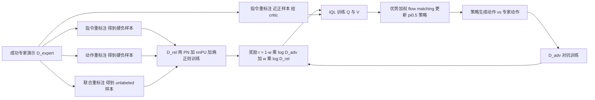

# CounterAlign：用反事实监督做 VLA 离线 RL（arXiv:2608.21740）

## 一句话定义

**CounterAlign 把成功专家演示里的「指令—动作」配对故意打乱，合成语义不一致的反事实样本，训练一个指令—观测—动作对齐奖励，再用它做 VLA 的离线 RL，不需要额外 rollout、奖励标注或失败轨迹。**

## 英文缩写速查

| 缩写 | 英文全称 | 简要说明 |
|------|----------|----------|
| VLA | Vision-Language-Action | 视觉—语言—动作策略 |
| BC | Behavior Cloning | 行为克隆，只对专家动作做正监督 |
| RL | Reinforcement Learning | 强化学习 |
| IQL | Implicit Q-Learning | 离线 RL 算法，用期望分位数回归学 V（论文第 3.3 节，引用 Kostrikov 等） |
| nnPU | non-negative Positive-Unlabeled learning | 非负正例—无标签学习，用于处理标签不确定的联合重标注样本（第 3.2 节） |
| GAIL | Generative Adversarial Imitation Learning | 对抗模仿学习，D_adv 与奖励形式参照它（第 3.2、3.3 节） |
| AWR | Advantage-Weighted Regression | 优势加权回归；论文把它改成优势加权 flow matching（式 6） |
| AIRoA | AI Robot Association | 作者所在机构之一 |
| LIBERO-PRO | LIBERO-PRO benchmark | 对 LIBERO 加 Obj / Pos / Sem / Task 扰动的鲁棒性评测（第 4.1 节） |

## 为什么重要

- 作者的出发点（第 1 节）：BC 只告诉策略专家做了什么，不告诉同一指令与观测下哪些动作是错的，VLA 对改写指令、物体位置变化仍脆弱；而失败 / 纠正轨迹采集昂贵。
- 思路是「从每条演示里榨更多监督」而不是只多采数据：同一动作块配上不同指令就成为负样本（第 1 节）。
- 这是作者自述；论文也说明离线 RL 不能探索，效果受数据分布限制（第 1 节）。

## 核心原理与流程总览

要点（均出自第 3 节与补充 1–5）：

1. **两个判别器**（第 3.2 节）：D_adv 判动作块来自专家还是当前策略，偏低层动作保真；D_rel 判动作是否在语义上符合指令，对小偏差不敏感。二者结构相同，用不同样本训练。
2. **三种重标注**：指令重标注（换指令，保留观测和动作）与动作重标注（换动作块）都用相似度区间 (θ_min, θ_max) 筛「不太易也不太像」的硬负样本；联合重标注同时换指令和动作，因可能仍然一致，当 unlabeled 并用 nnPU（式 2）。相似度函数是启发式的（补充 1，余弦相似度，动作相似度为逐步余弦的连乘）。
3. **奖励**（式 3）：r = (1−w)·log D_adv + w·log D_rel，w 平衡两个判别器。
4. **离线 RL**（第 3.3 节）：IQL 加 clipped double Q；critic 的数据额外加入「近正样本」指令重标注（相似度 ≥ θ_max），不做动作重标注，因为换动作后没有对应的下一观测来算自举目标；actor 只用专家数据，损失为 exp(β(Q−V)) 加权的 flow matching（式 6）。
5. **交替训练**（补充 4 算法 4）：判别器、critic、actor 轮流更新 K 次。

## 工程实践

- **基座**：π0.5，全参数微调不用 LoRA（第 4.1 节、补充 6）。
- **算力**（补充 6、7）：BC 基线约 3.4B 参数，本方法约 12.7B（多出判别器和 critic 网络，策略结构不变）；LIBERO 训练 15K 步、batch 256、8 张 H200 约 28 小时，BC 可单卡 H200，本方法至少 5 张；真机训练 150K 步、batch 64、8 张 H200 约 96 小时。
- **真机推理**：NVIDIA RTX 5070（第 4.4 节）。
- **熵正则**：作者称不加会让判别器输出饱和、奖励退化（第 3.2 节）；消融中加熵正则整体提升（补充 8，作者解释为「可能」）。
- **代码**：论文与项目页首页均未见公开仓库链接（本页不写 `code:`）。

## 与清单说法的核对

清单（Glen Berseth 的 CoRL 2026 阅读清单第 073/101 条，P2，据作者说由 LLM 依摘要起草）一句话：「Offline RL for VLAs from expert data alone, using instruction relabeling to create counterfactual negative supervision.」

| 清单措辞 | 论文核对 |
|----------|----------|
| 离线 RL、仅用专家数据 | 属实：不收集额外 rollout、标注或失败轨迹（摘要、第 1 节）。但对抗判别器的负样本是当前策略生成的动作（式 1），属训练中产生、非环境交互的数据。 |
| 用指令重标注造反事实负监督 | 部分准确：指令重标注只是其一。论文还用动作重标注、联合重标注（nnPU 当 unlabeled）、近正样本给 critic，并叠加 GAIL 式对抗判别器与熵正则（第 3.2、3.3 节）。清单漏掉了 nnPU 与对抗部分。 |
| 未提 VLA 基座与评测 | 论文基座为 π0.5；仿真是 LIBERO 训练、LIBERO-PRO 评测；真机为 TX-G2（第 4 节）。 |
| 隐含「有效」 | 增益主要在 Pos 与 Task 扰动；Sem、Obj 与 BC 基线无明显差距（第 4.2 节，作者自述）。CALVIN ABC→D 平均长度仅 3.93 → 4.03（补充 10）。 |

## 局限

论文自己承认或可从文中读出：

- Sem、Obj 扰动上与 BC 无明显差距（第 4.2 节）；CALVIN 上提升很小，作者归因于数据更大更丰富，BC 已较强（补充 10）。
- actor 侧重标注不能稳定带来提升，作者推测是学到的优势函数不完美、重标注动作给 actor 引入噪声（第 4.3 节、补充 8）。
- 相似度函数及阈值是启发式定义（第 3.2 节、补充 1）；阈值的具体取值正文未给出（我没有在读到的部分看到）。
- 离线 RL 无法探索，改进受数据质量与多样性约束（第 1 节）；作者把更大更多样的数据列为未来工作（第 5 节）。

我看到的未验证之处（我的判断）：

- 表 1 里 CounterAlign 的 Spatial-Pos 为 0.60 对 π0.5 的 0.53 等差距，基于每格 100 trials 且未报告多种子或置信区间，小差距是否显著无法判断；在 LIBERO-Object-Pos 上相对基线提升大（0.19 → 0.51），而 LIBERO-Spatial-Sem、LIBERO-Goal-Obj 等格子低于或持平基线。
- 真机每个任务只有 10 次试验，其中 8 次小扰动、2 次大扰动（第 4.4 节），任务 1 为 0.05 → 0.20，样本很小；基线 VLA-Adapter、xVLA 近乎为 0，说明对比更像「是否训得动」而非精细比较（推测）。
- 计算开销：参数量约 3.7 倍、训练至少 5 倍 GPU（补充 6、7），未与「用同等算力多训 BC」做对照。
- 没有与其他 VLA 离线 RL 方法（如论文相关工作里引用的 Co-RFT、ARM 等）做实验对比，Table 1 只对比 BC 型基线。

## 关联页面

- [VLA（Vision-Language-Action）](../methods/vla.md)
- [行为克隆](../methods/behavior-cloning.md)
- [强化学习](../methods/reinforcement-learning.md)
- [模仿学习](../methods/imitation-learning.md)
- [奖励设计](../concepts/reward-design.md)
- [进度奖励建模](../concepts/progress-reward-modeling.md)
- [Flow Matching 具身策略](../concepts/flow-matching-embodied-policy.md)
- [生成对抗网络](../concepts/generative-adversarial-network.md)
- [LIBERO 基准](../entities/libero-benchmark.md)
- [CALVIN 基准](../entities/calvin-benchmark.md)
- [RoboReward（同样用反事实重标注造负样本的奖励模型）](../entities/paper-roboreward.md)
- [LIBERO-Plus（同类鲁棒性分析）](../entities/paper-rcl-2510-13626-libero-plus-in-depth-robustness-analysis-of-visi.md)

## 参考来源

- [counteralign_arxiv_2608_21740.md](../../sources/papers/counteralign_arxiv_2608_21740.md)
- [arXiv:2608.21740](https://arxiv.org/abs/2608.21740)
- [项目页](https://counteralign.airoa.io)

## 推荐继续阅读

- [arXiv PDF](https://arxiv.org/pdf/2608.21740v1)
- [RoboReward](../entities/paper-roboreward.md)
- [奖励设计](../concepts/reward-design.md)
