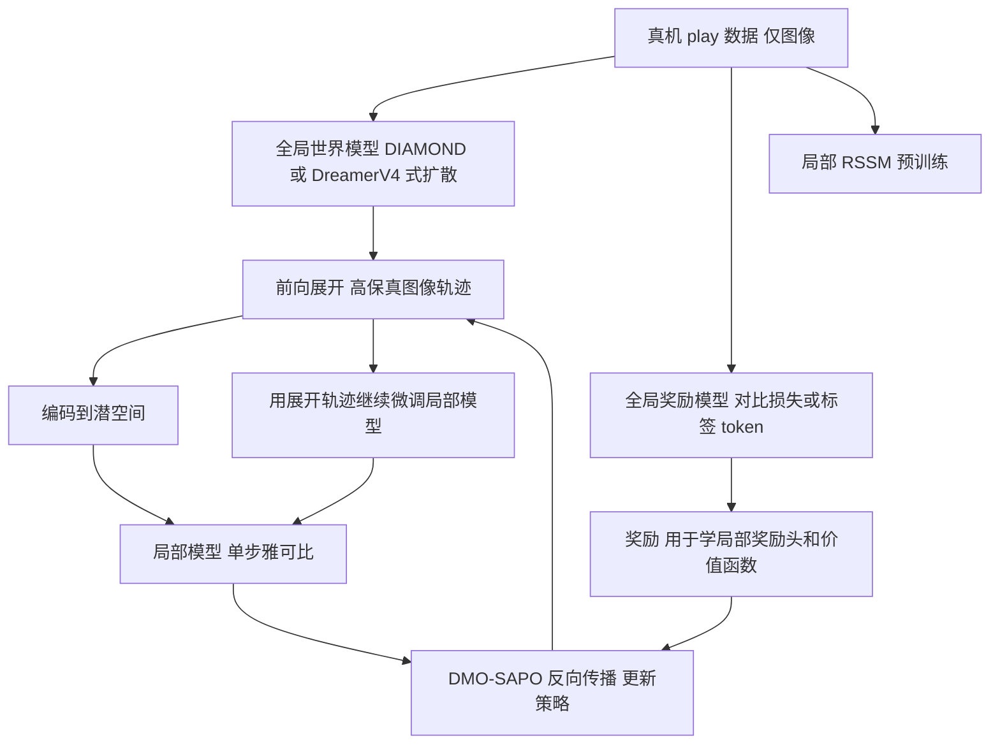

# Coupled Local and Global World Models for Efficient First Order RL（arXiv:2602.06219）

[arXiv:2602.06219](https://arxiv.org/abs/2602.06219)（NYU Machines in Motion Lab 与 LAAS-CNRS，v1 2026-02-05）。归档见 [来源归档](../../sources/papers/coupled-local-global-world-models_arxiv_2602_06219.md)。

## 一句话定义

**不用物理仿真器，直接在由真机 play 图像学来的世界模型里训练 RL 策略：大型扩散世界模型（全局）负责高保真前向展开，轻量 RSSM（局部，潜空间）负责提供一阶梯度，二者通过 DMO 解耦耦合（摘要、III-B）。**

## 英文缩写速查

| 缩写 | 英文全称 | 简要说明 |
|------|----------|----------|
| FoG | First-order Gradient | 一阶（解析）梯度，经反向传播穿过动力学模型 |
| MBRL | Model-Based Reinforcement Learning | 基于模型的强化学习 |
| DMO | Decoupled forward-backward Model-based policy Optimization | 前向与反向用不同模型的优化框架（引自作者前作 [2]） |
| SAPO | Soft Analytic Policy Optimization | 带熵正则的解析策略优化目标（III-F，引 [36]） |
| RSSM | Recurrent State-Space Model | DreamerV3 的循环潜状态模型，本文作局部模型 |
| BPTT | Backpropagation Through Time | 沿时间反向传播 |
| PPO | Proximal Policy Optimization | 无模型基线（零阶 / 得分函数类） |
| ACT | Action Chunking Transformer | 行为克隆基线 |
| BC | Behavior Cloning | 行为克隆 |
| KV | Key-Value (cache) | Transformer 推理缓存，用于加速世界模型展开 |

## 为什么重要

- 作者的论点（引言）：RL 在 GPU 仿真里对运动控制很成功，但操作任务的 sim-to-real 对齐费力，且像素输入下样本效率低；可微世界模型加一阶梯度有望同时缓解这几点。
- 扩散世界模型难以直接做 FoG：多步去噪拉长 BPTT、穿过像素反传低效、模型规模大（引言）。本文用解耦绕开这一瓶颈，这是论文的核心贡献点。
- 与 DreamerV4、DIAMOND 等扩散世界模型工作相比，作者指出它们依赖零阶优化、需要大量昂贵的扩散采样（II-C）。这是作者自述，论文未与它们做实验对比。

## 核心原理与流程总览

**FoG-MBRL 的问题（III-A）：** 策略梯度需要动力学对状态和动作的偏导，雅可比在模型自己展开出的状态序列上求，累积误差会改变求导点。

**解耦（III-B）：** 用前向模型 f→ 生成轨迹；反向模型 f←（即学到的近似动力学）的雅可比不在其自身下一状态处求，而在 f→ 的前向下一状态处求，以近似真实动力学导数。

**全局模型（III-D）：**

| 任务 | 世界模型 | 上下文 | 奖励模型 |
|------|----------|--------|----------|
| Push-T | DIAMOND，3 个扩散步 | 4 帧（0.8 s） | Bradley-Terry 对比损失，仅用被动视频（目标图像奖励） |
| Go2 自我中心推方块 | DreamerV4 式 Transformer 潜扩散（shortcut learning、diffusion forcing、轴向注意力、KV cache） | 96 帧（19.2 s） | 世界模型加奖励 token，用遥操作者按钮标注的 demo / play 二元标签后训练 |

**局部模型（III-E）：** DreamerV3 RSSM，先在 play 数据上预训练，RL 期间用全局模型生成的轨迹继续微调；只需单步精度；图像编码器把观测投到紧凑潜空间，策略梯度不经过编码器。

**算法（III-F、算法 1、式 4-6）：** 在 DMO 上加入 SAPO 熵正则目标，评论家用 λ-return 的 TD 误差训练；RL 期间世界模型上下文从真实轨迹采样 L_init = 32 帧预填 KV cache。

## 工程实践

- **数据（III-C、IV-B）：** 只在真机上采 play 数据（遥操作或自动探索，不必分割任务、不必频繁复位），且仅图像。Push-T 4 小时；推方块 12 小时随机交互数据。
- **硬件与控制（IV-A）：** Flexiv Rizon-10S 桌面机械臂，固定相机，5 Hz 末端位姿增量经插值 100 Hz 执行；Unitree Go2 带机载相机，动作为 2D 机体线 / 角速度，5 Hz 输入 50 Hz 底层 RL 运动策略。
- **前向展开长度（IV-D）：** 推方块上 DMO 用 64，PPO 基线需增至 128，否则陷入反复接近方块拿 +1 奖励的次优解。
- **零样本分布偏移测试（IV-E）：** 替换底层运动控制器（奖励中去掉 Raibert 启发项，步态不同），不重新采集数据也不重训世界模型，Go2 仍把方块推入目标（图 7）。
- **代码：** 论文正文未给仓库链接，本页不写 code 字段。

## 与清单说法的核对

清单（Glen Berseth 的 CoRL 2026 阅读清单，据作者说由 LLM 依摘要起草）写：「First-order RL with a large world model for forward rollouts and a lightweight latent surrogate for gradients, on real robots.」逐项核对：

| 清单措辞 | 论文核对 |
|----------|----------|
| 一阶 RL | 符合：FoG-MBRL，DMO-SAPO（III-F）。 |
| 大型世界模型做前向展开 | 符合方法描述（扩散全局模型）。但论文未报告参数量或模型规模数字，「large」只能理解为相对 RSSM 而言。 |
| 轻量潜空间代理求梯度 | 符合（III-E，DreamerV3 RSSM，只需单步精度）。 |
| on real robots | 需限定：世界模型与奖励模型用真机数据训练，策略也在真机上评估（Push-T 10 次、Go2 定性与 3 回合指标），但 RL 优化本身发生在世界模型内部，并非真机在线 RL。摘要自述为「bypasses simulators entirely」，结论称「零样本迁移」，真机评估规模很小（见局限）。 |
| 清单未提 | 论文的对比对象是 PPO（图像输入）、ACT、No Diffusion 消融，任务仅两个，指标主要是样本 / 时间效率与成功率。 |

## 局限

**论文自己承认或明示的：**

- 只在两个任务上验证；作者称更深入研究预训练通用世界模型是「未来工作」（IV-E）。
- DIAMOND 在需要长上下文的部分可观测任务上扩展性不足，因此第二个任务换用 DreamerV4 式模型（III-D）。
- 现有 FoG-MBRL（如原版 DreamerV3 算法）不适合扩散模型，故没有加入这类基线；直接对全局模型反传被判定不可行（IV-C，为论断，非实验）。

**阅读中看到的未验证之处（我的判断）：**

- 真机统计量小：Push-T 为 10 次试验（表 I），Table II 仅 N = 3 个评估回合，无置信区间，也未说明种子数。
- 「时间效率」优势主要来自图 3 的曲线，正文未给具体墙钟数字；DMO 与 PPO 的样本数（8M vs 40M，4M vs 25M，图 3 图注）指世界模型内样本，不是真机样本。
- PPO 基线的展开长度单独调整过（128 vs 64），其余超参调优程度正文未写；PPO 在 Push-T 严格判据下 1/10，放宽判据 4/10（表 I 脚注）。
- 结论中的「零样本迁移成功率很高」「sim-to-real 差异大幅降低」没有与任何仿真器方法比较，仅在世界模型内训练后直接上真机，推测其支撑力度有限。
- 与 DreamerV4 / DIAMOND 零阶方法没有直接的同任务对比（II-C 为论述）。
- 奖励依赖人工标注的 play / demo 开关或目标图像，推方块任务的奖励质量对结果的影响未做消融。

## 关联页面

- [基于模型的强化学习（Model-Based RL）](../methods/model-based-rl.md)
- [PPO](../methods/ppo.md)
- [行为克隆（Behavior Cloning）](../methods/behavior-cloning.md)
- [生成式世界模型](../methods/generative-world-models.md)
- [扩散模型](../concepts/diffusion-model.md)
- [可微仿真](../concepts/differentiable-simulation.md)
- [奖励设计](../concepts/reward-design.md)
- [Sim2Real](../concepts/sim2real.md)
- [世界动作模型](../concepts/world-action-models.md)

## 参考来源

- [coupled-local-global-world-models_arxiv_2602_06219.md](../../sources/papers/coupled-local-global-world-models_arxiv_2602_06219.md)
- [arXiv:2602.06219](https://arxiv.org/abs/2602.06219)

## 继续阅读

- [arXiv PDF](https://arxiv.org/pdf/2602.06219v1)
- 论文引用的前作：DMO，Amigo 等，First order model-based RL through decoupled backpropagation，CoRL 2025（论文参考文献 [2]）；DIAMOND（NeurIPS 2024，[1]）。
