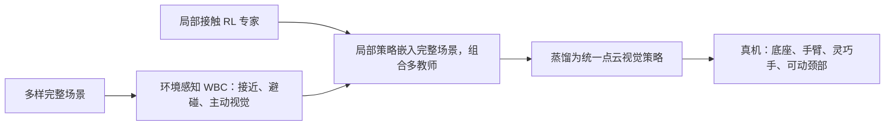

# COWBOY：上下文全身操作的仿真到现实框架

**COWBOY: A Scalable Sim-to-Real Framework for Learning Contextual Whole-Body Manipulation**（Jiahui Yang 等，CMU；CoRL 2026；[arXiv:2610.28948](https://arxiv.org/abs/2610.28948)）面向移动操作中的场景适配：机器人要同时决定底座停在哪里、手臂如何接近、采用什么抓取姿态，以及如何调整相机视角。

## 一句话定义

> COWBOY 把环境感知全身控制、局部接触强化学习和多教师蒸馏组合起来，让单一视觉策略在不同物体与场景几何中协调底座、手臂、灵巧手和主动视觉。

## 英文缩写速查

| 缩写 | 英文全称 | 简要说明 |
|---|---|---|
| COWBOY | Project name (no expansion stated) | 论文提出的仿真到现实移动操作框架 |
| WBC | Whole-Body Controller | 协调底座、手臂与视线的环境感知控制器 |
| RL | Reinforcement Learning | 用于学习物体接触与局部抓取专家 |
| DOF | Degrees of Freedom | 项目页所述整机策略协调 32 个自由度 |
| SAM3 | Segment Anything Model 3 | 项目页展示的语言提示目标分割入口 |

## 为什么重要

移动操作的困难不仅来自物体形状，也来自周围环境：桌沿、货架或抽屉会改变机器人能否到达目标、底座该如何停靠，以及相机是否能持续观察目标。若让单个策略直接从完整场景中学习，场景布局变化会与接触操作难度叠加。

COWBOY 通过结构化教师把“安全接近”和“接触抓取”分开训练，再将教师行为统一蒸馏。这个设计让局部抓取策略可以复用于大量完整场景，并让部署策略学习场景依赖的全身动作。

## 方法流程

1. **环境感知 WBC 接近目标：** 向量化控制器生成避碰的底座与手臂动作，并控制相机朝向目标。
2. **局部 RL 专家完成交互：** 在局部场景学习接触丰富的抓取策略，包括不同方向或受限空间下的抓取。
3. **局部到完整场景的多教师蒸馏：** 将局部场景嵌入不同完整布局，先由 WBC 接近，再由局部专家执行抓取；将组合出的示范蒸馏为统一视觉策略。
4. **真机执行：** 策略以点云为观测，控制移动底座、手臂、灵巧手和可动颈部，并根据观测几何调整站位、视角与抓取。

项目页另外展示 SAM3 语言提示分割：先分割用户指定物体，再用估计物体位置引导上述抓取策略。该接口补充目标选择，不应与核心策略的场景适配机制混为一谈。

## 实验与结果

项目页报告在 **24 个真实场景、100 多种物体**上进行评测，整体抓取成功率 **91%**。其单一视觉策略协调 32 个自由度：移动底座 3、手臂 7、灵巧手 16、主动视觉颈部 6。WBC 可向量化到数千仿真环境，项目页称可在单 GPU 上运行。

这些数字来自官方项目页摘要；页面未提供逐场景分项结果，不能从总体成功率推断每种物体或每类布局均达到相同表现。

## 工程实践与开放状态

- **系统拆解可借鉴：** 让全身控制器处理碰撞约束和接近，把局部学习策略的容量留给难以手工建模的接触动作。
- **蒸馏的作用：** 运行时用单一视觉策略协调多自由度动作，避免部署时显式切换多个教师。
- **评测口径：** 真机成功率应同时报告场景和物体分布；整体成功率不足以揭示狭窄空间、遮挡或特定抓取类别的失败。
- **源码复现：** 截至 2026-10-23，官方项目页没有列出代码仓库、权重或数据集入口；目前无法仅凭公开项目页复现训练与部署流程。
- **资料边界：** 此页的架构与结果按论文摘要和项目页归纳；项目页未给出足够信息核对全部训练超参数、模型结构与基线细节。

## 与相关工作的对比

- **相对单阶段端到端训练：** COWBOY 将无碰接近与接触抓取拆成环境感知 WBC 和局部 RL 专家，再蒸馏为单一视觉策略；这是训练与系统组织方式的差异。
- **相对部署时显式切换多个模块：** 论文方案把教师行为压到一个全身策略中，运行时统一协调底座、手臂、手与主动视觉。
- 现有项目页归档未给出足够的逐基线消融数据，因此这里只比较架构设计，不据此声称定量优于其他方法。

## 结论

COWBOY 的关键价值是把场景适配显式分配给环境感知 WBC，再让局部 RL 解决接触抓取，并通过多教师蒸馏获得统一部署策略。

- 当桌面、货架或抽屉几何改变可达性时，联合评估底座站位、手臂避碰与主动视角。
- 若完整场景探索过难，可先训练局部接触策略，再用规划或控制器把局部专家嵌入多样布局。
- 复用总体 91% 结果时应注明官方评测覆盖 24 个场景和 100 多种物体；需要逐场景结果才能判断边界。
- 在官方代码与数据入口公开前，把方法视为论文级系统方案，不据此宣称可直接复现或部署。

## 关联页面

- [Loco-Manipulation（移动操作）](../tasks/loco-manipulation.md) — 机器人移动底座与上肢操作的协调问题。
- [Manipulation（操作任务）](../tasks/manipulation.md) — 抓取与物体交互的任务路线。
- [Whole-Body Control（全身控制）](../concepts/whole-body-control.md) — 环境感知底座、手臂与视线协调的控制基础。

## 参考来源

- [COWBOY 论文摘录](../../sources/papers/cowboy_arxiv_2610_28948.md)
- [COWBOY 官方项目页归档](../../sources/sites/cowboy-manip.md)
- [arXiv:2610.28948](https://arxiv.org/abs/2610.28948)
- [COWBOY 官方项目页](https://cowboy-manip.com/)

## 推荐继续阅读

- [COWBOY 官方项目页与演示](https://cowboy-manip.com/)
