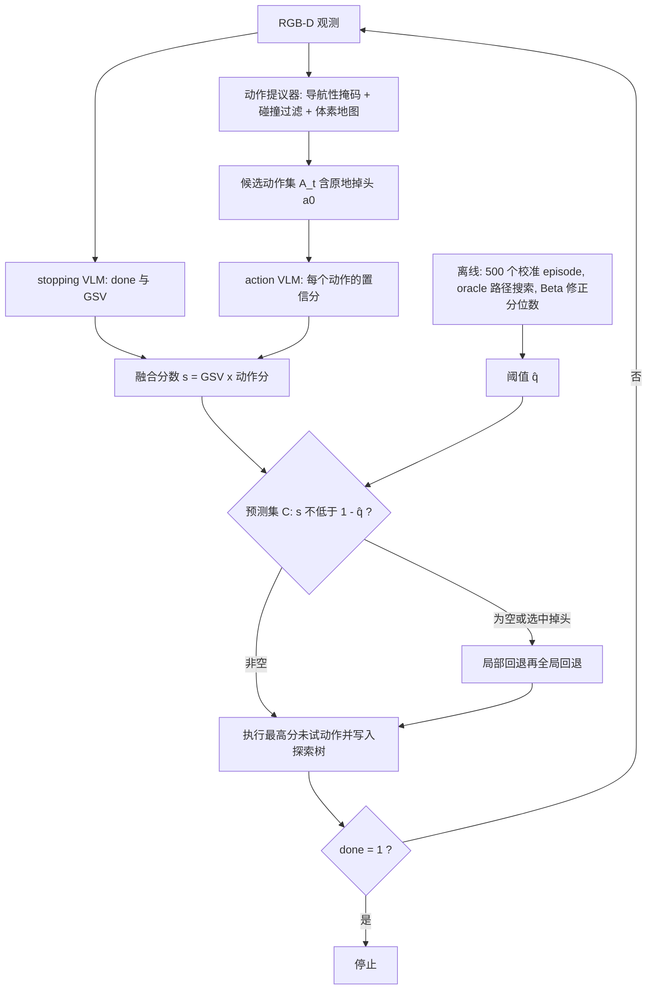

# CPNAV：校准的视觉语言导航（arXiv:2611.10366）

**CPNAV**（*CPNAV: Calibrated Vision–Language Navigation for Object-Goal Search in Unseen Environments*，[arXiv:2611.10366](https://arxiv.org/abs/2611.10366)，cs.RO，v1 于 2026-11-07）来自 UCLA（Qizhao Chen、Yuanhong Zeng、Shoh Nishino、Anushri Dixit）。代码：[practice-lab-ucla/CPnav](https://github.com/practice-lab-ucla/CPnav)，项目页：[practice-lab-ucla.github.io/papers/cpnav](https://practice-lab-ucla.github.io/papers/cpnav/)。本页依据论文全文（含附录）撰写，详见 [来源归档](../../sources/papers/cpnav_arxiv_2611_10366.md)。

## 一句话定义

**一个模型无关的校准层：用保形预测把 VLM 给候选导航动作的打分离线标定成一个阈值，在线只保留分数高于阈值的动作，并用探索历史树回退，用于无地图的室内物体目标搜索。**

注意它不是强化学习方法，也没有训练任何策略；全程是 VLM 查询 + 共形阈值 + 树式探索（论文 III-C 明确说树是「探索历史结构而非规划树」，不做 rollout 与价值估计）。

## 英文缩写速查

| 缩写 | 英文全称 | 简要说明 |
|------|----------|----------|
| CP | Conformal Prediction | 保形 / 共形预测：用留出校准集把模型分数转成带覆盖率保证的预测集 |
| VLM | Vision-Language Model | 视觉–语言模型；论文用 GPT-5 Nano 打分（Table I） |
| GSV | Global Semantic Value | 全局语义值：stopping VLM 对当前视图探索潜力的 [0,1] 评分（III-B） |
| SR | Success Rate | 成功率 |
| SPL | Success weighted by Path Length | 按路径长度加权的成功率 |
| HM3D | Habitat-Matterport 3D | 主评测数据集，v0.2 |
| MP3D | Matterport3D | 跨数据集泛化评测 |
| RGB-D | RGB + Depth | 彩色加深度输入 |
| α / δ | 目标风险 / 失败概率 | 覆盖率 1−α；校准集有限采样的置信度 1−δ（δ=0.01） |
| q̂ | calibrated quantile | 校准得到的非一致性分位阈值，在线过滤条件 s ≥ 1−q̂ |

## 为什么重要

- **作者主张的问题（引言）：** VLM 能提供语义先验，但其输出面向 token 预测 / 图文对齐，对动作的置信度未校准，长程会表现为低效探索、反复回退和动作环路。
- **做法的价值（作者自述，VI）：** 校准层只用输出分数，不改底层策略也不重训，可套在任何基于 VLM 的导航框架上（作者称可用于 WMNav、STRIVE 这类框架，但论文**没有**做这个实验，属于主张，见「局限」）。
- **我的判断：** 把「该不该剪掉这个动作」交给带统计保证的阈值，而不是靠 VLM 自报的概率，是对 VLM 做导航决策较干净的一种工程折中；但保证的对象是「oracle 路径不被剪」，不是「一定到达目标」，两者间的差距见「局限」。

## 核心原理与流程总览

### 1. 动作提议与打分（III-B）

- 动作提议器沿用 VLMNav 思路（论文引用 [18]）：从深度图建导航性掩码（高度变化低于 5 cm 视为可通行），沿水平视场均匀取射线方向，用按机器人半径加余量膨胀的足迹求最大无碰撞距离；剔除短于 0.75 m 的动作，长于 1.7 m 的截断，剔除终点大多在已探索区域的动作，另加原地掉头 a0=(π,0)。
- 两个 VLM 查询：stopping VLM 输出 done∈{0,1}（仅当目标清晰可见且在 2 m 以内才置 1，见图 3 提示词）与 GSV；action VLM 为每个候选动作输出 [0,1] 置信分。
- 融合：s_{i,t} = GSV_t × 动作分_{i,t}。

### 2. 树状探索与回退（III-C）

- 节点记录访问状态、候选动作与分数；选中掉头时回到父节点，按分数执行未试过的最高分动作（局部回退）；局部耗尽后在全历史里找仍有未试动作的节点（全局回退，式 3）；全局集合为空则终止。

### 3. 离线 oracle 路径与共形校准（III-D、III-E）

- oracle 路径 P* 取「路径瓶颈（最小动作分）最大」的到达目标路径（式 4），用改造的 BFS 搜索，并对分数高于当前瓶颈的未试动作继续细化（式 5）。
- 校准集 n=500 个 i.i.d. episode；非一致性分数 E_j = 1 − b(P*_j)；用 Beta 分位数做有限样本修正（δ=0.01）得到 α̂，再取共形分位数 q̂（式 6–7）。仿真 α=0.3 → α̂=0.25 → q̂=0.940；硬件 α=0.45 → α̂=0.39 → q̂=0.936（V-A1）。
- 在线：预测集 C(ξ_t)={a_{i,t} | s_{i,t} ≥ 1−q̂}（式 8）。作者给出的保证：在校准与部署 episode 可交换下，以至少 1−α 的概率 oracle 一致轨迹不被剪掉（式 9，附录 A）。

## 实验结果（均为论文数字）

| 设置 | 方法 | SR (%) | SPL (%) | 平均距离 (m) | 出处 |
|------|------|--------|---------|--------------|------|
| HM3D v0.2，200 ep | 无校准 | 81.0 | 40.3 | 35.4 | Table II |
| HM3D v0.2，200 ep | CPNAV | 86.0 | 44.9 | 29.2 | Table II |
| HM3D v0.2，200 ep | STRIVE | 82.5 | 41.5 | 17.6 | Table II |
| HM3D v0.2，200 ep | WMNav | 80.0 | 39.9 | 18.2 | Table II |
| MP3D，200 ep | 无校准 | 68.5 | 43.0 | 36.4 | Table II |
| MP3D，200 ep | CPNAV | 77.0 | 46.8 | 32.1 | Table II |
| MP3D，200 ep | WMNav | 75.0 | 45.2 | 18.5 | Table II |
| 真机，24 ep，两间公寓 | 无校准 | 66.7 | 42.0 | 9.0 | Table IV |
| 真机，24 ep，两间公寓 | CPNAV | 83.3 | 48.4 | 6.3 | Table IV |

- 相对提升（摘要与 V-A、V-C）：HM3D SR +6.2%、SPL +11.4%，MP3D SR +12.4%、SPL +8.8%，真机 SR +24.9%、SPL +15.2%；这些是**相对无校准基线**的相对提升，不是百分点（例如 HM3D SR 86.0 对 81.0 是 +5.0 个百分点）。
- 受限步数（附录 C，Table V，HM3D）：50 / 100 / 200 步 SR 为 73.0 / 80.0 / 86.0，对应无校准 60.3 / 75.7 / 81.0。
- 敏感性（V-B，Table III）：HFoV 69° 时 SR 40.0，高度 0.45 m 时 67.0，换 GPT-4o-mini 为 71.3，去掉体素地图为 66.0；作者结论为感知几何与模型容量影响很大。
- token（附录 D）：CPNAV 总 201.6K，无校准 231.4K，Ensemble Set 约为 CPNAV 的 8.9 倍。

## 工程实践

- **硬件（IV-A）：** 改装的 Hiwonder MentorPi M1（麦轮底盘），SLAM Toolbox 融合 2D LiDAR、轮速计与 IMU，ZED 2i 双目相机提供 RGB-D；图 1(d) 还显示 NVIDIA Jetson Orin Nano / 树莓派 5 控制板。附录 D 称 CPNAV 无需单独算力服务器即可在该平台运行（VLM 通过 API 调用，见局限）。
- **复现入口：** 仓库 README 说明 conda 环境、`.env` 写入 OpenAI API key、按 DATASET.md 准备 HM3D / MP3D，先跑离线校准 / 搜索再跑在线策略。本页未下载或运行代码，仓库与论文是否一致 **未核实**。
- **阈值选择：** 校准用的 α 是用户指定的风险。论文仿真取 0.3，硬件取 0.45；硬件的校准集是在匹配硬件相机参数的仿真配置中生成的（IV-A），没有在真机上采集。
- **推测：** 若要换 VLM 或换相机配置，需要重新跑 500 个 episode 的 oracle 搜索与校准，API 成本不低（论文给的是单 episode 平均 token，未给校准总成本）。

## 局限

**论文自己承认的（VI）：**

1. 树节点仅按空间邻近定义，不含朝向，可能带来估计偏差。
2. 硬件校准用的是仿真 episode，保证依赖「仿真与真实公寓可交换」。
3. 依赖经 ChatGPT API 访问的 VLM，其随机性会影响打分与校准。

**我看到的未验证之处（判断，非作者自述）：**

- **保证的范围比标题宣称的窄。** 式 9 保证的是 oracle 动作不被剪；附录 A 的「到达目标概率 ≥ 1−α」命题要求存在到达目标的 oracle 轨迹、完全回退、动作可靠执行、步数预算充足。真机有 SLAM 漂移与步数上限 100，这些假设是否成立论文没有量化。
- **可交换性在硬件上基本未检验。** 校准来自仿真，真机是 24 个 episode 的两间公寓；论文只说这两间是 HM3D / MP3D「分布内」的住宅（附录 B），没有做统计检验。真机 α=0.45 的覆盖保证本身也比较松。
- **真机样本很小。** 24 个 episode，SR 66.7 → 83.3 相当于 24 次中 16 次对 20 次成功（由 Table IV 推算），没有置信区间或重复；「24 trials each in two apartment environments」与「24 randomized episodes across two layouts」的说法不一致（见来源归档）。
- **评测口径。** 成功判据是人工标准（IV-B），非 Habitat 默认判据；仿真每个基准仅 200 个 episode，没有多随机种子的方差。
- **与最强对比方法的关系。** 距离列显示 STRIVE 与 WMNav 的行走距离明显短于 CPNAV（V-A），MP3D 上 WMNav SR 75.0 与 CPNAV 77.0 差距不大；作者说「可套在这些框架上」，但没有实验。
- **单一 VLM。** 主实验只用 GPT-5 Nano，换成 GPT-4o-mini 即降到 SR 71.3（Table III）；校准阈值对其他模型的可迁移性没有验证。
- **基线集合有限。** 校准基线为作者实现的 Simple Set / Prompt Set / Ensemble Set，不含其他不确定性方法的实测对比。
- **性质提示：** 本文是导航系统 / 校准方法论文，与强化学习无关；无训练、无奖励设计。

## 关联页面

- [WMNav：把 VLM 接入世界模型做物体目标导航](./paper-sa-2503-02247-wmnav-integrating-vision-language-models-into-wo.md)：本文的对比基线之一。
- [类条件保形预测与 STL 推断](./paper-class-conditional-conformal-stl-inference.md)：wiki 内另一篇保形预测应用。
- [On Evaluation of Embodied Navigation Agents](./paper-rcl-1807-06757-on-evaluation-of-embodied-navigation-agents.md)：SPL 指标来源（本文引用为 [49]）。
- [安全滤波器](../concepts/safety-filter.md)：同属「在决策外加一层带保证的过滤」的思路，但保证类型不同。
- [Sim2Real](../concepts/sim2real.md)：本文硬件校准依赖仿真，对应可交换性假设。
- [具身语义认知地图](../concepts/embodied-semantic-cognitive-map.md)：物体目标导航的语义先验背景。

## 参考来源

- [sources/papers/cpnav_arxiv_2611_10366.md](../../sources/papers/cpnav_arxiv_2611_10366.md)
- [arXiv:2611.10366](https://arxiv.org/abs/2611.10366)
- [项目页](https://practice-lab-ucla.github.io/papers/cpnav/)
- [GitHub：practice-lab-ucla/CPnav](https://github.com/practice-lab-ucla/CPnav)

## 继续阅读

- [论文 PDF（v1）](https://arxiv.org/pdf/2611.10366v1)
- 论文引用的相关工作：VLMNav（arXiv:2411.05755）、STRIVE（arXiv:2505.06729）、Ren 等 *Robots that ask for help*（CoRL 2023）、Angelopoulos & Bates 保形预测入门（Foundations and Trends in ML 2023）。
