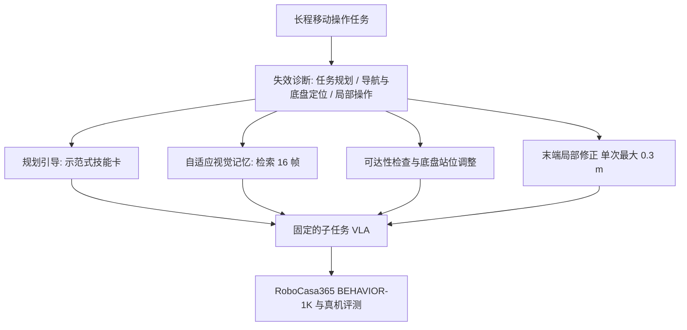

# Cracking Mobile Manipulation：从失效诊断到 agentic 机器人系统

**本文先诊断长程移动操作的失效来源，再在不改动子任务 VLA 的前提下，用四类针对失效的 agentic 干预把成功率从 19% 提升到 47%（RoboCasa365）。**

## 英文缩写速查

| 缩写 | 英文全称 | 简要说明 |
|------|----------|----------|
| VLA | Vision-Language-Action | 视觉-语言-动作策略；本文的子任务 VLA 是固定不训练的底层执行器 |
| VLM | Vision-Language Model | 视觉语言模型；本文用于任务规划与历史帧检索 |
| IK | Inverse Kinematics | 逆运动学；论文指出可达性检查未覆盖 IK 与关节限位 |
| A* | A-star search | 启发式图搜索；用于在不可达时规划新的底盘站位路径 |

## 为什么重要

单任务 VLA 在原子操作上表现不错，但一旦把多个原子技能组合成移动操作，成功率掉得很快：论文中的预训练子任务 VLA 在原子任务上 80%，组合后只有 19%。本文的价值在于说明：失败主要来自规划、导航与底盘定位、局部操作三者叠加，而不只是局部操作能力弱。这提示工程上应优先修正当前瓶颈，而不是一味放大策略。

## 核心信息

| 项目 | 内容 |
|------|------|
| arXiv | [2610.19600](https://arxiv.org/abs/2610.19600)（PDF 与 HTML 已核对） |
| 作者 | Zixuan Wang, Jia-Ning Li, Yinzhou Tang, Yanzhao Yu, Biao Wu, Meng Fang, Xin Li, Yiwu Zhong |
| 机构 | Peking University（智能科学与技术学院、通用人工智能国家重点实验室）、Alibaba DAMO Academy / Alibaba Group、中国科学院自动化研究所、Tsinghua University、University of Technology Sydney、University of Liverpool |
| 数据/平台 | 仿真：RoboCasa365（32 个组合任务中选 20 个，每任务 5 次开发 rollout + 5 个 held-out 种子）；BEHAVIOR-1K（5 个任务，迁移测试）。真机：双臂移动操作平台（型号未核实），2 个任务、20 次试验 |
| 开源状态 | **待发布**（2026-10-15 核查：仓库公开（Apache-2.0），README 标注 "Coming soon" 并列出六项计划发布内容；当前仅含 PDF、LICENSE、README 与三张图，无运行脚本） |
| 代码仓库 | <https://github.com/PKU-VaLuE-Lab/Cracking-Mobile-Manipulation> |

## 核心原理

流程分两步：先把长程失败归入三类，再为每类加一项针对性干预。底层子任务 VLA 保持不变。

四类干预分别是：

- **示范式规划引导：** 从训练示范中检索匹配样例，压缩为技能卡（目标、子任务顺序、关键帧、完成判据），供规划器使用。
- **自适应视觉记忆：** 只存当前回合已观测的画面；规划器请求历史时，由视觉语言模型筛出最相关的 16 帧并附轨迹摘要，不使用未来帧或仿真器状态。
- **可达性感知底盘调整：** 用检测与分割模块把站位标为可达、边缘、不可达；边缘站位做小幅修正，不可达则重新选站位并用 A* 规划路径。
- **局部末端调整：** 从分割深度掩码估计目标的三维位置与表面法向，施加有界修正；子任务 VLA 保持固定。

## 工程实践

- **复现入口：** 论文公开的仓库尚未发布代码，目前只能按论文描述自行搭建规划器、记忆与站位检查模块。
- **关键消融（RoboCasa365，完整系统 47.0%）：** 去掉 `check_stance` 降到 36.0%；去掉 `approach_xy` 为 42.0%；去掉 `goto_stance` 为 39.0%；视觉记忆改为固定均匀采样时 8/16/32 帧为 37.0/40.0/35.0%，由规划器按需检索时为 42.0/47.0/45.0%。
- **调试指标：** 按失效类别记录失败（规划错误、底盘站位失败、局部操作失败），论文显示操作类失败（放置错误、掉落、碰撞）在修正后仍占多数。
- **源码运行时序图：** **不适用**（官方仓库仅为占位 README，代码标注 "Coming soon"，无可运行的训练或推理入口）。

## 实验与评测

| 设置 | 基线 | 加入干预后 |
|------|------|------------|
| 原子操作任务（子任务 VLA） | 80% | 不适用 |
| 组合移动操作（组合前后对比） | 19% | 47%（RoboCasa365 开发集） |
| RoboCasa365 held-out 种子 | 18% | 49% |
| BEHAVIOR-1K | 14% | 37% |
| 真机 | 5/20 | 13/20 |

## 结论

**一句话总判：长程移动操作的瓶颈常在规划与底盘站位上，针对瓶颈的小型 agentic 干预，性价比可能高于统一放大策略。**

1. **先诊断再干预** — 失效分成规划、底盘定位与局部操作三类，修复哪一类要由失败数据决定。
2. **底盘可达性检查收益最大** — 去掉 `check_stance` 后下降最多（47 到 36），说明站位错误是主要失效源之一。
3. **记忆检索要按需触发** — 固定帧数采样反而不如规划器按需检索（16 帧按需 47% 对固定 16 帧 40%）。
4. **末端修正的收益有限** — 与规划器直接给定目标相比仅从 43 提升到 47，操作类失败仍是剩余主因。
5. **迁移结果需要区分** — BEHAVIOR-1K 与真机上的提升真实存在，但真机只有 2 个任务、20 次试验，样本偏少。

## 与其他工作对比

| 路线 | 思路 | 与本文的差异 |
|------|------|--------------|
| 直接放大或微调 VLA | 统一提升策略能力 | 本文保持子任务 VLA 固定，只改规划与站位等环节 |
| 端到端长程 VLA | 一个策略端到端输出全部动作 | 本文用显式的失效诊断与模块化干预，可解释性更强 |
| 基于 [VLA](../methods/vla.md) 的任务组合 | 把原子技能串成序列 | 本文指出组合失败的具体来源，并针对性修补 |

## 局限与风险

- 可达性检查只做位置层面的判断，未验证关节限位、逆运动学可解性与全身碰撞。
- 规划依赖外部的视觉语言模型与技能卡，系统对这些组件的稳定性与延迟敏感（推测）。
- 论文的显式局限说明较少；基底 VLA 的具体型号在可见正文中未给出。
- 仿真评测覆盖两套基准，真机只有 2 个任务，跨场景泛化结论需要谨慎。
- 官方代码尚未发布，复现与第三方验证目前受阻。

## 关联页面

- [VLA](../methods/vla.md)
- [Loco-manipulation 任务](../tasks/loco-manipulation.md)
- [操作任务](../tasks/manipulation.md)
- [仿真与真机评测差距](../concepts/sim-vs-real-eval-gap.md)

## 参考来源

- [Cracking Mobile Manipulation 来源归档](../../sources/papers/cracking_mobile_manipulation_arxiv_2610_19600.md)
- [公众号综述摘录（31 篇论文）](../../sources/raw/wechat_embodied_station_robot_31_papers_2026-10-15.md)

## 推荐继续阅读

- [arXiv:2610.19600 — Cracking Mobile Manipulation](https://arxiv.org/abs/2610.19600)
- [官方仓库（待发布）](https://github.com/PKU-VaLuE-Lab/Cracking-Mobile-Manipulation)
