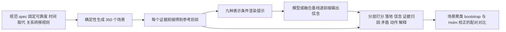

# CREG：证据落地的共享信念更新基准（arXiv:2611.11842）

**CREG**（Connected Robotics Evidence Graph Benchmark；*A Benchmark and Layered Evaluation Protocol for Evidence-Grounded Shared Belief Updating in Connected Robotics*，Bezerra 与 Yamazaki，Tohoku University，[arXiv:2611.11842](https://arxiv.org/abs/2611.11842)，v1 为 2026-11-09，页眉标「PREPRINT UNDER REVIEW」）。项目页：<https://creg-bench.github.io/>，下载页：<https://creg-bench.github.io/download/>。本页由论文全文（正文与附录）整理，通读范围见 [原文归档](../../sources/papers/creg-evidence-grounded-shared-belief_arxiv_2611_11842.md)。

## 一句话定义

**一个全合成、预注册、冻结的基准：350 个场景、每个证据前缀都有规范后验参考，把「机器人 / IoT 传感器 / 边缘 AI 报告 → 共享信念 → 矛盾 → 动作 → 解释」拆成分层指标来评，而不是只评最终答案。**

## 英文缩写速查

| 缩写 | 英文全称 | 简要说明 |
|------|----------|----------|
| CREG | Connected Robotics Evidence Graph | 本基准名（论文 Abstract） |
| IoT | Internet of Things | 物联网传感器，场景中的证据来源之一 |
| TV | Total Variation distance | 预测与参考后验的总变差距离，轨迹分为 1 − TV（Sec. III-B） |
| AGM | Alchourrón–Gärdenfors–Makinson | 信念修正的经典理论，论文相关工作引用（Sec. II-B） |
| JSON | JavaScript Object Notation | 其中 canonical JSON 为主表示条件之一 |
| CI | Confidence Interval | 场景聚类 bootstrap 95% 置信区间（Sec. IV-D） |

## 为什么重要

- **问题（作者自述）：** 现有评测多只给最终答案、任务成功或所选动作，分不清系统是推理正确，还是「碰巧」对（绑错实体、引错证据、漏掉矛盾、过早或过晚修正）。CREG 把这条链拆开单独打分（Sec. I）。
- **三条发现（作者自述，Sec. V）：** 弱模型的缺口很大一部分来自输出根本没绑定到所需实体；删掉语义关系在关系依赖场景里严重掉准确率，但信息匹配的结构化列表反而优于完整图、打乱顺序也不伤；信念准确率沿证据序列强烈非单调，中途失败只看终点发现不了。
- **我的判断：** 对多机器人 / 传感器网络的「共享世界模型」研究，它提供了一个可复现的最小可检验环境；但它是合成数据，价值在评测方法，不在证明真实部署效果。

## 核心原理与流程总览

- **场景（Sec. III-A）：** 每个场景一个目标实体、二值状态（anomalous / normal）、均匀先验；报告带来源、声称值、置信度、事件 / 到达时间、状态 epoch；报告有效准确率 = 0.5 + (confidence − 0.5) · reliability；epoch 与显式取代链决定哪些报告仍适用；measures 关系决定传感器报告能否转到目标实体。7 个 regime 各 50 个（Table A4），共 1,150 个场景-前缀对。关系关联场景做成「删掉关系后观察上不可区分」的反事实对（项目页称 25 对）。
- **参考校验（Sec. III-A/B）：** 独立 log-odds 检查器在全部 1,150 个前缀与生成器一致；1 位专家盲评 35 个对，第一轮 29/35，修规范（并列后验语义）后第二轮 35/35，没有手改标签。
- **表示条件（Sec. III-C）：** 主条件 canonical JSON、structured list、full graph、graph without relations；仅 Qwen2.5-7B 做 5 个因子消融（flat edge-removed、no provenance、no timestamps、no confidence、shuffled graph）。
- **指标分层（Sec. IV-B）：** 可靠性（JSON 有效 / 修复率）、实体落地、信念轨迹（1 − TV，另有严格前缀信念态准确率、保持准确率、正确修正率、Brier 距离、更新延迟）、证据归因 F1、矛盾检测 / 定位 / 类型、动作（精确策略一致、动作族一致、证据支持率）、解释落地（引用覆盖，非忠实度）。

## 评测结果

主要数字（Table II/III，Qwen-7B 为基准）：

| 系统 | 轨迹得分 | 严格态准确率 | 落地率 |
|------|----------|--------------|--------|
| Qwen-1.5B / JSON（诊断层） | 0.397 | 0.331 | 0.786 |
| Mistral-7B / JSON（诊断层） | 0.239 | 0.221 | 0.694 |
| Qwen-7B / JSON | 0.797 | 0.831 | 1.000 |
| Gemma-12B / JSON | 0.801 | 0.729 | 1.000 |
| Qwen-7B / full graph | 0.814 | 0.695 | 1.000 |
| Qwen-7B / structured list | 0.842 | 0.682 | 0.966 |
| Qwen-7B / shuffled graph | 0.848 | 0.741 | 0.999 |
| Qwen-7B / graph w/o relations | 0.727 | 0.537 | 0.868 |

- **关系内容（Table III）：** 全体 regime 删关系轨迹得分差 +0.088（Holm p = 0.0001）；关系关联 regime 内严格准确率差 +0.153（CI [0.098, 0.207]，Holm p = 0.0001），但同 regime 轨迹得分差 +0.020（Holm p = 0.0577，未过校正）。
- **序列化无一致优势：** structured list − canonical JSON = +0.045；shuffled − full graph = +0.034；full graph − flat edge-removed = +0.041。严格态准确率上 canonical JSON 反而比 full graph 高 0.136，但 canonical JSON 提示更短（0.843 倍），作者不把差异归于格式本身（Sec. V-B）。
- **轨迹非单调（Sec. V-C）：** 第 3 个前缀图族条件准确率 0.20–0.25，第 4 个回升到 0.62–0.81。
- **透明基线（Table IV）：** 来源可靠度加权最高 0.700，最低 latest-observation 0.603，均高于诊断层、低于全部核心神经系统；作者指出「可靠度加权最好」来自参考语义，不是独立发现。

## 与其他工作对比

| 工作 | 关注点 | 与 CREG 的区别 |
|------|--------|----------------|
| 只评终点的智能体评测（见 [AI Agent 评测](../concepts/ai-agent-evaluation.md)） | 最终答案、任务成功或所选动作 | 分不清「推理正确」与「碰巧正确」；CREG 对每个证据前缀给参考后验，并把实体落地、证据归因、矛盾、动作、解释分层打分（Sec. I、IV-B） |
| 透明融合基线（Table IV，如来源可靠度加权、latest-observation） | 不用语言模型的规则式 [传感器融合](../concepts/sensor-fusion.md) | 轨迹得分 0.603–0.700，高于诊断层模型、低于全部核心神经系统；「可靠度加权最好」由参考语义决定，不是独立发现 |
| AGM 信念修正理论（Sec. II-B） | 形式化的信念修正公设 | 是理论框架；CREG 把信念更新落成可打分的合成数据与指标，并引入关系、取代链与到达时间 |

选型时如何把这类诊断型基准与任务成功率基准搭配使用，见 [具身评测基准选型闭环](../queries/embodied-eval-benchmark-selection-loop.md)。

## 结论

**CREG 的核心价值是评测方法：按证据前缀给参考后验并分层打分，能暴露只看终点时看不到的失败——尤其是弱模型的大部分缺口其实是实体落地失败。**

1. Qwen-1.5B 与 Mistral-7B 落地率仅 0.786 / 0.694，轨迹得分 0.397 / 0.239，远低于 Qwen-7B 的 0.797（Table II）。
2. 关系内容有用（关系关联 regime 严格准确率 +0.153，Holm p = 0.0001），但图序列化本身无一致优势（Table III、Sec. V-B）。
3. 信念准确率沿证据序列强烈非单调，第 3 个前缀图族条件只有 0.20–0.25（Sec. V-C）。
4. 局限：全合成、二值状态、单目标实体，只测 1.5B–12B 四个开源模型且完整矩阵只在 Qwen-7B，无真机或仿真机器人实验，语义审计仅 1 位专家。

## 工程实践

- **取用数据：** 下载页提供冻结的 `evaluation-v1.0` 场景 JSONL（350 条，带 SHA-256）、manifest、规范说明，以及带标签的 Evidence-Graph-Toolkit 仓库；项目页称可离线、无硬件复现，并可用固定种子（20260725）重新生成并对照 manifest 哈希。本页**未下载数据、未运行代码**，仓库 README 在本环境不可读，属**未核实**。
- **评测自己的方法时：** 逐前缀给出结构化信念（含实体绑定）；先看落地率与 JSON 有效率，再看信念轨迹，避免把输出格式失败误判成融合能力差（作者建议，Sec. VI-A）。
- **别踩的坑：** 比较序列化时要控制提示长度和信息量；canonical JSON 与图的差异混有长度因素（Sec. III-C、App. B Table A2）。
- **复现注意（App. I）：** 模型按名称而非提交哈希固定，且逐场景原始输出以 release artifact 分发。

## 与文章说法的核对

对照公众号文章《机器人动作块太长，什么时候该重新规划？》中第 37 条对本论文的说法：

| 文章说法 | 核对结果 |
|----------|----------|
| 用分层协议检查共享信念更新 | 与论文一致（Abstract、Sec. IV-B 分层指标）。 |
| 沿观测前缀追踪证据、关系与最终判断 | 基本一致，但论文强调的是按前缀的参考后验与证据归因，且「终点判断」恰是被认为不足的对象；动作与解释只在终点任务上评（Sec. IV-B）。 |
| 基准强调关系信息的作用 | 成立但需限定：关系内容的效应在关系关联 regime 的严格态准确率上显著（+15.3 点，仅 Qwen-7B），同 regime 轨迹得分差 +0.020 校正后不显著（p = 0.058）；作者同时说图序列化本身无一致优势。文章没提这一限定。 |
| 当前主要是合成单实体二元状态 | 一致，论文 Sec. VI-D 明说合成、二值状态、单目标实体。 |
| 尚不代表真实机器人群部署效果 | 一致且更严格：物理日志重放只是 2 条观测的管线演示，不是机器人评测（App. G）；全文没有真机或仿真机器人实验，只有语言模型读文本 / 图提示。 |
| 文章未提及 | 论文的另两条主要发现（实体落地解释弱模型大部分缺口；终点评测掩盖中途失败）、只测 1.5B–12B 四个开源模型、算力回退导致表示矩阵只做 Qwen-7B、不同指标排序不一致。 |

## 局限

**论文自述（Sec. VI-D 与附录）：** 套件为合成，状态二值、单个评分目标实体；物理日志重放只演示摄入通路；语义合理性审计仅 1 位专家，无共识或评分者一致性；两个表示消融有混淆（提示长度、no-provenance 同时删可靠度字段）；时间戳操控刻意偏弱，null 结果是预期；无独立来源可靠度消融；条件轨迹得分与 Gemma 非 canonical 运行为探索性；模型仅 1.5B–12B 四个开源、512 token，更大模型、工具增强、更长预算未测。

**我看到的未验证之处：**

- 仅 Qwen-7B 做完整表示与因子矩阵，其他模型是否同样「序列化无优势」未知（推测：可能随模型规模变化，论文未测）。
- 论文处于「under review」预印本状态，数字未经同行评审。
- 动作层的证据支持率四个模型同为 0.857 是谓词结构性所致，作者承认区分力有限；确定性策略 35.7% 一致率是两种不同策略的分歧，不是能力分。
- 基准的参考后验由作者规范定义，「可靠度加权最佳」自然成立，基准结论依赖该规范本身是否合理。
- 本页未核实 GitHub 仓库内容与许可证，也未复算任何表格。

## 关联页面

- [传感器融合](../concepts/sensor-fusion.md)：多源观测融合的一般概念。
- [贝叶斯信念分析](../concepts/bayesian-belief-analysis.md)：后验更新的基本思路。
- [AI Agent 评测](../concepts/ai-agent-evaluation.md)：为何只看终点成功不够。
- [具身语义认知地图](../concepts/embodied-semantic-cognitive-map.md)：语义地图 / 场景图类表示。
- [人形多机器人协同](../concepts/humanoid-multi-robot-coordination.md)：多机器人共享信息的应用背景。
- [仿真与真机评测差距](../concepts/sim-vs-real-eval-gap.md)：本基准全合成，与此话题相关。

## 参考来源

- [CREG 论文归档](../../sources/papers/creg-evidence-grounded-shared-belief_arxiv_2611_11842.md)
- 论文：<https://arxiv.org/abs/2611.11842>（PDF：<https://arxiv.org/pdf/2611.11842v1>）
- 项目页：<https://creg-bench.github.io/>；下载页：<https://creg-bench.github.io/download/>
- 工具包仓库：<https://github.com/RanulfoBezerra/Evidence-Graph-Toolkit>（README 未核实）

## 继续阅读

- 先读论文 Sec. V-B 与 Table III，看关系内容与序列化两组对比的统计口径。
- 再看 App. D 的透明基线与覆盖验证器诊断（Table A5），理解动作层为何区分力弱。
- 关联：[AI Agent 评测](../concepts/ai-agent-evaluation.md)、[传感器融合](../concepts/sensor-fusion.md)。
