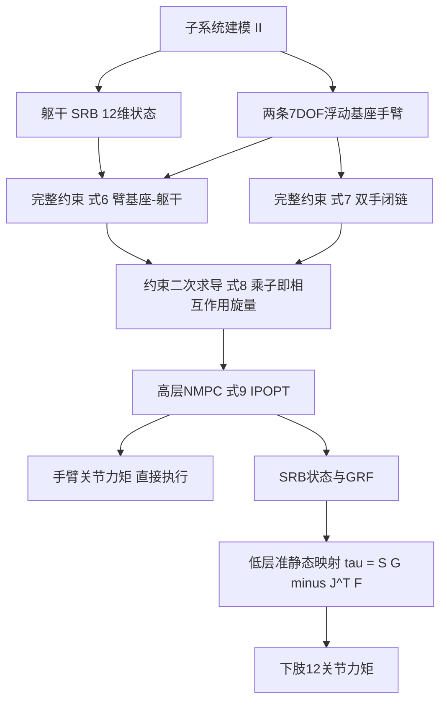

# CRISP：约束解析的子系统交互 · 预测式全身协同（arXiv:2611.07268）

**CRISP**（*Constraint-Resolved Interactions between Subsystems for Predictive Whole-Body Cooperation*，[arXiv:2611.07268](https://arxiv.org/abs/2611.07268)，v1 2026-11-05，cs.RO）。作者 Dario Valenzuela、Jeeseop Kim，机构为 University of Texas at El Paso（UTEP）航空航天与机械工程系（论文首页脚注）。这是一篇**基于模型的 NMPC 控制论文，不是强化学习**。注意它与 [paper-crisp](./paper-crisp.md)（接触引导 real2sim，arXiv:2609.21761）只是缩写撞名。

## 一句话定义

**把人形机器人看成「躯干单刚体 + 浮动基座手臂」几个子系统，用完整约束把它们连起来，约束的拉格朗日乘子就是肩部与双手之间传递的相互作用力旋量；高层 NMPC 把这些旋量与状态、手臂力矩、地面反力（GRF）一起优化，下肢再用准静态映射把 GRF 变成关节力矩。**（摘要、II-C、III）

## 英文缩写速查

| 缩写 | 英文全称 | 简要说明 |
|------|----------|----------|
| NMPC | Nonlinear Model Predictive Control | 非线性模型预测控制，滚动时域内解非线性优化（III-A） |
| SRB | Single Rigid Body | 单刚体模型，此处表示躯干，状态为质心位置、欧拉角及其速度，共 12 维（II-A） |
| GRF | Ground Reaction Force | 地面反力；此处是躯干四个下角点上的传递力，再映射到双脚（III-B） |
| DOF | Degrees of Freedom | 自由度；G1 为 29 DOF，单臂 7 DOF |
| COM / COP | Center of Mass / Center of Pressure | 质心 / 压力中心；Fig. 7(c) 用 COP 是否在支撑多边形内判稳 |
| FK / IK | Forward / Inverse Kinematics | 正 / 逆运动学；手臂参考轨迹由 IK 控制器生成（III-A） |
| IPOPT / MA57 | Interior Point OPTimizer / HSL 稀疏线性求解器 | 求解 NMPC 所用的非线性规划求解器与线性求解器（IV） |
| 完整约束 | holonomic constraint | 只约束位形（可写成 ψ(q)=0）的约束，其乘子即约束力（II-C） |

## 为什么重要

- **作者自述的问题（I-A、I-B）：** 双手共持一物时，两臂与物体构成闭链，末端力旋量里有一部分是不产生合力的「内力」，不能对每条臂独立刻画，且仅凭抓取矩阵无法唯一确定负载分配；这些力旋量还与浮动基座动力学耦合，处理不当会同时损害操作跟踪与全身平衡。
- **作者自述的缺口：** 已有方法要么用腕力 / 力矩传感器或力估计器，要么针对固定基座双臂、环境接触或机体内置闭链；在浮动基座全身优化里联合求出双臂 + 物体诱导的内部相互作用旋量「相对较少被探索」（I-A）。
- **作者的做法带来的好处（自述）：** 用统一的约束表示得到模块化、可扩展的建模方式，后续可以组合更多子系统（I-B、V）。
- **我的判断：** 它的价值在于把「内力 / 肩部载荷」变成 NMPC 的显式决策变量，不依赖腕部力传感器即可在线得到旋量估计；但验证规模很小（见局限）。

## 核心机制 · 方法栈与流程总览

| 步骤 | 内容 | 出处 |
|------|------|------|
| 1 躯干 | SRB：x = (r, θ, ṙ, ω)，净外力旋量 = 角点 GRF + 两臂的相互作用旋量 | II-A，式 1 至 3 |
| 2 手臂 | 7 DOF 浮动基座模型，欧拉-拉格朗日加约束力项 `-J_iᵀ λ_i + σ J_eeᵀ λ_ee` | II-B，式 4、5 |
| 3 约束 | 臂基座与躯干刚性连接（式 6）；双手夹同一物体 r_i + FK_i = r_j + FK_j + ρ（式 7）；二次求导并入动力学（式 8） | II-C |
| 4 NMPC | 代价 = SRB 项 + 手臂项 + 旋量惩罚 + 缺陷变量惩罚；等式约束为离散动力学与约束（含缺陷变量 δ_a、δ_v、δ_ee 提高数值稳定）；不等式为输入可行域 | III-A，式 9 |
| 5 输出 | 手臂力矩取 u_arm(t|t) 直接下发；SRB 状态与 GRF 交给低层 | III-A |
| 6 低层 | 下肢准静态：G(q) = Sᵀτ + Jᵀ(q)F_GRF，τ = S(G(q) − Jᵀ(q)F_GRF)；四角点力映射为双脚旋量并保持合力与合力矩 | III-B |

关键设定（IV）：29 DOF Unitree G1；460 个决策变量；预测时域 60 ms（N = 3）；平均求解 8 ms，99% 低于 14 ms；PC 为 AMD Ryzen 7 9700X、48 GB 内存；仿真为 MuJoCo。

## 实验结果（论文自述 + 读图）

- **仿真 IV-A（Fig. 5）：** 盒子抬升并准静态支撑，负载 0.1 至 0.5 kg 逐级增加作为未知扰动。NMPC 的最优末端力 F_y 与肩部力矩 M_y，同独立测得的接触旋量对比，作者称随模型不确定性增大仍「有界误差」跟踪。**论文未给数值误差**；Fig. 5(c) 读图可见最优曲线与实测曲线之间存在可见的偏置（我的读图观察）。
- **实机 IV-B（Fig. 6）：** 抬升载荷时末端各方向误差在抓取前有界，抓取并挤压（squeeze）阶段累积，读图量级约 ±20 mm（我的读图估计，非论文给出的数字）；末端相互作用力随挤压增大。
- **实机扰动（Fig. 7、8）：** 沿 z 向扰动，躯干俯仰角不发散，COP 一直在支撑多边形内；多方向扰动下最优旋量有明显响应、系统保持稳定。实机图只画了最优旋量，没有画实测旋量对照。

## 工程实践

- 求解器：IPOPT + MA57，N = 3、20 ms 步长（60 ms / 3，推测为每步 20 ms，论文只给总时域与 N）；平均 8 ms 求解足够在线运行（IV）。
- 手臂以力矩级输入直接执行，需要手臂力矩接口与可靠的臂动力学参数；下肢需要 G(q) 与双足雅可比做准静态映射（III-B）。
- 代价权重全部在 IV 开头给出（如 Q_SRB 的 r、θ 权重分别为 1e3、1e4，旋量权重 R_int 为 1e-2 / 1e-1，缺陷权重 W 各不同），复现时可直接参照；论文未提供代码链接。
- 与 RL 路线的关系（我的判断）：这是一条可显式输出内力的基于模型路线，可与 [MPC 与 RL 对比](../comparisons/mpc-vs-rl.md) 对照阅读；论文本身不含任何学习成分。

## 局限

**论文自己承认或隐含的：**
- 未来工作才会引入允许滑移的接触模型、行走中操作、更多子系统（V）；因此当前不含滑移，只验证静态站立下的双臂操作（IV-B 实验为站立抬升与扰动）。
- 下肢采用准静态假设（III-B），不处理动态步行；NMPC 里也没有下肢动力学（II 至 III 中只有躯干 SRB + 两臂）。

**我看到的未验证之处：**
- 没有任何与基线（如不含约束乘子的分解控制、阻抗 / 混合位置力控制、完整全身 MPC）的对比，也没有消融；无法判断「约束解析」带来的收益大小。
- 「一致 / 有界误差」均未给数值指标（RMSE、峰值误差等），也无多次重复或统计；实机只有少数几类扰动。
- 实机上没有独立的旋量测量对照，旋量估计的准确性只在仿真里与「测得的」对比（Fig. 5）；该仿真测量值来自 MuJoCo 接触，不是真实传感器。
- 摘要说「浮动基座动力学模型表示手臂与下肢」，但方法节里下肢并未作为 NMPC 子系统建模，存在表述与方法不一致（我的读法）。
- 只在一个机型（G1）、一类物体（盒子）、站立姿态下验证；泛化性未知。

## 与周报说法的核对

本篇同时出现在两份周报里，逐条对照论文：

| 周报条目 | 论文核对 |
|----------|----------|
| 机构：eiBI「得克萨斯大学埃尔帕索分校」；Y21u「待核实」 | eiBI 正确（UTEP，航空航天与机械工程系，首页脚注），Y21u 可补全 |
| eiBI：「单刚体躯干与关节子系统」「NMPC 联合优化关节力矩、地面反力和内部约束力」 | 大体属实，但「关节力矩」仅是手臂力矩，下肢力矩由 GRF 经准静态映射得到，不在 NMPC 变量内（III-A、III-B） |
| Y21u：「躯干、手臂和下肢子系统」 | 只符合摘要字面；方法里 NMPC 子系统是躯干 SRB 与两臂，下肢走低层映射 |
| Y21u：「完整动力学优化的计算负担较高」 | 论文未以此为动机；论文动机是闭链内力 / 肩部旋量的刻画（I-B），该句应视为周报自己的概括 |
| Y21u：「在 Unitree G1 上验证在线全身协同操作」 | 属实：29 DOF G1，NMPC 平均 8 ms（IV） |
| eiBI：「子系统之间约束力与负载传递容易被忽略，整体动力学不一致」 | 与 I 节动机一致（「不准确或不完整地处理旋量会损害跟踪与平衡」），属合理概括 |

周报均未给数字，没有需要回核的数值。

## 关联页面

- [非线性模型预测控制（NMPC）](../methods/nonlinear-model-predictive-control.md)
- [模型预测控制（MPC）](../methods/model-predictive-control.md)
- [全身控制（WBC）](../concepts/whole-body-control.md)
- [全身协调](../concepts/whole-body-coordination.md)
- [浮动基座动力学](../concepts/floating-base-dynamics.md)
- [质心动力学](../concepts/centroidal-dynamics.md)
- [MPC 与 WBC 集成](../concepts/mpc-wbc-integration.md)
- [约束优化](../concepts/constrained-optimization.md)
- [KKT 条件](../formalizations/kkt-conditions.md)
- [双臂操作](../tasks/bimanual-manipulation.md)
- [Loco-Manipulation](../tasks/loco-manipulation.md)
- [Unitree G1](./unitree-g1.md)
- [MuJoCo](./mujoco.md)
- [MPC 与 RL 对比](../comparisons/mpc-vs-rl.md)
- [同名 CRISP（real2sim，非同一篇）](./paper-crisp.md)

## 参考来源

- [crisp-whole-body-nmpc_arxiv_2611_07268.md](../../sources/papers/crisp-whole-body-nmpc_arxiv_2611_07268.md)
- [arXiv:2611.07268](https://arxiv.org/abs/2611.07268)

## 推荐继续阅读

- [arXiv PDF](https://arxiv.org/pdf/2611.07268)
- [NMPC 方法页](../methods/nonlinear-model-predictive-control.md)
- [MPC 与 WBC 集成](../concepts/mpc-wbc-integration.md)
