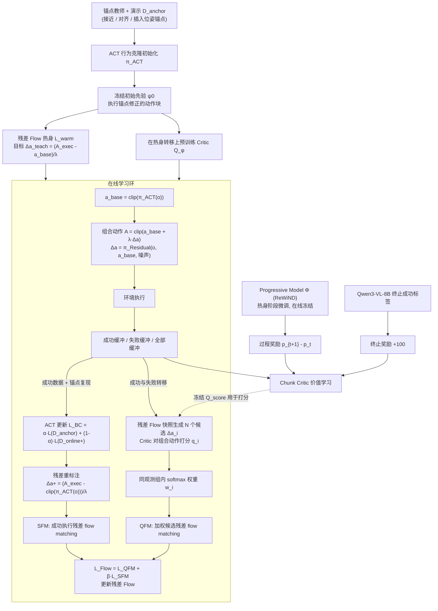

# Critic-Weighted Residual Flow：学习吸收纠正：面向视觉插入任务的 Critic 加权残差 Flow

**Critic-Weighted Residual Flow**（*Learning to Absorb Corrections: Critic-Weighted Residual Flow for Vision-Based Insertion*，[arXiv:2610.29117](https://arxiv.org/abs/2610.29117)）收录于 senlanke「具身运控lab」10-19–10-23 前沿论文动态（Manipulation）。本页依据**周报条目 + arXiv 摘要页**整理，流程图依据论文方法部分（见参考来源），未逐页核对实验数字；指标与结论以论文为准。

## 一句话定义

**Critic-Weighted Residual Flow：学习吸收纠正：面向视觉插入任务的 Critic 加权残差 Flow——将 Critic 加权与残差 Flow 结合，研究利用纠正反馈优化视觉插入策略，使策略能够学习更有效的误差补偿行为。**

## 英文缩写速查

| 缩写 | 英文全称 | 简要说明 |
|------|----------|----------|
| VLA | Vision-Language-Action | 视觉–语言–动作模型 |
| IL | Imitation Learning | 模仿学习 |

## 为什么重要

- 周报所述待解决的问题：视觉插入任务需要较高位置精度。基础策略执行过程中出现的误差，需要通过纠正动作进行补偿，但不同纠正动作的价值并不相同。

## 流程总览

图依据：论文 §IV-A–C / Fig.2 / Eq.1–11

## 核心机制

| 项 | 内容 |
|----|------|
| **arXiv** | [2610.29117](https://arxiv.org/abs/2610.29117) · [PDF](https://arxiv.org/pdf/2610.29117) |
| **作者（arXiv）** | Yiqing Yuan, Zhi Li, Jinrong Yang, Mingshan Sun, Mei Yu Zhi, Yong Zhao, Liangliang Ren, Hui Cheng |
| **机构（周报所述，未逐条核实）** | 待核实（作者：Yiqing Yuan、Zhi Li、Hui Cheng 等）。 |
| **arXiv 评论栏** | 9 pages, 7 figures |
| **开源** | arXiv 摘要页与评论未见代码或项目页链接（仅核对 arXiv 摘要页，不代表未发布）（2026-10-26） |
| **周报所述创新点** | 将 Critic 加权与残差 Flow 结合，研究利用纠正反馈优化视觉插入策略，使策略能够学习更有效的误差补偿行为。 |

### arXiv 摘要节选（英文原文）

> Vision-based insertion requires correcting alignment errors while retaining useful behavior learned from demonstrations. We present ACT--Flow, an online learning framework that couples an adaptive Action Chunking Transformer (ACT) with a conditional residual flow policy.

## 源码运行时序图

**不适用**：arXiv 摘要页与评论未见代码或项目页链接（仅核对 arXiv 摘要页，不代表未发布），无可对齐的官方代码流程。

## 实验与评测

- 周报与摘要给出的数字/场景已写入上表「创新点」与摘要节选；其余实验细节、基线与成功率定义请回到论文正文。
- 读法：先对齐任务设定、传感器与成功定义（仿真/真机），再解读 headline 数字，勿跨论文直接比较。

## 与其他工作对比

| 维度 | 读法 |
|------|------|
| **同周对照** | 见 [Manipulation周报技术地图](../overview/senlanke-weekly-2026-10-19-23-manipulation-technology-map.md)，按方向浏览同期论文 |
| **开源状态** | arXiv 摘要页与评论未见代码或项目页链接（仅核对 arXiv 摘要页，不代表未发布） |

## 结论

**Critic-Weighted Residual Flow：学习吸收纠正：面向视觉插入任务的 Critic 加权残差 Flow。**

1. 本页是入库级摘要，复现前请核对论文正文、附录与代码仓库。
2. 指标须连同实验条件解读。
3. 关注 arXiv 版本更新与代码发布。

## 关联页面

- [senlanke-weekly-2026-10-19-23-manipulation-technology-map](../overview/senlanke-weekly-2026-10-19-23-manipulation-technology-map.md)
- [manipulation](../tasks/manipulation.md)
- [vla](../methods/vla.md)

## 参考来源

- [critic-weighted-residual-flow-insertion_arxiv_2610_29117.md](../../sources/papers/critic-weighted-residual-flow-insertion_arxiv_2610_29117.md)
- [wechat_senlanke_weekly_manipulation_2026-10-19_23.md](../../sources/blogs/wechat_senlanke_weekly_manipulation_2026-10-19_23.md)
- [arXiv:2610.29117](https://arxiv.org/abs/2610.29117)
- [arXiv PDF](https://arxiv.org/pdf/2610.29117)：已通读方法部分（实验与附录以略读为准）：摘要、§I–II、§III 问题设定、§IV Method（IV-A 锚点热身与行为吸收 / IV-B Critic 加权残差 Flow / IV-C 进度估计与块价值学习）、§V-A 实验设定开头

## 推荐继续阅读

- [arXiv PDF](https://arxiv.org/pdf/2610.29117)
