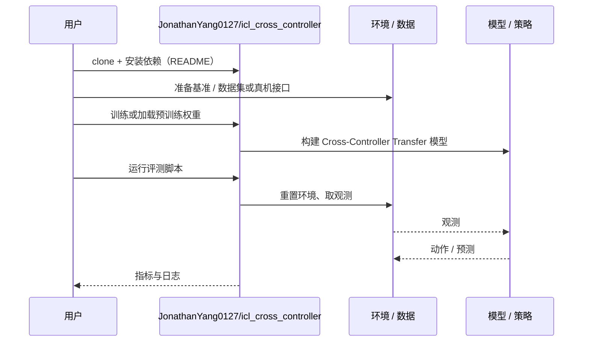

# Cross-Controller Transfer（arXiv:2610.39280）

**Cross-Controller Transfer**（*Cross-Controller Transfer via In-Context Behavior Adaptation*，[arXiv:2610.39280](https://arxiv.org/abs/2610.39280)，[项目页](https://controller-transfer.github.io/)，[代码](https://github.com/JonathanYang0127/icl_cross_controller)）来自 [具身智能小站 2026-10-30 盘点](../../sources/blogs/wechat_embodied_station_28_papers_event2reward_progress_rewards_2026-10-30.md)，属「奖励学习与 VLA 策略」组。

## 一句话定义

**以动作指令及实际运动组成交互上下文，让统一策略适配不同控制模式与增益。**

## 英文缩写速查

| 缩写 | 英文全称 | 简要说明 |
|------|----------|----------|
| Cross-Controller Transfer | Cross-Controller Transfer via In-Context Behavior Adaptation | 本文方法 / 基准的简称 |

## 为什么重要

- 控制器换了，策略也要读懂动作的新含义。跨控制器迁移不仅是数值换算，也可能需要调整接触任务中的操作策略。
- 开源结论：**已开源**（步骤 2.5，2026-10-30）。仓库可达（git ls-remote）。项目页 HTTP 200。
- 同期同组工作见 [进度奖励、接触监督与规划验证：具身智能小站 10-30 期 28 篇阅读坐标](../overview/embodied-station-2026-10-30-28-papers-technology-map.md)。

## 核心机制

| 项 | 内容 |
|----|------|
| **arXiv** | [2610.39280](https://arxiv.org/abs/2610.39280) |
| **开源** | **已开源** |
| **要点** | 以动作指令及实际运动组成交互上下文，让统一策略适配不同控制模式与增益。 |
| **文内指标** | 公众号转述：跨控制器迁移不仅是数值换算，也可能需要调整接触任务中的操作策略。 |

## 源码运行时序图

以下为按仓库入口（`JonathanYang0127/icl_cross_controller`）推断的通用运行链路；入库日仅核实仓库可达，未逐文件阅读，具体脚本名以 README 为准。

## 实验与评测

- 公众号转述：跨控制器迁移不仅是数值换算，也可能需要调整接触任务中的操作策略。
- **读法：** 本页为索引级摘要，依据公众号转述的官方摘要与仓库信息整理；逐项数字与 baseline 以原文 PDF 为准。

## 与其他工作对比

- 横向索引见 [进度奖励、接触监督与规划验证：具身智能小站 10-30 期 28 篇阅读坐标](../overview/embodied-station-2026-10-30-28-papers-technology-map.md)；同 arXiv 不重复造页。

## 结论

**控制器换了，策略也要读懂动作的新含义：跨控制器迁移不仅是数值换算，也可能需要调整接触任务中的操作策略。**

1. 开源边界：**已开源** — 仓库可达（git ls-remote）。项目页 HTTP 200。
2. 核心机制：以动作指令及实际运动组成交互上下文，让统一策略适配不同控制模式与增益。
3. 复现与选型前核对任务协议、硬件与基准口径，勿直接横比公众号摘录数字。

## 关联页面

- [reinforcement-learning](../methods/reinforcement-learning.md)
- [vla](../methods/vla.md)
- [imitation-learning](../methods/imitation-learning.md)
- [embodied-station-2026-10-30-28-papers-technology-map](../overview/embodied-station-2026-10-30-28-papers-technology-map.md)

## 参考来源

- [cross_controller_transfer_arxiv_2610_39280.md](../../sources/papers/cross_controller_transfer_arxiv_2610_39280.md)
- [wechat_embodied_station_28_papers_event2reward_progress_rewards_2026-10-30.md](../../sources/blogs/wechat_embodied_station_28_papers_event2reward_progress_rewards_2026-10-30.md)
- [arXiv:2610.39280](https://arxiv.org/abs/2610.39280)

## 推荐继续阅读

- [arXiv PDF](https://arxiv.org/pdf/2610.39280)
- [项目页](https://controller-transfer.github.io/)
- [https://github.com/JonathanYang0127/icl_cross_controller](https://github.com/JonathanYang0127/icl_cross_controller)
