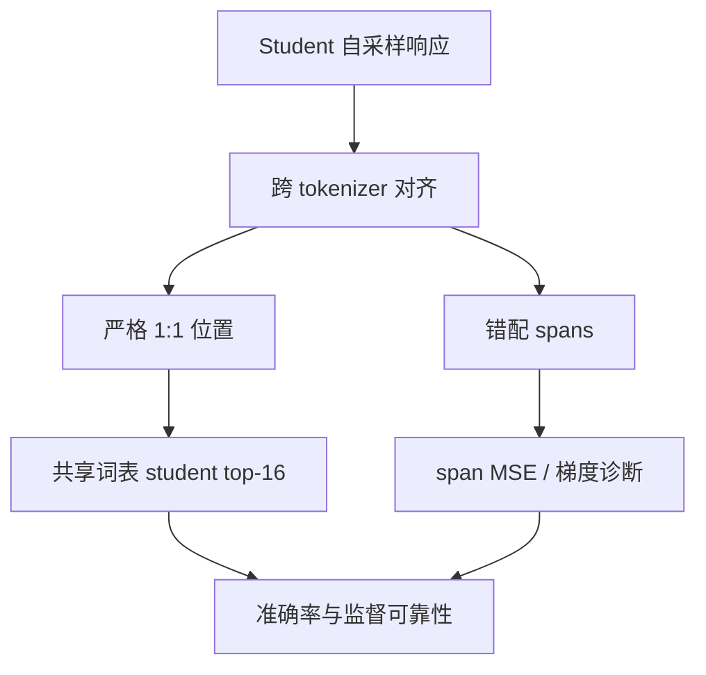

# Cross-Tokenizer OPD：从对齐覆盖转向监督可靠性

这项工作指出，跨 tokenizer 的同策略蒸馏应优先保障严格对齐位置上的监督质量，而不是为了全覆盖引入可能冲突的训练信号。

## 英文缩写速查

| 缩写 | 英文全称 | 简要说明 |
|------|----------|----------|
| OPD | On-Policy Distillation | student 对自身生成样本接收 teacher 监督 |
| KL | Kullback–Leibler Divergence | 蒸馏时比较 teacher/student 词表分布 |
| MSE | Mean Squared Error | 论文为错配 span log-probability 加入的损失 |
| top-k | top-k selection | 从共享词表选择 student 概率最高的候选 token |

## 为什么重要

异构分词器会破坏 token 位置和词表的一一对应。将低置信的 span 映射当作精确监督，可能令梯度相互抵消。论文将“监督可靠性”提升为和“覆盖率”并列的目标。

## 方法栈与流程

对 student 自采样响应做 teacher/student token 序列对齐，将位置分为严格 1:1 组和错配 span；严格位置按共享词表分布计算 reverse KL，并对错配 span 的扩展监督做梯度诊断。

## 评测与结果

三组异构 teacher–student 配对覆盖数学推理和代码生成。严格位置已覆盖多数 student tokens，且共享词表保留几乎全部概率质量。student top-16 reverse KL 准确率接近全共享词表 OPD，并优于论文比较的跨 tokenizer baseline。错配 span 加 log-probability MSE 后准确率下降，其梯度与严格损失方向弱一致或负一致。

## 结论

**可靠的局部监督可能胜过覆盖全面但对齐质量较差的目标。**

1. 先测严格对齐比例和共享词表概率质量，再扩展监督范围。
2. top-16 是论文实验设置，不应默认适用于所有词表与模型。
3. 同时报损失梯度余弦相似度、相对梯度范数和任务准确率。
4. 三组模型和数学/代码任务不足以建立普遍蒸馏定律。
5. 复现固定 tokenizer、采样策略、词表归一化和模型版本。

## 与其他工作对比

[Self-Retrospection Distillation](./paper-self-retrospection-distillation.md) 研究如何把事后轨迹作为事前预测目标；本文关心不同 tokenizer 下的 token 级监督映射。[Shallow-π](./paper-shallow-pi.md) 使用蒸馏压缩 flow-based VLA，应用任务不同。

## 工程实践

建议先复现严格对齐 + 共享词表 KL 基线，并监控 strict-alignment ratio、shared-vocab mass、top-k recall、梯度方向和各任务准确率。**源码运行时序图：** 不适用（arXiv 页面未列可运行代码仓库）。

## 局限与风险

结果基于有限异构模型和数学/代码任务；top-16 敏感于 tokenizer 与词表交叠。span MSE 的失败不意味着所有 span-level 监督无效。没有代码入口时，细节和计算成本仍需自行复现核实。

## 关联页面

- [Self-Retrospection Distillation](./paper-self-retrospection-distillation.md) — 轨迹监督的策略学习
- [Shallow-π](./paper-shallow-pi.md) — flow-based VLA 模型蒸馏

## 参考来源

- [论文摘录](../../sources/papers/cross_tokenizer_opd_arxiv_2610_08448.md)
- [arXiv:2610.08448v1](https://arxiv.org/abs/2610.08448v1)

## 推荐继续阅读

- [arXiv:2610.08448v1](https://arxiv.org/abs/2610.08448v1)
