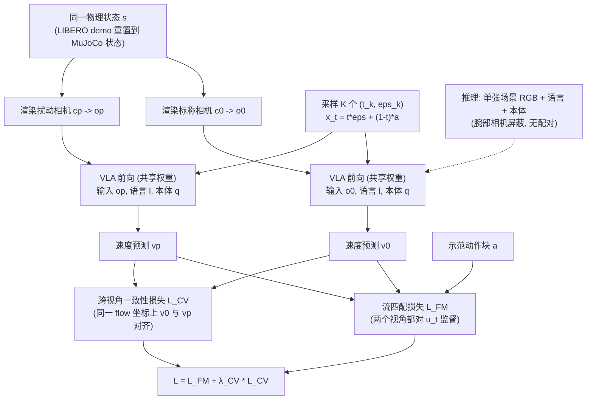

# Cross-View Action Consistency（arXiv:2608.06965）

**Cross-View Action Consistency**（[arXiv:2608.06965](https://arxiv.org/abs/2608.06965)）收录于 [多模空间 · 一周 VLA 研究趋势简析（2026.08.10–08.16）第一篇](../../sources/blogs/wechat_duomo_vla_weekly_trends_2026-08-10_part1.md) **架构模块** 段。

## 一句话定义

**相机鲁棒流式 VLA：仅用场景 RGB+语言+本体，屏蔽腕部相机；对正常与扰动视角渲染同一机器人状态并约束流匹配速度一致，提升未见相机位姿成功率。**

## 英文缩写速查

| 缩写 | 英文全称 | 简要说明 |
|------|----------|----------|
| VLA | Vision-Language-Action | 视觉–语言–动作策略 |
| VLM | Vision-Language Model | 视觉–语言多模态模型 |
| VLN | Vision-Language Navigation | 视觉–语言导航 |
| WAM | World Action Model | 联合未来与动作生成的具身策略 |
| TTT | Test-Time Training | 部署阶段无标注数据的在线适配 |

## 为什么重要

- 相机鲁棒流式 VLA：仅用场景 RGB+语言+本体，屏蔽腕部相机；对正常与扰动视角渲染同一机器人状态并约束流匹配速度一致，提升未见相机位姿成功率。
- 开源状态：**待核实**（步骤 2.5，入库日 2026-09-19）。
- 与 [vla weekly trends 2026 08 10 part1 technology map](../overview/vla-weekly-trends-2026-08-10-part1-technology-map.md) 同批工作可横向对照。

## 流程总览

图依据：论文 §3 / Fig. 2、式 (1)–(6)（推理虚线表示配对与 L_CV 仅用于训练，推理仍走同一 VLA）。

## 核心机制

| 项 | 内容 |
|----|------|
| **arXiv** | [2608.06965](https://arxiv.org/abs/2608.06965) |
| **开源** | **待核实** |
| **文内评测** | LIBERO-Plus；实机 RealMan RM-75 |

## 源码运行时序图

**不适用**（截至入库日未提供可运行官方代码入口，或仓库尚未公开）。

## 实验与评测

- **文内口径：** LIBERO-Plus；实机 RealMan RM-75
- **读法：** 本页为 [公众号策展](../../sources/blogs/wechat_duomo_vla_weekly_trends_2026-08-10_part1.md) 摘要；逐项指标以 **原文 PDF** 为准。

## 与其他工作对比

> 下表只做**定位对照**：本页与下列同批各页均为 [公众号策展](../../sources/blogs/wechat_duomo_vla_weekly_trends_2026-08-10_part1.md) 的索引级摘要，未逐条核对原文实验表，彼此**不共享同一评测协议**，不可据此横比数字。

| 对照 | 差异读法 |
|------|----------|
| [AnyCamVLA](./paper-anycam-vla.md) | 同批同题（未见相机位姿就掉点），**介入时机相反**：本文在**训练期**用「同一机器人状态的正常 / 扰动视角流匹配速度一致」把策略练成视角不敏感，AnyCamVLA 在**测试期**合成新视角把观测搬回训练配置。本文要重训、部署零开销；那边免训、推理多一次合成 |
| [Hermite Curves VLA](./paper-hermite-curves-vla-trajectory-priors.md) | 同批「架构模块」段，同属训练期加约束、部署不加计算一族；差别在约束对象：本文约束**跨视角一致性**，Hermite 约束**轨迹平滑先验** |
| [Diffusion Policy](../methods/diffusion-policy.md) | 本文的一致性约束落在**流匹配速度场**上；该页给这类生成式动作头的机制背景，读「速度一致」需先有 flow / diffusion 动作头这个前提，纯回归动作头搬不过去 |
| [VLA](../methods/vla.md) | 本文刻意**屏蔽腕部相机**、只用场景 RGB + 语言 + 本体；该页给标准输入配置，这一差别本身就是一条可迁移的接口主张——腕部相机越少，视角鲁棒性越成为硬约束 |

## 结论

**Cross-View Action Consistency 适合作为本期「架构模块」路线的快速索引页。**

1. 核心贡献：相机鲁棒流式 VLA：仅用场景 RGB+语言+本体，屏蔽腕部相机；对正常与扰动视角渲染同一机器人状态并约束流匹配速度一致，提升未见相机位姿成功率。
2. 开源结论：**待核实** — 以项目页/仓库实际链接为准。
3. 横向对照见 [技术地图](../overview/vla-weekly-trends-2026-08-10-part1-technology-map.md)，避免与同 arXiv 重复造页。

## 关联页面

- [VLA（Vision-Language-Action）](../methods/vla.md)
- [一周 VLA 趋势技术地图](../overview/vla-weekly-trends-2026-08-10-part1-technology-map.md)
- [Generative World Models](../methods/generative-world-models.md)

## 参考来源

- [wechat_duomo_vla_weekly_trends_2026-08-10_part1.md](../../sources/blogs/wechat_duomo_vla_weekly_trends_2026-08-10_part1.md)
- [arXiv:2608.06965](https://arxiv.org/abs/2608.06965)
- [arXiv PDF](https://arxiv.org/pdf/2608.06965)：已通读方法部分（实验与附录以略读为准）：§1 引言、§3 Cross-View Action-Flow Consistency、§4.1 实验设置、§4.2 主结果

## 推荐继续阅读

- [VLA 方法页](../methods/vla.md)
- [arXiv PDF](https://arxiv.org/pdf/2608.06965)
