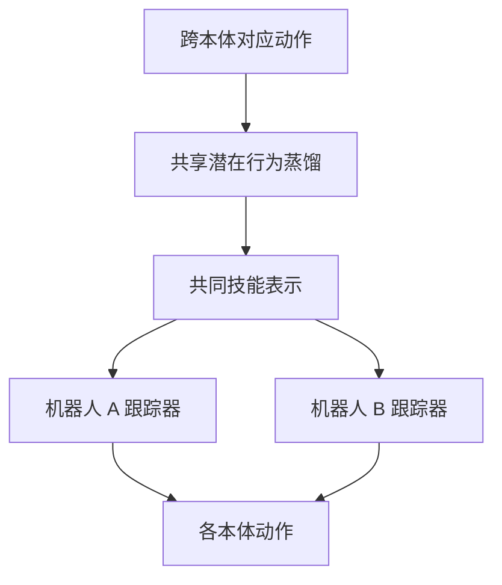

# CrossBFM：跨人形本体蒸馏共享行为空间

**CrossBFM**（*Distilling a Shared Latent Behavior Space Across Humanoid Embodiments*，[arXiv:2609.38087](https://arxiv.org/abs/2609.38087)，[项目页](https://dotandung.github.io/crossbfm/)）研究如何让同一个行为提示在不同人形机器人的潜在动作空间中具有相近含义。

## 一句话定义
对齐不同本体的动作表示，让共享行为提示由每台机器人自己的跟踪控制器落实。

## 英文缩写速查

| 缩写 | 英文全称 | 简要说明 |
|---|---|---|
| BFM | Behavior Foundation Model | 行为基础模型 |
| DoF | Degrees of Freedom | 自由度 |
| FB | Forward-Backward Representation | 用于无监督预训练可执行行为基座的表示学习方法 |

## 为什么重要

现有基于 Forward-Backward 的行为基础模型（BFM）单机预训练需数百 GPU 小时，且跨平台训练会学出互不对齐的私密潜空间；CrossBFM 将潜行为空间本身视为可迁移资产，在不到 **1 GPU 小时** 内利用帧级重定向把多款异构人形对齐到同一个共享提示接口上。

## 流程总览

以下按本页已归纳的机制与资料绘制，表示模块或阅读路径关系。

## 核心原理
- 利用跨本体对应动作蒸馏共享行为编码器。
- 共享的是高层行为表示；各机器人仍保留各自的身体控制器。
- 该设计将跨机器人复用放在行为接口上，而不是直接复制关节命令。

## 与相邻工作

[BFM](./paper-behavior-foundation-model-humanoid.md)讨论人形行为基础模型；CrossBFM进一步处理跨本体表示对齐。本页对应独立论文，不与一般跨本体跟踪工作合并。

## 参考来源

- [CrossBFM 原文精读归档](../../sources/papers/crossbfm_arxiv_2609_38087.md)
- [arXiv:2609.38087](https://arxiv.org/abs/2609.38087)
- [项目页](https://dotandung.github.io/crossbfm/)
- [Day 2 文章来源索引](../../sources/blogs/humanoid_motion_intelligence_day2_locomotion_motion_priors_2026_10_03.md)

## 评测

文章报告三种人形机器人上的动作跟踪、目标到达与奖励提示测试；不同本体的任务设置应回到论文核对。

## 与其他工作对比

与一般跨本体动作跟踪相比，CrossBFM明确蒸馏共享行为空间，各机器人仍使用各自的动作跟踪器。

## 结论

CrossBFM把跨机器人复用放在共享行为表示上，同时让各本体保留自己的低层控制器。

## 工程实践

- **两阶段解耦部署：** Stage 1 采用无机器人专属参数的统一编码器，利用 1/4 数据量即能把冻结源 BFM 潜空间高精度蒸馏给多款新具身；Stage 2 在目标机器人上搭配约 200 Hz 仿真/50 Hz 控制频率的潜条件全身跟踪器落实物理动作。

## 常见误区或局限

- **跨本体泛化仍受帧级运动重定向品质限制：** 若源与目标人形关节比例差异过大导致运动学重定向失真，潜空间对齐后跟踪器仍需额外接触修正。

## 关联页面

- [paper-behavior-foundation-model-humanoid](./paper-behavior-foundation-model-humanoid.md)
- [paper-any2any-cross-embodiment-wbt](./paper-any2any-cross-embodiment-wbt.md)

## 推荐继续阅读

- [arXiv:2609.38087](https://arxiv.org/abs/2609.38087)
- [CrossBFM 项目主页](https://dotandung.github.io/crossbfm/)
