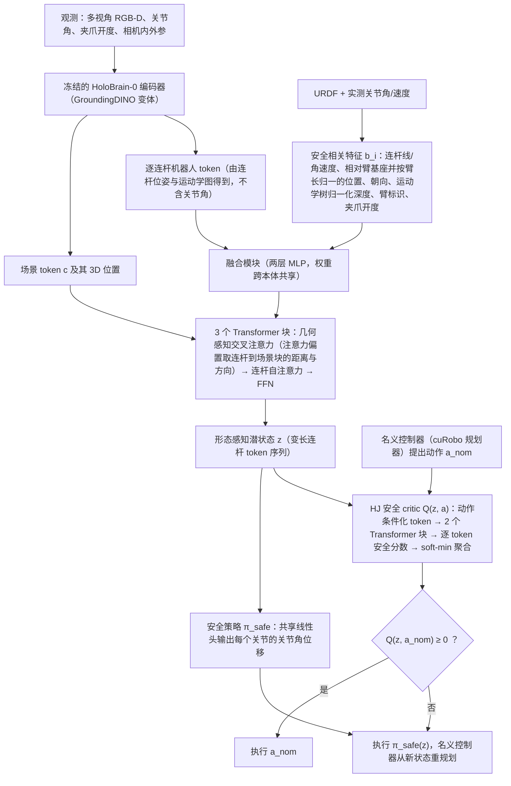

# CrossSafe

**CrossSafe**（*Towards Cross-Embodiment Latent Safety Filters*，[arXiv:2609.28984](https://arxiv.org/abs/2609.28984)，[项目页](https://trustworthyautonomy.github.io/CrossSafe/)）收录自 [具身智能小站 12 篇清单](../../sources/blogs/wechat_embodied_station_12_papers_research_checklist_2026-09-26.md)。

## 一句话定义

**同一末端动作在不同机身上风险不同——CrossSafe 在形态感知 latent 里学安全过滤并做跨本体留一评估。**

## 英文缩写速查

| 缩写 | 英文全称 | 简要说明 |
|------|----------|----------|
| VLA | Vision-Language-Action | 视觉-语言-动作策略 |
| IL | Imitation Learning | 模仿学习 |
| SR | Success Rate | 任务成功率 |
| WM | World Model | 世界模型 |

## 为什么重要

- 纳入 [12 篇具身研究清单](../../wiki/overview/embodied-research-12-papers-technology-map.md) 主线，与同期 VLA / 接触 / 规划 / 安全论文可横向对照。
- 公众号强调的可操作读法：先看 **任务信息需求**（如 PolyUMI 旋灯泡仍以视觉最优）与 **评测口径**（如 Self-Adaptive 多 trial、BeyondRetarget 仿真片段非真机 SR）。
- 开源状态（步骤 2.5）：**待发布**。

## 流程总览

图依据：论文 §IV-A~D（含 Eq.(2)–(10)）、§V-C 在线过滤 Eq.(11) / Fig.1

## 核心信息

| 项 | 内容 |
|----|------|
| **arXiv** | [2609.28984](https://arxiv.org/abs/2609.28984) |
| **项目页** | https://trustworthyautonomy.github.io/CrossSafe/ |
| **代码** | 截至入库日未列 |
| **开源** | **待发布** |

## 实验与评测（公众号口径）

- 指标与消融以 [公众号盘点](../../sources/blogs/wechat_embodied_station_12_papers_research_checklist_2026-09-26.md) 与 **原文 PDF** 为准；本页不复制整表。
- 读复现前先核对：样本规模、是否仿真/真机、是否允许多次 attempt。

## 源码运行时序图

**不适用**（截至 2026-09-26 项目页未提供可运行官方代码仓库；见 [sources/papers/crosssafe_arxiv_2609_28984.md](../../sources/papers/crosssafe_arxiv_2609_28984.md)）。

## 结论

**总判：CrossSafe 适合作为「同一末端动作在不同机身上风险不同——CrossSafe 在形态感知 latent…」方向的入口页；细节以 arXiv 与项目页为准。**

1. 与 [12 篇技术地图](../overview/embodied-research-12-papers-technology-map.md) 对照选型，避免与同名不同 arXiv 的工作混淆（如 RAPID vs RAPID-VLM-RL）。
2. 开源为 **待发布** 时优先从项目页 Code 区核实，再写复现计划。
3. 长程 / 部署类条目（AdaHVLA、HarnessPAI、Self-Adaptive VLA）同时记录 **成功率定义** 与 **失败恢复预算**。

## 与其他工作对比

| 对照 | 差异读法 |
|------|----------|
| [Safety Filter](../concepts/safety-filter.md) | 通用定义：最小修改把名义动作投影回安全集；CrossSafe 用 **Hamilton–Jacobi 可达性** 值函数 + 安全最大化策略实现过滤，并让两者 **跨本体共享** |
| [Control Barrier Function](../concepts/control-barrier-function.md) | 通常按机器人解析设计 $h(x)$；CrossSafe 在 **形态感知 latent** 中做 HJ 可达性分析，安全概念可迁移、同时显式条件化各机身形态与运动学 |
| 共享末端动作空间的通才 VLA | 末端动作空间不刻画「安全依赖形态」——同一动作对一台机身安全、对另一台不安全；这正是 CrossSafe 要补的缺口 |
| 单本体安全过滤 | 每台机器人单独训练；CrossSafe 共 5 本体（Piper、Franka-Panda、ARX-X5、UR5-WSG、Aloha-AgileX）× 5 任务，做 5 折留一本体评测：每折用其余 4 本体 × 5 任务联合训练，**零样本** 迁移到留出本体（依据 arXiv:2609.28984 摘要与 §V）、降低名义策略碰撞率，且训练本体越多泛化越好（摘要口径） |

## 关联页面

- [具身研究 12 篇技术地图](../overview/embodied-research-12-papers-technology-map.md)
- [Manipulation](../tasks/manipulation.md)
- [VLA](../methods/vla.md)

## 参考来源

- [crosssafe 论文归档](../../sources/papers/crosssafe_arxiv_2609_28984.md)
- [公众号 12 篇清单](../../sources/blogs/wechat_embodied_station_12_papers_research_checklist_2026-09-26.md)
- [arXiv PDF](https://arxiv.org/pdf/2609.28984)：已通读方法部分（实验与附录以略读为准）：§III 预备知识（HJ 可达性）、§IV 形态感知潜空间安全过滤（A 至 D）、§V-A/B/C 设定、训练与在线过滤
- 核对（2026-11-02）：对照 arXiv:2609.28984 摘要、引言与 §V-A/B；「四本体×五任务联合训练」补全为 5 本体×5 任务的留一评测（每折 4 本体训练）。

## 推荐继续阅读

- [arXiv:2609.28984](https://arxiv.org/abs/2609.28984)
- [项目页](https://trustworthyautonomy.github.io/CrossSafe/)
