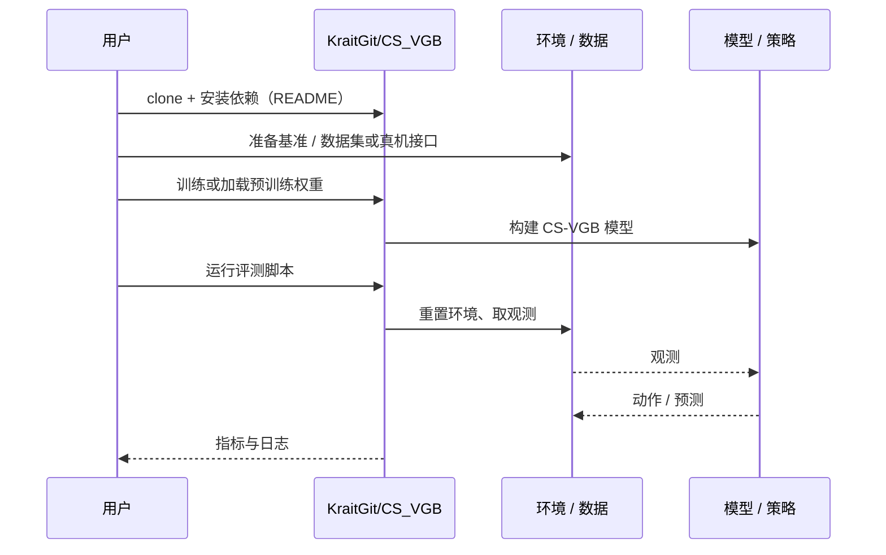

# CS-VGB（arXiv:2610.15281）

**CS-VGB**（*Imperfect Verifiers, Exact Targets: Inference-Time Scaling for Continuous Generation*，[arXiv:2610.15281](https://arxiv.org/abs/2610.15281)，[代码](https://github.com/KraitGit/CS_VGB)）来自 [具身智能小站 2026-10-14 盘点](../../sources/blogs/wechat_embodied_station_41_papers_streamingwam_2026-10-14.md)，属「VLA 与动作生成」组。

## 一句话定义

**通过配对去噪与再加噪的回溯搜索，在验证器有误差时仍保持目标奖励倾斜分布的精确性。**

## 英文缩写速查

| 缩写 | 英文全称 | 简要说明 |
|------|----------|----------|
| VGB | Verifier-Guided Backtracking | 验证器引导回溯（论文方法缩写） |
| ITS | Inference-Time Scaling | 推理期扩展 |
| MRP | Multi-Robot Planning | 多机器人规划 |

## 为什么重要

- 推理期用验证器引导连续生成时，验证器误差会把采样分布推离目标；需要有保证的搜索规则。
- 开源结论：**已开源**（步骤 2.5，2026-10-14）。仓库可达。
- 同期同组工作见 [流式动作块与世界模型记忆：具身智能小站 10-14 期 41 篇阅读坐标](../overview/embodied-station-2026-10-14-41-papers-technology-map.md)。

## 核心机制

| 项 | 内容 |
|----|------|
| **arXiv** | [2610.15281](https://arxiv.org/abs/2610.15281) |
| **开源** | **已开源** |
| **要点** | 搜索在去噪/再加噪配对转移上进行；理论保证依赖其转移与正则条件；除图像外测试多机器人规划。 |
| **文内指标** | 图像生成与多机器人规划实验；数值以原文为准。 |

## 源码运行时序图

以下为按仓库入口（`KraitGit/CS_VGB`）推断的通用运行链路；入库日仅核实仓库可达，未逐文件阅读，具体脚本名以 README 为准。

## 实验与评测

- 图像生成与多机器人规划实验；数值以原文为准。
- **读法：** 本页为索引级摘要，依据公众号转述的官方摘要与仓库信息整理；逐项数字与 baseline 以原文 PDF 为准。

## 与其他工作对比

- 横向索引见 [流式动作块与世界模型记忆：具身智能小站 10-14 期 41 篇阅读坐标](../overview/embodied-station-2026-10-14-41-papers-technology-map.md)；同 arXiv 不重复造页。

## 结论

**推理期扩展不等于贪心选高分样本；配对转移 + 回溯能在不完美验证器下保住目标分布。**

1. 开源边界：**已开源** — 仓库可达。
2. 核心机制：搜索在去噪/再加噪配对转移上进行；理论保证依赖其转移与正则条件；除图像外测试多机器人规划。
3. 复现与选型前核对任务协议、硬件与基准口径，勿直接横比公众号摘录数字。

## 关联页面

- [diffusion-model](../concepts/diffusion-model.md)
- [marl](../methods/marl.md)
- [trajectory-optimization](../methods/trajectory-optimization.md)
- [embodied-station-2026-10-14-41-papers-technology-map](../overview/embodied-station-2026-10-14-41-papers-technology-map.md)

## 参考来源

- [cs_vgb_inference_time_scaling_arxiv_2610_15281.md](../../sources/papers/cs_vgb_inference_time_scaling_arxiv_2610_15281.md)
- [wechat_embodied_station_41_papers_streamingwam_2026-10-14.md](../../sources/blogs/wechat_embodied_station_41_papers_streamingwam_2026-10-14.md)
- [arXiv:2610.15281](https://arxiv.org/abs/2610.15281)

## 推荐继续阅读

- [arXiv PDF](https://arxiv.org/pdf/2610.15281)
- [https://github.com/KraitGit/CS_VGB](https://github.com/KraitGit/CS_VGB)
