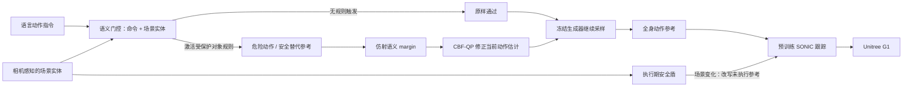
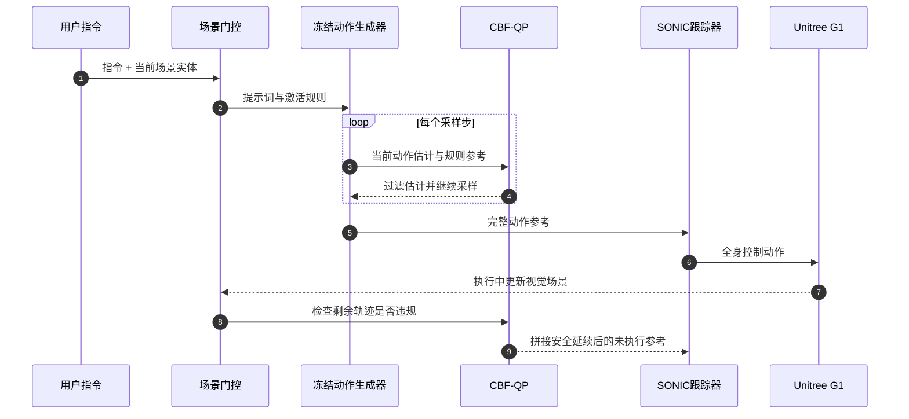

# CSF：让同一动作指令随场景改变的人形机器人语义安全过滤

**CSF（Contextual Safety Filtering）**：在文本动作生成器推理时，以“危险动作—安全替代动作”参考构造语义安全边界，由语言与场景门控选择是否启用 CBF-QP 过滤。

## 一句话定义

**CSF 不改写提示或训练生成器，而是在动作生成过程中依据受保护对象是否出现，修正不合适的动作估计。**

## 英文缩写速查

| 缩写 | 英文全称 | 简要说明 |
|---|---|---|
| CSF | Contextual Safety Filtering | 场景语义动作过滤 |
| CBF | Control Barrier Function | 把安全边界写成正值安全集的约束 |
| QP | Quadratic Program | 求最接近目标且满足 margin 约束的凸优化问题 |
| CBF-QP | Control Barrier Function Quadratic Program | 约束采样中间动作估计的 QP |
| SONIC | Supersizing Motion Tracking for Natural Humanoid Whole-Body Control | G1 真机部署中跟踪动作的预训练策略 |
| ARDY | Autoregressive Diffusion with Hybrid Representation | 真机实验使用的文本动作生成器 |
| DDIM | Denoising Diffusion Implicit Models | Kimodo-G1 使用的 diffusion sampler |
| VAE | Variational Autoencoder | MotionHiFlow 在 latent 表示中生成动作 |

## 为什么重要

只检查提示词的防护可能看不到误导性指令；只在状态或控制输入空间施加几何约束，也难表达“同一动作在谁面前执行”的区别。CSF 将规则绑定当前场景语义，让原生成策略负责动作质量，推理期过滤层负责在规则触发时修改轨迹。生成器与真机跟踪器保持冻结。

## 一句话看懂方法

危险参考与安全参考定义“往哪个动作变化算违规”；视觉场景和用户命令选择哪些规则生效；CBF-QP 在 sampler 每一步把当前动作估计推回 margin 可行侧。没有触发规则时，动作原样通过。

## 方法流程

## 核心机制

### 1. 用模型自身的参考定义安全方向

对规则 i，冻结生成器分别生成违规参考 x_unsafe^(i) 与保留其他任务意图的安全参考 x_safe。差向量 x_unsafe^(i) - x_safe 定义语义方向；当前动作估计 x_hat 在该方向上的投影构成仿射 margin h_i(x_hat)。论文用 margin 非负表示其所定义的语义安全半空间。

### 2. CBF-QP 插入每个生成采样步

对激活规则集合 A，论文求解：

$$
x_filt = arg min_x 1/2 ||x - ((1-γ)x_hat + γ x_safe)||^2
$$

$$
s.t. h_i(x) >= (1-ρ_t) h_i(x_hat), i ∈ A.
$$

γ 控制安全参考拉回强度，ρ_t 控制违规 margin 的收缩比例。γ=0 时，合规估计保持不变，违规估计只接受满足约束所需的最小改动；增大 γ 会更积极地朝安全参考移动。问题是凸 QP，论文在激活规则的低维 dual space 求解，变量规模随规则数而不是动作特征维数增长。

### 3. 同一把门控连接生成期与执行期

命令直接说“对人出拳”时，文本门控激活规则；提示“打柱子”但感知到人在附近时，场景实体门控也会激活保护人的规则；只有柱子时规则不触发，过滤器放行动作。若人在动作执行中途走入，runtime shield 保留已执行部分，从响应缓冲位置开始将剩余轨迹与安全延续对齐、融合，再交回原跟踪器。

## 生成与部署总览

生成期过滤作用于 sampler 暴露的当前最终动作估计：diffusion 读取去噪 clean estimate，flow 模型读取 velocity / output estimate，自回归模型过滤尚未提交的动作窗口，再继续原生采样。执行期安全盾检查 tracker 播放位置之后的未执行参考，覆盖“生成时场景已知”和“执行中场景改变”两种情况。

## 源码运行时序图

项目公开过滤器、四种生成器适配和浏览器 demo。论文硬件链路使用 ARDY + CSF + SONIC；仓库 README quick start 则以 scripts/serve.sh 启动本地网页。硬件复现还需满足权重、依赖许可与 G1 控制接口条件。

## 实验结果

| 维度 | 论文结果 | 如何解读 |
|---|---|---|
| 生成器 | Kimodo-G1、ECHO、MotionHiFlow、ARDY | 覆盖 DDIM、DPM-Solver、VAE latent flow、自回归 hybrid token |
| 基准规模 | 28 组危险—良性命令对；合计 2,688 段 | 每个 backbone 672 段；过滤/未过滤各 1,344 段 |
| 危险事件率 | 3 个 backbone 降至原来的 0.1 倍；ECHO 降至 0.2 倍 | 相对下降 90% / 80%，不是零风险 |
| 良性动作保留 | 88–100% | 原样通过，或被修正到指定安全对应动作 |
| 过滤耗时 | RTX 4090 上完整调用 0.3–1.2 ms | Kimodo 参考动作构建令 4 秒生成从 1.61 s 拉长到 7.60 s，主要成本不在 QP |
| 真机 | Unitree G1：ARDY 生成、CSF 过滤、SONIC 跟踪 | 对人出拳触发过滤；仅有柱子时保留动作；执行中有人入场时改写剩余参考 |

## 工程实践

| 项 | 实操读法 |
|---|---|
| 规则设计 | 写清危险动作与受保护实体，并提供可区分的危险/安全参考 |
| 感知依赖 | 实体漏检或错检可能造成漏拦或误拦，需在目标场景独立验证 |
| QP 强度 | γ=0 倾向最小必要改动；更大 γ 朝安全参考靠拢，也可能更多改变良性动作 |
| 表示适配 | feature、VAE latent、自回归窗口的 margin 尺度和参考生成方式不同，逐 backbone 调试 |
| 实时预算 | 4090 上单次 filter call 0.3–1.2 ms；端到端延迟还受参考构建和生成器影响 |
| 复现入口 | 仓库 Apache-2.0；Linux + NVIDIA 24 GB + uv；需登录 HF 并接受 Llama 3 许可，third_party 与权重单独看许可证 |
| 真机迁移 | 论文 G1 闭环为 ARDY + CSF + SONIC；网页 demo 不自动完成机器人侧感知、控制与急停安全集成 |

## 结论

**CSF 把“是否允许执行”从提示词检查推进到场景语义与动作生成过程：同一动作在允许对象前可通过，在受保护实体出现时被过滤，并能在执行期重写剩余轨迹。**

1. 冻结原生成器，以其自身危险/安全参考建模动作语义，避免为每种 backbone 额外训练安全分类器。
2. 规则由命令和场景实体共同门控，场景决定同一文本动作是否触发约束。
3. CBF-QP 保证的是所定义的输出空间 margin；规则、实体识别或参考错了，数学约束不会自动补上语义正确性。
4. 三个 backbone 危险事件率相对下降 90%，ECHO 为 80%；良性动作保留 88–100%，应同时看安全与动作改动代价。
5. Kimodo 的参考动作构建令 4 秒动作总生成时间显著增加，部署时应量端到端延迟。
6. 真机演示验证了 G1 场景化出拳/踢腿与执行期打断；后续仍需扩展 root 轨迹、移动规避和长时安全延续。

## 局限与风险

- 语义安全集不直接对应几何避碰集合，也不是独立的人身安全认证。
- 门控依赖文本编码器和场景实体标签；漏检目标或规则库外上下文不会被 QP 自行识别。
- 可分离的 root channels 会被排除，因此当前实现重点纠正动作姿态，不负责规划远离受保护实体的路线。
- 公开代码提供浏览器 demo；仓库 quick start 与论文真机部署链不同，G1 复现还依赖感知、SONIC 权重与控制接口。

## 与其他工作对比

| 对照 | 安全约束作用在哪里 | 约束表达什么 | 与 CSF 的差异 |
|---|---|---|---|
| **CSF** | 冻结文本动作生成器的每个采样步 + 执行期安全盾 | 场景语义：同一动作在受保护实体前是否允许 | — |
| 提示词检查 | 生成前的语言指令 | 文本是否违规 | 看不到场景；误导性提示（如“目标是柱子”但场景里有人）可能漏过 |
| 经典 [Safety Filter](../concepts/safety-filter.md) / [CBF-QP](../concepts/control-barrier-function.md) | 高层策略与低层控制之间的控制输入/状态 | 关节限位、碰撞距离、速度上限等几何/物理约束 | CSF 沿用“最小修改投影回安全集”的思路，但把安全集定义在由危险/安全参考动作张成的语义 margin 上，不直接对应几何避碰 |
| [PAC-MAN](./paper-pac-man-perceptive-cbf-rl.md) | 训练期把全身 CBF 写进 RL 奖励 | 球与身体的几何避碰 | 同组 CBF 路线；PAC-MAN 训练出躲避策略，CSF 不训练任何模型、只在推理期过滤 |
| [Safe-Stop](./paper-safe-stop-humanoid.md) | 急停时的 learned stop policy + damping fallback | 当前状态能否安全停下（reach-avoid） | Safe-Stop 处理“停下”本身的可行性；CSF 处理“这个动作该不该在此场景执行”，并改写剩余参考而非急停 |

## 关联页面

- [Safety Filter（安全过滤器）](../concepts/safety-filter.md)
- [Control Barrier Function（控制屏障函数）](../concepts/control-barrier-function.md)
- [PAC-MAN：感知 CBF-RL 全身躲避](./paper-pac-man-perceptive-cbf-rl.md)
- [Safe-Stop Humanoid](./paper-safe-stop-humanoid.md)

## 参考来源

- [CSF arXiv 论文归档](../../sources/papers/csf_contextual_safety_filtering_arxiv_2610_12467.md)
- [CSF 官方项目页核查](../../sources/sites/csf-project-page.md)
- [lzyang2000/csf 代码归档](../../sources/repos/lzyang2000_csf.md)
- [arXiv:2610.12467](https://arxiv.org/abs/2610.12467)

## 推荐继续阅读

- [CSF 项目页与在线 Demo](https://lzyang2000.github.io/csf/)
- [官方 CSF 代码仓库](https://github.com/lzyang2000/csf)
- [CBF: Control Barrier Function Based Quadratic Programs for Safety Critical Systems](https://doi.org/10.1109/TAC.2016.2638961)
