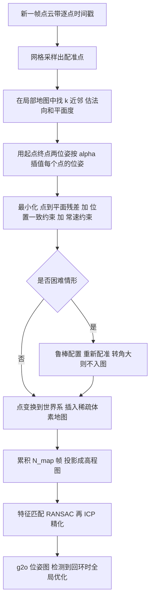

# CT-ICP：弹性连续时间激光里程计（arXiv:2109.12979）

**CT-ICP**（*CT-ICP: Real-time Elastic LiDAR Odometry with Loop Closure*，Dellenbach、Deschaud、Jacquet、Goulette，MINES ParisTech 与 Kitware，[arXiv:2109.12979](https://arxiv.org/abs/2109.12979)）。本页依据 arXiv v1 全文整理，核对记录见 [原文归档](../../sources/papers/ct-icp_arxiv_2109_12979.md)。

> 命名说明：综述《激光雷达 SLAM 算法最新综述》写作「CP-ICP」，其描述（弹性、带回环、帧内连续帧间不连续、对高频剧烈运动更鲁棒）与本论文逐条吻合，判断为 CT-ICP 的笔误（CT 即 Continuous-Time）。这是依据内容的判断，原文没有提 CP-ICP 这个名字。

## 一句话定义

把每一帧激光点云的位姿参数化为「帧起点位姿 + 帧终点位姿」，按点的时间戳在两者之间插值来边优化边去畸变；相邻两帧之间不强求位姿连续，只用软约束拉近，从而吸收传感器的高频抖动（作者自述，论文 I、III-A）。

## 英文缩写速查

| 缩写 | 英文全称 | 简要说明 |
|------|----------|----------|
| CT-ICP | Continuous-Time Iterative Closest Point | 本文方法：连续时间（帧内）的 ICP 配准 |
| ICP | Iterative Closest Point | 迭代最近点点云配准 |
| LiDAR | Light Detection and Ranging | 激光雷达 |
| SLAM | Simultaneous Localization and Mapping | 同步定位与建图 |
| RTE | Relative Translation Error | KITTI 相对平移误差，按 100 至 800 m 路段平均 |
| ATE | Absolute Trajectory Error | 绝对轨迹误差，回环评估用 |
| LC / LO | Loop Closure / LiDAR Odometry | 回环 / 激光里程计 |
| PG | Pose Graph | 位姿图，本文用 g2o 实现 |
| SE(3) | Special Euclidean group | 三维刚体位姿（旋转加平移） |
| slerp | Spherical Linear Interpolation | 旋转的球面线性插值 |

## 为什么重要

- 多数激光里程计（F-LOAM、MULLS、IMLS-SLAM）先用常速模型给整帧去畸变，再在 ICP 迭代中保持畸变不变；论文指出这对突然转向或快速加减速不够稳（II、I）。
- 连续时间轨迹方法（Elastic LiDAR Fusion、MARS 等）用样条或线性插值保证轨迹连续，作者认为这会把抖动平滑掉（II）。CT-ICP 折中：帧内连续、帧间不连续。
- 作者报告在手持 / Segway 等不稳平台上显著好于对照（见下「实验」），并在 KITTI 榜单公开代码方法里取得第一（摘要，作者自述，榜单排名随时间会变）。

## 核心原理与方法栈

### 流程总览

### 目标函数（论文 III-A，式 1 至 8）

- 变量：X = (Ω_b, Ω_e) ∈ SE(3)²。
- 目标：F_ICP(X) + β_l·C_loc + β_v·C_vel。F_ICP 为点到平面残差经鲁棒核 ρ 的均值，并乘平面度权重 a_i = (σ2 − σ3)/σ1（沿用 IMLS-SLAM）。
- 点位姿：旋转 slerp，平移线性插值，插值比例 α_i = (τ_i − τ_b)/(τ_e − τ_b)。
- C_loc = ‖t_b − t_e^{n−1}‖²：本帧起点位置靠近上一帧终点位置，限制帧间不连续的幅度。
- C_vel：本帧的位移向量靠近上一帧的位移向量，限制过快的加速度。β_l = β_v = 0.001。

### 局部地图与鲁棒配置（III-B）

- 稀疏体素哈希存稠密点云，邻域访问为常数时间；每体素至多 20 点、点间距不小于 10 cm；体素边长驾驶 1.0 m、高频运动 0.80 m。法向和平面度由地图邻域计算，而非当前帧。
- 鲁棒配置：检测到快速转向或配准失败（位置不一致、大量新点落入空体素）时，用更保守的参数重配准；朝向变化 ≥5° 的帧不入图。作者自述代价是运行时间变长。

### 回环与后端（IV）

- 累积 N_map 帧成局部地图，投影为高程图（每格取最大高程，高度裁剪到 z_min 至 z_max），提取旋转不变 2D 特征，RANSAC 估 2D 刚体变换，内点数过阈值才接受，再用 Open3D ICP 精化出 6 自由度约束；候选取最近的 10 个；后端为 g2o 位姿图，只有检测到回环才全局优化。
- 实验设置 N_map = 100，N_overlap = 30，z_max = z_min + 10 m（V-C）。

## 实验（论文 V，作者自述）

| 数据集 | CT-ICP 平均 RTE | 对照（同表） | 出处 |
|--------|----------------|--------------|------|
| KITTI-corrected（已运动校正） | 0.53%，60 ms/帧 | IMLS-SLAM 0.55%，MULLS 0.55%，pyLiDAR F2M 0.53% | Table I |
| KITTI-raw（未校正） | 0.55%，65 ms | IMLS-SLAM 0.71%，MULLS 1.41%，F2M 1.61% | Table I |
| KITTI-360 | 0.45%，70 ms | IMLS-SLAM 0.68%，MULLS 1.55%，F2M 1.46% | Table I |
| KITTI-CARLA | 0.09% | IMLS-SLAM 0.81%，MULLS 1.04%，F2M 23.84% | Table I |
| NCD | 0.55%，430 ms | F2M 2.20% | Table I |
| NCLT 2012-01-08 | 1.17%，180 ms | F2M 19.80% | Table I |

- 消融（V-B）：把弹性换成纯常速去畸变，KITTI-raw 0.55% 变 0.79%，KITTI-360 0.45% 变 0.60%。
- 回环（V-C，Table II）：KITTI-360 00 的 ATE 由 29.87 降到 1.07 m；KITTI-CARLA Town01 和 NCD 01 回环后 ATE 略增。
- 注意：在已运动校正的 KITTI-corrected 上与对照持平，论文自己说明这时弹性公式用不上（V-B）。

## 工程实践

- 输入只需要 xyz 加每点时间戳；KITTI-raw 与 KITTI-360 没有逐点时间戳，作者按方位角线性估计（V）。时间戳质量因此直接影响效果（推测：时间戳不准时弹性项收益会打折，论文未测）。
- 驾驶与高频运动用两套参数配置（体素 1.0 m 对 0.80 m 等），论文强调驾驶数据集共用一套参数（V-B）。
- 工程上里程计与回环是分开的：C++ 里程计仓库加 Python 的 pyLiDAR-SLAM 做回环和位姿图。仓库内容本次未核实。
- 与本库其他激光 SLAM 的关系：它是纯激光、无 IMU 的 scan-to-map 路线，与 [FAST-LIO](./fast-lio.md)、[LIO-SAM](./lio-sam.md) 这类紧耦合 IMU 方案并列；融合思路见 [激光里程计融合](../methods/lidar-odometry-fusion.md)。

## 局限

论文自己承认的：

- 回环部分要求传感器运动基本为地面平面运动，且外参需使 z 轴对齐地面法向，限制了可用的传感器安装和运动（IV）。作者指出已知重力向量或局部地面时可以缓解，但没有实现。
- 回环平均每次 1.1 s，位姿图优化平均 1.2 s，当前在主线程运行，不是实时完整 SLAM；多线程化是论文的设想（V-C）。
- 鲁棒配置以运行时间为代价（III-B）。
- 作者在结论里承认后端还没有把连续时间公式扩展到扫描匹配之外（VI）。

我看到的未验证之处（判断）：

- 评测只有激光，不含 IMU 融合对比；对照方法只有 MULLS、IMLS-SLAM、pyLiDAR F2M 三个，没有 LOAM 系或 LIO 系的直接对比。
- 回环评估每个数据集只取一条序列（Table II），且 KITTI-CARLA 与 NCD 上回环后 ATE 没有改善；回环对一般 3D 场景的泛化无证据。
- KITTI 榜排名是投稿时的状态，现在的榜单需另行查证。
- 会议版本信息（任务说明称 ICRA 2022）本次读的 v1 里没有，未核实。

## 与综述说法的对照

综述原话：「一种弹性的带回环的激光雷达里程计算法，考虑帧内数据连续性和帧间数据非连续性，对高频剧烈运动更鲁棒；回环检测部分约束过多，限制了传感器的运动」。

- 名称写作「CP-ICP」应为 CT-ICP（判断）。
- 前半句与论文一致（I、III-A、V）。
- 「约束过多」是综述的措辞；论文本身写的是回环模块要求地面平面运动与 z 轴对齐地面法向（IV），会限制传感器配置和运动，方向一致，但论文用词是「requires」「limits」，不是「约束过多」。
- 综述没有提到回环是挂在 pyLiDAR-SLAM 里的独立 Python 模块、且当前并非实时。

## 与其他工作对比

| 工作 | 关注点 | 与 CT-ICP 的区别 |
|------|--------|------------------|
| IMLS-SLAM / MULLS（Table I 对照） | 先用常速模型整帧去畸变，再做 scan-to-model 配准 | ICP 迭代中畸变不变；KITTI-raw 上 RTE 0.71% / 1.41%，CT-ICP 0.55%（Table I） |
| [LOAM](./paper-loam-lidar-odometry-and-mapping.md) | 边缘 / 平面特征配准，sweep 内匀速插值去畸变 | 特征点路线且无回环；CT-ICP 用稠密点到面配准，帧内起止双位姿联合优化，论文未直接与 LOAM 比较 |
| [DLO](./paper-dlo-direct-lidar-odometry.md) | 稠密点云 + GICP 的轻量前端 | 同为不提特征的稠密配准，但无连续时间位姿、无回环 |
| [FAST-LIO](./fast-lio.md) | 迭代卡尔曼滤波紧耦合 IMU | 用 IMU 解决畸变与高频运动；CT-ICP 纯激光，靠弹性位姿吸收抖动 |

## 结论

**CT-ICP 用「帧内连续、帧间不连续」的双位姿参数化，把去畸变放进配准优化，在未校正与高频运动数据上明显优于常速去畸变方法。**

1. KITTI-raw / KITTI-360 / KITTI-CARLA 平均 RTE 0.55% / 0.45% / 0.09%，均优于 IMLS-SLAM、MULLS、F2M（Table I）。
2. 消融显示弹性是收益来源：换回常速去畸变后 KITTI-raw 0.55% → 0.79%（V-B）；在已校正数据上则无优势。
3. 高程图回环让 KITTI-360 00 的 ATE 从 29.87 m 降到 1.07 m，但另两条序列回环后略增（Table II）。
4. 局限：回环要求平面运动与 z 轴对齐，回环与位姿图在主线程运行不实时，对照方法少且无 LIO 系比较。

## 关联页面

- [LeGO-LOAM](./lego-loam.md)
- [LIO-SAM](./lio-sam.md)
- [FAST-LIO](./fast-lio.md)
- [LVI-SAM](./paper-lvi-sam.md)
- [Point-LIO](./point-lio-unilidar.md)
- [Cartographer](./cartographer.md)
- [激光里程计融合](../methods/lidar-odometry-fusion.md)
- [状态估计](../concepts/state-estimation.md)
- [激光雷达感知](../concepts/lidar-sensing.md)

## 参考来源

- [ct-icp_arxiv_2109_12979.md](../../sources/papers/ct-icp_arxiv_2109_12979.md)
- [arXiv:2109.12979](https://arxiv.org/abs/2109.12979)
- 代码（未核实）：[jedeschaud/ct_icp](https://github.com/jedeschaud/ct_icp)、[Kitware/pyLiDAR-SLAM](https://github.com/Kitware/pyLiDAR-SLAM)

## 继续阅读

- [arXiv PDF v1](https://arxiv.org/pdf/2109.12979v1)
- [激光里程计融合](../methods/lidar-odometry-fusion.md)
- [LIO-SAM](./lio-sam.md)
