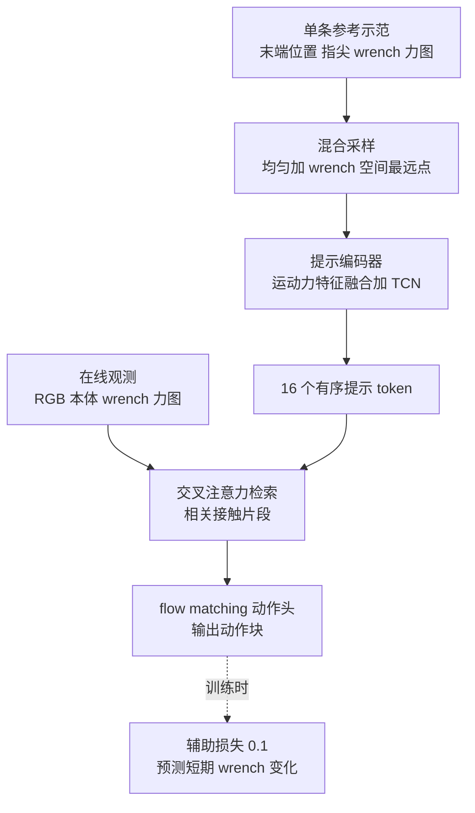
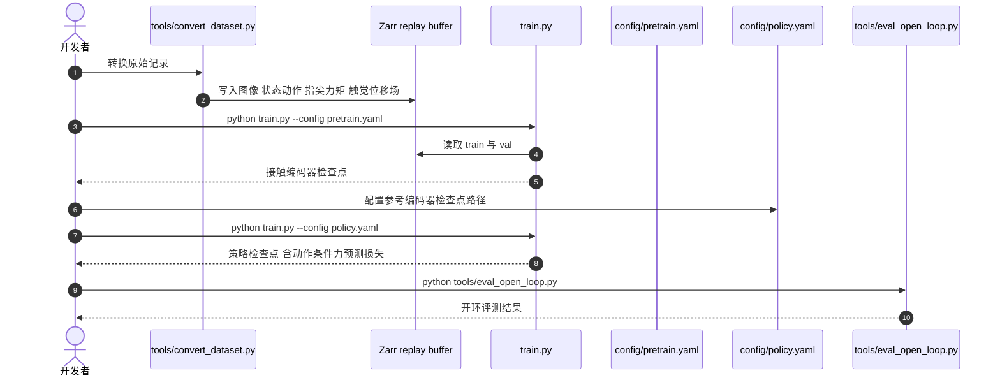

# CTP：用一条示范的接触轨迹当提示

**Contact Trajectory Prompting（CTP）把一条示范里的运动和接触变化（指尖力矩、力图）编成一串有序提示 token，让冻结参数的策略在线用接触反馈去检索相关片段，从而在新物体上复现该示范隐含的力度与接触模式。**

论文 *Contact Trajectory Prompting: In-Context Transfer of Contact-Rich Behaviors from a Single Demonstration*（[arXiv:2610.18848](https://arxiv.org/abs/2610.18848)，[代码](https://github.com/ctp-robotics/CTP)，[项目页](https://ctp-robotics.github.io/project_page/)）。

## 英文缩写速查

| 缩写 | 英文全称 | 简要说明 |
|------|----------|----------|
| CTP | Contact Trajectory Prompting | 本文方法：示范接触轨迹作为提示 |
| BPP* | 论文中的最强提示类基线 | 全称与实现细节本页未核实 |
| F/T | Force/Torque | 六轴力 / 力矩传感器，装在每个指尖 |
| DP-FT / π0.5-FT | Diffusion Policy / π0.5 fine-tuned | 对照基线，需针对任务微调（具体设置未核实） |
| TCN | Temporal Convolutional Network | 提示编码器里把运动与力特征压成 16 个 token 的时序卷积 |

## 为什么重要

- 只看位置轨迹分不清「轻擦」与「重擦」：外观相近的动作需要的力度与接触模式不同，必须把接触强度及其时序演化放进提示。
- 换一条参考示范就换一种行为，策略参数不用更新，部署侧只需录一条新示范。
- 论文的证据是：只换示范就改变擦拭力度和旋转方向，说明接触轨迹可以充当物理交互行为的规格说明。

## 核心信息

| 项 | 内容 |
|----|------|
| **机构** | 论文页与 HTML 版均未列单位，**未核实** |
| **平台** | 7 自由度 xArm7，每个指尖带触觉与六轴 F/T 传感器 |
| **任务** | 擦拭、拧瓶盖（旋转）、插入；每族 3 个未见实例，每实例 12 次 |
| **开源** | **已开源（训练代码）**，2026-10-17 核查：[ctp-robotics/CTP](https://github.com/ctp-robotics/CTP)；许可证、权重、真机数据未显示；项目页文本未列代码链接 |

## 核心原理

### 流程总览

- **提示编码器预训练：** 以重建示范为目标，并随机遮挡指尖，增强对缺失传感器的稳健性。
- **策略：** 在线观测通过交叉注意力查询提示，flow matching 头生成动作块；参数在测试时冻结。
- **在线接触是关键：** 去掉在线接触信息后，±2 cm 高度偏移下的成功率从 95.8% 降到 20.8%。

## 源码运行时序图

仓库提供训练与开环评测入口，未见真机运行脚本。时序对齐 README 命令与根目录结构，内部模块调用未逐文件核实。

- **复现路径：** 数据转 Zarr → 预训练接触编码器 → 训练策略 → 开环评测。仓库附合成数据 CPU smoke test，可先验证流程。

## 工程实践

| 项 | 建议 |
|----|------|
| 硬件前提 | 需要每个指尖的触觉 + F/T 与力图；没有这些传感器无法套用论文设置 |
| 示范选择 | 每个测试物体需要一条匹配的参考示范；示范决定力度与方向，选错则行为随之改变 |
| 先跑通 | 先用 smoke test 验证两阶段训练配置，再接自有 Zarr 数据 |
| 评测口径 | 开环评测不等于真机闭环成功；真机 12 次 / 实例的规模很小 |
| 源码运行时序图 | 见上；真机推理脚本仓库未见（未核实） |

## 实验与评测

- **总体（未见物体、一次示范）：** CTP 78.7%；BPP* 65.7%；DP-FT 40.7%；π0.5-FT 37.0%；领先最强基线 13.0 个百分点。
- **只换示范改行为：** 轻 / 重擦拭 CTP 91.7% / 83.3%（BPP* 75.0% / 58.3%）；顺 / 逆时针拧盖 CTP 均 100%。
- **插入最弱：** 实例 C 上 CTP 33.3%，低于 BPP* 的 41.7%。
- **消融：** 位置提示（CTP-P）不能保持轻-中-重强度顺序；均值池化在扰动下 38.9%，交叉注意力 94.4%；预训练编码与交叉注意力检索都有贡献。

## 结论

**CTP 证明了接触信息写进提示后，一条示范就能指定「怎么接触」，但它依赖带力觉 / 触觉的硬件与逐物体一条示范，插入类任务尚未稳定。**

1. **接触不可省** — 位置提示不能保持力度顺序；去掉在线接触，高度偏移下 95.8%→20.8%。
2. **示范即规格** — 换示范即改变力度或方向，部署时要把「选哪条示范」当作控制接口。
3. **优势集中在擦拭与旋转** — 插入实例 C 33.3% 输给 BPP* 的 41.7%，高精度几何对准不是它的强项（推测：提示只编码接触不编码几何）。
4. **不是零示范** — 每个测试物体都要一条示范，只是不微调参数。
5. **规模偏小** — 3 个任务族、9 个未见实例、每实例 12 次，结论需要更多重复。

## 与其他工作对比

| 对照 | 差异读法 |
|------|----------|
| [机器人上下文学习](../concepts/robot-in-context-learning.md) | 同属示范即提示；CTP 的提示是接触轨迹而非视觉轨迹 |
| [接触丰富操作](../concepts/contact-rich-manipulation.md) | 任务背景；CTP 用示范指定接触强度，而非手工阻抗参数 |
| [视触觉融合](../concepts/visuo-tactile-fusion.md) | 同样用触觉 / 力觉；CTP 把它用于提示编码与检索 |
| DP-FT / π0.5-FT | 需针对任务微调参数，未见物体上 40.7% / 37.0% |
| BPP* | 论文最强基线 65.7%；具体机制本页未核实 |

## 局限与风险

- **硬件门槛：** 指尖触觉 + F/T + 力图，复现成本高。
- **示范依赖：** 每个目标物体需一条匹配示范。
- **插入表现不稳：** 实例 C 仅 33.3%。
- **样本规模：** 每实例 12 次。
- **作者展望：** 论文未设专门局限节，结论称未来将扩展到更多任务、更丰富的时序交互与其他平台。
- **开源边界：** 仓库有训练与开环评测；权重、许可证、真机脚本未核实（2026-10-17）。

## 关联页面

- [机器人上下文学习](../concepts/robot-in-context-learning.md) — 示范作为提示的范式
- [接触丰富操作](../concepts/contact-rich-manipulation.md) — 任务背景
- [视触觉融合](../concepts/visuo-tactile-fusion.md) — 触觉输入处理
- [Flow matching 具身策略](../concepts/flow-matching-embodied-policy.md) — 动作头的方法族

## 参考来源

- [ctp_arxiv_2610_18848.md](../../sources/papers/ctp_arxiv_2610_18848.md) — 论文摘录与开源核查
- [ctp-project.md](../../sources/sites/ctp-project.md) — 项目页归档
- [ctp.md](../../sources/repos/ctp.md) — 官方仓库归档
- [arXiv:2610.18848](https://arxiv.org/abs/2610.18848) — 原文

## 推荐继续阅读

- [CTP 项目页](https://ctp-robotics.github.io/project_page/)
- [CTP 官方仓库](https://github.com/ctp-robotics/CTP)
