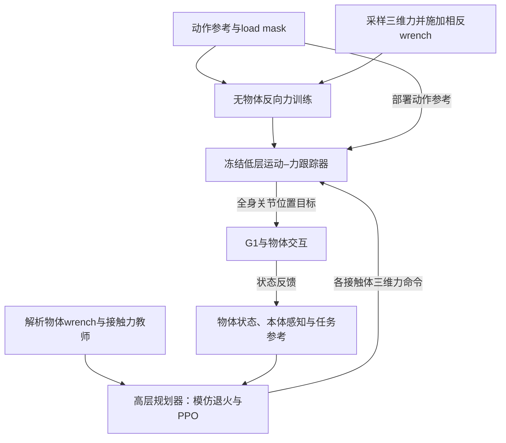

# Ctrl-F: Force as an Interface for Humanoid Loco-Manipulation / 力作为人形机器人运动与操作的接口

## 一句话定义

Ctrl-F让动作参考负责身体如何移动，让每个指定接触体的三维力命令表达如何用力，再根据物体运动反馈在线调节命令。

## 英文缩写速查

| 缩写 | 英文全称 | 简要说明 |
|---|---|---|
| PPO | Proximal Policy Optimization | 优化高层任务结果 |
| BC | Behavior Cloning | 模仿解析教师的力命令 |
| PD | Proportional-Derivative | 解析物体控制中的反馈项 |
| DAgger | Dataset Aggregation | 在当前策略访问状态查询教师的思想来源 |

## 为什么重要

相同动作作用于不同载荷时需要不同接触力。单纯跟踪姿态或提供接触标签无法显式表达推多大力、握多紧；这里的力既有方向又有大小，并作为高低层之间的连续接口。

## 核心信息

| 字段 | 内容 |
|---|---|
| 机构 | 加利福尼亚大学伯克利分校（University of California, Berkeley） |
| 作者 | Mengjie Zhao、Yuxin Chen（共同一作）、Yiyang Shao、Chuye Hong、Jiakang Chen、Koushil Sreenath、Masayoshi Tomizuka |
| 版本 | arXiv:2611.05507v1，2026-11-03，预印本 |
| 平台 | Unitree G1；仿真基于mjlab |
| 开放状态 | 2026-11-07项目页Code为coming soon；提供浏览器演示，完整实现待发布 |

## 核心机制

1. **低层运动–力跟踪器**接机器人参考、本体感知与每个指定身体的三维力，输出全身关节位置目标。训练不放物体：load mask筛选可施力身体，采样命令并施加相反wrench，维持参考动作要求策略产生抵消力。先零力学动作，再逐步放大力范围；支撑足不能随意作为独立交互通道。
2. **高层力规划器**接机器人/物体参考、目标接触点、测得物体状态和本体感知；低层冻结。解析教师用物体姿态/速度PD、Newton–Euler动力学、重力或地面摩擦补偿生成目标wrench，再经抓取矩阵与接触约束分配为力。
3. **模仿加强化学习**：在当前策略状态查询解析教师，模仿权重逐渐退火，PPO按物体运动结果优化。教师训练时可读真实质量，部署策略不输入质量或测得接触力。纯BC可能命令正确却传力不足，RL负责接触效果修正。

## 流程总览

上图区分训练监督与部署反馈；解析教师不进入真机控制回路。

## 源码运行时序图

**不适用**：截至2026-11-07官方项目页仍标Code coming soon，未提供可核验的完整训练/部署实现入口。浏览器策略演示与底层mjlab框架不能充作本文源码分析。

## 工程实践

- 高层依赖可靠物体位姿，真机由机载感知与AprilTag提供；免测力不等于免外部物体观测。
- 手、足、复合任务分别训练一对高低层控制器，同族多个任务共享；需按任务族和动作覆盖范围理解复用程度。
- 原文区分力命令、实际传给物体的力和最终任务结果。工程评估应同时检查动作误差、物体误差与完成率，不能只看网络输出。
- 项目页的硬件重量指添加到物体上的载荷；完整训练代码、权重下载与数据发布入口尚待官方提供。

## 实验与评测

| 证据位置 | 结果与边界 |
|---|---|
| §4.2、表2 | 零命令无载动作保持可用；与SONIC存在评测动作是否见过、G1配置差异，作者不据此宣称普遍优越 |
| §4.2、图5 | 满量程反向载荷下完成率约75%，其余设置不高于30%；反号命令最差，表明方向条件有效 |
| §4.3 | 五手部任务质量扫描中完整方法完成率超过90%；名义载荷SONIC为31%、去命令消融43%，到1.5倍二者为零 |
| §4.5、表3 | 完整方法抬箱100%、物体位置误差4.59 cm；纯BC为6%、26.03 cm。推箱完整方法84%，不能把所有表格都写成100% |
| §4.6、图8 | 命令10/20/30 N，秤读8.8/16.7/24.5 N；有12–18%欠量，测量方向与柔顺性限制精度判断 |
| §4.6、图7–9 | 推/踢测试添加20 kg载荷；锁轮拖车14 kg可拖、20 kg失败；添加2 kg的箱抬起9/10；拖拽8→14 kg与持袋1→2 kg体现在线适应 |

## 结论

Ctrl-F验证力命令能补全动作参考缺少的交互强度，但现有结果仍依赖有限动作集与物体状态估计。

- 复用动作跟踪器时，可把每接触体三维力作为显式高层接口。
- 反向力训练降低低层对物体模型和交互标注的依赖，不代表整个系统无需物体建模。
- 模仿教师负责找到合理施力区域，强化学习优化实际传力与任务完成。
- 20 kg证据限定推踢场景；不能推出20 kg抬举、任意动作泛化或精密力控。

## 与其他工作对比

| 项目 | 定位区别 |
|---|---|
| [SONIC动作跟踪](../methods/sonic-motion-tracking.md) | 论文采用的无显式力命令基线；名义载荷下五手部任务完成率31%，1.5倍载荷归零 |
| [混合力位控制](../concepts/hybrid-force-position-control.md) | 经典控制按方向划分力/位子空间；本文把每接触体三维力做成学习式高低层接口 |
| [Loco-Manipulation](../tasks/loco-manipulation.md) | 全身运动与物体操作的任务主线；本文只覆盖有限动作集与接触体用力强度 |

## 局限与风险

- 高层依赖AprilTag物体状态，遮挡与检测可靠性构成部署约束。
- 训练动作有限，新动作仍需重新训练；尚非通用运动–力基础模型。
- 显式命令扩大载荷可用区间，但仍有负载上限。
- 缺完整官方实现，当前不能据项目视频声称完整复现；代码发布后需补真实入口及运行时序图。

## 关联页面

- [Loco-Manipulation](../tasks/loco-manipulation.md)：全身运动与物体操作任务主线。
- [混合力位控制](../concepts/hybrid-force-position-control.md)：对比经典控制中的位置/力分工与本文学习接口。
- [SONIC动作跟踪](../methods/sonic-motion-tracking.md)：理解论文采用的无显式力命令基线。

## 参考来源

- [论文全文归档与版本](../../sources/papers/ctrl-f.md)
- [官方项目页及代码开放核查](../../sources/sites/ctrl-f.md)

## 推荐继续阅读

- [论文v1全文](https://arxiv.org/html/2611.05507v1)：§3方法、§4消融与真机、§5局限。
- [官方项目页](https://forcectrl.github.io/)：方法、硬件对照与浏览器演示。
