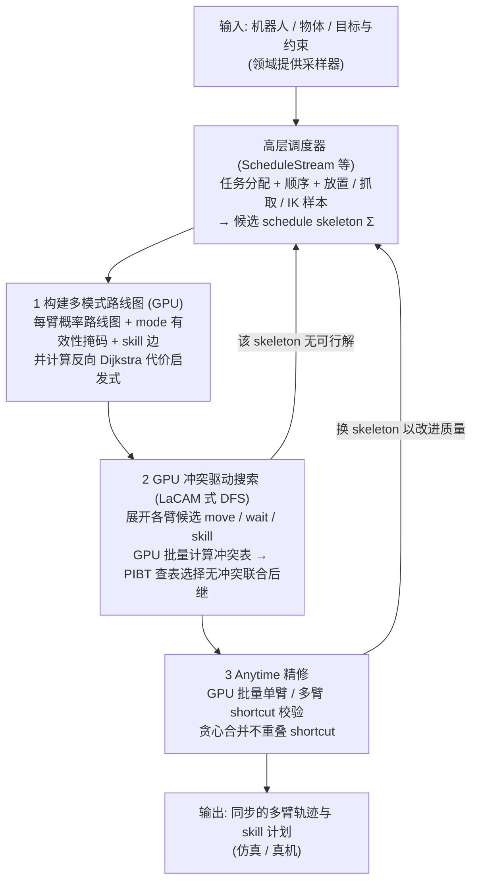

# cuArms（arXiv:2610.36250）

**cuArms**（*cuArms: GPU-Accelerated Conflict-Based Planning for Multi-Arm Manipulation*，[arXiv:2610.36250](https://arxiv.org/abs/2610.36250)，[项目页](https://cuarms.github.io/)）来自 [具身智能小站 2026-10-28 盘点](../../sources/blogs/wechat_embodied_station_59_papers_human_video_to_robot_experience_2026-10-28.md)，属「控制、规划与系统」组。

## 一句话定义

**复用单臂多模式路线图，以延迟冲突搜索处理多臂碰撞与死锁，再联合任务分配和调度。**

## 英文缩写速查

| 缩写 | 英文全称 | 简要说明 |
|------|----------|----------|
| cuArms | cuArms: GPU-Accelerated Conflict-Based Planning for Multi-Arm Manipulation | 本文方法 / 基准的简称 |

## 为什么重要

- 多机械臂规划利用 GPU 并行。给出仿真与工业真机示例，适合关注共享工作站吞吐与规划扩展性的团队。
- 开源结论：**项目页未列 GitHub**（步骤 2.5，2026-10-28）。项目页 HTTP 200，未见 GitHub 链接或 coming soon 字样。
- 同期同组工作见 [潜在动作、免渲染事件仿真与机器人评测：具身智能小站 10-28 期 59 篇阅读坐标](../overview/embodied-station-2026-10-28-59-papers-technology-map.md)。

## 流程总览

图依据：论文 §IV-A 至 §IV-C、§V / Fig.2 / Alg.1

## 核心机制

| 项 | 内容 |
|----|------|
| **arXiv** | [2610.36250](https://arxiv.org/abs/2610.36250) |
| **开源** | **项目页未列 GitHub** |
| **要点** | 复用单臂多模式路线图，以延迟冲突搜索处理多臂碰撞与死锁，再联合任务分配和调度。 |
| **文内指标** | 公众号转述：给出仿真与工业真机示例，适合关注共享工作站吞吐与规划扩展性的团队。 |

## 源码运行时序图

**不适用（项目页未列 GitHub）** — 项目页 HTTP 200，未见 GitHub 链接或 coming soon 字样。 不编造运行脚本；代码公开后再补。

## 实验与评测

- 公众号转述：给出仿真与工业真机示例，适合关注共享工作站吞吐与规划扩展性的团队。
- **读法：** 本页为索引级摘要，依据公众号转述的官方摘要与仓库信息整理；逐项数字与 baseline 以原文 PDF 为准。

## 与其他工作对比

- 横向索引见 [潜在动作、免渲染事件仿真与机器人评测：具身智能小站 10-28 期 59 篇阅读坐标](../overview/embodied-station-2026-10-28-59-papers-technology-map.md)；同 arXiv 不重复造页。

## 结论

**多机械臂规划利用 GPU 并行：给出仿真与工业真机示例，适合关注共享工作站吞吐与规划扩展性的团队。**

1. 开源边界：**项目页未列 GitHub** — 项目页 HTTP 200，未见 GitHub 链接或 coming soon 字样。
2. 核心机制：复用单臂多模式路线图，以延迟冲突搜索处理多臂碰撞与死锁，再联合任务分配和调度。
3. 复现与选型前核对任务协议、硬件与基准口径，勿直接横比公众号摘录数字。

## 关联页面

- [manipulation](../tasks/manipulation.md)
- [impedance-control](../concepts/impedance-control.md)
- [llm-robotics-control-interfaces](../concepts/llm-robotics-control-interfaces.md)
- [embodied-station-2026-10-28-59-papers-technology-map](../overview/embodied-station-2026-10-28-59-papers-technology-map.md)

## 参考来源

- [cuarms_arxiv_2610_36250.md](../../sources/papers/cuarms_arxiv_2610_36250.md)
- [wechat_embodied_station_59_papers_human_video_to_robot_experience_2026-10-28.md](../../sources/blogs/wechat_embodied_station_59_papers_human_video_to_robot_experience_2026-10-28.md)
- [arXiv:2610.36250](https://arxiv.org/abs/2610.36250)
- [arXiv PDF](https://arxiv.org/pdf/2610.36250)：已通读方法部分（实验与附录以略读为准）：摘要、§I、§III、§IV（路线图、冲突驱动搜索、anytime 精修）、§V、§VI 实验设定

## 推荐继续阅读

- [arXiv PDF](https://arxiv.org/pdf/2610.36250)
- [项目页](https://cuarms.github.io/)
