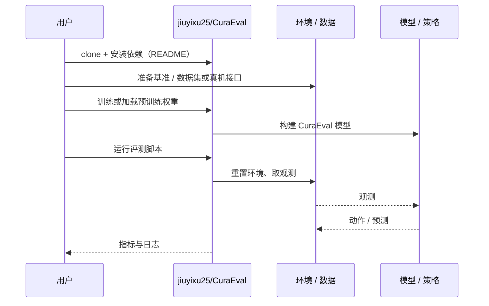

# CuraEval（arXiv:2610.38221）

**CuraEval**（*CuraEval: Evaluating Demonstration Curation on Mixed-Skill Robot Data*，[arXiv:2610.38221](https://arxiv.org/abs/2610.38221)，[代码](https://github.com/jiuyixu25/CuraEval)）来自 [具身智能小站 2026-10-30 盘点](../../sources/blogs/wechat_embodied_station_28_papers_event2reward_progress_rewards_2026-10-30.md)，属「示范数据与评测」组。

## 一句话定义

**CuraEval 在混合技能数据上控制子集大小与训练预算，比较筛选、随机抽样和全量训练。**

## 英文缩写速查

| 缩写 | 英文全称 | 简要说明 |
|------|----------|----------|
| CuraEval | CuraEval: Evaluating Demonstration Curation on Mixed-Skill Robot Data | 本文方法 / 基准的简称 |

## 为什么重要

- 筛掉示范之前，先检验随机基线。调整评测协议会改变收益方向，提醒数据清洗结论必须附带统计口径。
- 开源结论：**已开源**（步骤 2.5，2026-10-30）。仓库可达（git ls-remote）。
- 同期同组工作见 [进度奖励、接触监督与规划验证：具身智能小站 10-30 期 28 篇阅读坐标](../overview/embodied-station-2026-10-30-28-papers-technology-map.md)。

## 核心机制

| 项 | 内容 |
|----|------|
| **arXiv** | [2610.38221](https://arxiv.org/abs/2610.38221) |
| **开源** | **已开源** |
| **要点** | CuraEval 在混合技能数据上控制子集大小与训练预算，比较筛选、随机抽样和全量训练。 |
| **文内指标** | 公众号转述：调整评测协议会改变收益方向，提醒数据清洗结论必须附带统计口径。 |

## 源码运行时序图

以下为按仓库入口（`jiuyixu25/CuraEval`）推断的通用运行链路；入库日仅核实仓库可达，未逐文件阅读，具体脚本名以 README 为准。

## 实验与评测

- 公众号转述：调整评测协议会改变收益方向，提醒数据清洗结论必须附带统计口径。
- **读法：** 本页为索引级摘要，依据公众号转述的官方摘要与仓库信息整理；逐项数字与 baseline 以原文 PDF 为准。

## 与其他工作对比

- 横向索引见 [进度奖励、接触监督与规划验证：具身智能小站 10-30 期 28 篇阅读坐标](../overview/embodied-station-2026-10-30-28-papers-technology-map.md)；同 arXiv 不重复造页。

## 结论

**筛掉示范之前，先检验随机基线：调整评测协议会改变收益方向，提醒数据清洗结论必须附带统计口径。**

1. 开源边界：**已开源** — 仓库可达（git ls-remote）。
2. 核心机制：CuraEval 在混合技能数据上控制子集大小与训练预算，比较筛选、随机抽样和全量训练。
3. 复现与选型前核对任务协议、硬件与基准口径，勿直接横比公众号摘录数字。

## 关联页面

- [embodied-data-collection-four-layers-taxonomy](../concepts/embodied-data-collection-four-layers-taxonomy.md)
- [imitation-learning](../methods/imitation-learning.md)
- [simulation-evaluation-infrastructure](../concepts/simulation-evaluation-infrastructure.md)
- [embodied-station-2026-10-30-28-papers-technology-map](../overview/embodied-station-2026-10-30-28-papers-technology-map.md)

## 参考来源

- [curaeval_arxiv_2610_38221.md](../../sources/papers/curaeval_arxiv_2610_38221.md)
- [wechat_embodied_station_28_papers_event2reward_progress_rewards_2026-10-30.md](../../sources/blogs/wechat_embodied_station_28_papers_event2reward_progress_rewards_2026-10-30.md)
- [arXiv:2610.38221](https://arxiv.org/abs/2610.38221)

## 推荐继续阅读

- [arXiv PDF](https://arxiv.org/pdf/2610.38221)
- [https://github.com/jiuyixu25/CuraEval](https://github.com/jiuyixu25/CuraEval)
