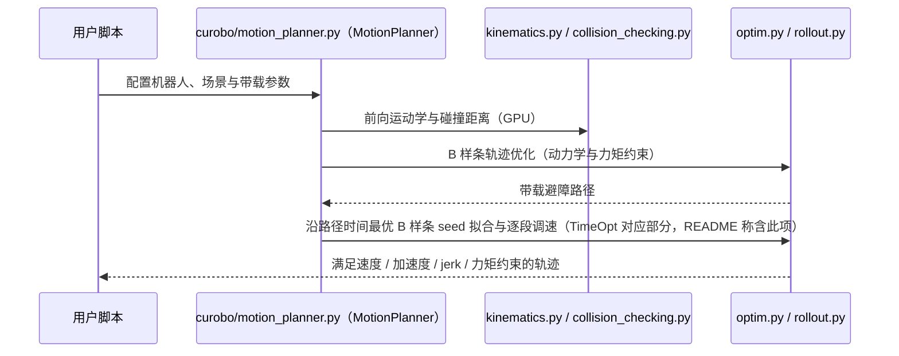

# cuRoboV2-Fast（arXiv:2611.06913）

**cuRoboV2-Fast**（*cuRoboV2-Fast: Fast Torque-Limited Collision-Free Motion Planning*，[arXiv:2611.06913](https://arxiv.org/abs/2611.06913)，[项目页](https://research.nvidia.com/labs/lpr/curobov2-fast/)，[代码](https://github.com/NVlabs/curobo)）来自 [具身智能小站 2026-11-06 盘点](../../sources/blogs/wechat_embodied_station_20_papers_curobov2_fast_halo_humanwam_2026-11-06.md)，属「运动与控制」组。

## 一句话定义

**cuRoboV2-Fast** 是 GPU 加速的运动规划器：用 B 样条轨迹优化减少迭代，用可微逆动力学降低带载精修的代价，再用 TimeOpt 沿固定路径在速度 / 加速度 / jerk / 力矩约束下逐段调速（arXiv 摘要）。

## 英文缩写速查

| 缩写 | 英文全称 | 简要说明 |
|------|----------|----------|
| cuRoboV2-Fast | cuRoboV2-Fast: Fast Torque-Limited Collision-Free Motion Planning | 本文方法 / 基准的简称 |

## 为什么重要

- 一次抓放省下 3 秒，机械臂快在哪里。有些路段可以加速，有些路段再快一点就会超出关节力矩上限。
- 开源结论：**已开源**（步骤 2.5，2026-11-06）。仓库可达（git ls-remote）。项目页 HTTP 200。
- 同期同组工作见 [按路段调速的规划、虚拟房间到真机的人形动作与人类视频缩放：具身智能小站 11-06 期 20 篇阅读坐标](../overview/embodied-station-2026-11-06-20-papers-technology-map.md)。

## 核心机制

| 项 | 内容 |
|----|------|
| **arXiv** | [2611.06913](https://arxiv.org/abs/2611.06913) |
| **开源** | **已开源** |
| **要点** | B 样条轨迹优化 + 加速的机器人计算与可微逆动力学（适应负载变化）+ TimeOpt（利用样条局部支撑在 GPU 上解带状牛顿系统）；官方仓库 README 称其含「受力矩和平滑约束的动力学感知轨迹优化」与「时间最优 B 样条 seed 拟合」。 |
| **文内指标** | arXiv 摘要：3 kg 负载下 RTX 5090 平均规划 4.4 ms，比 cuRoboV2 快 14.7 倍；Jetson AGX Orin 上的规划比 RTX 5090 上的 cuRoboV1 + TOPPRA 还快；YAM 双目相机部署的平均抓放完成周期 5.93 s，比 cuRoboV2 短 34.6%。公众号转述（口径未回论文核对）：Franka Panda 离线基准 3 公斤负载同 RTX 5090 上平均规划耗时由 65.13 ms 降至 4.43 ms；YAM 上新旧方法分别约 50 次和 15 次完成搬运，平均周期 5.93 s 对 9.07 s；新版 53 次完成记录里手臂运动占 63.1%、规划只占 1.0%，可靠抓取仍是缩短周期的难点。（我核对：65.13 / 4.43 ≈ 14.7 倍，(9.07 − 5.93) / 9.07 ≈ 34.6%，与摘要一致。） |

## 源码运行时序图

按官方仓库 README 与目录结构画（浅克隆 `NVlabs/curobo`，Apache-2.0，**静态阅读、未运行**）：仓库顶层有 `curobo/`（含 `motion_planner.py`、`batch_motion_planner.py`、`kinematics.py`、`collision_checking.py`、`optim.py`、`rollout.py`、`inverse_kinematics.py`、`model_predictive_control.py`）、`cpp_runtime/`、`benchmark/`、`docs/`。cuRoboV2 是对 v1 的重写、公开 API 已变；具体调用以源码和文档为准，下图只标到模块层，不声称函数级对应。

## 实验与评测

- 公众号转述：真机数据显示，新方法让机械臂在接近速度上限的区间运行得更久，但要进一步缩短作业周期，可靠抓取仍是难点。
- **读法：** 本页为索引级摘要，依据公众号转述的官方摘要与仓库信息整理；逐项数字与 baseline 以原文 PDF 为准。

## 与其他工作对比

- 横向索引见 [按路段调速的规划、虚拟房间到真机的人形动作与人类视频缩放：具身智能小站 11-06 期 20 篇阅读坐标](../overview/embodied-station-2026-11-06-20-papers-technology-map.md)；同 arXiv 不重复造页。

## 结论

**一次抓放省下 3 秒，机械臂快在哪里：真机数据显示，新方法让机械臂在接近速度上限的区间运行得更久，但要进一步缩短作业周期，可靠抓取仍是难点。**

1. 开源边界：**已开源** — 仓库可达（git ls-remote）。项目页 HTTP 200。
2. 核心机制：机械臂端着重物搬运，关节受力会随姿态改变。
3. 复现与选型前核对任务协议、硬件与基准口径，勿直接横比公众号摘录数字。

## 关联页面

- [locomotion](../tasks/locomotion.md)
- [manipulation](../tasks/manipulation.md)
- [embodied-station-2026-11-06-20-papers-technology-map](../overview/embodied-station-2026-11-06-20-papers-technology-map.md)

## 参考来源

- [curobov2_fast_arxiv_2611_06913.md](../../sources/papers/curobov2_fast_arxiv_2611_06913.md)
- [wechat_embodied_station_20_papers_curobov2_fast_halo_humanwam_2026-11-06.md](../../sources/blogs/wechat_embodied_station_20_papers_curobov2_fast_halo_humanwam_2026-11-06.md)
- [arXiv:2611.06913](https://arxiv.org/abs/2611.06913)

## 推荐继续阅读

- [arXiv PDF](https://arxiv.org/pdf/2611.06913)
- [项目页](https://research.nvidia.com/labs/lpr/curobov2-fast/)
- [https://github.com/NVlabs/curobo](https://github.com/NVlabs/curobo)
