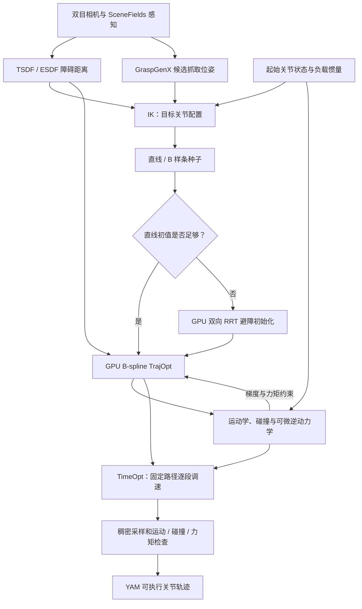
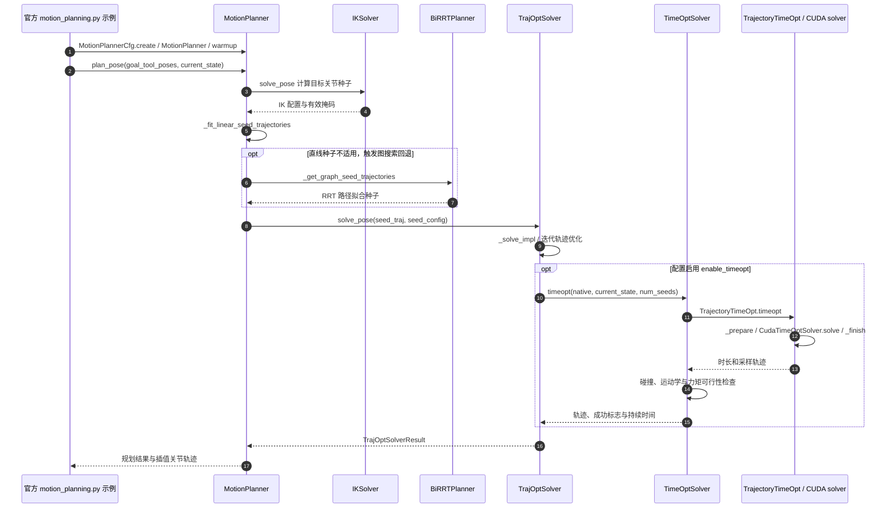

# cuRoboV2-Fast：快速力矩受限无碰撞运动规划 / Fast Torque-Limited Collision-Free Motion Planning

> **NVIDIA 原始论文深读**（[arXiv:2611.06913v1](https://arxiv.org/abs/2611.06913)，2026-11-04，作者 Balakumar Sundaralingam、Adithyavairavan Murali、Stan Birchfield）。官方 [项目页](https://research.nvidia.com/labs/lpr/curobov2-fast/) · [PDF](https://research.nvidia.com/labs/lpr/curobov2-fast/paper.pdf) · [代码](https://github.com/NVlabs/curobo)。来源由旧版二手公众号摘录升级为论文正文、图表和官方实现的直接核对。

## 一句话定义

**cuRoboV2-Fast** 是英伟达（NVIDIA）公开的 GPU 加速运动规划器：先获取无碰撞的关节空间路径并用 B 样条优化，再对固定几何路径进行 TimeOpt 时间分配，在速度、加速度、jerk 与关节力矩约束下生成适于执行的轨迹。

## 英文缩写速查

| 缩写 | 英文全称 | 简要说明 |
|---|---|---|
| GPU | Graphics Processing Unit | 并行求解 IK、RRT、轨迹优化与机器人动力学 |
| IK | Inverse Kinematics | 把目标末端位姿转换为可行关节构型 |
| RRT | Rapidly-exploring Random Tree | 直线种子不足时，用双向搜索提供避障路径初值 |
| TrajOpt | Trajectory Optimization | 用三次 B 样条控制点优化几何、碰撞与运动代价 |
| TimeOpt | Time Optimization | 保持几何路径不变，优化各路段的时间分配 |
| ESDF | Euclidean Signed Distance Field | 用于环境障碍距离约束的有符号距离场 |
| RNEA | Recursive Newton–Euler Algorithm | 关节逆动力学与力矩约束的计算基础 |

## 为什么重要

- **规划快**与**执行快**不是同一指标：14.7× 是规定负载和 GPU 上的**平均规划时延比值**，真实抓放周期只缩短 34.6%，两者不能互换。
- 力矩约束与负载变化使最短几何路径未必是最短可执行时间；TimeOpt 允许沿同一路径在受限段放慢、在宽松段加快。
- 论文给出 Jetson AGX Orin 的完整规划结果，也覆盖 Panda 7 DoF 与 G1 29 DoF 的部分 GPU 机器人计算模块基准；后者不代表在 G1 真机上完成了同样的抓放周期实验。

## 核心原理

1. **目标与初值（论文 III-A）：** IK 求目标关节解；优先直线种子，困难场景用 GPU 并行双向 RRT。其按轮扩展并批量校验采样边、截取有效前缀；RRT 路线最终仍须后续 TrajOpt 与稠密可行性验证。
2. **B 样条 TrajOpt（III-B）：** 三次 B 样条每个采样点依赖邻近四个控制点；一次评估位置、速度、加速度、jerk，用局部梯度 gather/warp reduction 减少 atomic 与迭代开销。25 次初始 L-BFGS 迭代在收敛实验达 93% 验证成功率，对比 cuRoboV1 为 64%（Fig. 11）。
3. **固定路径 TimeOpt（III-C）：** 不动几何样条 q(s)，改为优化路径参数的平方速度 x(s) = (ds/dt)^2。扭矩可按论文式 (6) 表示为 τ(s) = 0.5 A(s)x'(s) + D(s)x(s) + g(s)；在采样速度、加速度、jerk、力矩约束下缩短持续时间。每个采样点只依赖四个时间控制点，因此 GPU 上可求解带状牛顿系统；使用原始-对偶预测校正及 Cholesky 分解复用。
4. **加速机器人计算（III-D/E）：** 并行局部 FK、连杆 wrench 汇总、可微逆动力学的直接损失梯度、自碰撞 broad-phase 与 swept bounds 剪枝、融合成本归约；可在运行时更新质量、质心、惯量，无需因负载更新重编译相同拓扑的内核。

## 流程总览

以下是论文 Fig. 2–9、17 的**算法/真机数据流概括**。RRT 是条件分支，并非所有规划都必经；外部感知和抓取组件不是 cuRobo 内部模块。



注意：这里的 “直线初值是否足够” 代表源码中的直接尝试/条件图搜索，不是论文声称存在独立命名的二分类模型。

## 源码运行时序图

官方 [Motion Planning 教程](https://nvlabs.github.io/curobo/latest/getting-started/motion_planning.html) 提供真实运行入口（2026-11-08 静态核对源码，**没有本地 GPU 复现**）：

```bash
python -m curobo.examples.getting_started.motion_planning --mode pose
python -m curobo.examples.getting_started.motion_planning --mode grasp
```

下图按官方入口、`MotionPlanner`、`TrajOptSolver`、`TimeOptSolver` 和 `TrajectoryTimeOpt` 的源码调用关系绘制；省略多种 seed、goalset 与重试变体。



**逐级可核对：** [示例入口](https://github.com/NVlabs/curobo/blob/main/curobo/examples/getting_started/motion_planning.py) → [MotionPlanner](https://github.com/NVlabs/curobo/blob/main/curobo/_src/motion/motion_planner.py) → [TrajOptSolver](https://github.com/NVlabs/curobo/blob/main/curobo/_src/solver/solver_trajopt.py) → [TimeOptSolver](https://github.com/NVlabs/curobo/blob/main/curobo/_src/solver/solver_timeopt.py) → [TrajectoryTimeOpt](https://github.com/NVlabs/curobo/blob/main/curobo/_src/motion/motion_trajectory_timeopt.py)。Grasp 模式在示例中调用 `plan_grasp`，依次生成 pregrasp、approach、lift，不与单独的 transfer 调用混为一谈。

## 工程实践

| 项目 | 核验结果 / 建议 |
|---|---|
| 公开状态 | **已开源**：官方 [NVlabs/curobo](https://github.com/NVlabs/curobo)，代码 Apache-2.0；附带机器人资源另有对应许可证 |
| 版本 | 官方 2026-11-04 **v0.9.0** 公告引入 cuRoboV2-Fast、GPU BiRRT、TimeOpt、C++ 部署；v0.8 起与 v1 API 存在重大不兼容 |
| 官方复现 | 按 [Installation](https://nvlabs.github.io/curobo/latest/getting-started/installation.html) 配置驱动、CUDA 与 Python；再运行上述 pose/grasp tutorial；优先预热 CUDA Graph |
| 配置重点 | 正确填写机器人关节限值、速度 / 加速度 / jerk / effort、负载惯量、几何碰撞模型与障碍距离场 |
| 性能复核 | 区分 IK、RRT、TrajOpt、TimeOpt、总规划时间与真机夹爪/执行时间；记录 GPU、载荷、成功率与 warmup |
| 代码定位 | 源码对应文件与真实调用链见 [repo 归档](../../sources/repos/curobov2_fast.md) |

## 实验与评测

所有结果来自 NVIDIA 原论文 v1；不是在本仓库重新跑出的 benchmark。

| 指标与条件 | 对照 | cuRoboV2-Fast | 说明 |
|---|---:|---:|---|
| RTX 5090，3 kg，全链路平均规划时间 | cuRoboV2：65.13 ms | **4.43 ms** | 14.7×（Fig. 14） |
| Jetson AGX Orin，3 kg，平均规划时间 | cuRoboV2：602.27 ms | **25.99 ms** | 23.2×（Fig. 14） |
| GPU RRT 粗碰撞路线初始化 | cuRoboV2 PRM：8.49 ms | **0.305 ms** | 98.68% 初始化成功，2575 个查询；不是最终轨迹（Fig. 10） |
| 仿真五方块 YAM 每块平均规划 | cuRoboV2：290.76 ms | **26.05 ms** | 11.2×（Fig. 15） |
| YAM 真机平均手臂运动 | cuRoboV2：6.78 s | **3.75 s** | 缩短 44.8%（Fig. 18） |
| YAM 真机平均抓放周期 | cuRoboV2：9.07 s | **5.93 s** | 缩短 34.6%，**RTX 6000 Ada**（Fig. 18） |

- TimeOpt 在 93 条共同验证有效轨迹上，相较于仅用统一时步精调再额外缩短**15.7%** 运动时间（论文 Fig. 11）；报告的标准迭代预算是 50 次初始 + 25 次精修。
- 真实 YAM 的 53 次已完成操作中，规划只占总周期约 **1.0%**，手臂 63.1%、夹爪 25.8%、其他 10.1%（Fig. 19）。超过规划端的速度提升须由控制、机械臂执行和夹爪共同兑现。
- 论文还对 Panda 7 DoF 与 G1 29 DoF 的计算模块做 batch 1/1024 benchmark；不要将计算内核延迟误认为完整人形机器人的无碰撞规划时延。

## 结论

**关键贡献是同时减少规划优化轮次与每轮成本，并把时间重新分配给不同负载/力矩限制的路径段；14.7× 规划加速不会自动转化为同等比例的整机节拍提升。**

1. 做性能复测时，**先锁定 3 kg、RTX 5090、相同 benchmark 和完整规划范围**，否则 4.43 ms 不具直接可比性。
2. **RRT 是按需初始化，不能与完整运动规划时间或成功率混淆**；0.305 ms 不代表能在该时长生成最终可执行轨迹。
3. **TimeOpt 不改变路径几何，只优化时间律**，其额外 15.7% 的收益需与整体端到端指标分别评估。
4. 真机优先关注夹爪动作、可靠性和轨迹执行：规划只占已完成抓放周期的约 1%。
5. 将负载的质量、质心、惯量与关节 effort 限制纳入验证，不能只用几何路径成功代替带载可执行性。
6. 选用官方 v0.9 API 与 Python/CUDA 可运行教程；旧 v1 示例不应直接套用。

## 与其他工作对比

- **cuRoboV1 + TOPPRA：** V1 自身先做几何规划，再用外部时间参数化满足相关运动限制；论文 RTX 5090/3 kg 全链路平均 44.10 ms，慢于 4.43 ms。
- **cuRoboV2：** 同样考虑动力学与负载，但本研究通过更少 B 样条迭代与高效内核缩短时延，维持接近的有效成功率。
- **VAMP + TOPPRA：** 3 kg 时可有更短的规划计时，但本文指出其成功率较低、且相应计时未计入 IK。各家计时口径不完全一致，不能单用单列排名。
- 同期导航见 [具身智能小站 20 篇阅读坐标](../overview/embodied-station-2026-11-06-20-papers-technology-map.md)。

## 局限与风险

- 结果来自论文指定的机器人、场景、载荷、成功条件与硬件；速度、力矩、碰撞约束仍需依据控制频率、安全余量和实际负载做部署验证。
- TimeOpt 在离散路径样本及补充结点上检查约束；论文给出的验证成功率不能当作连续时间对任意未采样时刻的形式化安全保证。
- GPU RRT 的粗碰撞检查只产生路径种子；必须接受后续轨迹优化与最终碰撞/动态约束校验。
- NVIDIA 开源的是 cuRobo 规划库，真机演示含 SceneFields、GraspGenX、双目和 YAM；不要把整套系统误认为只安装 cuRobo 就可独立复现。
- 本次为论文/源码的静态查阅，没有 RTX 5090、Jetson 或真机的重新测量。

## 关联页面

- [Manipulation 任务](../tasks/manipulation.md)
- [Locomotion 任务](../tasks/locomotion.md)
- [2026-11-06 具身论文阅读坐标](../overview/embodied-station-2026-11-06-20-papers-technology-map.md)

## 参考来源

- [NVIDIA 论文原文（通读与图表指标）](../../sources/papers/curobov2_fast_arxiv_2611_06913.md)
- [NVIDIA 项目页归档](../../sources/sites/curobov2-fast.md)
- [NVlabs/curobo 源码与官方入口归档](../../sources/repos/curobov2_fast.md)

## 推荐继续阅读

- [NVIDIA cuRoboV2-Fast 官方交互页](https://research.nvidia.com/labs/lpr/curobov2-fast/)
- [论文 PDF（arXiv 2611.06913v1）](https://research.nvidia.com/labs/lpr/curobov2-fast/paper.pdf)
- [官方 Motion Planning 教程](https://nvlabs.github.io/curobo/latest/getting-started/motion_planning.html)
- [GitHub — NVlabs/curobo](https://github.com/NVlabs/curobo)
