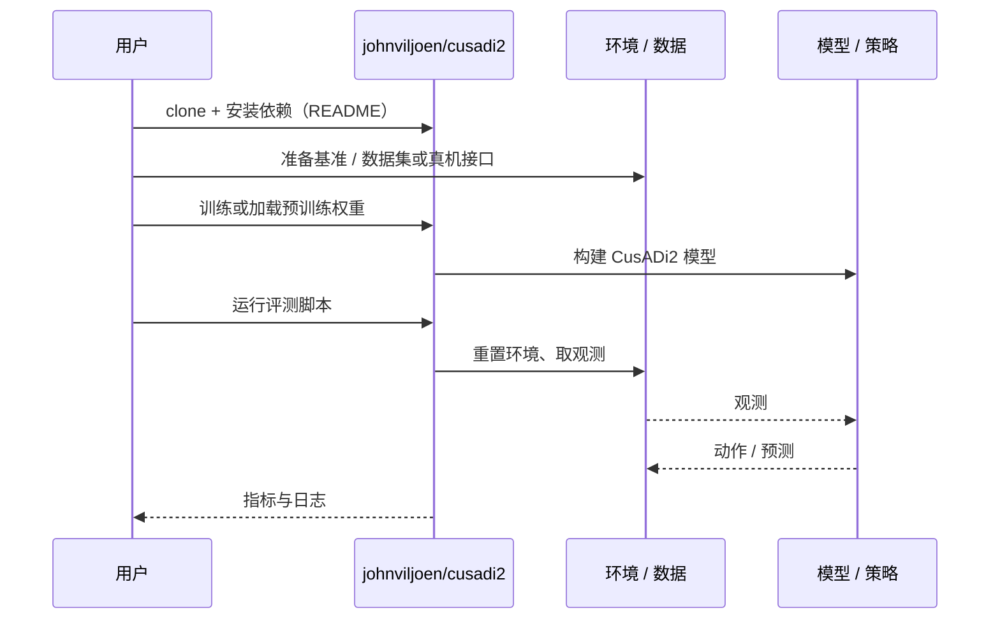

# CusADi2（arXiv:2610.25476）

**CusADi2**（*CusADi2: Latency-Optimized Batch Computation of Robot Kinematics, Jacobians, and Hessians on the GPU*，[arXiv:2610.25476](https://arxiv.org/abs/2610.25476)，[代码](https://github.com/johnviljoen/cusadi2)）来自 [具身智能小站 2026-11-01 盘点](../../sources/blogs/wechat_embodied_station_56_papers_libero_dynamic_latency_eval_2026-11-01.md)，属「感知、规划与系统」组。

## 一句话定义

**CusADi2在批次内部继续并行计算运动学及其导数，面向在线规划的低延迟需求；覆盖多种机器人和控制示例，优势随批量大小与计算图结构变化。**

## 英文缩写速查

| 缩写 | 英文全称 | 简要说明 |
|------|----------|----------|
| CusADi2 | CusADi2: Latency-Optimized Batch Computation of Robot Kinematics, Jacobians, and Hessians on the GPU | 本文方法 / 基准的简称 |

## 为什么重要

- GPU批量计算，也要降低单批延迟。
- 开源结论：**已开源**（步骤 2.5，2026-11-01）。仓库可达（git ls-remote）。
- 同期同组工作见 [动态评测、技能编译与环境潜变量适配：具身智能小站 11-01 期 56 篇阅读坐标](../overview/embodied-station-2026-11-01-56-papers-technology-map.md)。

## 核心机制

| 项 | 内容 |
|----|------|
| **arXiv** | [2610.25476](https://arxiv.org/abs/2610.25476) |
| **开源** | **已开源** |
| **要点** | CusADi2在批次内部继续并行计算运动学及其导数，面向在线规划的低延迟需求；覆盖多种机器人和控制示例，优势随批量大小与计算图结构变化。 |
| **文内指标** | 公众号未给具体数字，本页不引用。 |

## 源码运行时序图

以下为按仓库入口（`johnviljoen/cusadi2`）推断的通用运行链路；入库日仅核实仓库可达，未逐文件阅读，具体脚本名以 README 为准。

## 实验与评测

- 公众号未给具体数字，本页不引用。
- **读法：** 本页为索引级摘要，依据公众号转述的官方摘要与仓库信息整理；逐项数字与 baseline 以原文 PDF 为准。

## 与其他工作对比

- 横向索引见 [动态评测、技能编译与环境潜变量适配：具身智能小站 11-01 期 56 篇阅读坐标](../overview/embodied-station-2026-11-01-56-papers-technology-map.md)；同 arXiv 不重复造页。

## 结论

**GPU批量计算，也要降低单批延迟：CusADi2在批次内部继续并行计算运动学及其导数，面向在线规划的低延迟需求；覆盖多种机器人和控制示例，优势随批量大小与计算图结构变化。**

1. 开源边界：**已开源** — 仓库可达（git ls-remote）。
2. 核心机制：CusADi2在批次内部继续并行计算运动学及其导数，面向在线规划的低延迟需求；覆盖多种机器人和控制示例，优势随批量大小与计算图结构变化。
3. 复现与选型前核对任务协议、硬件与基准口径，勿直接横比公众号摘录数字。

## 关联页面

- [manipulation](../tasks/manipulation.md)
- [locomotion](../tasks/locomotion.md)
- [sim2real](../concepts/sim2real.md)
- [embodied-station-2026-11-01-56-papers-technology-map](../overview/embodied-station-2026-11-01-56-papers-technology-map.md)

## 参考来源

- [cusadi2_arxiv_2610_25476.md](../../sources/papers/cusadi2_arxiv_2610_25476.md)
- [wechat_embodied_station_56_papers_libero_dynamic_latency_eval_2026-11-01.md](../../sources/blogs/wechat_embodied_station_56_papers_libero_dynamic_latency_eval_2026-11-01.md)
- [arXiv:2610.25476](https://arxiv.org/abs/2610.25476)

## 推荐继续阅读

- [arXiv PDF](https://arxiv.org/pdf/2610.25476)
- [https://github.com/johnviljoen/cusadi2](https://github.com/johnviljoen/cusadi2)
