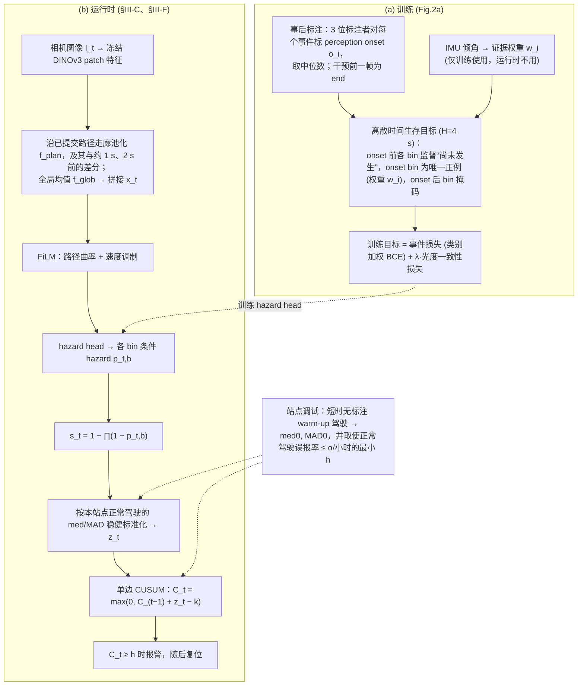

# CUSP（arXiv:2610.07882）

**CUSP**（*CUSP: CUSUM-Governed Survival Hazard Alarms at the Perception Onset for Off-Road Navigation*，[arXiv:2610.07882](https://arxiv.org/abs/2610.07882)，[项目页](https://in-uk.github.io/cusp-project/)）来自 [具身智能小站 2026-10-13 盘点](../../sources/blogs/wechat_embodied_station_34_papers_mulligan_2026-10-13.md)，属「导航、足式与规划」组。

## 一句话定义

**把人类感知危险时刻与实际接管时刻分开标注，累积生存风险信号；五个未见场地统一误报率评测。**

## 英文缩写速查

| 缩写 | 英文全称 | 简要说明 |
|------|----------|----------|
| CUSUM | Cumulative Sum | 累积和变化检测 |
| Hazard | Survival Hazard | 生存风险率 |
| FPR | False Positive Rate | 误报率 |

## 为什么重要

- 越野导航要在接管前报警。
- 开源结论：**待发布**（步骤 2.5，2026-10-14）。项目页含「coming soon」字样，入库日未列 GitHub。
- 同期同组工作见 [失败导向采集与可组合世界动作模型：具身智能小站 10-13 期 34 篇阅读坐标](../overview/embodied-station-2026-10-13-34-papers-technology-map.md)。

## 流程总览

图依据：论文 §III-B–F / Fig.2

## 核心机制

| 项 | 内容 |
|----|------|
| **arXiv** | [2610.07882](https://arxiv.org/abs/2610.07882) |
| **开源** | **待发布** |
| **要点** | CUSUM + 生存分析。 |
| **文内指标** | 以原文为准。 |

## 源码运行时序图

**不适用（待发布）** — 项目页含「coming soon」字样，入库日未列 GitHub。 不编造运行脚本；代码公开后再补。

## 实验与评测

- 以原文为准。
- **读法：** 本页为索引级摘要，依据公众号转述的官方摘要与仓库信息整理；逐项数字与 baseline 以原文 PDF 为准。

## 与其他工作对比

- 横向索引见 [失败导向采集与可组合世界动作模型：具身智能小站 10-13 期 34 篇阅读坐标](../overview/embodied-station-2026-10-13-34-papers-technology-map.md)；同 arXiv 不重复造页。

## 结论

**报警系统的标签应对齐「感知起点」而非「接管时刻」。**

1. 开源边界：**待发布** — 项目页含「coming soon」字样，入库日未列 GitHub。
2. 核心机制：CUSUM + 生存分析。
3. 复现与选型前核对任务协议、硬件与基准口径，勿直接横比公众号摘录数字。

## 关联页面

- [safety-filter](../concepts/safety-filter.md)
- [robot-safety-state-machine](../concepts/robot-safety-state-machine.md)
- [embodied-station-2026-10-13-34-papers-technology-map](../overview/embodied-station-2026-10-13-34-papers-technology-map.md)
- [机器人视觉感知栈选型闭环](../queries/robot-perception-stack-selection-loop.md) — CUSP 位于 ④ 下游策略消费层：把感知到的危险累积为生存风险告警，评测关注误报率而非检测 mAP

## 参考来源

- [cusp_survival_hazard_alarms_offroad_arxiv_2610_07882.md](../../sources/papers/cusp_survival_hazard_alarms_offroad_arxiv_2610_07882.md)
- [wechat_embodied_station_34_papers_mulligan_2026-10-13.md](../../sources/blogs/wechat_embodied_station_34_papers_mulligan_2026-10-13.md)
- [arXiv:2610.07882](https://arxiv.org/abs/2610.07882)
- [arXiv PDF](https://arxiv.org/pdf/2610.07882)：已通读方法部分（实验与附录以略读为准）：§I 引言、§III 方法（§III-A 至 §III-F）

## 推荐继续阅读

- [arXiv PDF](https://arxiv.org/pdf/2610.07882)
- [项目页](https://in-uk.github.io/cusp-project/)
