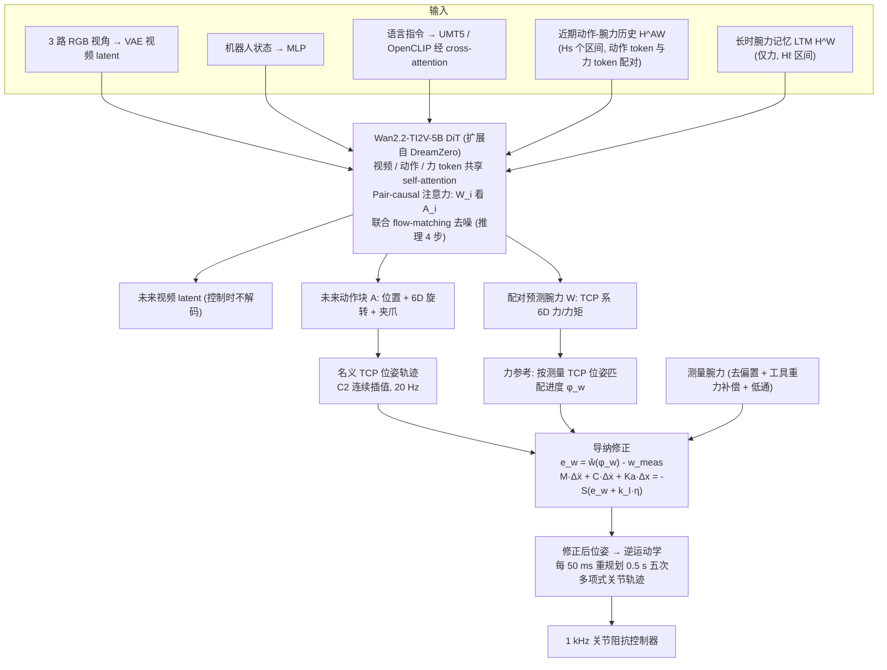

# CW-WAM：面向力敏感操作的结构化接触力旋量世界动作模型

**CW-WAM**（*CW-WAM: A Structured Contact-Wrench World Action Model for Force-Sensitive Manipulation*，[arXiv:2610.30117](https://arxiv.org/abs/2610.30117)）收录于 senlanke「具身运控lab」10-19–10-23 前沿论文动态（Manipulation）。本页依据**周报条目 + arXiv 摘要页**整理，流程图依据论文方法部分（见参考来源），未逐页核对实验数字；指标与结论以论文为准。

## 一句话定义

**CW-WAM：面向力敏感操作的结构化接触力旋量世界动作模型——CW-WAM 将结构化接触力旋量（Contact Wrench）引入世界动作模型，使世界预测和动作生成能够利用接触力与力矩信息。**

## 英文缩写速查

| 缩写 | 英文全称 | 简要说明 |
|------|----------|----------|
| WAM | World Action Model | 世界–动作联合建模 |
| VLA | Vision-Language-Action | 视觉–语言–动作模型 |

## 为什么重要

- 周报所述待解决的问题：机器人接触操作不仅取决于物体的视觉位置，还取决于接触力和力矩。缺少接触动力学信息的世界模型难以准确表达力敏感任务。

## 流程总览

图依据：论文 §III–IV / Fig.2 / Fig.3

## 核心机制

| 项 | 内容 |
|----|------|
| **arXiv** | [2610.30117](https://arxiv.org/abs/2610.30117) · [PDF](https://arxiv.org/pdf/2610.30117) |
| **作者（arXiv）** | Houzhu Ding, Xinda Qi, Luqi Wang, Ming Yang |
| **机构（周报所述，未逐条核实）** | 待核实（作者：Houzhu Ding、Xinda Qi、Luqi Wang、Ming Yang）。 |
| **arXiv 评论栏** | Project website: this https URL |
| **开源** | arXiv 摘要页/评论给出项目页或外链（https://cw-wam-project.github.io/）；未发现代码仓库链接（2026-10-26） |
| **周报所述创新点** | CW-WAM 将结构化接触力旋量（Contact Wrench）引入世界动作模型，使世界预测和动作生成能够利用接触力与力矩信息。 |

### arXiv 摘要节选（英文原文）

> Force-sensitive manipulation requires contact and load information that is not provided explicitly by visual observations. We present CW-WAM, a world action model that jointly predicts video, motion, and contact wrench.

## 源码运行时序图

**不适用**：arXiv 摘要页/评论给出项目页或外链（https://cw-wam-project.github.io/）；未发现代码仓库链接，无可对齐的官方代码流程。

## 实验与评测

- 周报与摘要给出的数字/场景已写入上表「创新点」与摘要节选；其余实验细节、基线与成功率定义请回到论文正文。
- 读法：先对齐任务设定、传感器与成功定义（仿真/真机），再解读 headline 数字，勿跨论文直接比较。

## 与其他工作对比

| 维度 | 读法 |
|------|------|
| **同周对照** | 见 [Manipulation周报技术地图](../overview/senlanke-weekly-2026-10-19-23-manipulation-technology-map.md)，按方向浏览同期论文 |
| **开源状态** | arXiv 摘要页/评论给出项目页或外链（https://cw-wam-project.github.io/）；未发现代码仓库链接 |

## 结论

**CW-WAM：面向力敏感操作的结构化接触力旋量世界动作模型。**

1. 本页是入库级摘要，复现前请核对论文正文、附录与代码仓库。
2. 指标须连同实验条件解读。
3. 关注 arXiv 版本更新与代码发布。

## 关联页面

- [senlanke-weekly-2026-10-19-23-manipulation-technology-map](../overview/senlanke-weekly-2026-10-19-23-manipulation-technology-map.md)
- [manipulation](../tasks/manipulation.md)
- [vla](../methods/vla.md)

## 参考来源

- [cw-wam-contact-wrench-world-action-model_arxiv_2610_30117.md](../../sources/papers/cw-wam-contact-wrench-world-action-model_arxiv_2610_30117.md)
- [wechat_senlanke_weekly_manipulation_2026-10-19_23.md](../../sources/blogs/wechat_senlanke_weekly_manipulation_2026-10-19_23.md)
- [arXiv:2610.30117](https://arxiv.org/abs/2610.30117)
- [arXiv PDF](https://arxiv.org/pdf/2610.30117)：已通读方法部分（实验与附录以略读为准）：摘要、§I–II、§III 结构化接触-腕力世界动作建模（问题设定 / 交互历史与配对预测 / 训练与推理）、§IV 慢-快运动-力控制、§V 任务设定与开环预测结果

## 推荐继续阅读

- [arXiv PDF](https://arxiv.org/pdf/2610.30117)
