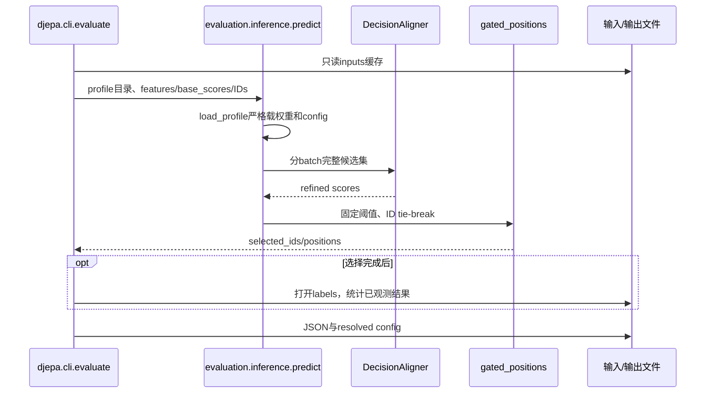

# D-JEPA（arXiv:2609.24749）

**D-JEPA**（*D-JEPA: A Decision-Aligned Latent World Model*，[arXiv:2609.24749](https://arxiv.org/abs/2609.24749)，[项目页](https://nebulis-lab.com/D-JEPA/)，[代码](https://github.com/NEBULIS-Lab/D-JEPA)）由HKUST(GZ)、Boston University、上海交大作者提出；已通读arXiv v1和官方实现，原盘点作为发现线索保留。

## 一句话定义

**用实际执行结果学习候选未来之间的关系，修正潜在距离与任务成败不一致的问题，让世界模型选对能成功的动作。**

## 英文缩写速查

| 缩写 | 英文全称 | 简要说明 |
|------|----------|----------|
| JEPA | Joint-Embedding Predictive Architecture | 联合嵌入预测架构 |
| PDMS | Predictive Driver Model Score | 本文七驾驶场景的轨迹评分 |
| CD | Chamfer Distance | 粒子形状误差，需附成功阈值 |

## 为什么重要

- 预测接近目标的潜在状态不等于选对动作；潜在距离与成败可能不一致。
- 开源结论：**已开源**（步骤 2.5，2026-10-18）。仓库可达（git ls-remote），项目页 HTTP 200。
- 同期同组工作见 [编程智能体造数据与 VLA 闭环评测：具身智能小站 10-18 期 26 篇阅读坐标](../overview/embodied-station-2026-10-18-26-papers-technology-map.md)。

## 核心机制

给定同初态、同目标的完整动作候选集，冻结世界模型提供各自的future–goal差向量及候选内归一化rank。两层、四头set Transformer学习候选间关系，零初始化低秩头输出±0.2有界修正；训练以成功候选总概率、局部成败排序及修正惩罚监督。部署不使用执行结果标签。

受限predictive plasticity只改预测器末block与投影，校准gate可组合其候选与relational默认。多几何融合保留各空间descriptor，仅通过无量纲rank比较异构证据。Exact realization另把排序写入终点goal-relative半径，前面future不变；它保证读出同一排序，不保证任务成功或物理更真实。

## 源码运行时序图

固定版本`9b59aaa6`的CPU cached replay路径（[源码归档](../../sources/repos/d_jepa_decision_aligned_latent_world_model.md)）；新仿真/机器人执行需另一套入口，未在本次运行。

## 工程实践

- 保持candidate ID、初态、horizon与特征严格对齐，按start隔离训练/校准/测试；不能随机拆候选造成身份泄漏。
- profile需整个目录的model.pt与config.json，cached replay只是重放已生成特征的选择结果。
- ±0.2是score约束；接入新候选数/尺度需重新核对模型输入和校准，不作控制安全界。
- 真机包独立安装，设备控制器和标定由使用者提供；当前未运行模型、下载权重或上机。

## 实验与评测

| 设置 | 匹配对照 | D-JEPA | 边界 |
|---|---:|---:|---|
| PushT 256 confirmation starts | LeWM83.59% | 组合87.89% | 非平凡决策边界筛选群体 |
| Reacher128 starts | LeWM86.72% | relational93.75% | transport为另一个表示诊断 |
| Granular64 starts | DINO严格7.81% | 严格18.75% | CD .358仍差于DINO .341 |
| RoboTwin四任务512 starts | native61.72% | 76.76% | 候选与初态匹配 |
| PiPER两任务100配对trial | 64% | 81% | 实机有限任务 |
| 驾驶七困难场景 | PDMS57.36 | 95.34 | 三source logs，非全量基准 |

Ordinal realization为87.11%，恢复100% relational候选排序和选择，不是87.89%组合结果。形状评测为未见几何；七视觉变化家族已参与task-local fitting，仅测试start新。34.02/35.03/52.16ms为各模式每start推理中位，不含仿真执行。

## 局限

- 依赖配对候选执行监督、候选可用性及预训练预测器，无法创造集合外成功动作。
- confirmation筛选、已知视觉家族与七驾驶难例限制外推；不能解读为通用驾驶安全结果。
- 终点半径编码是goal/候选集条件的排序实现，非学习出新物理动力学，仍包含predictive与relational计算。
- 原始预测器、任务接口、机器人控制器各有额外依赖，轻量cached replay不代表实机闭环复现。

## 与其他工作对比

- 横向索引见 [编程智能体造数据与 VLA 闭环评测：具身智能小站 10-18 期 26 篇阅读坐标](../overview/embodied-station-2026-10-18-26-papers-technology-map.md)；同 arXiv 不重复造页。

## 结论

**潜在世界模型的评价要绑定候选动作生成方式；决策对齐的收益不能脱离候选集合解读。**

1. 已公开实现、task profiles和监督数据入口；cached replay与新仿真/实机流程分开核验。
2. 核心机制：以真实执行结果监督候选未来之间的排序关系，使潜在空间与决策对齐。
3. 复现与选型前核对任务协议、硬件与基准口径，勿直接横比公众号摘录数字。

## 关联页面

- [generative-world-models](../methods/generative-world-models.md)
- [world-action-models](../concepts/world-action-models.md)
- [paper-vl-jepa](./paper-vl-jepa.md)
- [embodied-station-2026-10-18-26-papers-technology-map](../overview/embodied-station-2026-10-18-26-papers-technology-map.md)

## 参考来源

- [d_jepa_decision_aligned_latent_world_model_arxiv_2609_24749.md](../../sources/papers/d_jepa_decision_aligned_latent_world_model_arxiv_2609_24749.md)
- [固定版本代码归档](../../sources/repos/d_jepa_decision_aligned_latent_world_model.md)
- [项目页核对](../../sources/sites/d-jepa-decision-aligned-latent-world-model.md)
- [wechat_embodied_station_26_papers_embodiedswe_2026-10-18.md](../../sources/blogs/wechat_embodied_station_26_papers_embodiedswe_2026-10-18.md)
- [arXiv:2609.24749](https://arxiv.org/abs/2609.24749)

## 推荐继续阅读

- [arXiv PDF](https://arxiv.org/pdf/2609.24749)
- [项目页](https://nebulis-lab.com/D-JEPA/)
- [https://github.com/NEBULIS-Lab/D-JEPA](https://github.com/NEBULIS-Lab/D-JEPA)
