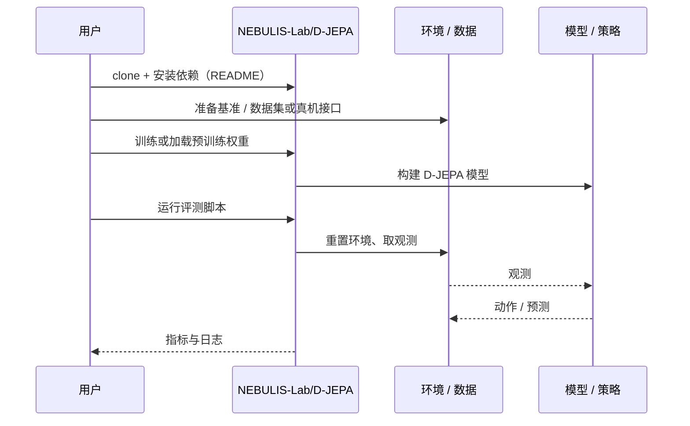

# D-JEPA（arXiv:2609.24749）

**D-JEPA**（*D-JEPA: A Decision-Aligned Latent World Model*，[arXiv:2609.24749](https://arxiv.org/abs/2609.24749)，[项目页](https://nebulis-lab.com/D-JEPA/)，[代码](https://github.com/NEBULIS-Lab/D-JEPA)）来自 [具身智能小站 2026-10-18 盘点](../../sources/blogs/wechat_embodied_station_26_papers_embodiedswe_2026-10-18.md)，属「世界模型与仿真」组。

## 一句话定义

**用实际执行结果学习候选未来之间的关系，修正潜在距离与任务成败不一致的问题，让世界模型选对能成功的动作。**

## 英文缩写速查

| 缩写 | 英文全称 | 简要说明 |
|------|----------|----------|
| JEPA | Joint-Embedding Predictive Architecture | 联合嵌入预测架构 |

## 为什么重要

- 预测接近目标的潜在状态不等于选对动作；潜在距离与成败可能不一致。
- 开源结论：**已开源**（步骤 2.5，2026-10-18）。仓库可达（git ls-remote），项目页 HTTP 200。
- 同期同组工作见 [编程智能体造数据与 VLA 闭环评测：具身智能小站 10-18 期 26 篇阅读坐标](../overview/embodied-station-2026-10-18-26-papers-technology-map.md)。

## 核心机制

| 项 | 内容 |
|----|------|
| **arXiv** | [2609.24749](https://arxiv.org/abs/2609.24749) |
| **开源** | **已开源** |
| **要点** | 以真实执行结果监督候选未来之间的排序关系，使潜在空间与决策对齐。 |
| **文内指标** | 公众号提示：决策对齐在匹配候选集合下评估，效果须连同动作候选生成方式理解。 |

## 源码运行时序图

以下为按仓库入口（`NEBULIS-Lab/D-JEPA`）推断的通用运行链路；入库日仅核实仓库可达，未逐文件阅读，具体脚本名以 README 为准。

## 实验与评测

- 公众号提示：决策对齐在匹配候选集合下评估，效果须连同动作候选生成方式理解。
- **读法：** 本页为索引级摘要，依据公众号转述的官方摘要与仓库信息整理；逐项数字与 baseline 以原文 PDF 为准。

## 与其他工作对比

- 横向索引见 [编程智能体造数据与 VLA 闭环评测：具身智能小站 10-18 期 26 篇阅读坐标](../overview/embodied-station-2026-10-18-26-papers-technology-map.md)；同 arXiv 不重复造页。

## 结论

**潜在世界模型的评价要绑定候选动作生成方式；决策对齐的收益不能脱离候选集合解读。**

1. 开源边界：**已开源** — 仓库可达（git ls-remote），项目页 HTTP 200。
2. 核心机制：以真实执行结果监督候选未来之间的排序关系，使潜在空间与决策对齐。
3. 复现与选型前核对任务协议、硬件与基准口径，勿直接横比公众号摘录数字。

## 关联页面

- [generative-world-models](../methods/generative-world-models.md)
- [world-action-models](../concepts/world-action-models.md)
- [paper-vl-jepa](./paper-vl-jepa.md)
- [embodied-station-2026-10-18-26-papers-technology-map](../overview/embodied-station-2026-10-18-26-papers-technology-map.md)

## 参考来源

- [d_jepa_decision_aligned_latent_world_model_arxiv_2609_24749.md](../../sources/papers/d_jepa_decision_aligned_latent_world_model_arxiv_2609_24749.md)
- [wechat_embodied_station_26_papers_embodiedswe_2026-10-18.md](../../sources/blogs/wechat_embodied_station_26_papers_embodiedswe_2026-10-18.md)
- [arXiv:2609.24749](https://arxiv.org/abs/2609.24749)

## 推荐继续阅读

- [arXiv PDF](https://arxiv.org/pdf/2609.24749)
- [项目页](https://nebulis-lab.com/D-JEPA/)
- [https://github.com/NEBULIS-Lab/D-JEPA](https://github.com/NEBULIS-Lab/D-JEPA)
