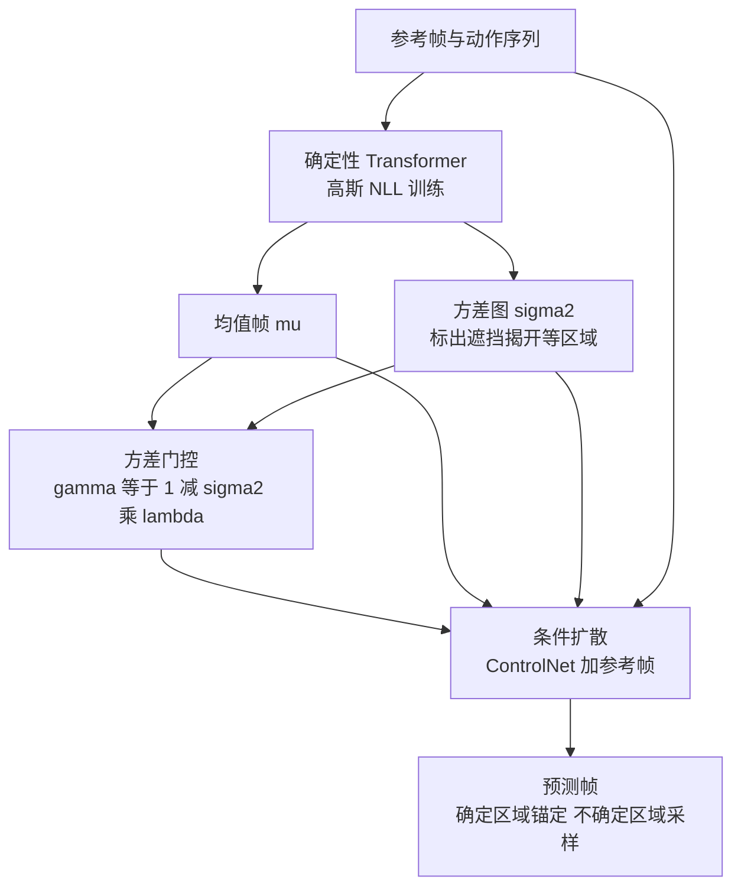

# D3WM：用不确定性图把确定性漂移与随机扩散分开

**D3WM 让一个 Transformer 先预测"确定会发生什么"（均值帧）和"哪里不确定"（逐像素方差图），再让方差图去门控条件扩散模型：确定区域锚定在预测上，不确定区域（如被遮挡后露出的背景）才由扩散采样。**

论文 *Decoupled Drift-Diffusion World Models for Consistent Future Frame Prediction*（[arXiv:2610.19212](https://arxiv.org/abs/2610.19212)，[项目页](https://anton-arapin.github.io/d3wm-site)）。

## 英文缩写速查

| 缩写 | 英文全称 | 简要说明 |
|------|----------|----------|
| D3WM | Decoupled Drift-Diffusion World Model | 漂移（确定）与扩散（随机）分离的世界模型 |
| NLL | Negative Log-Likelihood | 确定性网络的高斯 NLL 损失，同时学均值与方差 |
| ADE / FDE | Average / Final Displacement Error | 轨迹平均 / 终点误差，用于 PushT 与策略一致性评测 |
| NVS | Novel View Synthesis | 新视角合成，论文在 DL3DV 与 RealEstate10K 上评测 |

## 为什么重要

- 纯扩散世界模型会"编造"本该确定的内容（如机械臂位置），确定性回归模型则会把不确定区域糊成平均；两者分工可兼顾一致性与细节。
- 不确定性是模型自己学出来的空间图，不需要额外标注。
- 评测直接对接下游：候选动作排序、冻结策略一致性、PushT 规划。

## 核心信息

| 项 | 内容 |
|----|------|
| **机构** | University of Michigan（全部作者）；Jun Gao 另属 NVIDIA（论文 HTML） |
| **确定性网络** | 约 450M 参数 ViT，AdaLN 条件 + MLP 动作嵌入，输出均值 μ 与 log 方差 σ²（tanh 缩放到 [-10, 0]） |
| **扩散模型** | Stable Diffusion 1.5 上的 ControlNet，条件为 μ、σ² 与参考帧（IP-Adapter-Plus；BridgeData V2 用 reference-attention） |
| **数据** | Real PushT、BridgeData V2、DL3DV（训练与分布内评测）、RealEstate10K（仅零样本评测） |
| **开源** | **待发布**（2026-10-17 核查）：项目页写 "Code coming soon"；论文无仓库链接；无数据下载 |

## 核心原理

### 流程总览

两个网络顺序训练：先训确定性网络，再训扩散模型。推理时每个反向步用信任图 γ 混合加噪的 μ 与扩散潜变量。

- λ 调度默认为阶跃函数：去噪 70% 之后关闭锚定（论文 HTML）。
- 论文将其写成"方差门控 SDE"：确定性漂移 + 随机扩散项。

## 源码运行时序图

**不适用**：截至 2026-10-17 项目页写 "Code coming soon"，论文与页面均无仓库链接，没有可对齐的运行入口。

## 与其他工作对比

| 维度 | D3WM（本文） | [IRASim](./paper-irasim.md) | [iVideoGPT](./paper-sa-2405-15223-ivideogpt-interactive-videogpts-are-scalable-wor.md) | [WorldGym](./paper-shenlan-wm-15-worldgym.md) |
|------|------|------|------|------|
| 生成方式 | 确定性 Transformer 出均值帧 + 方差图，方差门控 ControlNet 扩散 | DiT 潜空间扩散 + 帧级动作条件 | 交互式 VideoGPT（自回归） | 世界模型作策略评估环境，VLM 奖励 + MC 模拟 |
| 确定 / 随机内容处理 | 显式学逐像素不确定性，只在不确定区域采样 | 统一由扩散生成 | 本库页未展开 | 不涉及 |
| 下游用途 | 候选动作排序、冻结策略一致性、PushT 规划 | 策略评估、模型规划、可控合成 | 本文 Real PushT 基线 | 策略排名评估 |
| 开源 | 代码 coming soon | Apache-2.0 已开源含数据 / checkpoints | 本库页未展开 | 已开源（本库归类） |

- **相对 IRASim：** IRASim 用帧级动作条件端到端扩散生成；D3WM 把确定部分锚定在回归预测上，候选验证 K=32 的 MSE（.022 对 .030）更优，但冻结 Octo 策略一致性 ADE 不及 IRASim（1.063 对 0.846）。
- **相对 iVideoGPT：** 在本文 Real PushT 设置下 D3WM 的 ADE 为 12.864，iVideoGPT 为 45.134。
- **相对 WorldGym：** 本文在候选选择任务中把 WorldGym 作为基线（K=32 MSE .063），WorldGym 本身定位是策略评估靶场而非帧预测模型。
- 上述数字均来自 D3WM 论文的同一设置；IRASim 论文自报的 Push-T IoU 等指标口径不同，不可横比。

## 工程实践

| 项 | 建议 |
|----|------|
| 复现状态 | 代码未发布；训练配方见论文附录 |
| 快速近似 | 仅用确定性分支 μ 单次前向约 4.9 ms/候选，适合大批量候选粗筛；完整模型约 2643 ms/候选 |
| 用作验证器 | 完整模型在候选动作选择中 K=32 的 MSE 为 .022，优于 IRASim（.030）与 WorldGym（.063） |
| 注意输出形式 | 每次查询只产生单帧，不适合直接看中间状态 |

## 实验与评测

- **Real PushT（16 帧，ADE / FDE）：** D3WM 12.864 / 17.550；iVideoGPT 45.134 / 65.228；真值帧 1.552 / 1.319。
- **BridgeData V2 开环（PSNR，间隔 1/2/3/4）：** D3WM 24.29 / 22.80 / 22.32 / 21.91；仅 μ 为 24.73 / 23.54 / 23.09 / 22.76；IRASim 23.34 / 22.37 / 21.64 / 21.12。完整模型 LPIPS 反而高于 copy-frame 和 μ（.104 对 .086 起）。
- **冻结 Octo 策略一致性（ADE）：** D3WM 1.063；IRASim 0.846 更优（论文承认）。
- **DL3DV 外推 12 帧（PSNR）：** D3WM 18.35 对 DepthSplat 14.14；3 帧时 DepthSplat 的 SSIM（0.761 对 0.669）与 LPIPS（.200 对 .222）更好。
- **RealEstate10K 零样本，12 帧（PSNR）：** D3WM 16.78 对 NWM 13.57。
- **消融（DL3DV）：** 仅确定性分支 PSNR 最高但 LPIPS 更差；"带噪桥接"门控比干净状态混合平均高约 1.97 dB PSNR。

## 结论

**D3WM 的价值在于用学到的方差图决定"哪里让扩散发挥"，在感知质量与长外推上占优；但在像素 PSNR 和部分下游指标上并非全面最优。**

1. **看指标口径** — PSNR 上仅 μ 分支常更高，LPIPS / 细节上完整模型更好。
2. **下游排序更有用** — 候选验证 MSE 随 K 增大持续下降（.027 → .022），而 WorldGym 反而变差。
3. **成本差两个数量级** — μ 分支 4.9 ms 对完整模型 2643 ms/候选，部署要权衡。
4. **策略一致性并非第一** — IRASim 的 ADE 0.846 优于 D3WM 的 1.063。
5. **不要替代真实观测** — 作者提示预测帧可能看似合理却错误。

## 局限与风险

- 作者自述：单帧输出；假设场景变化完全由动作序列驱动，不建模独立于智能体的动态；实验为两个参考视图；预测可能合理但错误。
- 代码与数据未发布，所有数字无法独立复现。
- 论文 HTML 末尾约 6k 字符未读，附录细节可能遗漏（未核实）。

## 关联页面

- [生成式世界模型](../methods/generative-world-models.md) — 方法族背景
- [扩散模型](../concepts/diffusion-model.md) — ControlNet 与去噪基础
- [世界模型功能分类](../concepts/functional-taxonomy-world-models.md) — 动作条件视频预测定位
- [World Action Models](../concepts/world-action-models.md) — 动作条件世界模型对照

## 参考来源

- [d3wm_arxiv_2610_19212.md](../../sources/papers/d3wm_arxiv_2610_19212.md) — 论文摘录与开源核查
- [d3wm-project.md](../../sources/sites/d3wm-project.md) — 项目页归档
- [arXiv:2610.19212](https://arxiv.org/abs/2610.19212)

## 推荐继续阅读

- [D3WM 项目页](https://anton-arapin.github.io/d3wm-site)
- [论文 HTML](https://arxiv.org/html/2610.19212)
