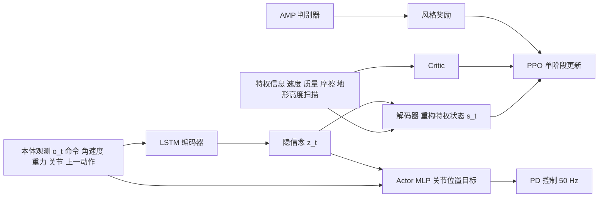

---

type: entity
tags: [paper, humanoid, locomotion, rl, amp, adversarial-motion-prior, sim2real, blind-locomotion, privileged-training, recurrent-policy, sdu]
status: complete
updated: 2026-10-12
project_id: damp-humanoid-denoised-belief-amp
arxiv: "2610.11505"
venue: "arXiv 2026"
summary: "DAMP：无外部地形感知的人形运动控制——LSTM 编码器从本体历史重构特权状态（去噪信念），叠加 AMP 风格奖励与 Lipschitz 惩罚，IsaacGym 单阶段 PPO 训练（约 5 小时），在 Noetix N2 上完成台阶/斜坡/路沿等真机地形；仿真平均地形等级 5.76–5.89 高于 HIM 的 4.54–4.65。"
related:
  - ../overview/frontier-humanoid-quadruped-2026-10-05-10-09.md
  - ../tasks/humanoid-locomotion.md
  - ../methods/amp-reward.md
  - ../concepts/privileged-training.md
  - ../concepts/sim2real.md
  - ../methods/ppo.md
  - ../concepts/recurrent-neural-network.md
  - ./paper-amp-survey-06-natural_humanoid_robot_locomotion_wi.md
  - ./cn-os-noetix-n2-gym.md
  - ../overview/humanoid-amp-motion-prior-survey.md
sources:
  - ../../sources/papers/damp_arxiv_2610_11505.md
  - ../../sources/blogs/frontier_humanoid_quadruped_2026_10_05_10_09.md
---

# DAMP：去噪信念学习 + 对抗动作先验的人形运动控制

**DAMP**（*Humanoid Locomotion via Denoised Belief Learning and Adversarial Motion Priors*，arXiv:2610.11505，山东大学控制科学与工程学院 / 山东省人形机器人重点实验室）是一个**单阶段端到端 RL 框架**：策略只看本体感知（无相机、无高度图），用 LSTM 编码器把历史压成隐信念 z_t 并要求其能重构特权状态，再用 AMP 判别器约束步态自然度，使松延动力 N2 人形在台阶、斜坡、路沿、鹅卵石等地形上稳定行走。

## 英文缩写速查

| 缩写 | 英文全称 | 简要说明 |
|------|----------|----------|
| DAMP | Denoised belief + Adversarial Motion Priors | 本文框架名 |
| AMP | Adversarial Motion Priors | 用判别器度量状态转移与参考动作的相似度，提供风格奖励 |
| HIM | Hybrid Internal Model | 本文仿真对比基线（Huang 等工作，隐式估计速度/环境） |
| PPO | Proximal Policy Optimization | 单阶段训练所用的策略优化算法 |
| LSTM | Long Short-Term Memory | 策略主干与信念编码器的循环网络 |
| DoF | Degrees of Freedom | N2 共 18 DoF，踝关节仅俯仰 |

## 为什么重要

- **盲走是人形部署的常见约束**：许多场馆/赛事场景无法稳定提供外部地形感知，需要纯本体感知策略（见 [CAP 盲人形](./paper-cap-perception-blind-humanoid.md) 对照）。
- **单阶段替代两阶段蒸馏**：特权教师→学生蒸馏流程繁琐，DAMP 把“重构特权状态”作为辅助损失与 PPO 同时训，约 5 小时（RTX 4090，7000 iteration）完成。
- **自然度与鲁棒性一起拿**：AMP 风格奖励与任务奖励联合，消融显示去掉 AMP 与风格奖励后三类地形等级均下降。

## 方法栈 / 流程总览

## 方法

### 观测与网络

- **Actor**：LSTM 主干 + 单头 MLP，输出关节位置目标，PD：τ = kp(a − θ) − kd·θ̇。观测为速度指令 (vx, vy, yaw rate)、基座角速度、重力方向、关节位置/速度、上一动作。
- **Critic（仅训练）**：额外获得基座线速度、负载质量、摩擦、恢复系数、Kp/Kd、电机强度、足端接触与 1.2 m × 0.8 m 地形高度扫描。

### 去噪信念

LSTM 编码器输出隐变量 z_t，解码器重构特权状态 s_t，损失 L = ‖s̃ − s‖² + λ_r‖z‖₁；部署时仅保留编码器与 actor。z_t 的稀疏正则起“去噪”作用（把与任务无关的历史细节压掉）。

### AMP 风格约束与其他项

- 最小二乘判别器作用于状态转移并带梯度惩罚；风格奖励 max(0, 1 − D/4)，总奖励 α·r_task + β·r_style。
- PPO 额外加 Lipschitz 惩罚 E[‖∇_s log π(a|s)‖²] 以平滑策略；足接触奖励用左右脚接触 XOR、双脚同触地计时（< 0.2 s）与站立指令标志。
- 奖励权重（Table I）示例：线速度跟踪 1.2，角速度跟踪 1.0，足端滞空 3.0，碰撞 −50，关节限位 −5.0，速度限位 −10.0。

### 训练与随机化

IsaacGym，单阶段 PPO，7000 iteration ≈ 5 h（RTX 4090）。地形课程含台阶（文中写“88 to 20 cm”，疑为 8–20 cm 笔误）、鹅卵石路、至 15° 坡、20 cm 路沿；前向指令 0–0.8 m/s，偏航率 ±1 rad/s；覆盖距离 > 50% 升难度。随机化：PD 增益与电机强度 0.8–1.2、质心 ±0.05 m、摩擦 0.1–2.0、基座质量 ±5 kg、推力 50–300 N、推力矩 25–100 N·m、每步 0.002 概率扰动。

## 源码运行时序图

**不适用**：arXiv 页面与正文均未提供项目页或仓库，截至 2026-10-12 无官方可运行代码，故无法对齐真实目录与脚本。

## 实验与评测

- **平台**：松延动力（Noetix）N2，18 DoF，1.2 m / 33 kg，策略 50 Hz。
- **仿真平均地形等级（越高越好）**：

| 方法 | Stairs | Slope | Discrete Rough |
|------|--------|-------|----------------|
| DAMP | 5.76 | 5.84 | 5.89 |
| 去掉 AMP 与风格奖励 | 4.74 | 4.89 | 4.32 |
| HIM | 4.54 | 4.65 | 4.33 |
| 去掉 L_denoise | 3.38 | 3.36 | 3.78 |

- 速度估计误差在启动阶段最大、稳态收敛（500 推理步），正文无数值。
- **真机**：每方法、每地形与难度 20 次试验（数值仅在图中，正文未给）；地形含 15 cm 台阶、20° 交错斜坡、石板路、15° 连续斜坡、20 cm 路沿、不规则鹅卵石；论文称完成 2025 世界人形机器人运动会 100 m 障碍赛程并通过竞技场 A–J 全部地形。

## 结论

**DAMP 的核心是“特权状态重构”这一辅助损失：去掉它地形等级降幅最大，而 AMP 主要提供自然度和一部分鲁棒性。**

1. **去噪信念损失最关键** — 去掉 L_denoise 后三类地形等级降到 3.36–3.78（完整版 5.76–5.89），降幅大于去 AMP（4.32–4.89）。
2. **AMP 不只是“好看”** — 去掉 AMP 与风格奖励后等级也下降，但该消融同时去掉了两项，无法分离判别器与风格奖励各自的作用。
3. **单阶段可行** — 约 5 小时即可训完，省去教师蒸馏；代价是 critic 训练期仍用高度扫描，不对称 actor–critic 仍然成立。
4. **勿把“无感知”读成“无地形信息”** — 部署时无外部感知，训练时有特权地形信息。
5. **真机数据读图** — 正文无成功率数值，评估需看原图；与基线的真机对比只能看论文图。
6. **复现门槛** — PPO 超参、α/β/λ 取值、AMP 参考数据未公开，无代码。

## 工程实践

- 部署只需 LSTM 编码器 + actor；特权解码器和判别器只在训练使用。
- 若复刻，先定参考动作来源（原文未说明）并校准 AMP 权重 β；随机化范围可直接采用 Table II。
- **开源状态（核查日 2026-10-12）**：arXiv 页面只列演示视频（<https://youtu.be/AkI7TZB2DDM>），无项目页/GitHub/HF，**未发布**；因此无 `sources/sites/`、`sources/repos/` 条目。

## 局限与风险

- 无局限性章节；超参、网络尺寸、参考动作数据、sim-to-real 定量指标均缺。
- 仅在 N2（1.2 m、18 DoF）验证，迁移到更多自由度的本体需重调。
- 速度/高度分布限于 0–0.8 m/s、至 20 cm 台阶，未覆盖更高速或更陡地形。
- 消融只对比 HIM 与两项去除，缺少 RNN vs MLP、编码器容量等分解（推测需要补充）。

## 与其他工作对比

- [自然人形运动 AMP 综述条目](./paper-amp-survey-06-natural_humanoid_robot_locomotion_wi.md)：同样用 AMP 获得自然步态，DAMP 的差异在于叠加去噪信念，并明确约束“无外部感知”。
- [AMP 动作先验综述](../overview/humanoid-amp-motion-prior-survey.md)：给出 AMP 家族整体谱系，DAMP 属于“AMP + 隐式状态估计”分支。
- [Noetix N2 训练栈](./cn-os-noetix-n2-gym.md)：N2 的社区开源训练环境，可作复现 DAMP 平台的起点（与本文无官方关系）。

## 关联页面

- [人形/四足周报汇总（2026-10-05~10-09）](../overview/frontier-humanoid-quadruped-2026-10-05-10-09.md)
- [人形运动控制任务页](../tasks/humanoid-locomotion.md)
- [AMP 奖励](../methods/amp-reward.md)
- [特权训练](../concepts/privileged-training.md)
- [Sim2Real](../concepts/sim2real.md)

## 参考来源

- [DAMP 论文归档](../../sources/papers/damp_arxiv_2610_11505.md)
- [人形/四足周报来源](../../sources/blogs/frontier_humanoid_quadruped_2026_10_05_10_09.md)
- 论文：<https://arxiv.org/abs/2610.11505>

## 推荐继续阅读

- [arXiv HTML 全文](https://arxiv.org/html/2610.11505v1)
- [DAMP 真机演示视频](https://youtu.be/AkI7TZB2DDM)
