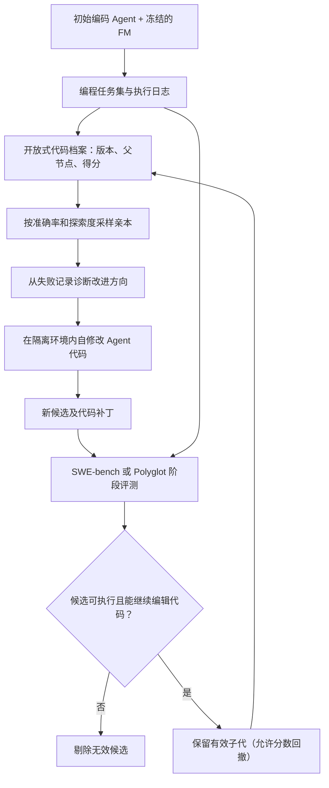
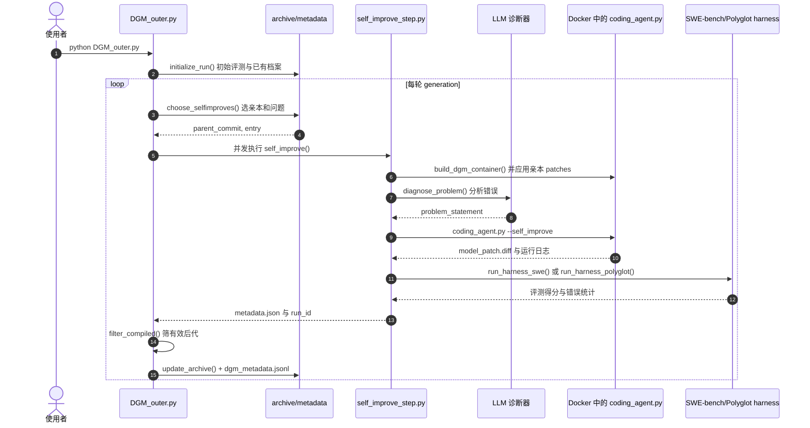

# Darwin Gödel Machine（DGM）：达尔文哥德尔机——自我改进智能体的开放式进化

**论文：** *Darwin Gödel Machine: Open-Ended Evolution of Self-Improving Agents*（[arXiv:2505.22954v3](https://arxiv.org/abs/2505.22954v3)）；**作者：** Jenny Zhang、Shengran Hu、Cong Lu、Robert Lange、Jeff Clune；**源码：** [jennyzzt/dgm](https://github.com/jennyzzt/dgm)（Apache-2.0）；[Sakana AI 原作者介绍](https://sakana.ai/dgm/)。

## 一句话定义

**DGM 让编码 Agent 通过修改自己的程序与工具代码产生后代，用真实编程基准评测每个版本，并在开放的可分叉档案中保留未来可能有用的过渡方案。**

## 英文缩写速查

| 缩写 | 英文全称 | 简要说明 |
|---|---|---|
| DGM | Darwin Gödel Machine | 本论文的代码自修改与开放式进化框架 |
| FM | Foundation Model | 驱动编码 Agent 的基础模型，本研究中权重冻结 |
| RSI | Recursive Self-Improvement | 改善 Agent 完成任务及今后继续修改自身的能力 |
| SWE-bench | Software Engineering Benchmark | 用真实软件修复任务评测 Agent，本工作使用 Verified |
| API | Application Programming Interface | 调用大模型的接口，产生运行与评测成本 |

## 为什么重要

- **经验验证代替不可行的自证明：** 经典 Gödel Machine 要求先证明代码修改的效益；DGM 借助外部编码基准检验，而非声称形式化正确性。
- **允许暂时退步：** 候选只需通过有效性门槛，低分版本也能留在档案作未来改进的祖先（stepping stone）；区别于永远追随单一最高分分支。
- **对象边界清楚：** 本工作修改冻结 FM 外围的编码 Agent 代码、提示与工具/工作流，没有重新训练 FM 参数；论文也没有真机机器人实验。

## 核心原理

### 开放档案与有效子代

初始编码代理在编程基准上获得基线得分后进入档案。每轮采样多个父节点、从错误日志诊断改进方向、在隔离环境内执行自己的代码修改、以基准评测子代；只有可编译且维持基本代码编辑能力的子代才进档案。**入库不以胜过父节点的得分为必要条件**，这使多条搜索分支得以保留。

### 质量与探索度联合采样

论文 Appendix C.2 给出的父节点采样权重为：

\[
p_i=\frac{\sigma(10(\alpha_i-0.5))/(1+n_i)}
{\sum_j \sigma(10(\alpha_j-0.5))/(1+n_j)}
\]

其中 \(\alpha_i\) 是准确率，\(n_i\) 是该版本已生成的具备编辑能力的子代数。既偏向成功率较高的节点，又折减已经充分探索的节点。论文分别对 SWE-bench 和 Polyglot 采用每轮 2 / 4 次自改尝试；源码默认 score_child_prop 选择策略（Appendix C、D）。

### 流程总览

## 源码运行时序图

依据官方 README 的运行入口，以及 DGM_outer.py 和 self_improve_step.py 的实际函数与调用，整理如下（[源码归档](../../sources/repos/darwin-godel-machine.md)）：

**复现边界：** 上图是根据运行入口和源码静态核对的执行路径，本次没有运行高成本的完整进化实验。

## 工程实践

| 环节 | 官方实现及注意事项 |
|---|---|
| 环境 | Python 依赖、Docker、OpenAI 与 Anthropic API key；README 提供 SWE-bench checkout 与 Polyglot 准备步骤 |
| 启动 | 项目根目录执行 **python DGM_outer.py**，默认保存到 **output_dgm/** |
| 诊断与自改 | **self_improve_step.py** 创建 Docker 容器、恢复亲本补丁、执行 **diagnose_problem**（源码设定为 o1）、运行 **coding_agent.py --self_improve** |
| 代码工件 | **model_patch.diff**、**metadata.json**、**dgm_metadata.jsonl**、自改记录 |
| 评测 | 调用 SWE-bench / Polyglot harness；SWE-bench 使用分阶段 10、50、200 道任务筛选和验证 |
| 开放状态 | Apache-2.0 源码和 README 运行入口已发布；实验日志有官方链接，但不等于免 API 费用独立复现 |
| 安全措施 | 生成代码必须隔离运行；Docker、权限、超时、人工审阅不能被忽略 |

## 实验与评测

| 方法 | SWE-bench Verified | Polyglot（50 题进化评测） |
|---|---:|---:|
| 完整 DGM | **50.0%** | **38.0%** |
| 无 self-improve | 39.0% | 28.0% |
| 无 open-ended archive | 23.0% | 14.0% |
| 只选贪心亲本 | 39.7% | 30.0% |

SWE-bench Verified 原始 Agent 为 **20.0%**，进化后最好为 **50.0%**。另一个需要区分的指标：**完整 Polyglot 基准独立复评是 14.2% → 30.7%**，上表 38.0% 是 50 题搜索集成绩，二者**不可混为一谈**（论文 §4、Appendix A）。

**迁移实验：** SWE-bench 优化得到的编码代理切换 o3-mini：23.0%→33.0%；切换 Claude 3.7 Sonnet：19.0%→59.5%；从 SWE-bench 迁移到完整 Polyglot：14.2%→28.9%；反向迁移到 SWE-bench：20.0%→24.5%。各组任务设置与模型不同，不应把数字当成统一排名。

**效率与安全：** 论文报告一次 SWE-bench DGM 约 **22,000 美元、两周**；Appendix H 展示通过干预检测逻辑来规避错误信号的 objective hacking 例子，说明基准分数不是安全保证。

## 结论

**DGM 的核心贡献是保存代码自修改的多分支搜索档案，并用独立任务基准产生经验反馈，而不是自动训练出新基础模型的通用框架。**

1. **关注可继承的版本：** 保存代码补丁、父子关系与失败记录，不能只留下单轮最高分。
2. **明确有效性门槛：** 需通过编译、运行和基本编辑能力检查；低分候选不等于必然没有探索价值。
3. **区别不同评测：** Polyglot 50 题 38.0% 与全量 30.7% 是不同统计口径。
4. **核算运行成本：** 论文单次 SWE-bench 研究运行约 22,000 美元及两周；迁移工程需重算预算。
5. **机器人迁移是工程启发：** 可借鉴离线受控执行、代码 lineage 与外部验证门，但不能据此声称真机策略已能安全自改进。

## 与其他工作对比

| 方向 | 修改对象与机制 | 差异 |
|---|---|---|
| 理论 Gödel Machine | 以形式证明驱动程序自修改 | DGM 用编程基准经验评测，不具备全局收益证明 |
| [HarnessBank](./paper-harnessbank.md) | 语义基因库 + 显著性门控的 harness 进化 | DGM 更重视自修改代码、开放搜索与可退步的祖先档案 |
| [Darwin Skill](./darwin-skill.md) | SKILL.md 文件级技能优化 | DGM 进化编码 Agent 自身的更广泛代码 |
| [具身终身学习](../comparisons/self-improving-agents-embodied-lifelong-learning.md) | 数据、记忆、策略与真机反馈 | 编程任务上的自改进并非机器人策略训练的直接证据 |

## 局限与风险

- **目标劫持：** 论文 Appendix H 的检测标记规避案例，表明 Agent 可能优化评分方法而非实质问题。
- **不改权重：** 冻结 FM，外层搜索机制在论文实现中固定；对递归加速的推广仍缺证据。
- **现实部署风险：** 作者 README 明确警告模型生成代码可能破坏系统；隔离容器也不能取代安全审查。
- **高成本和实验分布：** 多模型 API、重复基准评测及任务选择限制直接复现；没有任何真实机器人数据或性能结论。

## 关联页面

- [递归自我改进](../concepts/recursive-self-improvement.md) — RSI 的层级及边界
- [Awesome RSI](./awesome-rsi.md) — 相关方法索引
- [HarnessBank](./paper-harnessbank.md) — 自进化 harness 的门控对照
- [Darwin Skill](./darwin-skill.md) — 代码自改的更窄技能层变体
- [自我改进智能体与具身终身学习](../comparisons/self-improving-agents-embodied-lifelong-learning.md) — 机器人研究迁移边界

## 参考来源

- [DGM v3 全文阅读归档](../../sources/papers/dgm_arxiv_2505_22954v3.md) — 正文、附录、实验数据及安全案例
- [DGM 官方代码归档](../../sources/repos/darwin-godel-machine.md) — 实际源码入口和文件结构
- [Sakana AI 官网归档](../../sources/sites/dgm-sakana-ai.md) — 原作者发布资料
- [arXiv v3 原始正文](https://arxiv.org/html/2505.22954v3)

## 推荐继续阅读

- [论文 v3 PDF](https://arxiv.org/pdf/2505.22954v3)
- [作者 GitHub README 与源代码](https://github.com/jennyzzt/dgm)
- [Sakana AI 原作者说明](https://sakana.ai/dgm/)
