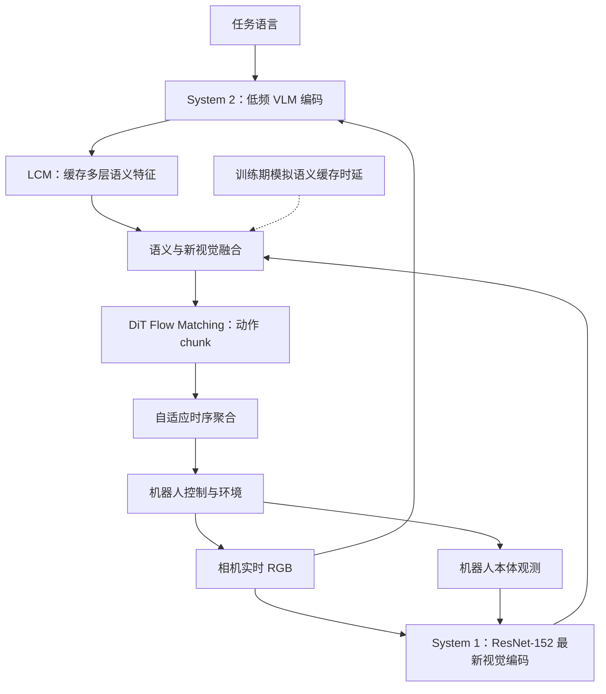

# DASH：面向人形机器人的异步视觉语言动作控制
**DASH — Asynchronous Humanoid Vision-Language-Action Control**

## 一句话定义

DASH 把大模型产生的**低频语义特征**与轻量动作策略读取的**最新视觉观测**拆成两个并行服务，使新相机帧不必等待慢速 VLM 推理，仍能高频输出人形操作动作。

## 英文缩写速查

| 缩写 | 英文全称 | 简要说明 |
|---|---|---|
| VLA | Vision-Language-Action | 视觉、语言、动作联合的机器人策略 |
| VLM | Vision-Language Model | 提取任务语义的慢速多模态主干 |
| DiT | Diffusion Transformer | 动作侧的扩散/流匹配网络结构 |
| LCM | Latent Context Manager | 缓存和传递慢速语义上下文的组件 |
| RTC | Real-Time Chunking | 连续动作片段提前生成/衔接的相关实时机制 |
| Hz | Hertz | 每秒控制或观测的循环频率 |

## 核心信息

| 维度 | 结论 |
|---|---|
| 原文 | [arXiv:2611.11854v1](https://arxiv.org/html/2611.11854v1) |
| 慢分支 System 2 | Qwen3.5 0.8B 或 Qwen3-VL 2B/4B/8B，输出语义特征 |
| 快分支 System 1 | ResNet-152 新鲜视觉特征 + DiT flow-matching 动作头 |
| 工程结构 | 多服务并行、慢语义缓存、快动作与环境反馈闭环 |
| 数据/评测 | RoboTwin 50 任务；真实 pick-and-place |
| 开放 | 论文未列明可以核验的官方可执行训练/推理仓库 |

## 为什么重要

同步的 VLA 通常是「拍一帧 → 等待 VLM → 生成 action chunk → 执行」，大语言视觉模型变大时会直接拉低执行频率。DASH 的关键不是仅把推理 GPU 加快，而是**允许快分支边执行边消费最近一次有效的慢分支语义信息**。它与 [LHNav](./paper-lhnav.md) 的任务层级控制互补：一个解决单次执行时延，一个解决跨目标任务分解。

## 流程总览（原文 System 1 / System 2）

**虚线是训练阶段的时延鲁棒性建模，不表示部署时需要额外模型反馈。** 慢分支与快分支可并行，数据到达未必同一采样时刻。

## 核心原理

### 1. 跨时刻语义缓存

VLM 的语义特征并非每个控制 tick 都重算；LCM 复用最近完成的特征。System 1 始终处理较新的 RGB 与状态，避免动作侧所有信息同时过时。缓存可能仍然滞后，不能声称语义条件始终实时。

### 2. 异步一致性训练

只在同步样本上训练、部署再任意缓存 VLM 特征，会造成 semantic-time 与 visual-time 的分布错位。DASH 在训练时显式模拟语义过时、视觉更新的组合，使策略能够消费时间上不完全同步的条件。这是方法贡献，不仅仅是 GPU pipeline 优化。

### 3. 动作连续性

快分支 DiT 按 flow-matching 预测 action chunks；论文采用时间聚合规则结合多个连续更新的动作提案，避免分块切换造成关节命令突跳。务必把**控制频率、VLM 特征更新频率、chunk 长度**分别记录。

## 实验与评测

| 项目 | 论文作者报告 |
|---|---|
| RoboTwin | 50 任务；各配置 250 episodes，涉及 0.8B–8B 慢模型 |
| 控制频率 | DASH 维持约 **20 Hz**；同步链对较大模型约 **9.7→4.1 Hz** |
| 同协议成功率 | 异步方案对同步方案约 +1 至 +5.9 个百分点（依模型/任务变化） |
| 真机 pick-and-place | DASH **23/24 = 95.8%**，同步 **16/24 = 66.7%** |

注意：频率越高不直接推出成功率越高；论文还涉及训练/融合设计。真机仅 24 trials/配置，不能将 95.8% 当作无置信区间的部署承诺。

## 与其他工作对比

- [VLA 方法](../methods/vla.md) 的一般多模态策略训练与动作头；DASH 专门约束语义缓存与视觉时序不一致。
- [Action Chunking](../methods/action-chunking.md) 的分块执行；DASH 进一步使慢编码不阻塞快 chunk。
- [LHNav](./paper-lhnav.md) 将任务管理、导航 VLA 与步态分层；DASH 解决的是**操作控制**的异步特征与快视觉闭环。
- [VLA Adaptation Chess](./paper-vla-adaptation-chess.md) 在可重复 MuJoCo/SO-101 任务中研究动作训练量与时间片段，DASH 研究系统推理时延与异步融合；实验任务不同，不能直接横比成功率。

## 源码运行时序图

**不适用（截至 2026-11-11）：** 原文未给出可核实的官方训练/推理仓库及调用入口。上面的 Mermaid 是论文明确的**方法/系统模块关系**，不能冒充实际源码 `sequenceDiagram`。

## 工程实践

1. 为慢 VLM 输出打时间戳，测量语义缓存的实际 age，防止控制线程静默消费极端陈旧的上下文。
2. 对快分支的新视觉、action chunk 排队时延、低层控制频率分别打点；测任务完成率而非只测模型吞吐。
3. 在本体变化或动态障碍情景，检查 semantic age 上限/安全退化策略；论文不提供可直接复用的生产级实现。

## 局限与风险

- 官方未开放可识别的完整可运行代码，复现困难；本文没有独立运行结果。
- 当前主要实验针对结构化、准静态任务，不能推断高速动态场景或强力接触操作的安全闭环。
- 语义缓存长期过时、跨视角变化及控制器尾部时延对人形硬件仍需验证。

## 结论

**DASH 证明 VLM 语义可低频、动作视觉可高频，但获得高成功率还依赖时间错位训练与动作聚合，而非直接缓存一个旧 embedding。**

1. 分别计量 System 1 与 System 2 的吞吐、排队时延和时间戳。
2. 复现实验必须同时比较同步/异步、是否训练语义滞后、是否进行时序聚合。
3. 成功率与 Hz 不能跨模型/任务协议相加或直接对应。
4. 真机部署应配置独立安全控制器和缓存失效处理。

## 关联页面

- [VLA 方法](../methods/vla.md)
- [Action Chunking](../methods/action-chunking.md)
- [LHNav：长程人形导航](./paper-lhnav.md)
- [VLA Adaptation Chess：真实/仿真微调](./paper-vla-adaptation-chess.md)

## 参考来源

- [DASH 论文原文深读](../../sources/papers/dash_arxiv_2611_11854.md)

## 推荐继续阅读

- [DASH arXiv HTML 全文](https://arxiv.org/html/2611.11854v1)
- [人形 VLA 系统与控制时序的讨论](../methods/vla.md)
