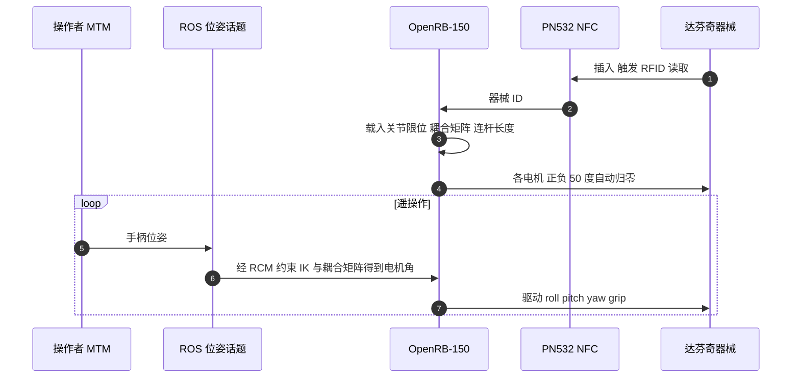

# DASH：面向串联机械臂与人形机器人的达芬奇器械适配器

**DASH**（*A da Vinci Adapter for Serial-link and Humanoid Robots as an Accessible Platform for Surgical Robotics Research*，arXiv:2610.05792，UCSD Michael Yip 团队）是一套**机械–电气适配器 + 软件**：不改装达芬奇 Classic 与 Xi 器械，就能把它们装到通用机械臂（Franka Emika Panda）和人形机器人（Unitree G1）上，并通过 NFC 识别器械类型、自动载入对应运动学，让通用机器人参与腹腔镜/手术机器人研究。

## 英文缩写速查

| 缩写 | 英文全称 | 简要说明 |
|------|----------|----------|
| DASH | da Vinci Adapter for Serial-link and Humanoid robots | 本文适配器平台 |
| RCM | Remote Center of Motion | 器械轴必须绕切口固定点运动的约束；本文用软件“远程 RCM” |
| MTM | Master Tool Manipulator | 达芬奇主端手柄，发布手柄位姿到 ROS |
| NFC | Near-Field Communication | PN532 读取器械背面 RFID 贴纸以识别器械 |
| DoF | Degrees of Freedom | Classic 器械 4 DoF，所用 Xi 器械也是 4 DoF |
| MIS | Minimally Invasive Surgery | 微创手术，研究背景 |

## 为什么重要

- **降低手术机器人研究门槛**：专用平台昂贵且封闭；DASH 让已有的通用臂/人形用上真实达芬奇器械（对比此前只能用手持器械经被动连杆连接的方案）。
- **补齐人形手术链条**：[Humanoid Surgeon](./paper-humanoid-surgeon-in-vivo-laparoscopy.md) 与 [LapSurgie](./paper-notebook-lapsurgie-humanoid-robots-performing-surgery-via.md) 证明人形做腹腔镜的可行性，DASH 提供更接近临床的原生器械接口（同组 UCSD，Zekai Liang 与 Yip 为共同作者）。
- **自动化换器械**：RFID 识别 + 自动归零让更换器械成为数秒级操作。

## 方法栈 / 流程总览

## 方法

### 机械与驱动

- **两种适配器**：DASH C（Classic）与 DASH Xi；整机质量 < 0.5 kg（含最重器械：C 0.439 kg，Xi 0.463 kg）；经可更换腕部接口板装到 G1 与 Panda；负载指标原文未给。
- **电机**：DYNAMIXEL XC330-T181-T，TTL 总线；Classic 4 个电机，Xi 最多 5 个；11.1 V 下堵转电流 3.2 A（C）/ 4.0 A（Xi）；控制板 OpenRB-150，电机延迟约 5 ms。
- **锁止**：Classic 用弹簧锁止板（约 3 mm 压缩）；Xi 用卡扣接入器械自带锁止，3 mm 波形弹簧提供至多 2 mm 压缩，保持原生锁止，无需改装器械。

### 识别与软件

- PN532 NFC 读取器械背面 RFID 贴纸，载入该器械关节限位、耦合矩阵与连杆长度；两状态机在“寻找器械”和“控制电机”间切换；插入后自动归零（每个电机 ±50° 往返）。
- 运动学：URDF 正运动学 + 腕部 Modified DH；RCM 约束使 7 关节臂剩 4 个冗余 DoF，由姿态目标解决；轴需保持在 RCM 周围 10 mm 直径内。
- 耦合矩阵把盘角映射到 roll/pitch/yaw/grip；Xi 矩阵因官方未公开而实验测定。

## 源码运行时序图

**不适用**：arXiv 页面与正文均未提供仓库、CAD 或项目页，截至 2026-10-12 无官方可运行代码。下图为论文描述的**器械插入到遥操作的运行流程（非仓库时序）**：

## 实验与评测

- **识别与归零**：Classic 40/40（4 种器械 × 10 次），Xi 20/20（2 种 × 10 次）。
- **换器械时间**：Classic 4.74 ± 1.15 s，Xi 3.39 ± 0.51 s（各 10 次）。
- **系统延迟**：20.3 ± 15.7 ms，先前人形腹腔镜系统报告为 156 ms。
- **画圆（指令半径 40 mm，3 次）**：DASH 41.45 ± 0.30 mm，先前系统 49.83 ± 1.09 mm；平面外误差 DASH 1.50 ± 0.61 mm，先前系统 1.23 ± 0.14 mm（先前系统有物理 RCM 约束，更小的平面外误差可能源于此）。
- **RCM 收敛**：两个估计 RCM 相距 15.79 mm（轴长 410 mm）；枢轴误差 3.37 ± 2.44 mm 与 2.64 ± 1.54 mm，在 10 mm 界内。
- **Xi 耦合**：两把 8 mm 器械在 0°–90° 范围测量，以近零斜率判可接受，无标量精度。

## 结论

**DASH 证明“原生达芬奇器械 + 通用机器人”在接口与延迟层面可行，但距离手术级验证还差完整任务与临床流程。**

1. **接口层成熟度高** — 60/60 次识别归零成功，换器械 3–5 s。
2. **延迟显著低** — 20.3 ms 对 156 ms，但抖动较大（±15.7 ms）。
3. **精度读法要谨慎** — 画圆半径误差 1.45 mm，但先前系统有物理 RCM，平面外误差反而更小。
4. **回差是主要误差源** — Xi roll 与镊类器械 pitch 的波动来自适配器/器械回差。
5. **临床验证缺口** — 未做完整手术任务、灭菌或外科医生操作 MTM。
6. **复现门槛** — 无 CAD/代码，需等待作者发布或自行重制。

## 工程实践

- 若自建：优先复刻识别 + 自动归零流程，再调耦合矩阵；Xi 耦合矩阵需自己测定。
- 选机器人：Panda 与 G1 经腕部接口板切换；负载与动态极限需自行评估。
- **开源状态（核查日 2026-10-12）**：arXiv 页面无项目页、代码、CAD 链接，也无开源声明，**未公开**；无 `sources/sites/`、`sources/repos/` 条目。

## 局限与风险

- 作者明确称未在完整手术任务下验证，未测灭菌，也未让外科医生操作。
- 远程 RCM 无物理约束，误差来自软件配准。
- 回差影响 Xi roll 与部分器械 pitch。
- 结果为台架测试，非临床。

## 与其他工作对比

- [Humanoid Surgeon（Nature 2026）](./paper-humanoid-surgeon-in-vivo-laparoscopy.md)：活体腹腔镜胆囊切除，用的是通用器械；DASH 把原生达芬奇器械接上，两者互补。
- [LapSurgie](./paper-notebook-lapsurgie-humanoid-robots-performing-surgery-via.md)：前作人形腹腔镜遥操作，本文用其作延迟与画圆的对比基线（156 ms；49.83 mm）。
- [TDHD 手术双臂](./paper-tdhd-surgical-dual-arm.md)：专用双臂手术系统，DASH 面向通用平台。

## 关联页面

- [人形/四足周报汇总（2026-10-05~10-09）](../overview/frontier-humanoid-quadruped-2026-10-05-10-09.md)
- [遥操作任务页](../tasks/teleoperation.md)
- [Unitree G1](./unitree-g1.md)
- [Franka Research 3](./franka-research-3.md)

## 参考来源

- [DASH 论文归档](../../sources/papers/dash_arxiv_2610_05792.md)
- [人形/四足周报来源](../../sources/blogs/frontier_humanoid_quadruped_2026_10_05_10_09.md)
- 论文：<https://arxiv.org/abs/2610.05792>

## 推荐继续阅读

- [arXiv HTML 全文](https://arxiv.org/html/2610.05792v1)
- [Humanoid Surgeon 项目页](https://humanoid-surgeon.github.io/)
