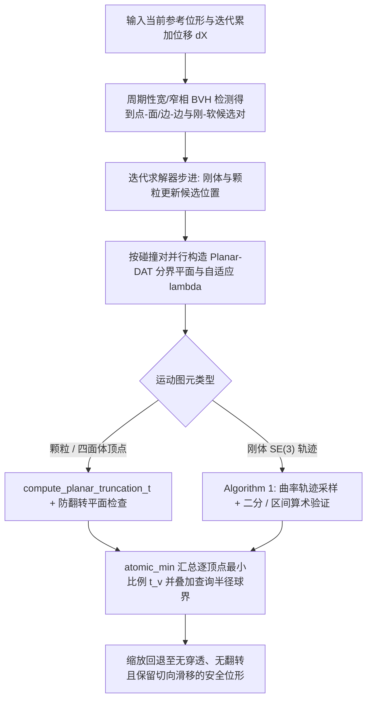
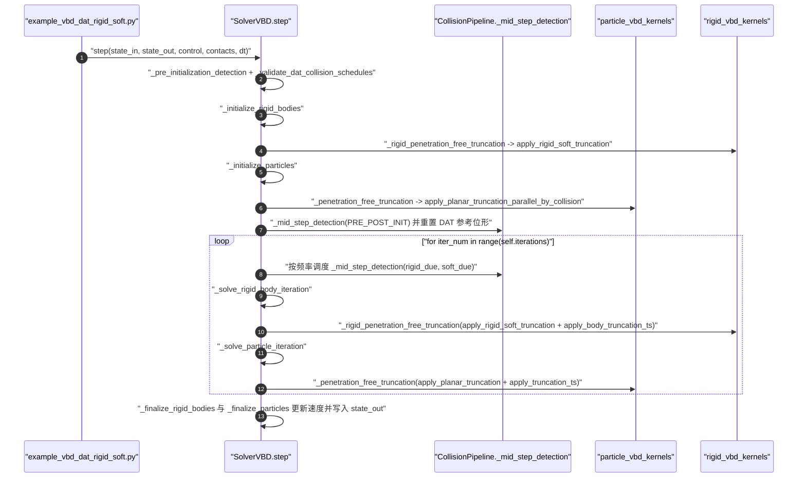

# DAT：Divide and Truncate 多物理无穿透接触

**Divide and Truncate（DAT）**（*A Penetration and Inversion Free Framework for Coupled Multi-physics Systems*，[arXiv:2604.15513](https://arxiv.org/abs/2604.15513)，SIGGRAPH 2026）由 **NVIDIA**（含 Newton 核心作者 Miles Macklin）与合作者提出：在 **刚体、四面体软体、薄壳布料、Cosserat 杆与动画碰撞体** 共存的耦合场景中，通过 **半空间划分与逐节点/刚体位移截断** 保证全程 **无穿透、无四面体翻转（inversion-free）**。核心变体 **Planar-DAT** 仅约束各侧朝向分割平面的法向靠近位移、保留切向自由移动，解决了各向同性球面截断带来的 **切向阻尼与接触死锁**，并已作为核心机制集成于 [Newton](./newton-physics.md) 的 `SolverVBD` 求解器。

## 一句话定义

**为每一对潜在碰撞图元构造带自适应分配比例的半空间分界平面并截断过界位移，使不同材料求解器在不互相了解本构的前提下获得几何无穿透、无翻转与切向无锁死耦合。**

## 英文缩写速查

| 缩写 | 英文全称 | 简要说明 |
|------|----------|----------|
| DAT | Divide and Truncate | 空间互斥划分与位移截断统一接触框架 |
| Planar-DAT | Planar Divide and Truncate | 基于半空间切分的 DAT 变体，释放切向滑动 |
| OGC | Offset Geometric Contact | 先前各向同性半径截断接触法（Isotropic-DAT 基线） |
| CCD | Continuous Collision Detection | 连续碰撞检测，全局步长回退易在高接触密度下卡死 |
| VBD | Vertex Block Descent | 顶点块下降求解器，Newton 中承载 DAT 的主要后端 |

## 为什么重要

多物理机器人与仿真环境（刚体抓手/足端 + 布料 + 软体 + 绳索/杆件）长期受困于接触「两难」：
- **惩罚力/柔顺接触**：面对高速、大质量比或大步长冲击极易发生穿透隧道（tunneling），单靠调高刚度会引爆数值刚性；
- **全局连续碰撞检测（CCD）**：单一慢速碰撞对即可通过全局最小 TOI 把整套系统步长锁死到接近停滞，且无法脱离优化器独立插拔；
- **传统各向同性截断（Isotropic-DAT / OGC）**：把顶点限制在距离最近图元一半的球域内，虽可保证无穿透，但会同时砍掉平行于表面的滑动与滚动（在紧致堆叠或扭转场景中呈现强人工粘滞）。

DAT 把「几何可行性」从具体材料能量和刚度公式中抽离为纯几何后处理：无论后端求解器采用 VBD、XPBD 还是其他迭代优化器，只要按碰撞对插入平面截断核函数，就能在不引入接触能量刚性项的情况下稳住高速度、百万级接触对的耦合系统。

## 核心原理

### 核心信息

| 维度 | 内容 |
|------|------|
| **论文** | *A Penetration and Inversion Free Framework for Coupled Multi-physics Systems*（SIGGRAPH 2026） |
| **作者 / 机构** | Anka H. Chen（NVIDIA）、Jerry Hsu（ZeroMatter）、Youssef Ayman（American Univ. in Cairo）、Miles Macklin（NVIDIA） |
| **统一对象** | 刚体（SE(3) 曲率轨迹）、四面体软体（含防翻转）、薄壳/布料、Cosserat 杆、预设动画体 |
| **实现位置** | 已开源并合入 [Newton](https://github.com/newton-physics/newton)（`SolverVBD` + `example_vbd_dat_rigid_soft.py`） |

### 关键数学机制

1. **Planar-DAT 自适应半空间分割：**
   给定碰撞检测时刻参考位形下的点–面图元对 $(v, t)$（边–边对对称处理），设面片上距离顶点 $x_v$ 最近的支撑点为 $c_{v,t}$，单位接触法向 $n_{v,t} = \mathrm{normalize}(x_v - c_{v,t})$。Planar-DAT 在两图元之间放置垂直于 $n_{v,t}$ 的分界平面，过点：
   $$p_{v,t} = x_v - \lambda_{v,t}(x_v - c_{v,t})$$
   其中分配比例 $\lambda_{v,t} = \frac{\delta_t}{\delta_t + \delta_v}$ 由双方候选位移沿法向的**逼近分量**自适应决定：
   $$\delta_v = \max(-dx_v \cdot n_{v,t}, 0), \quad \delta_t = \max\Big(\max_{k \in \{a,b,c\}} dx_k \cdot n_{v,t}, 0\Big)$$
   （若两侧均未相互逼近则取 $\lambda_{v,t}=0.5$）。这样只有真正朝分界平面高速冲去的一侧会分走更小安全裕度，静止或背离运动的另一侧不被无端限位；而与表面平行（切向）的位移分量满足 $dx \cdot n_{v,t} = 0$，完全不受截断。

2. **Theorem 3.1 与逐顶点快速截断：**
   论文证明：一个三角形仍留在其凸互斥区域内的充要条件是它的**三个顶点**全部满足半空间不等式（Theorem 3.1）。因此平面约束可以直接分解到逐顶点计算合法缩放比例 $t_v = \gamma_r t_i$（引入保守松弛系数 $\gamma_r \in (0,1)$，Newton 默认 `dat_conservative_bound_relaxation = 0.85`，防止恰好贴上分界面导致下一轮无解），无需像 Divide-and-Project（DAP）那样迭代求解耦合二次规划。当单次检测周期内位移超出空间查询半径 $r_q$ 时，位移上界自动退化为半径 $0.5 \gamma_r r_q$ 的各向同性安全球以保底无穿透。

3. **四面体防翻转与刚体弧线截断（Sec. 3.5–3.6）：**
   - **体网格防翻转（Inversion-free）：** 限制四面体每个顶点不能越过其对侧面所在平面——公式与点–面 Planar-DAT 约束完全同构，同一核函数一次完成穿透与翻转双重过滤。
   - **刚体旋转自由度（Algorithm 1）：** 刚体既有平移也有旋转，质点轨迹 $\phi_i(t) = R(\theta_i + t\,\Delta\theta)\hat{x}_i + x_i + t\,\Delta x_i$ 为非线性空间曲线。Newton/论文通过两阶段二分求根求解全刚体一致截断因子 $t_b$：第一阶段在 $t\in[0,1]$ 上等距采样 $K$ 步（如 $K=8$）检测并二分首个可能穿过分界面的时间点；第二阶段进一步可用区间算术（interval arithmetic，`rigid_soft_dat_use_interval_arithmetic`）对残余弧线做严格包络二分验证。根据 Theorem 3.2，刚体三角面穿面当且仅当至少一个顶点轨迹穿面，最后将刚体平移和旋转角增量整体缩放 $t_b$。

4. **碰撞对并行与周期性 BVH 检测（Alg. 2–3）：**
   按活跃碰撞对（而非逐顶点遍历邻接碰撞列表）并行计算各顶点与刚体的局部截断因子，再通过浮点 `atomic_min` 写回全局最小值（论文测量比逐顶点循环快约 $20\times$，比块内归约快约 $2\times$）。由于每次 BVH 检测间累计存储相对位移 $\Delta X$，求解器可每 5 轮或按固定频率刷新碰撞（兼容 CUDA Graph 静态捕获）而依然保持刚性无穿透保证。

### 流程总览

## 实验与评测

原文 §5 在单张 **NVIDIA RTX PRO 6000 Blackwell** GPU 上搭配 VBD + GPU BVH 完成了控制变量基准与 10 组高难度多物理压力测试（Table 1、Table 2、Fig. 5、Fig. 16）：

| 评测维度 | 测试场景 / 规模 | 关键结果 |
|------|------|------|
| **900 万随机三角形受控位移保留（Table 2）** | 随机近距三角形对（纯平移 / 旋转+平移） | Planar-DAT 平均保留有效位移为 Isotropic-DAT（OGC）的 **2.22x / 2.34x**，99 分位达 **14.1x / 17.4x**，最大 **157.6x / 178.2x**；相对全局 CCD 平均高出 **265x / 289x** |
| **200 层布料重压堆叠（Table 1）** | 400 万顶点、784 万三角面、>2000 万接触对，$\Delta t=1/600\text{ s}$ | 10 步迭代下仅需 **12.6–18.1 ms/step**（约 **8 Eff. FPS**）全程无穿透；同等参数下 OGC（Isotropic-DAT）彻底失败卡死 |
| **线膛枪高速弹丸穿管（Table 1）** | 9.7K 顶点、46.6K 四面体，$\Delta t=1.7\times 10^{-5}\text{ s}$ | 弹丸速度达 **369 m/s**（摘要计 >370 m/s）仍稳定无穿透，单步仅 **1.0 ms** |
| **齿轮碾压/绳结释放/混合刚柔体（Table 1）** | 13 万 Cosserat 杆纱线扭转、齿轮啮合软体 Armadillo 等 10 场景 | 纱线释放场景 0.45 ms/step，而 Isotropic-DAT 发生死锁；高密接触下大步长运行总体墙钟速度比 Isotropic-DAT 快 **$\ge 2\times$** |
| **步内耗时拆解与收敛速率（Fig. 5 & Fig. 16）** | 布料扭转接触拆解 & 与 DAP / 全局 CCD 对比 | 单步耗时：碰撞检测 **63.5%**、力与 Hessian **13.8%**、Planar 截断 **12.8%**、其他 **9.9%**；Planar-DAT 每步比 DAP 快约 **50x**、比全局 CCD（~16 ms/iter）快一个数量级以上，取得最佳单位时间残差下降 |
| **Newton `example_vbd_dat_rigid_soft.py` 实测** | 双层布料蹦床 + 6 个 4–10 kg 高速旋转刚体投射物 | 在 1–2 子步下纯惩罚接触会穿透 6–15 mm，开启 `rigid_soft_enable_dat=True` 后完全无穿透；CUDA Graph 下仅增加约 3% 帧耗时（23.8 → 24.5 ms） |

## 结论

**总判：Planar-DAT 用碰撞对并行的半空间自适应平面截断代替昂贵的全局 CCD 或带切向粘滞的球形截断，在保持严格几何无穿透与无翻转的同时，把多物理耦合的工程落点压缩到单步 ~10% 的纯几何核开销并合入 Newton。**

1. **有刚–软–壳混合且怕穿透穿模才开 DAT：** 纯开链刚体 RL（无布料/软体或不需要硬无穿透）优先走 MuJoCo/Kamino 接触即可。
2. **默认选用 Planar-DAT 而非全向球截断：** 全向截断会让旋转和滑动部件在密接时彻底卡死，Planar-DAT 通过自适应 $\lambda$ 把切向自由度完全还给摩擦本构。
3. **一定搭配足够覆盖每检测步最大位移的查询半径 $r_q$：** 运动预算受 $0.5 \gamma_r r_q$ 兜底；在 Newton 中 `soft_contact_gap` 与 `particle_self_contact_gap` 设得过小会被 DAT 当成速度上限强行节流。
4. **生产部署尽量开启 CUDA Graph：** Newton 示例实测 Graph 捕获时 DAT 仅增约 3% 帧耗，而未开 Graph 时多次逐颜色/逐迭代小核函数发射会导致 ~40% 主机侧开销。
5. **与摩擦/冲量求解解耦理解：** DAT 只做几何可行域截断，真正决定抓握滑移率与接触恢复系数的是 VBD 摩擦、ALM 刚度与外层迭代次数。

## 与其他工作对比

| 路线 | 几何防穿透原理 | 切向滑动表现 | 单步扩展性与代价 |
|------|----------------|--------------|------------------|
| **Planar-DAT（本文）** | 半空间分界平面 + 自适应比例 $\lambda$ + `atomic_min` 逐顶点/刚体截断 | **切向无阻碍**，保留滑动与滚动 | 仅增加 ~12.8% 单步计算，支持周期性 BVH 检测与 2000 万级接触对 |
| **Isotropic-DAT（OGC）** | 以距最近表面一半的各向同性安全球限制顶点步长 | 强行截断切向步长，密接场景易出现人工阻尼与死锁 | 计算略快（~10%），但需更小步长且高密场景整体慢 $\ge 2\times$ |
| **Divide-and-Project（DAP）** | 用 Dykstra 投影求解 Hessian 度量下逐顶点凸多面体投影 | 切向表现接近 Planar-DAT | 迭代求解多约束冲突耗时约为 Planar-DAT 的 **~50x** |
| **全局 CCD（连续碰撞检测）** | 回退整个仿真步到全局最早首次碰撞时间 TOI | 理论上保留，但往往未移动先卡停 | 单步每轮可比 Planar-DAT 慢 **~10x+**，有效位移缩水两个数量级 |
| **IPC 类障碍函数方法** | 将对数势能障碍直接写入隐式全局线性/非线性系统内部 | 靠隐式耦合自然产生法向与切向阻尼 | 步长受牛顿线搜索约束，难以像后处理一样免修改嵌入多求解器 |
| **[Particles4All](./particles4all.md)** | 将所有物体转为粒子在单环 PBD 内投影 | 依赖粒子颗粒度与位置松弛次数 | 适用于统一粒子轻量实时场景，而非高刚度异构求解器精确耦合 |

## 源码运行时序图

以下时序图严格对齐 [Newton](https://github.com/newton-physics/newton) 中的 `newton/examples/multiphysics/example_vbd_dat_rigid_soft.py`、`SolverVBD.step`（`newton/_src/solvers/vbd/solver_vbd.py`）与 `particle_vbd_kernels.py` / `rigid_vbd_kernels.py` 核函数调用链：

## 工程实践

| 实践要点 | 建议做法 |
|------|----------|
| **可运行算例定位** | 运行 `python -m newton.examples vbd_dat_rigid_soft`，对应 `newton/examples/multiphysics/example_vbd_dat_rigid_soft.py` |
| **开启刚–软联合截断** | 在 `SolverVBD` 中设置 `rigid_soft_enable_dat=True` 并传入 solver 托管的 `collision_pipeline`，同时启用 `enable_rigid_soft_full_surface_contact=True` |
| **自接触与刚软调度对齐** | 若同时启用 `particle_enable_self_contact=True` 与 `rigid_soft_enable_dat=True`，`SolverVBD` 要求两者的碰撞检测频率与调度策略保持一致（否则校验报错） |
| **预算防节流参数整定** | 每次检测允许的最大单侧位移约为 `0.5 * dat_conservative_bound_relaxation * gap`（`relaxation` 默认 `0.85`）；若高速刚体被异常拖慢，优先放大 `soft_contact_gap` 或 `particle_self_contact_gap` |
| **CUDA Graph 必开** | 存在多个刚体着色（`builder.color()`）时，无图捕获会暴露大量小内核发射开销（例程中未捕获增耗 ~40%，捕获后仅 ~3%） |

## 常见误区与局限

- **误把运动预算限速当成物理摩擦或空气阻力：** 如果物体高速下落还没碰到布料就明显变慢，通常是 `soft_contact_gap` 太小导致 $0.5 \gamma_r r_q$ 球界提前触发截断，而非摩擦参数过高。
- **提前中止求解不守恒动量与能量（原文 §6）：** DAT 是纯几何位移回退而不修正动量方程，若在约束显著激活的情况下强行以极少 VBD 迭代退出步长，可能引入能量损失或残余漂移。
- **高速旋转刚体与非凸边界限制（原文 §6）：** 极端角速度下 `rigid_soft_dat_use_interval_arithmetic` 区间算术会抬升计算成本，且点–面/边–边划分继承了 OGC 接触势在非凸网格棱边处的不连续性。
- **外部刚体求解器暂不兼容：** Newton 当前版本明确校验若 `rigid_soft_enable_dat=True` 且由外部刚体求解器接管积分会直接抛出 `ValueError`。

## 关联页面

- [Newton Physics](./newton-physics.md) — DAT 的工程落点与 `SolverVBD` 所属仿真引擎
- [Mixed MPM（刚性弹塑性）](./paper-mixed-mpm-stiff-elastoplasticity.md) — Newton 同栈内颗粒/连续体隐式流变求解器
- [Kamino](./paper-kamino.md) — Newton 闭链刚体约束后端
- [Contact Dynamics](../concepts/contact-dynamics.md) — 接触动力学基础概念与碰撞模型
- [仿真物理保真（Query）](../queries/simulation-physics-fidelity.md) — 多物理保真度与接触选型分析
- [Particles4All](./particles4all.md) — 单环统一粒子 PBD 方案对照
- [强化学习（Reinforcement Learning）](../methods/reinforcement-learning.md) — 高保真接触仿真服务的策略训练范式

## 参考来源

- [DAT arXiv 2604.15513 归档](../../sources/papers/dat_arxiv_2604_15513.md)
- [DAT 原文精读归档（arXiv:2604.15513 全文）](../../sources/papers/dat_arxiv_2604_15513_reading.md)
- [NVIDIA Newton — SolverVBD 与 Planar-DAT 源码归档](../../sources/repos/newton_dat.md)

## 推荐继续阅读

- [arXiv:2604.15513 论文原文](https://arxiv.org/abs/2604.15513)
- [Newton GitHub（SolverVBD 与 `vbd_dat_rigid_soft` 示例）](https://github.com/newton-physics/newton)
- [Newton 官方文档 Overview](https://newton-physics.github.io/newton/stable/guide/overview.html)
