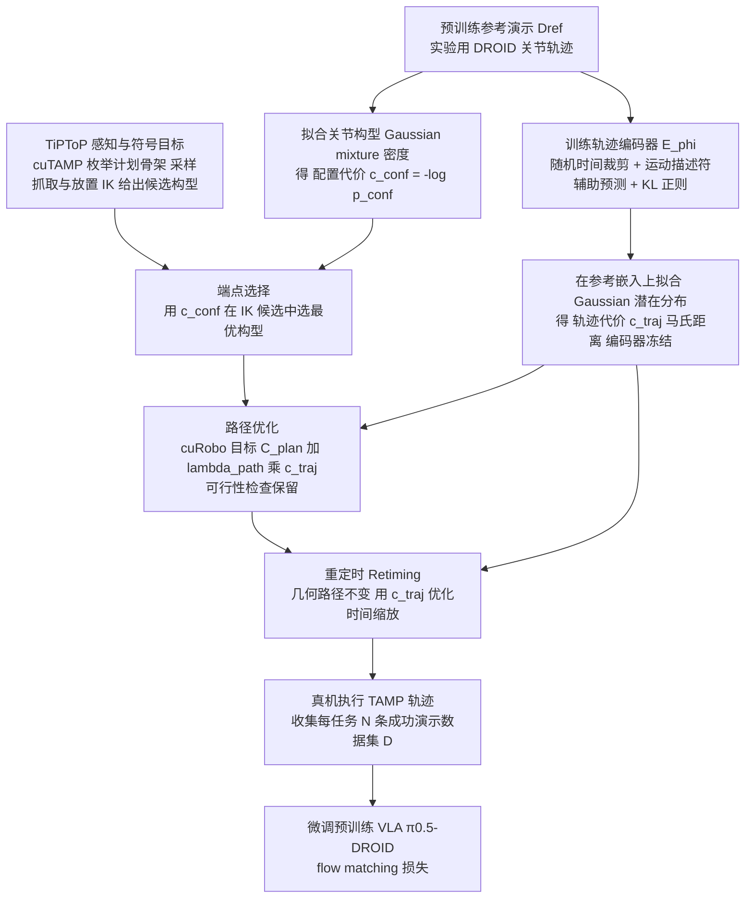

# DATAFARM（arXiv:2609.12316）

**DATAFARM**（[DATAFARM: Distribution-Aligned Task and Motion Planning for Fine-Tuning Vision-Language-Action Models](https://arxiv.org/abs/2609.12316)）来自 [具身智能小站 11 篇 VLA/TAMP 盘点](../../sources/blogs/wechat_embodied_station_11_papers_vla_tamp_planning_2026-09-14.md)。规划轨迹能解题不代表适合微调 VLA；DATAFARM 从参考演示学习分布并对齐终点选择、路径优化与重定时。

## 一句话定义

**对齐配置密度与轨迹潜变量分布的 TAMP 数据生成，使规划轨迹更像 VLA 预训练分布。**

## 英文缩写速查

| 缩写 | 英文全称 | 简要说明 |
|------|----------|----------|
| VLA | Vision-Language-Action | 视觉-语言-动作策略 |
| VLM | Vision-Language Model | 视觉-语言多模态模型 |
| WM | World Model | 预测未来观测或表征的动力学模型 |
| TAMP | Task and Motion Planning | 任务与运动规划 |
| OOD | Out-of-Distribution | 分布外泛化评测 |

## 为什么重要

- 规划轨迹能解题不代表适合微调 VLA；DATAFARM 从参考演示学习分布并对齐终点选择、路径优化与重定时。
- 开源状态：**待发布**（步骤 2.5 核查，2026-09-14）。
- 与 [11 篇技术地图](../overview/vla-tamp-planning-11-papers-technology-map.md) 中同类工作可横向对照。

## 流程总览

图依据：论文 §IV（Fig. 2 Overview of DATAFARM，§IV-A 至 §IV-D）。

## 核心机制

| 项 | 内容 |
|----|------|
| **arXiv** | [2609.12316](https://arxiv.org/abs/2609.12316) |
| **项目页** | https://prpl-group.com/datafarm/ |
| **开源** | **待发布** |
| **文内指标** | 三桌面 + 布料折叠：DATAFARM 56.7%，raw TAMP 8.3%，人工遥操 61.7%；OOD 可变形物体微调后 85%。 |

## 源码运行时序图

**不适用**（截至 2026-09-14 项目页未提供可运行官方代码入口，或仓库尚未公开）。

## 实验与评测

| 项 | 文内口径 |
|----|----------|
| 要点 | 三桌面 + 布料折叠：DATAFARM 56.7%，raw TAMP 8.3%，人工遥操 61.7%；OOD 可变形物体微调后 85%。 |

- **读法：** 本页为清单摘要，上表取自 [公众号盘点](../../sources/blogs/wechat_embodied_station_11_papers_vla_tamp_planning_2026-09-14.md) 与项目页；具体对照方法、任务集与逐项指标以 **原文 PDF** 为准。

## 与其他工作对比

- **raw TAMP 直接喂微调** — 文内同协议下 **8.3%**：规划器能解题，但终点选择、路径形态与时序都不像 VLA 预训练分布，微调等于往分布外拽模型。DATAFARM 的全部改动就是把这三项对齐回来。
- **人工遥操数据** — 文内 **61.7%**，仍是上界；DATAFARM 的 **56.7%** 是「合成数据逼近人工数据」的口径，不是超越。
- **[LIT](./paper-lit-latent-interface-training.md)（同批）** — 对同一个「规划轨迹微调不动 VLA」问题给出 **模型侧** 答案（潜接口抗视觉捷径），DATAFARM 给的是 **数据侧** 答案（生成时就对齐分布）；两条可叠加，不互斥。
- **[FoldNet++](./paper-foldnet-plus-plus.md)（同批）** — 同为「合成数据换真机数据」，但 FoldNet++ 造的是 **仿真渲染的衣物折叠 episode**（跨机器人、跨衣物资产），DATAFARM 造的是 **符号规划器的轨迹** 并做分布对齐。
- **[Pelican-Sim 1.0](./paper-pelican-sim.md)（同批）** — 同样服务数据闭环，但生成源是 **世界模型 rollout** 而非 TAMP 规划器；两者代表「学出来的动力学」与「写出来的规划」两种合成数据来源。
- **[模仿学习](../methods/imitation-learning.md)** — 该页给出示范数据质量为何主导 BC 上限；DATAFARM 属其中「合成示范的分布匹配」一支。

- **读法：** 以上为知识库内 **路线级** 对照；与原文 baseline 的逐项定量比较以 **原文 PDF** 为准（[参考来源](#参考来源)）。开源状态为 **待发布**，暂无法按代码口径复现对照。

## 结论

**DATAFARM 适合作为本期「待发布」边界下的快速索引页，部署前请核对项目页/仓库可运行性。**

1. 核心贡献：规划轨迹能解题不代表适合微调 VLA；DATAFARM 从参考演示学习分布并对齐终点选择、路径优化与重定时。
2. 开源结论：**待发布** — 以项目页实际链接为准（入库日 2026-09-14）。
3. 横向对照见 [11 篇技术地图](../overview/vla-tamp-planning-11-papers-technology-map.md)，避免与同 arXiv 重复造页。

## 关联页面

- [11 篇技术地图](../overview/vla-tamp-planning-11-papers-technology-map.md)
- [VLA（Vision-Language-Action）](../methods/vla.md)
- [Generative World Models](../methods/generative-world-models.md)
- [Manipulation](../tasks/manipulation.md)

## 参考来源

- [datafarm_arxiv_2609_12316.md](../../sources/papers/datafarm_arxiv_2609_12316.md)
- [wechat_embodied_station_11_papers_vla_tamp_planning_2026-09-14.md](../../sources/blogs/wechat_embodied_station_11_papers_vla_tamp_planning_2026-09-14.md)
- [arXiv:2609.12316](https://arxiv.org/abs/2609.12316)
- [arXiv PDF](https://arxiv.org/pdf/2609.12316)：已通读方法部分（实验与附录以略读为准）：§III 问题设定、§IV 分布对齐 TAMP（预备知识、方法概览、参考模型学习、分布对齐规划）

## 推荐继续阅读

- [arXiv PDF](https://arxiv.org/pdf/2609.12316)
- [项目页](https://prpl-group.com/datafarm/)
