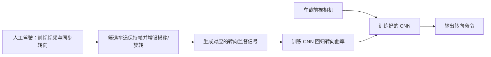

# DAVE-2：从前视图像端到端预测汽车转向

*End to End Learning for Self-Driving Cars*（[arXiv:1604.07316](https://arxiv.org/abs/1604.07316)）。

## 一句话定义

将驾驶员前视视频帧与同步转向标签送入 CNN，端到端学得从像素到转向曲率的映射，而非显式编写车道识别和规划模块。

## 英文缩写速查

| 缩写 | 英文全称 | 简要说明 |
|---|---|---|
| DAVE-2 | Driving Autonomous Vehicle Experiment 2 | NVIDIA 的学习式转向系统 |
| CNN | Convolutional Neural Network | 从图像到转向输出的骨干 |
| YUV | Luma and Chrominance Color Space | 原论文网络输入色彩表示 |
| FPS | Frames Per Second | 训练采样和车载执行频率 |

## 为什么重要

2016 年展示了行为克隆可以直接联系视觉观测与连续控制信号。其图像扰动增强思路是从示教分布出发，补上偏离车道时的恢复数据。

## 核心信息

| 项目 | 内容 |
|---|---|
| 原始论文 | [arXiv:1604.07316](https://arxiv.org/abs/1604.07316) |
| 研究机构 | 英伟达（NVIDIA） |
| 原文复核状态 | **已阅读原始论文全文（含方法与实验，附录情况见来源归档）** |

## 核心原理

论文采用前视相机图像（YUV）→归一化→五层卷积→三层全连接，输出转弯半径的倒数；训练目标最小化预测转向与示教/扰动修正标签的均方误差。人工生成的横移与旋转画面，配合重新计算的回正目标，服务于部署时偏离中心线的情况。

## 流程总览

## 工程实践

训练数据来自三台车载摄像头与 CAN 总线转向记录；截至 2016-03-28 约 72 小时视频，训练仅采用车道保持样本并降采样至 10 Hz，对弯道过采样。侧摄像头和视角平移/旋转合成偏移场景，重新计算约 2 秒内回正的监督目标。部署时仅用单台前视摄像头，网络输出 1/r。复核时关注人工增强图像的物理一致性、闭环偏离量、仿真接管次数和真机人工干预情况；不能将单纯预测 MSE 视为闭环安全指标。

## 源码运行时序图

**不适用**：未核实与此论文逐项对应的官方可运行实现。

## 实验与评测

论文先在基于录制视频和车辆动力学的模拟器中估计偏离车道中心的轨迹，偏离超过 1 m 触发虚拟接管，仿真自主率对每次接管计入固定时间惩罚。代表性道路约 98% 的自动转向时间占比不等于 98% 的通用自动驾驶成功率；路口转弯、换道等行为不在这一指标内。论文讨论了无车道线等场景的保持能力，但该工作并未声称解决完整自动驾驶栈。

## 结论

**本研究的定位：将驾驶员前视视频帧与同步转向标签送入 CNN，端到端学得从像素到转向曲率的映射，而非显式编写车道识别和规划模块。**

1. 图像到转向的端到端映射可替代部分手写中间感知规则。
2. 扰动增强是关键训练设计：使策略见到偏离专家轨迹后的恢复状态。
3. 离线监督损失和闭环行驶质量需分别评估。
4. 比较后续工作可重点看状态分布偏移与可解释性。

## 局限与风险

覆盖的训练与测试场景有边界；真实路况的极端障碍、交互与安全决策不能从车道保持结果外推。本文不提供本轮核实到的可执行开源入口；**源码运行时序图不适用**（未核实官方可运行实现）。

## 与其他工作对比

相较 [PilotNet 显著性分析](./paper-pilotnet-saliency.md)，本论文主要回答「如何学转向」，后者回答「网络看了哪些位置」。相较 [DAgger](./paper-ross-dagger.md)，这里的偏离处理依赖人工图像增强，而非在线专家针对学习者实际状态回标。

## 关联页面

- [PilotNet 显著性解释](./paper-pilotnet-saliency.md)
- [DAgger 论文](./paper-ross-dagger.md)
- [11 篇历史阅读路线](../overview/robot-learning-foundations-11-papers.md)

## 参考来源

- [论文核验与阅读归档](../../sources/papers/dave2_end_to_end_driving_arxiv_1604_07316.md)
- [arXiv 官方原文](https://arxiv.org/abs/1604.07316)

## 推荐继续阅读

- [官方相关一手资源](https://developer.nvidia.com/blog/deep-learning-self-driving-cars/)
