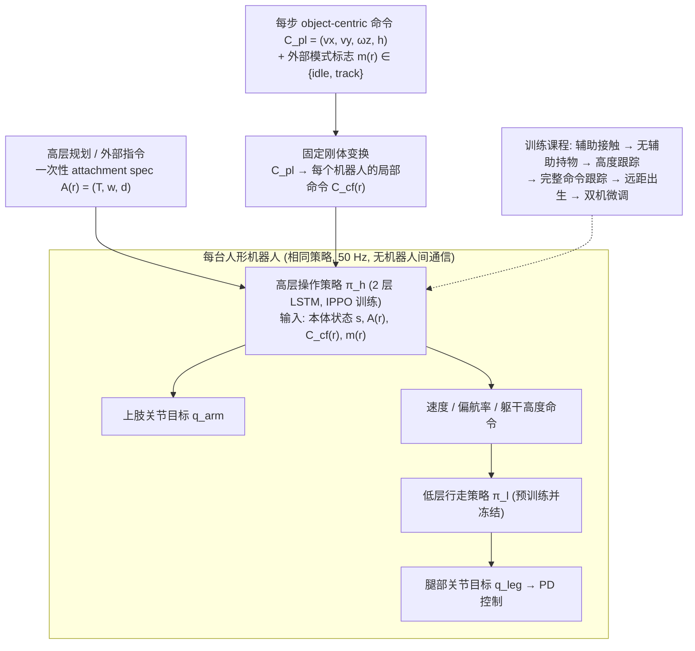

# 去中心化多人形搬运（arXiv:2609.17824）

**去中心化多人形搬运**（*Learning Multi-Humanoid Pickup and Transport via Decentralized Object-Centric Control*，[arXiv:2609.17824](https://arxiv.org/abs/2609.17824)，[项目页](https://decmht.github.io/)）由 Oregon State University DRAIL 团队提出，围绕“以物体附着坐标系为中心（object-centric）”的接口实现可零样本扩展团队规模的多人形协同搬运。

## 一句话定义

**每机物体局部附着区 + 相同策略 + 局部观测、无直接通信；单机拾取至十机协同与交接，迁移两台 Digit V3。**

## 英文缩写速查

| 缩写 | 英文全称 | 简要说明 |
|------|----------|----------|
| decMHT | Decentralized Multi-Humanoid Pickup and Transport | 本文去中心化多人形拾取与搬运控制框架 |
| IPPO | Independent Proximal Policy Optimization | 独立 PPO 训练范式；每机用同一局部策略权重独立优化/部署 |
| MRS | Multi-Robot System | 多机器人系统 |
| WBC | Whole-Body Control | 全身控制；本文中低层冻结行走策略协调下半身步态与平衡 |
| RL | Reinforcement Learning | 强化学习 |

## 为什么重要

- **解除团队规模绑定：** 传统多机协同依赖全局观测拼接、机间通信或固定人数策略；将任务统一编码为相对于物体的局部附着点规范 `A(r) = (T, w, d)` 与刚体转换后的局部命令 `C_cf(r)`，使单机/双机训练的策略可直接零样本扩展到多达 10 台机器人。
- **无需显式通信即可隐式载荷分担与交接：** 各机通过上肢力/接触与躯干运动感受经由刚性负载传递的耦合响应，并可在不改策略权重的条件下通过外部模式标志 `m(r) ∈ {idle, track}` 实现递送交接（relay handover）。
- **验证真机跨机迁移：** 在不做真机多机联合微调的条件下，直接零样本迁移到两台无夹爪双臂人形 Agility Digit V3 完成拾取、协同搬运与交接。

## 流程总览

图依据：论文 §III（attachment spec、object-centric 命令、模式标志）、§IV / Fig. 1、§V-B 训练课程。

## 核心机制

| 项 | 内容 |
|----|------|
| **arXiv** | [2609.17824](https://arxiv.org/abs/2609.17824)（[项目页](https://decmht.github.io/)） |
| **机构** | Oregon State University (DRAIL) |
| **开源** | **待发布**（步骤 2.5 于 2026-11-29 复核项目页无 GitHub/权重链接） |
| **核心接口** | 物体局部附着规范 `A(r)=(T,w,d)` + 模式标志 `m(r)` + 刚体变换后的局部指令 `C_cf(r)`，50 Hz 分层策略（2 层 LSTM 高层 + 冻结低层行走策略），训练至最多 `N=2` 后在 `N=1..10` 零样本泛化 |

## 源码运行时序图

**不适用**（截至 2026-11-29 复核项目页 `decmht.github.io` 与 arXiv，未发布官方可运行代码或训练权重）。

## 实验与评测

- **规模零样本扩展（Table I，主箱体 `N=1..10`）：** 全规模拾取成功率均超过 `97%`（`N=1` 为 `99.2%`，`N=4` 达 `99.9%`，`N=10` 为 `98.3%`）；随协作机数增加，箱体 RMS 倾角从 `8.04°`（单机）大幅下降至 `1.21°`（十机），掉箱率保持在 `0%–1.5%`（十机 `0.5%`）。
- **重物跨度与未见几何泛化（Fig. 3 & Table II）：** 训练最高仅 `N=2`，测试零样本泛化至最多 10 机协力搬运重达 `50 kg` 负载；在 5 种未训练物体（20 kg 金属柜、冰箱、木梁、床架、混凝土板）上，`decMHT` 在金属柜拾取率 `97.2%`、掉箱率 `2.0%`、RMS 倾角 `8.48°`，明显优于仅单机训练未微调的消融 `decMHT(1)`（掉箱率 `6.9%`、RMS 倾角 `23.62°`），并与针对该物体重训的 `Centralized` / `Specialized` 基线持平或更稳（4 机搬床时集中式基线因联合状态–动作维过大而无法收敛训练）。
- **单到双机交接（Table III）：** 静态交接三阶段均达 `100.0%`（峰值倾角 `7.04°`）；动态运动中接手从 `decMHT(1)` 的 `87.5%` 提升至 `96.5%`；未见过的高低落差跨台阶交接（Cross-level）Stage 3 达 `99.0%`。
- **物理真机迁移（§VIII，两台 Digit V3）：** 无需真机多机联合微调，通过外部动捕提供箱体相对各机器人躯干位姿 `^b T^(r)`，在纸箱上演示了单机拾取搬运、双机对侧协同搬运，以及仅切换模式标志 `m(r)` 完成的双机交接。

## 工程实践

- **分层解耦：** 高层 LSTM 操作策略仅输出上肢目标与速度/身高参考，下半身由预训练冻结的行走策略接管，避免多机闭链约束微调破坏双足步态稳定性。
- **附着坐标系供给接口：** 实机迁移仅需向每台机器人提供自身躯干系下的本地附着点位姿估计；当前硬件验证借助外部动捕，室外/非结构化部署需替换为机载视觉–触觉定位。
- **通过模式切换做交接调度：** 在无需重构底层策略的前提下，上层调度器按任务进度翻转载荷接手者的 `m(r) ∈ {idle, track}` 即可触发交接动作。

## 局限与风险

- **无夹爪双臂摩擦夹持假设：** 实验机器人的末端通过双臂挤压摩擦夹持箱体（gripperless pinch），带多指灵巧手或显式抓手接触的物体接触几何需要扩展接口。
- **同构对称角色约束：** 当前各机策略共享相同行为模式并假定各自附着区在物体刚体骨架内固定，尚不支持强非对称分工（如一机主扶门、一机专门精细操作）。
- **真机感知仍借力外部动捕：** Digit V3 实机依赖外部动捕广播自身对应的 `^b T^(r)`，尚未集成纯机载 egocentric 视觉追踪；此外官方代码尚待发布。

## 与其他工作对比

| 维度 | 读法 |
|------|------|
| **vs 集中式多机策略（Table II）** | 集中式需随 `N` 拼接观测/动作，4 机床架搬运直接难以收敛；`decMHT` 观测/动作维度恒定，可零样本扩至 `N=10` |
| **vs [CHORUS](./paper-chorus.md)** | 二者均为无需显式通信的去中心化共享策略；CHORUS 面向异构移动臂单权重 VLA，decMHT 面向双足人形强动态全身拾搬 |
| **开源状态** | **待发布** — 部署前以项目页 `decmht.github.io` 与 arXiv 更新为准 |

## 结论

**物体附着坐标系抽象使去中心化多人形策略能在固定局部观测维度下零样本扩展团队规模、物体几何与负载重量。**

1. `A(r)` + 局部刚体速度指令将多机团队规模从策略输入维度中彻底解耦，实现 `N=1..10` 与 `50 kg` 负载零样本扩展。
2. 仅增加少步 `N=2` 双机微调（相比 `decMHT(1)`）就将未见物体掉箱率与倾角显著压低，并大幅提高动态/跨台阶交接成功率（`87.5% -> 96.5%`）。
3. 真机验证已在两台 Digit V3 跑通单机、双机协同与递送交接，但仍依赖外部动捕供给本地附着点位姿，且官方代码暂未公开。

## 关联页面

- [多机器人协作（Multi-Robot Collaboration）](../concepts/multi-robot-collaboration.md)：系统定位在“无通信去中心化物体中心协作”范式轴上。
- [协同物体搬运（Collaborative Object Transport）](../concepts/collaborative-object-transport.md)：对比隐式载荷分担 RL 与经典 Virtual Linkage 显式内力分解。
- [人形多机协调](../concepts/humanoid-multi-robot-coordination.md)：同属人形团队协作节点群。
- [Loco-Manipulation](../tasks/loco-manipulation.md)：行进间拾取、搬运与跨台阶交接的核心任务页。
- [多智能体强化学习（MARL）](../methods/marl.md)：对比 IPPO 参数共享与 CTDE 集中评论家范式。
- [多机器人协作纵深路线](../../roadmap/depth-multi-robot-collaboration.md)：收录于 Stage 2 协同搬运与操作核心代表页。

## 参考来源

- [decentralized-multi-humanoid-pickup_arxiv_2609_17824.md](../../sources/papers/decentralized-multi-humanoid-pickup_arxiv_2609_17824.md) — 原文 §I–§IX 通读摘录与步骤 2.5 项目页复核
- [wechat_senlanke_weekly_humanoid_quadruped_2026-09-14_18.md](../../sources/blogs/wechat_senlanke_weekly_humanoid_quadruped_2026-09-14_18.md) — 周更线索
- [arXiv:2609.17824](https://arxiv.org/abs/2609.17824)（[PDF 原文](https://arxiv.org/pdf/2609.17824)）

## 推荐继续阅读

- [项目页 decmht.github.io](https://decmht.github.io/) — 单/双/十机仿真与 Digit V3 实机演示视频
- [Robot_Learning: Multi-Robot Collaboration 纵深路线](../../roadmap/depth-multi-robot-collaboration.md)
- [arXiv PDF 原文](https://arxiv.org/pdf/2609.17824)
