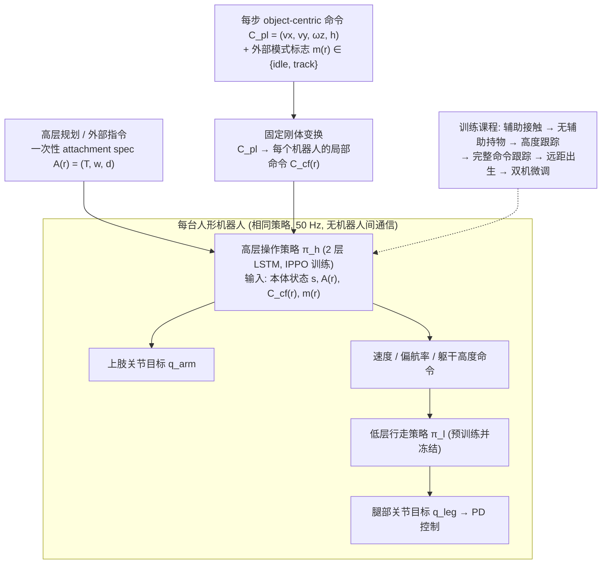

# 去中心化多人形搬运（arXiv:2609.17824）

**去中心化多人形搬运**（*Learning Multi-Humanoid Pickup and Transport via Decentralized Object-Centric Control*，[arXiv:2609.17824](https://arxiv.org/abs/2609.17824)）来自 [senlanke 具身运控lab 周更盘点](../../sources/blogs/wechat_senlanke_weekly_humanoid_quadruped_2026-09-14_18.md)（2026-09-14–18）。

## 一句话定义

**每机物体局部附着区 + 相同策略 + 局部观测、无直接通信；单机拾取至十机协同与交接，迁移两台 Digit V3。**

## 英文缩写速查

| 缩写 | 英文全称 | 简要说明 |
|------|----------|----------|
| MRS | Multi-Robot System | 多机器人系统 |
| WBC | Whole-Body Control | 全身控制 |
| RL | Reinforcement Learning | 强化学习 |

## 为什么重要

- 多机协同常需通信与异构策略；物体中心局部附着可扩展规模。

## 流程总览

图依据：论文 §III（attachment spec、object-centric 命令、模式标志）、§IV / Fig. 1、§V-B 训练课程

## 核心机制

| 项 | 内容 |
|----|------|
| **arXiv** | [2609.17824](https://arxiv.org/abs/2609.17824) |
| **开源** | **待发布**（步骤 2.5，2026-09-20） |
| **方法摘要** | Object-centric attachment regions; decentralized identical policies; no inter-robot comms. |

## 源码运行时序图

**不适用**（截至 2026-09-20 未发布可运行官方代码或待核实）。

## 实验与评测

- 最多十机协同运输；两台 Digit V3 迁移（以 PDF 为准）。
- 读法：先对齐任务设定、传感器与成功定义，再解读 headline 数字。

## 与其他工作对比

| 维度 | 读法 |
|------|------|
| **同周对照** | 见对应 [周更盘点](../../sources/blogs/wechat_senlanke_weekly_humanoid_quadruped_2026-09-14_18.md) 映射表，勿跨任务直接比 SR |
| **开源状态** | **待发布** — 部署前以项目页/arXiv 为准 |

## 结论

**物体中心去中心化控制使多人形 pickup/transport 在统一策略下扩展。**

1. 开源：**待发布**；勿凭公众号摘要臆断可复现性。
2. 指标须连同实验条件解读（仿真/真机、平台、成功阈值）。
3. 关注 arXiv 版本更新与代码发布。

## 关联页面

- [humanoid-multi-robot-coordination](../concepts/humanoid-multi-robot-coordination.md)
- [loco-manipulation](../tasks/loco-manipulation.md)
- ./paper-recal-collision-aware-wbc.md

## 参考来源

- [decentralized-multi-humanoid-pickup_arxiv_2609_17824.md](../../sources/papers/decentralized-multi-humanoid-pickup_arxiv_2609_17824.md)
- [wechat_senlanke_weekly_humanoid_quadruped_2026-09-14_18.md](../../sources/blogs/wechat_senlanke_weekly_humanoid_quadruped_2026-09-14_18.md)
- [arXiv:2609.17824](https://arxiv.org/abs/2609.17824)
- [arXiv PDF](https://arxiv.org/pdf/2609.17824)：已通读方法部分（实验与附录以略读为准）：§III 去中心化搬运框架、§IV 去中心化控制架构、§V 训练方法（场景生成、课程、奖励）

## 推荐继续阅读

- [arXiv PDF](https://arxiv.org/pdf/2609.17824)
