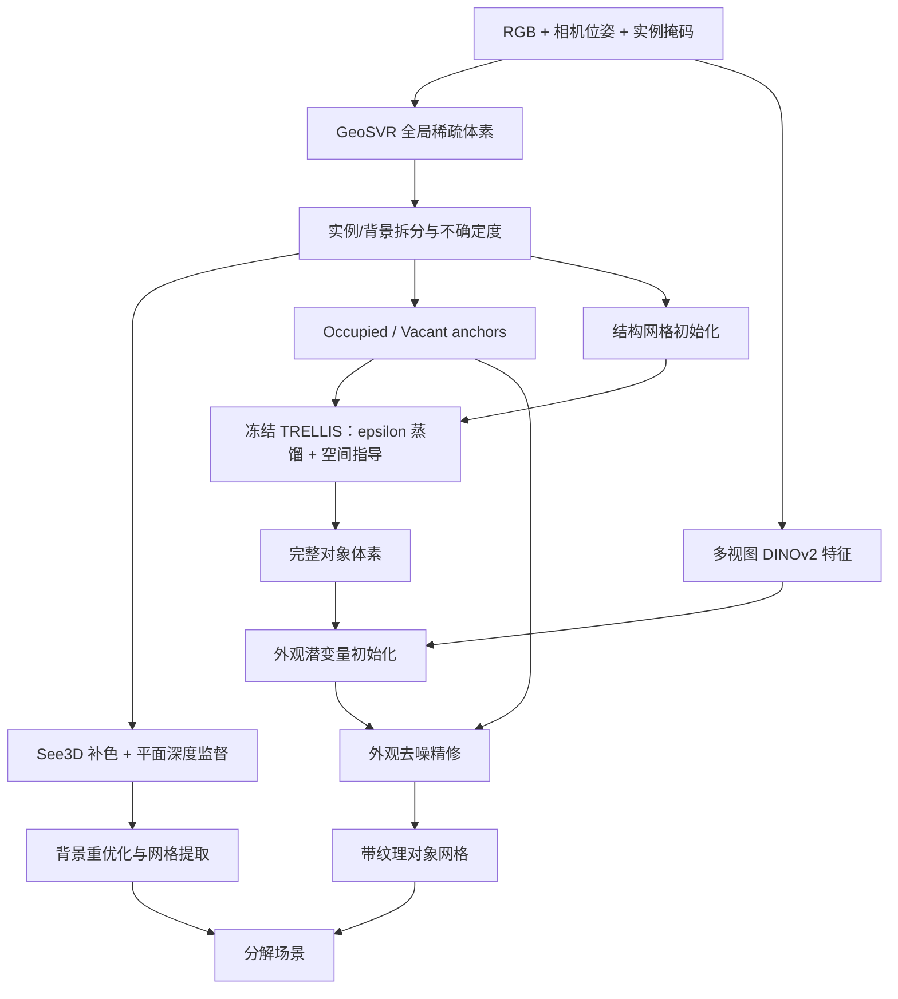
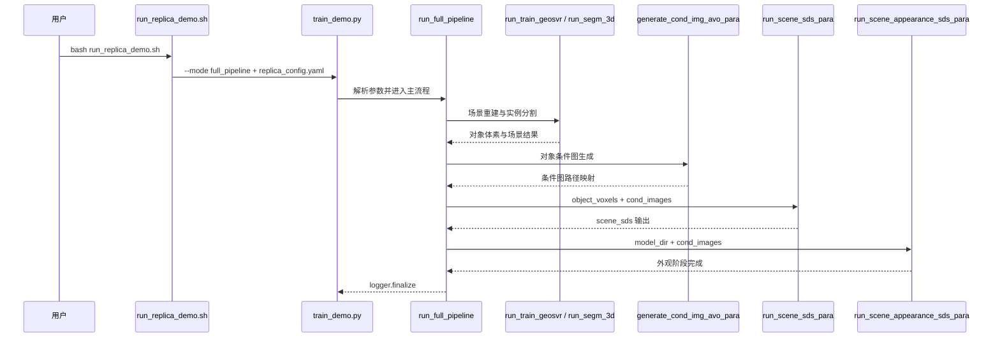

# DecomVoxel：三维原生先验引导的原位去噪可分解场景重建 / Guided In-situ Denoising for Decompositional Scene Reconstruction

## 一句话定义

DecomVoxel 从带位姿的多视角图像及实例掩码出发，在同一场景坐标系内逐物体优化几何及纹理，既填补遮挡缺失，又尽量保存真实物体的空间布局。

## 英文缩写速查

| 缩写 | 英文全称 | 简要说明 |
|---|---|---|
| RGB | Red Green Blue | 多视角彩色观测 |
| SDS | Score Distillation Sampling | 将生成先验作为优化梯度的蒸馏思路 |
| CFM | Conditional Flow Matching | TRELLIS 条件速度场生成模型 |
| VAE | Variational Autoencoder | 将体素结构/外观潜变量编解码 |
| CD | Chamfer Distance | 点集几何距离，论文以 cm 报告 |
| NC | Normal Consistency | 表面法线一致性 |
| PSNR | Peak Signal-to-Noise Ratio | 渲染图像像素质量指标 |
| SSIM | Structural Similarity Index Measure | 渲染结构一致性 |
| LPIPS | Learned Perceptual Image Patch Similarity | 感知距离，越低越好 |

## 为什么重要

- 单一整体重建难以分离物体、支持交互；遮挡又使每个实例的几何残缺。
- 单独生成物体再配准易引入尺度、旋转、平移误差；原位优化以场景证据约束生成。
- 对机器人 Real2Sim，可提供物体级可编辑网格作为碰撞与物性建模的上游，而非直接交付物理资产。

## 核心信息

| 属性 | 内容 |
|---|---|
| 论文 | [arXiv:2610.01914v1](https://arxiv.org/abs/2610.01914)，2026-10-01；SIGGRAPH Asia 2026 Journal Track (TOG) |
| 机构 | 清华大学、北京通用人工智能研究院、北京大学 |
| 输入 | 多视角 RGB、相机位姿、实例掩码 |
| 输出 | 对象级带纹理网格及背景网格 |
| 代码 | [官方实现](https://github.com/DecomVoxel/DecomVoxel) |
| 数据 | [Hugging Face](https://huggingface.co/datasets/JunfengNi/DecomVoxel) |
| 核查 | 已核对方法、实验表、附录关键内容与 CLI 入口；全文逐行核查和内部源码、实际复现尚未完成 |

## 核心原理与方法栈

1. GeoSVR 初始化全局稀疏八叉树体素，每个体素含位置、尺度、密度及球谐外观特征；融合实例掩码拆分对象与背景，估计几何不确定度。
2. 背景：See3D 补齐未观测区域颜色，拟合主平面提供深度监督，再优化背景并用 Marching Cubes 提取网格。
3. 对象几何：冻结 TRELLIS，连续占据网格经编码器得到结构潜变量。采用 Flow Matching 的噪声残差蒸馏。设 x_t=(1-t)x'+tε，预测噪声为 x_t+(1-t)v(x_t,t)。在附录 A 的 SDS 近似（省略模型 Jacobian）下，逐样本 epsilon 梯度比速度梯度多一个 (1-t) 权重，避免高噪声时过度更新。
4. 空间指导：低不确定度体素组成 occupied anchor，用保真损失约束初始特征；至少三个视图支持的自由空间和其他物体/背景组成 vacant anchor；有栅格冲突时 occupied 优先。空区潜变量向 void 分布重采样而非硬清零。噪声采样下界及引导权重逐步下降。
5. 外观：先解码结构并阈值化，再在完成体素上反投影多视角 DINOv2 特征初始化外观潜变量，使用 TRELLIS 外观先验及保真损失精修，最后解码带纹理网格。

## 流程总览

依据论文 Algorithm 1，图为方法级数据流，不是 Python 入口逐行调用图。

## 工程实践

| 参数（Appendix B Table 5） | 几何 | 外观 |
|---|---|---|
| 迭代次数 | 5000 | 3000 |
| Adam 初始学习率 | 0.03 | 0.01 |
| 噪声范围 | 0.02–0.98 | 0.02–0.98 |
| 退火迭代 | 4000 | 2000 |
| CFG strength | 3.0 | 3.0 |

几何栅格 64³，场景可见性栅格 256³；每 300 次迭代重分布空域，强度在前 2500 次迭代退火到零。实际代码参数应以配置为准。

官方 README 提供环境安装及 Replica scan1 快速测试：`source env.sh`、`bash run_replica_demo.sh`。默认调用 Seedream 条件图服务，需外部权重及 API 密钥。公开代码及数据入口不等于已独立复现；详情见[源码归档](../../sources/repos/decomvoxel.md)。

## 源码运行时序图

上图仅描述已静态核对的入口级调用；背景补全另见 bg_inpaint_replica.sh；尚未核查所有内部子模块或运行 demo。

## 实验与评测

作者 Table 1：Replica 8 场景、ScanNet++ 6 场景；每第十视图留作测试。CD 单位 cm，F-score 阈值 5 cm，PSNR 单位 dB。

| 数据集 | CD ↓ | F-score ↑ | NC ↑ | PSNR ↑ | SSIM ↑ | LPIPS ↓ |
|---|---:|---:|---:|---:|---:|---:|
| Replica | 3.95 | 77.87 | 78.85 | 24.21 | 0.907 | 0.114 |
| ScanNet++ | 4.34 | 77.93 | 76.39 | 21.71 | 0.893 | 0.133 |

Table 3 中仅加几何先验的 CD 为 6.52，增加几何空间指导后为 3.91；完整模型 CD 3.95 但渲染 PSNR 更高（24.21）。不能声称完整模型每个单项消融指标都最优。Table 4 Replica 耗时 1.35 h、峰值 GPU 显存 20.965 GB、平均 7.450 GB。

## 结论

**本工作的关键是将生成式补全约束在原场景证据内，而不是只追求独立物体视觉质量。**

1. 在输入阶段优先提升实例掩码及初始重建可靠性。
2. 已占据结构与禁止生长区域应分别约束；避免把未知区全部判为空域。
3. 先验冻结与每场景优化有利于几何对齐，但应预算耗时及显存。
4. 对 Real2Sim 的验收应另查尺寸、碰撞、质量、摩擦与关节，不能用 PSNR 代替接触验证。

## 与其他工作对比

| 方法 | 区别 |
|---|---|
| SimRecon | 使用生成先验补全，论文 Replica CD 17.55 |
| ShapeR | 几何生成，论文 Replica CD 6.59；未报告纹理指标 |
| DecomVoxel | 原位优化及显式锚定，Replica CD 3.95 |
| SimFoundry | 下游物理场景构建及训练/评测，任务边界不同 |

## 局限与风险

Appendix D 明确指出差掩码、低质量初始几何、严重遮挡及先验分布外对象可能失效；主要评估可分实例的室内场景。天空、草地等非对象区域不在当前方法适用范围内。逐对象优化比单次前向推理慢。可分解带纹理 mesh 尚需物性赋值、碰撞近似和物理 rollout 验收。源码公开但外部权重、条件图服务及许可仍需核查，未独立复现。

## 关联页面

- [CRISP（Contact-guided Real2Sim）](../methods/crisp-real2sim.md)：同样处理遮挡几何，但借助人–场景接触约束物理可行性；与 DecomVoxel 的视觉几何补全形成对照。
- [LingBot-Map](../methods/lingbot-map.md)：面向流式视觉的前馈三维重建方法，与 DecomVoxel 的逐场景、逐对象优化在输入组织和计算代价上不同。
- [GenSfM](./paper-gensfm.md)：少视图生成式结构恢复
- [DepthGS](./paper-depthgs.md)：深度引导表面重建
- [SimFoundry](./paper-simfoundry-real2sim-scene-generation.md)：下游可仿真场景构建
- [Real2Sim 纵深路线](../../roadmap/depth-real2sim.md)：Stage 1 几何外观重建

## 参考来源

- [论文归档](../../sources/papers/decomvoxel_arxiv_2610_01914.md)
- [项目页归档](../../sources/sites/decomvoxel.md)
- [官方代码归档](../../sources/repos/decomvoxel.md)

## 推荐继续阅读

- [原文 HTML](https://arxiv.org/html/2610.01914v1)
- [原文 PDF](https://arxiv.org/pdf/2610.01914)
- [官方项目页](https://decomvoxel.github.io/DecomVoxel-Webpage/)
- [官方源码](https://github.com/DecomVoxel/DecomVoxel)
