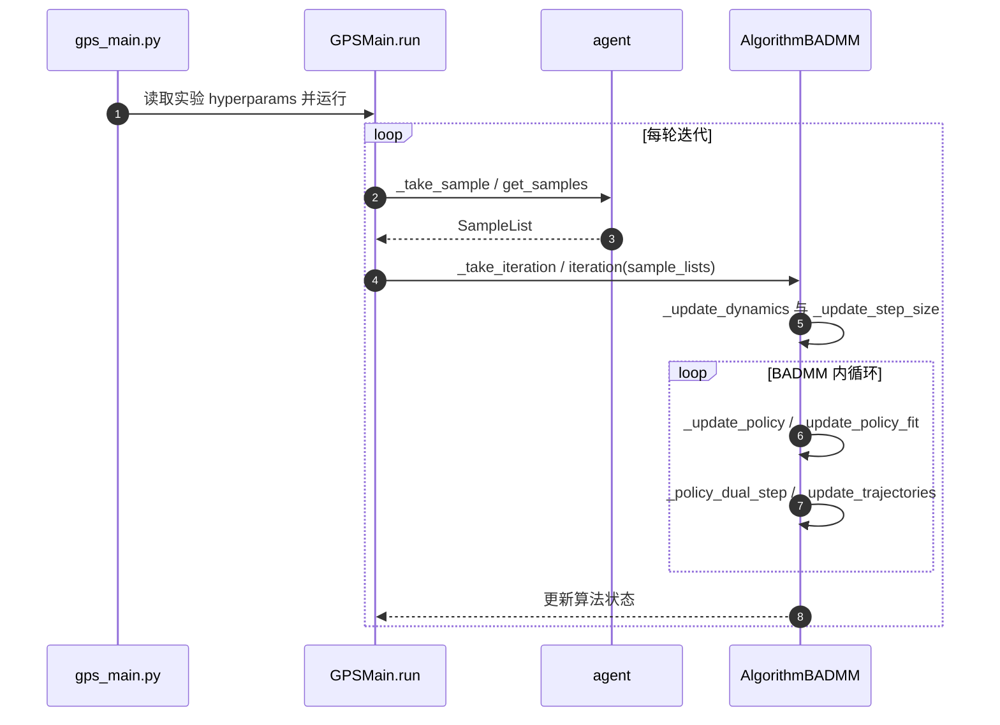

# Deep Visuomotor Policies：GPS 联合学习视觉与力矩

*End-to-End Training of Deep Visuomotor Policies*（[arXiv:1504.00702](https://arxiv.org/abs/1504.00702)）。

## 一句话定义

用训练时可获得的完整状态进行局部轨迹优化，将控制知识转移给仅依赖视觉观测的 CNN 策略，实现直接预测机器人电机力矩。

## 英文缩写速查

| 缩写 | 英文全称 | 简要说明 |
|---|---|---|
| GPS | Guided Policy Search | 轨迹优化与监督式策略学习的交替过程 |
| BADMM | Bregman Alternating Direction Method of Multipliers | 论文的受约束交替优化框架 |
| CNN | Convolutional Neural Network | 视觉到动作策略表示 |
| LQG | Linear Quadratic Gaussian | 局部线性高斯控制器优化 |

## 为什么重要

该工作把视觉编码和真实动作控制联合训练，而非先固定视觉模型再单独学习控制器，是后续 visuomotor policy 的重要奠基研究。

## 核心信息

| 项目 | 内容 |
|---|---|
| 原始论文 | [arXiv:1504.00702](https://arxiv.org/abs/1504.00702) |
| 研究机构 | 加利福尼亚大学伯克利分校（UC Berkeley） |
| 原文复核状态 | **待完成全文/附录核对**；详见来源归档 |

## 核心原理

局部线性高斯控制器借助训练时完整状态和少量真实轨迹，用局部动力学拟合、KL 信赖域与轨迹优化获得监督信号；BADMM 在局部控制器和全局 CNN 策略之间协调动作分布。部署策略只用视觉/传感器观测映射到低层力矩。

## 流程总览

## 工程实践

区分训练阶段额外状态估计与部署阶段可见输入；比较固定视觉特征与端到端联合训练。官方相关 GPS 仓库为旧环境的算法重实现，可从 `gps_main.py` 的示例实验运行，但与论文原始真机全配置不可直接画等号。

## 源码运行时序图

以下是**关联 GPS 重实现仓库**的实际入口与调用次序，不等于原论文的完整训练设置。

源码阅读：`python/gps/gps_main.py`、`python/gps/algorithm/algorithm_badmm.py`，CLI 示例见 [官方文档](https://github.com/cbfinn/gps/blob/master/docs/index.md)。

## 实验与评测

JMLR 论文评估了真机视觉与接触协同操作（包括拧瓶盖等）以及模拟消融。作者报告相对固定视觉层的改进；具体实验数字、每一行表格待继续核对后补充。

## 结论

**本研究的定位：用训练时可获得的完整状态进行局部轨迹优化，将控制知识转移给仅依赖视觉观测的 CNN 策略，实现直接预测机器人电机力矩。**

1. 训练时允许 privileged full state 可以降低真实轨迹优化的样本需求。
2. 部署时的感知到力矩映射仍可保持端到端。
3. GPS 的局部控制器与全局策略承担不同训练角色，不能简单称为纯 BC。
4. 固定视觉编码 vs 联合训练是本论文的重要实验对照。
5. 跨场景遮挡和强视觉干扰仍是主要局限。

## 局限与风险

训练需要能够估计完整状态；论文自身指出对显著偏离训练视觉分布的遮挡/背景变化泛化不足。关联仓库采用 Python 2.7 与早期生态，不代表当前 ROS2/GPU 环境可一键运行。

## 与其他工作对比

[DAVE-2](./paper-dave2-end-to-end-driving.md) 直接监督回归驾驶员转向，[本工作](./paper-deep-visuomotor-policies.md) 还使用局部轨迹优化产生监督；[Diffusion Policy](./paper-diffusion-policy.md) 则生成动作 chunk 的条件分布。

## 关联页面

- [DAVE-2](./paper-dave2-end-to-end-driving.md)
- [Diffusion Policy](./paper-diffusion-policy.md)
- [11 篇历史阅读路线](../overview/robot-learning-foundations-11-papers.md)

## 参考来源

- [论文核验与阅读归档](../../sources/papers/deep_visuomotor_policies_arxiv_1504_00702.md)
- [GPS 官方仓库核查](../../sources/repos/gps-guided-policy-search.md)
- [arXiv 官方原文](https://arxiv.org/abs/1504.00702)

## 推荐继续阅读

- [官方相关一手资源](https://www.jmlr.org/papers/v17/15-522.html)
