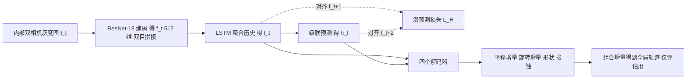

# DeepSoMo（arXiv:2611.11242）

**DeepSoMo**（*Deformable Object Motion Estimation under Proprioceptive Partial Observability via Predictive Latent Dynamics*，[arXiv:2611.11242](https://arxiv.org/abs/2611.11242)，Zhao、Dai、Chen、Feng，纽约大学）。项目页：<https://ai4ce.github.io/DeepSoMo>（2026-11-11 访问：代码标 "public soon"，数据 "coming soon"，均未发布，故本页不写 `code:`）。

## 一句话定义

**只用软体内部相机拍到的形变图像，估计软球的体坐标系位移与旋转增量、表面形状和接触点；训练时加一个让 LSTM 潜状态对齐下一帧特征的自监督约束以减轻长时程漂移，全部结果来自有限元仿真（论文 I、III、IV）。**

## 英文缩写速查

| 缩写 | 英文全称 | 简要说明 |
|------|----------|----------|
| FEM | Finite Element Method | 有限元法；本文用 PolyFEM 生成仿真真值（III-B） |
| LSTM | Long Short-Term Memory | 门控循环网络，本文的潜动力学聚合器（III-C） |
| JEPA | Joint-Embedding Predictive Architecture | 预测未来潜嵌入的自监督范式；本文仅称「精神相似」（III-C，引用 [33]） |
| NTE | Normalized Trajectory Error | 相对真值轨迹总长的归一化轨迹误差，% |
| ATE | Absolute Trajectory Error | 重建全局轨迹的平均欧氏误差，cm |
| ARE | Absolute Rotation Error | 重建全局朝向的角误差，度 |
| CPC | Contact Point Classification accuracy | 点云各点接触 / 非接触分类准确率，% |
| CD | Chamfer Distance | 点云重建的双向距离，单位 1e-1 mm |
| BCE | Binary Cross-Entropy | 接触分类损失 |

## 为什么重要

- 软体机器人的内部传感只局部可见：瞬时观测推不出全局位姿与外部接触，必须跨时间聚合（I）。本文把「潜状态要能预测未来观测」（作者称 latent temporal consistency）作为长时程估计的关键，并用同构基线做了隔离对比。
- 对本 wiki 的价值：这是把 JEPA 式潜预测当作**辅助训练损失**嵌入状态估计的一个小而干净的例子，可对照 [状态估计](../concepts/state-estimation.md) 与 [潜空间想象](../concepts/latent-imagination.md)。
- 作者自述的应用动机是行星、地下、杂乱或视觉退化环境中的软 / 充气球形机器人（I）；论文并未在任何这类硬件上验证。

## 核心原理与流程总览

- **输入与状态（III-A）：** 观测只有内部图像；估计量是体坐标系下的增量，全局位姿靠逐步组合得到，所以增量误差会累积成 ATE。
- **潜预测约束（III-C/D）：** l_t 用 MSE 对齐 f_{t+1}，级联得到的 h_t 对齐 f_{t+2}（式 4）；论文说该约束与具体循环结构无关，但只在 LSTM 上验证。总损失为四个任务损失加 L_H（式 5）。
- **解码器（III-C）：** 平移 / 旋转（6D 表示 + Gram-Schmidt）回归；形状用 FoldingNet 式点云解码器变形固定原型球；接触对重建点云逐点二分类。图 2 中另有一路「external acceleration field」输入，正文未解释其用途（推测：仿真中的外加加速度场，页面作者未能从正文确认）。
- **基线（IV-A）：** ResLSTM（无预测，主对照）、ObsPred（在图像空间做预测，约 156M 参数）、DeepSoMo（潜空间预测，约 18M 参数）。

## 工程实践

- **数据：** PolyFEM 仿真直径 0.5 m 软球（NeoHookean，E=1e4，ν=0.4，ρ=500）在 20×20 m 带噪声地形上滚动；100 地形 × 10 配置 = 1000 条，每条 100 步 × 0.1 s；测试 200 条取自留出地形，其余 640/160 划分训练 / 验证（III-B、IV-F）。相机：两个 256×256、170° 视场灰度相机，Blender 渲染（III-B）。
- **训练：** 单 A100，200 epoch，batch 5，Adam 1e-3，ReduceLROnPlateau，约 5 小时 / 模型，3 个种子（IV-C）。
- **主结果（表 II，均值 ± 标准差，3 种子）：**

| 方法 | NTE % | ATE cm | ARE 度 | CPC % | CD 1e-1 mm |
|------|-------|--------|--------|-------|------------|
| ResLSTM（无预测） | 8.3±0.3 | 56.8±1.1 | 19.3±1.0 | 99.0 | 3.1 |
| ObsPred（图像预测） | 7.7±0.5 | 49.9±7.2 | 19.0±0.8 | 99.1 | 2.9 |
| DeepSoMo（潜预测） | 6.6±0.4 | 38.1±3.7 | 16.8±0.7 | 99.2 | 2.5 |

  ATE 降幅 32.9% / 23.6%（相对 ResLSTM / ObsPred，IV-D，与表数字复算一致）。CPC 三者几乎相同（论文自称 "comparable"）。
- **消融（表 III / IV，IV-E）：** ResNet18 > VGG / ViT；LSTM > RNN / DCC / Transformer（ViT、Transformer 变体误差大，作者归因为旋转估计不稳定后经长时程组合放大，属作者解释，未做单独验证）；预测视野 2、3 步仅边际提升；其他目标（l_{t+1}、f_{t+2}）优于无预测但不及默认。
- **物体变化（表 V，IV-F）：** 形状变化（缩放 [1.6,1,1]）和形状 + 材料变化（缩放 [0.8,1,1]，E 提高到 3e4）均从规范 checkpoint 微调，每组 320/80/100。ATE：37.1→31.5 cm、57.1→35.6 cm（ResLSTM→DeepSoMo）；形状变化下 NTE（7.5±0.3 vs 6.8±0.8）和 ARE（11.4±0.1 vs 11.1±1.1）差距落在误差棒内。
- **复现：** 论文无代码；项目页代码与数据均未发布（2026-11-11 核对），本页未运行任何代码。

## 与文章说法的核对

对照公众号文章《机器人动作块太长，什么时候该重新规划？》第 47 条对本文的说法：

| 文章说法 | 核对结果 |
|----------|----------|
| 「用潜在动力学预测作为辅助训练」 | 符合：潜预测损失 L_H 与任务损失一起训练（式 4–5），推理时不需要预测头以外的额外输入（III-B 称 FEM 不在推理时使用）。 |
| 「让有限内部传感更能反映全局位姿、形变与接触」 | 基本符合，但有限定：网络直接估计的是**体坐标系增量**，「全局位姿」是评估时把增量累积组合出来的（III-A、IV-C），因此长时程误差会累积，作者也承认（V）。相对基线的改善见表 II（ATE 32.9%、ARE 19.3→16.8 度）；CPC 99.0→99.2 几乎无差别，说不上「更能反映接触」的显著提升。 |
| 「评估来自有限元仿真」 | 符合：PolyFEM 生成真值与形变网格，图像由 Blender 渲染（III-B）。 |
| 「真实材料变化和传感噪声下的迁移仍需硬件实验」 | 方向符合论文 V（无真机验证，需解决软体制造、嵌入传感、标定与 sim-to-real）。两点补充：①论文做了**仿真内**的材料变化（E=3e4，表 V），但都是从规范模型微调而非零样本迁移；②论文正文没有做传感噪声实验，「传感噪声」是文章的推断，论文只笼统写 sim-to-real 与标定。 |
| 文章未提：基线 | 对比对象仅 ResLSTM 与 ObsPred（同编码器 / 同解码器），未与其他软体状态估计方法比较；「改进」只相对于这两个自建基线。 |

## 局限

**论文自述（V）：** 内部视觉只能经形变与接触感知运动，看不到自由落体、无摩擦滑动等无形变运动；只有仿真单物体 + 静态地形，无真机、多物体或软–软碰撞；长时程仍会累积误差；真机需处理制造、传感、标定、sim-to-real。

**本页观察到的未验证之处（我的判断，非作者自述）：**

- 仿真渲染的灰度图无噪声、无光照 / 镜头畸变，未测试传感噪声鲁棒性。
- 只有一类形态（球）加两个微调变体；物体变化是微调后结果，不能说明零样本泛化。
- 3 个种子，ObsPred 的 ATE 标准差为 7.2，部分对比（如形状变化下的 NTE / ARE）差距在误差棒内。
- 论文提出「潜时间一致性是关键」，但消融（表 IV）只改变预测目标与视野，未检验潜状态是否确实更「一致」或漂移更小（没有直接的漂移或潜空间诊断）。
- 「与 JEPA 精神相似」仅为类比；本文是对 ResNet 特征做 MSE 回归，没有 stop-gradient、EMA 目标网络等防塌缩设计的说明，论文也未讨论特征塌缩（推测：目标特征同时由可训练编码器产生，存在退化风险，但被监督任务损失约束）。
- 本页性质：方法论文，无代码、无数据发布。

## 关联页面

- [状态估计](../concepts/state-estimation.md)：本文属于从局部观测恢复隐状态的问题。
- [循环神经网络](../concepts/recurrent-neural-network.md)：本文基线与主干均为 LSTM。
- [潜空间想象](../concepts/latent-imagination.md)：潜空间预测的另一条使用路线（面向规划）。
- [仿真到现实](../concepts/sim2real.md)：论文把真机迁移留作未来工作。
- [触觉传感](../concepts/tactile-sensing.md)：作者列为未来互补传感之一。
- [V-JEPA 2](./paper-vjepa2.md)：潜预测范式的大规模代表。
- [CR-VAE：可变形操作中的部分可观测](./paper-crvae-deformable-manipulation-partial-obs.md)：同为可变形体 + 部分可观测。
- [SimWeaver：可变形体零样本 sim-to-real](./paper-sa-2606-15338-simweaver-zero-shot-rgb-sim-to-real-for-deformab.md)

## 参考来源

- [deepsomo_arxiv_2611_11242.md](../../sources/papers/deepsomo_arxiv_2611_11242.md)
- [arXiv:2611.11242](https://arxiv.org/abs/2611.11242)
- 项目页：<https://ai4ce.github.io/DeepSoMo>
- 前作（论文引用 [9]）：Wang et al., Real-time soft body 3D proprioception via deep vision-based sensing, RA-L 2020（DeepSoRo）

## 继续阅读

- [arXiv PDF（v1）](https://arxiv.org/pdf/2611.11242v1)
- [状态估计概念页](../concepts/state-estimation.md)
- [V-JEPA 2](./paper-vjepa2.md)
