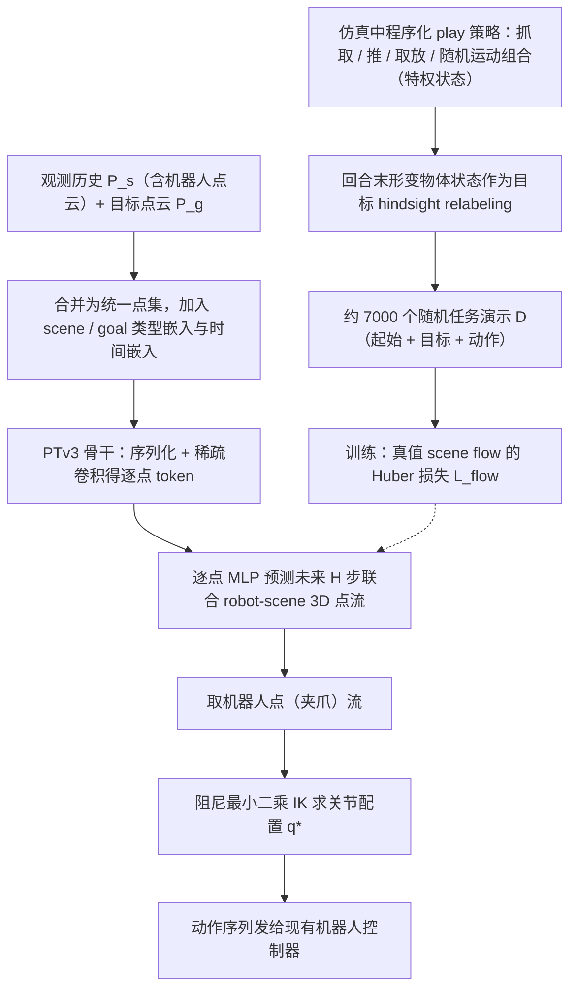

# DefFlow（arXiv:2610.22827）

**DefFlow**（*DefFlow: Goal-Conditioned Deformable Object Manipulation using 3D Point Flows*，[arXiv:2610.22827](https://arxiv.org/abs/2610.22827)，[项目页](https://def-flow.github.io)）来自 [具身智能小站 2026-11-01 盘点](../../sources/blogs/wechat_embodied_station_56_papers_libero_dynamic_latency_eval_2026-11-01.md)，属「世界模型与在线适配」组。

## 一句话定义

**DefFlow联合预测目标条件下的机器人与物体三维点流，用来学习抓取、释放和再抓取；绳索、颗粒、布料仿真及真机展示，目标输入仍需可用点云。**

## 英文缩写速查

| 缩写 | 英文全称 | 简要说明 |
|------|----------|----------|
| DefFlow | DefFlow: Goal-Conditioned Deformable Object Manipulation using 3D Point Flows | 本文方法 / 基准的简称 |
| 3D | 3D | 三维 |

## 为什么重要

- 把软物体和机器人的变化一起预测。
- 开源结论：**待发布**（步骤 2.5，2026-11-01）。项目页 HTTP 200，未列 GitHub，页面含 soon 字样（脚本扫描）。
- 同期同组工作见 [动态评测、技能编译与环境潜变量适配：具身智能小站 11-01 期 56 篇阅读坐标](../overview/embodied-station-2026-11-01-56-papers-technology-map.md)。

## 流程总览

图依据：论文 §III-A–B、§IV 演示收集 / Fig.2

## 核心机制

| 项 | 内容 |
|----|------|
| **arXiv** | [2610.22827](https://arxiv.org/abs/2610.22827) |
| **开源** | **待发布** |
| **要点** | DefFlow联合预测目标条件下的机器人与物体三维点流，用来学习抓取、释放和再抓取；绳索、颗粒、布料仿真及真机展示，目标输入仍需可用点云。 |
| **文内指标** | 公众号未给具体数字，本页不引用。 |

## 源码运行时序图

**不适用（待发布）** — 项目页 HTTP 200，未列 GitHub，页面含 soon 字样（脚本扫描）。 不编造运行脚本；代码公开后再补。

## 实验与评测

- 公众号未给具体数字，本页不引用。
- **读法：** 本页为索引级摘要，依据公众号转述的官方摘要与仓库信息整理；逐项数字与 baseline 以原文 PDF 为准。

## 与其他工作对比

- 横向索引见 [动态评测、技能编译与环境潜变量适配：具身智能小站 11-01 期 56 篇阅读坐标](../overview/embodied-station-2026-11-01-56-papers-technology-map.md)；同 arXiv 不重复造页。

## 结论

**把软物体和机器人的变化一起预测：DefFlow联合预测目标条件下的机器人与物体三维点流，用来学习抓取、释放和再抓取；绳索、颗粒、布料仿真及真机展示，目标输入仍需可用点云。**

1. 开源边界：**待发布** — 项目页 HTTP 200，未列 GitHub，页面含 soon 字样（脚本扫描）。
2. 核心机制：DefFlow联合预测目标条件下的机器人与物体三维点流，用来学习抓取、释放和再抓取；绳索、颗粒、布料仿真及真机展示，目标输入仍需可用点云。
3. 复现与选型前核对任务协议、硬件与基准口径，勿直接横比公众号摘录数字。

## 关联页面

- [world-action-models](../concepts/world-action-models.md)
- [generative-world-models](../methods/generative-world-models.md)
- [vla](../methods/vla.md)
- [embodied-station-2026-11-01-56-papers-technology-map](../overview/embodied-station-2026-11-01-56-papers-technology-map.md)

## 参考来源

- [defflow_arxiv_2610_22827.md](../../sources/papers/defflow_arxiv_2610_22827.md)
- [wechat_embodied_station_56_papers_libero_dynamic_latency_eval_2026-11-01.md](../../sources/blogs/wechat_embodied_station_56_papers_libero_dynamic_latency_eval_2026-11-01.md)
- [arXiv:2610.22827](https://arxiv.org/abs/2610.22827)
- [arXiv PDF](https://arxiv.org/pdf/2610.22827)：已通读全文：摘要、§I–§V（问题设定、PTv3 流预测、IK 动作提取、仿真基准与演示收集、基线与结果）、结论；附录未单列

## 推荐继续阅读

- [arXiv PDF](https://arxiv.org/pdf/2610.22827)
- [项目页](https://def-flow.github.io)
