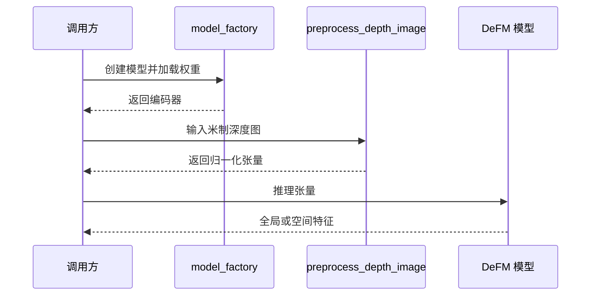

# DeFM（机器人深度基础表征）

**DeFM** 是针对深度图预训练的视觉编码器，为机器人任务提供几何与语义特征。

## 英文缩写速查

| 缩写 | 英文全称 | 简要说明 |
|------|----------|----------|
| DeFM | Depth Foundation Model | 深度基础模型 |
| ViT | Vision Transformer | 图像 Transformer 编码器 |
| CNN | Convolutional Neural Network | 卷积神经网络 |
| MDE | Monocular Depth Estimation | 单目深度估计 |
| PCA | Principal Component Analysis | 主成分分析 |

## 核心方法

- 6040 万张深度图来自 18 个真实、合成和 MDE 来源；ViT-L 使用 DINOv2 式教师学生自蒸馏，学习全局与稠密 patch 表征。
- 深度按米制处理，再经三通道尺度感知归一化，以兼顾近距离抓取和远距离导航。
- 大模型特征蒸馏到 ViT-S 与多种 CNN；CNN 通过 BiFPN 对齐稠密特征。下游可冻结编码器，但策略或任务头仍需训练。

## 实验与评测

| 任务 | 论文结果及范围 |
|------|----------------|
| 导航 | 三个仿真测试场景成功率 92.67%、84.33%、79.00%；四类真机场景为定性部署演示。 |
| 灵巧抓取 | 2000 个仿真回合，相对教师归一化：冻结模型在训练噪声 / Kinect 噪声下为 0.8089 / 0.4860；微调为 0.8936 / 0.8763。 |
| 四足爬梯 | 仿真成功率 90.14%，从头训练 CNN 为 90.45%；真机图像仅报告特征 PCA 定性可视化。 |

## 结论

DeFM 提供可跨任务复用的深度特征，但任务效果和部署成本仍需实测。

1. 导航、抓取与爬梯使用不同下游策略；冻结编码器不代表免训练。
2. 抓取的噪声迁移下微调明显改善结果，需用目标相机噪声验证。
3. 爬梯实验中冻结 DeFM 接近从头训练的基线，并未超过它。
4. 小模型参数少不必然延迟最低，应以目标硬件和输入尺寸测量。

## 与其他工作对比

- **vs [LingBot-Depth](./cn-os-lingbot-depth.md)：** LingBot-Depth 把含噪/稀疏深度 **补全** 为稠密深度与点云（输出仍是深度）；DeFM 把深度图编码为可复用的 **特征表征** 供下游策略使用，二者可前后串联。
- **vs 从头训练 CNN：** 四足爬梯中冻结 DeFM（90.14%）与从头训练 CNN（90.45%）接近，说明其收益主要体现在跨任务复用与噪声迁移（抓取微调后 0.8763），而非单任务上限。
- **vs [CoRE](./paper-core-collaboration-role-experts.md)：** CoRE 将 DeFM 深度特征与 RGB 表征融合用于多机协作，是 DeFM 作为下游特征骨干的一个使用实例。

## 源码运行时序图

官方 README 提供 `defm_vit_l14` 与 `defm_resnet50` 的推理示例；ViT 与 CNN 的输出接口不同，参见[仓库归档](../../sources/repos/leggedrobotics-defm.md)。

## 工程实践与局限

- 代码、模型权重与分类/分割基准公开；完整预训练数据及机器人策略代码的开放范围未由项目页确认。
- 输入深度需使用米，缺失像素置零，关注传感器有效范围与尺度。单目估计数据含相对尺度歧义，不能假定其天然具备米制精度。
- 仿真导航输入为 64×40，论文观察到细线、杆或网格等障碍可能被漏检；真机结果不等价于跨场景成功率统计。
- 官方 224×224 基准中，Jetson AGX Orin 单图 ViT-L 72.82 ms、ResNet-18 8.67 ms、EfficientNet-B0 21.04 ms；这些不包含完整机器人系统端到端时延。

## 关联页面

- [CoRE](./paper-core-collaboration-role-experts.md)：将 DeFM 深度特征与 RGB 表征融合。
- [LingBot-Depth](./cn-os-lingbot-depth.md)：另一个深度感知相关项目，输入与任务设定不同。
- [机器人操作](../tasks/manipulation.md)

## 参考来源

- [论文归档](../../sources/papers/defm_arxiv_2601_18923.md)
- [项目页归档](../../sources/sites/defm.md)
- [官方仓库归档](../../sources/repos/leggedrobotics-defm.md)

## 推荐继续阅读

- [DeFM 项目页](https://de-fm.github.io/)
- [论文 v3](https://arxiv.org/html/2601.18923v3)
