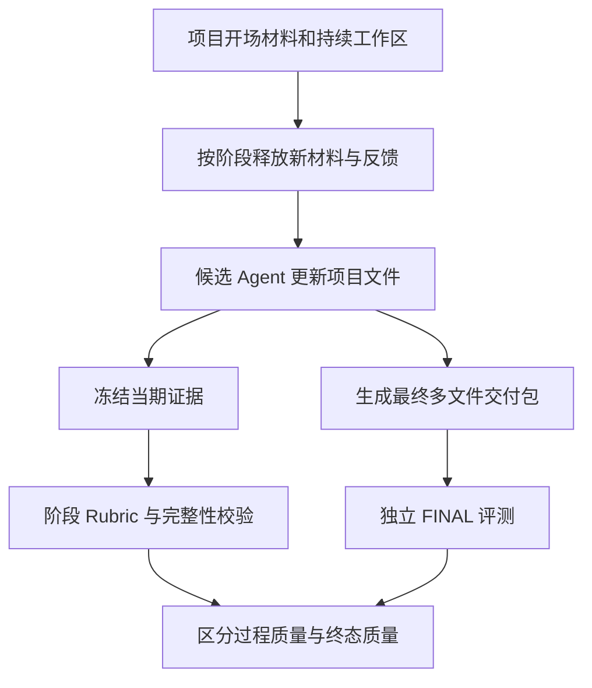
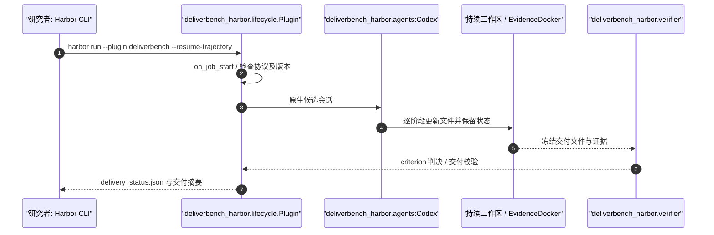

# DeliverBench: Benchmarking AI Agents on Delivering Realistic Multi-Stage Professional Projects｜面向连续专业项目交付的智能体评测

## 一句话定义

DeliverBench 衡量智能体在持续多阶段专业项目中能否维护依赖关系、修订文件，并交付符合整包验收要求的成果。

## 英文缩写速查

| 缩写 | 英文全称 | 简要说明 |
|---|---|---|
| AI | Artificial Intelligence | 生成/执行被评内容的人工智能 |
| LLM | Large Language Model | 基准中的语言智能体或评分模型 |
| API | Application Programming Interface | 运行模型或裁判的程序接口 |
| FINAL | Final Delivery Evaluation | 独立验收最终交付包的评测阶段 |
| QA | Quality Assurance | 协议自检与质量保证 |

## 为什么重要

- 论文研究对象是持续处理专业项目的 agent，不是单次答题或单个 coding issue。研究集合包含 **11 个项目、7 个领域、150 个阶段任务**；公开数据集当前仅完整开放 **3 个案例**，与论文总研究集不可混同。

对 [AI Agent 评测](../concepts/ai-agent-evaluation.md) 的价值是将笼统的“成功”拆为可审计且有复现边界的评价对象，而不把模型声明成功当作真实结果。

## 流程总览

## 核心原理

一条专业工作流被拆成按时释放的阶段材料和依赖性交付；候选 agent 持续读写工作区文件，阶段结束冻结证据并由独立 Judge 按 rubric 判分；最终交付包单独再评分，不对过程分数求平均。

- 论文研究对象是持续处理专业项目的 agent，不是单次答题或单个 coding issue。研究集合包含 **11 个项目、7 个领域、150 个阶段任务**；公开数据集当前仅完整开放 **3 个案例**，与论文总研究集不可混同。
- 公开案例：Mars Refinancing（13 阶段）、Pharmacovigilance ICSR（12 阶段）和 StarPulse Legal Delivery（8 阶段）。
- Agent 在 **同一持续工作空间** 中接收阶段材料、用户反馈并修改早先产物；开场背景不计分，阶段评测和独立 FINAL 评测区分。
- 每个可计分单元的证据冻结；判分器对 criterion 作完整性检查，真正违反 hurdle 才可有效记零，遗漏判决/不可读证据/运行错误不伪装成零分。
- 论文比较多种 agent 模型与 harness，但模型分数属于具体裁判、预算和项目集合的组合，不能与只开放三例的复现实验混称。

## 源码运行时序图

基于已核对的公开 README 和下列模块入口静态整理；未执行端到端实验。图描述已检查的调用职责，不是对每条内部调用的动态跟踪。

对应源码位置参见 [官方仓库归档](../../sources/repos/deliverbench.md)。

## 评测与结果

- 论文总集合包含 11 项项目、7 个领域和 150 个阶段任务；当前公开数据 **3 个完整案例，共 13/12/8 阶段**。这两种样本范围不可混淆。
- 阶段 score 和 FINAL score 是对不同交付版本的独立评分；FINAL 不继承过程中的 hurdle 命中，也不是过程平均值。
- 论文在七套系统上报告：Claude Opus 5 + Claude Code 的最终交付均分 65.00/100，≥90 分任务通过率为 50.0%；69/77 个系统-项目组合的 FINAL 低于平均 checkpoint 得分。
- 当前没有实际重跑候选模型，以上是**论文报告值**，不是本次重新实测。

## 论文全文复核要点（v2，24 页）

- **规模与构建（§3、图 2/4）：** 13 名领域专家指导，将 11 个项目（金融、医学、设计、数据运营、战略、审计、法律）重构为 150 个相互依赖的任务；原始输入 661 份、最终交付文件 111 份。共有 4,313 条 rubric 判据，其中 1,150 条过程判据会在最终交付版本再次检验（不重复计算为新任务）。
- **三种 FINAL 评价目标（§3.3、附录 C.1）：** artifact quality（单文件）、cross-file consistency（文件间）、package acceptance（整包验收）；再按 correctness、completeness、consistency、professionalism、usability 五个质量维度做诊断。目标分数不是可相加的独立权重项。
- **分数定义（§3.3、附录 C.2–C.3）：** 每项目过程成绩是其各任务阶段成绩的算术均值；最终分数单独按正负签名权重、依赖关系和 fatal gate 计算，不把阶段分数加进去；跨项目统计时 11 个项目等权重。**高分任务通过率**按 150 个任务的未四舍五入分数 ≥90 计算，不能视作最终包验收率。
- **论文主结果（§4.2、图 5、附录 E.1）：** 七套模型-harness 中 Claude Opus 5 + Claude Code 的最终均分 **65.00/100**、≥90 的任务通过率 **50.0%**；GPT-5.6 Sol + Codex 最终均分 63.75。全 77 个系统-项目组合中 **69 个**最终得分低于对应阶段均分，差距 11.3–18.5 分。
- **失效与恢复（§4.3、图 6–7）：** 审计结论与工作底稿矛盾、修正金额只写入变更说明未进入主表、把已收到的校准文件错误标记为缺失、已废止的设计决策仍在交付清单。P05 的 Claude 系统在任务 3 重建早先缺失的 3,327 行交易工作簿，展示了“恢复上游依赖”可使下游任务继续。
- **局限（§5、附录 D）：** 定时释放和脚本化反馈提高可重复性，却不覆盖真实客户开放式沟通；评测结果反映模型与其工具/harness 的组合。当前公开仓库只提供三项完整案例，不能把论文 11 项全部视为公开可复现。

## 结论

**一条专业工作流被拆成按时释放的阶段材料和依赖性交付，评价边界与复现设置同样重要。**

1. 区分阶段成绩与 FINAL 交付成绩，不能用过程平均数代替最终验收。
2. 保持持久工作区并按时释放材料，避免把未来资料提前暴露给被评 Agent。
3. 公开 3 个完整案例不等于论文 11 项全部开放，复现报告须显式标注样本。
4. 基础设施故障与有效失败分开统计，防止将缺判决记作可靠零分。

## 与其他工作对比

与 SelfImprove-Bench 的**自修改是否泛化**不同，DeliverBench 衡量**长期工作中持续产物能否最终交付**；与 AmbiHTMLBench 的**单页 HTML 重建保真度**也不同。

共同评测原则见 [AI Agent 评测](../concepts/ai-agent-evaluation.md)；机器人工作流的代码与实验验收可参照 [RLE-Bench](rle-bench.md)，但不能直接移植这三项榜单的数字。

## 工程实践

1. 在 Python 3.12 环境按仓库 README 安装 deliverbench-harbor 和 Harbor 0.20.0，并准备 Docker（建议至少 8 GiB 内存配额）。
2. 用 `python scripts/download_data.py --project all --output-dir data` 拉取固定修订的三例数据并核验文件 SHA256。
3. 对单项目运行 `harbor run -c harbor_job.yaml -a deliverbench_harbor.agents:Codex -m <candidate-model> --resume-trajectory --plugin deliverbench --job-name case-01-my-model`。
4. 用 `deliverbench-check jobs/case-01-my-model --verify-evidence` 验证完整性；synthetic Judge/Responder 的 pipeline probe 仅是协议自检，不是正式模型成绩。

## 局限与风险

- 三例公开数据不覆盖论文中的全部研究项目；运行需要 Python 3.12、Harbor 0.20.0、Docker 与候选/Judge/Responder 配置；授权材料和未来输入必须对被评 agent 隐藏。
- 已核对论文正文与附录，详见论文一手归档的核对范围；这不代表独立重跑模型实验。
- 本次仅静态阅读公开仓库和入口，尚未安装完整环境或独立复现实验成绩。

## 关联页面

- [AI Agent 评测](../concepts/ai-agent-evaluation.md) — agent 的评测任务、grader、隔离与判据原则。
- [RLE-Bench](rle-bench.md) — 与机器人学习工程交付相关的 Agent 评测。
- [SelfImprove-Bench](paper-selfimprove-bench.md) — 区分被评对象与评价指标。
- [AmbiHTMLBench](paper-ambihtmlbench.md) — 区分被评对象与评价指标。

## 参考来源

- [论文一手归档](../../sources/papers/deliverbench_arxiv_2611_03412.md)
- [官方项目页归档](../../sources/sites/deliverbench.md)
- [官方源码归档](../../sources/repos/deliverbench.md)

## 推荐继续阅读

- [作者项目主页](https://deliverbench.github.io/)
- [原始论文](https://arxiv.org/abs/2611.03412)
- [官方 GitHub 源码](https://github.com/theseus-labs-rsi/deliverbench)
